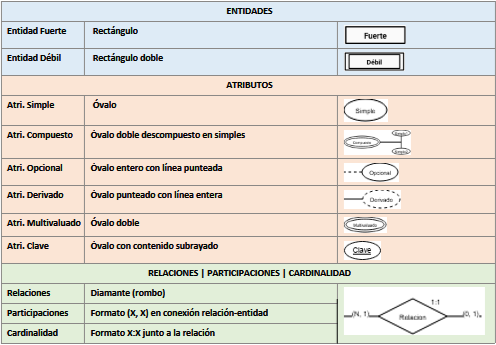
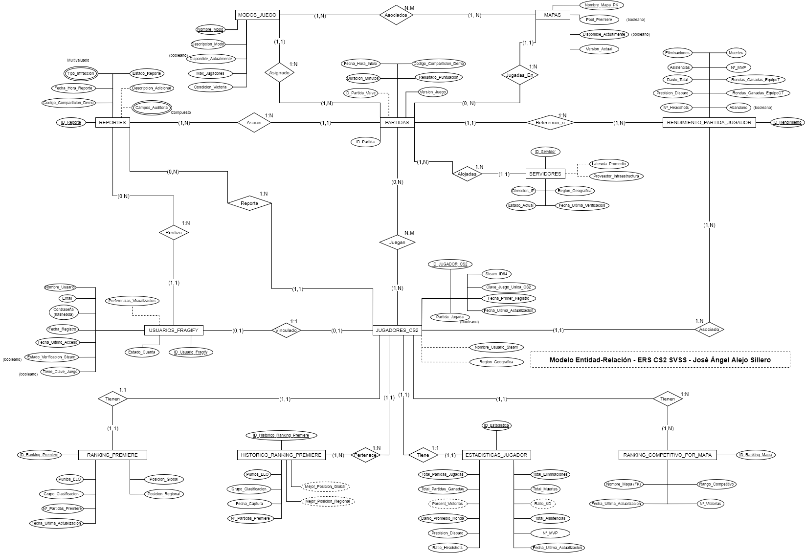
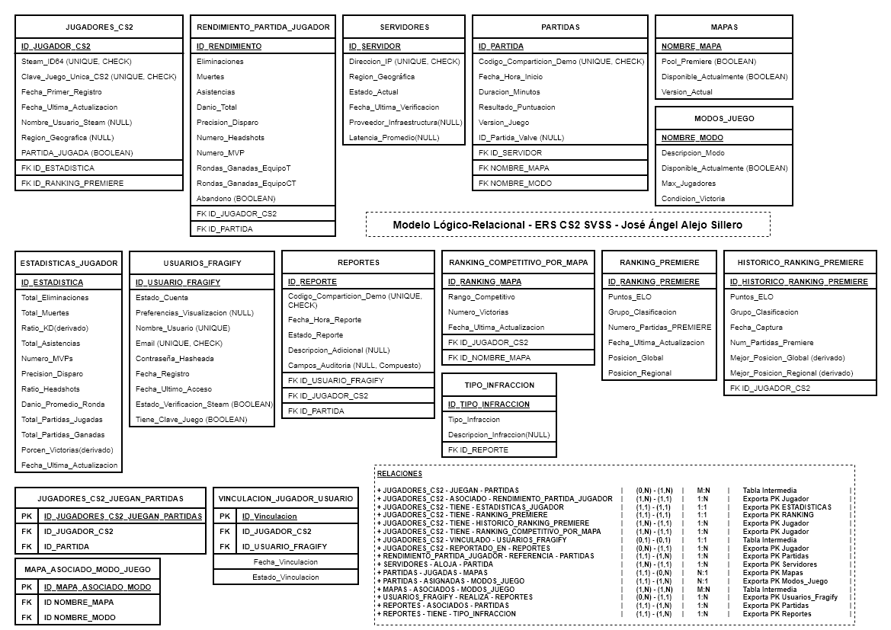

# **Entregable Unidad 2 - Modelado de BBDD | CS2 SVSS - Jose Angel Alejo Sillero**

> **INFORMACIÓN DEL DOCUMENTO**

- **Autor**: José Ángel Alejo Sillero
- **Fecha de creación**: 08 de Noviembre de 2025
- **Primer commit en GitHub**: 12 de Noviembre de 2025
- **Última edición**: 22 de Noviembre de 2025
- **Institución**: Instituto Tecnológico Pablo de la Torre
- **Módulo**: Base de Datos - 1º Desarrollo de Aplicaciones Web (DAW)
- **Entregable**: Unidad 2 - Modelado de Bases de Datos
- **Descripción**: Este documento detalla el proceso de modelado de bases de datos, incluyendo la creación de un modelo Conceptual Entidad-Relación (ER) y su posterior transformación a un modelo Lógico-Relacional (LR).
- **Licencia**: Todos los derechos reservados. Copyright © 2025 José Ángel Alejo Sillero. No se permite la reproducción, distribución, modificación o uso de este material sin autorización expresa y por escrito del autor.

---
<div style="page-break-after: always;"></div>

> **TABLA DE CONTENIDOS**

- [**Entregable Unidad 2 - Modelado de BBDD | CS2 SVSS - Jose Angel Alejo Sillero**](#entregable-unidad-2---modelado-de-bbdd--cs2-svss---jose-angel-alejo-sillero)
  - [**1. RECURSOS TEÓRICOS UTILIZADOS**](#1-recursos-teóricos-utilizados)
    - [**1.1 CONSIDERACIONES PARA LA CREACIÓN DEL MODELO ER**](#11-consideraciones-para-la-creación-del-modelo-er)
      - [**Notación de Chen**](#notación-de-chen)
    - [**1.2 CONSIDERACIONES PARA LA CREACIÓN DEL MODELO LÓGICO-RELACIONAL**](#12-consideraciones-para-la-creación-del-modelo-lógico-relacional)
      - [**FN y Reglas de Integridad de datos y restricciones a seguir**](#fn-y-reglas-de-integridad-de-datos-y-restricciones-a-seguir)
      - [**Proceso de transformación de Modelo ER a Modelo Lógico-Relacional**](#proceso-de-transformación-de-modelo-er-a-modelo-lógico-relacional)
  - [**2. ENTIDADES / ATRIBUTOS / RELACIONES | PROPUESTOS EN DOCUMENTO ERS**](#2-entidades--atributos--relaciones--propuestos-en-documento-ers)
    - [**2.1 ANÁLISIS | JUSTIFICACIÓN | ENTIDADES, ATRIBUTOS Y RELACIONES IDENTIFICADOS**](#21-análisis--justificación--entidades-atributos-y-relaciones-identificados)
    - [**2.2 RESUMEN DE ENTIDADES, ATRIBUTOS Y RELACIONES PROPUESTAS**](#22-resumen-de-entidades-atributos-y-relaciones-propuestas)
      - [**Relaciones y atributos de relación (si procede)**](#relaciones-y-atributos-de-relación-si-procede)
  - [**3. MODELO CONCEPTUAL ENTIDAD-RELACIÓN (ER)**](#3-modelo-conceptual-entidad-relación-er)
    - [**3.1 ADAPTACIÓN Y JUSTIFICACIÓN DE REPRESENTACIÓN DE ENTIDADES, ATRIBUTOS Y RELACIONES**](#31-adaptación-y-justificación-de-representación-de-entidades-atributos-y-relaciones)
    - [**3.2 ENTIDADES, ATRIBUTOS(tipos) Y RELACIONES PLASMADOS EN EL MODELO ER**](#32-entidades-atributostipos-y-relaciones-plasmados-en-el-modelo-er)
    - [**3.3 ADAPTACIONES CONCRETAS REALIZADAS**](#33-adaptaciones-concretas-realizadas)
      - [**3.3.1 Decisiones de diseño estructural**](#331-decisiones-de-diseño-estructural)
      - [**3.3.2 Nuevas entidades incorporadas al modelo**](#332-nuevas-entidades-incorporadas-al-modelo)
      - [**3.3.3 Nuevas relaciones entre entidades**](#333-nuevas-relaciones-entre-entidades)
      - [**3.3.4 Atributos de validación e integridad**](#334-atributos-de-validación-e-integridad)
      - [**3.3.5 Atributos específicos añadidos por entidad**](#335-atributos-específicos-añadidos-por-entidad)
    - [**3.4 IMAGEN DEL MODELO ENTIDAD-RELACIÓN**](#34-imagen-del-modelo-entidad-relación)
  - [**4. MODELO LÓGICO-RELACIONAL**](#4-modelo-lógico-relacional)
    - [**4.1 RESUMEN DE RELACIONES Y EXPORTACIÓN DE CLAVES O TABLAS INTERMEDIAS**](#41-resumen-de-relaciones-y-exportación-de-claves-o-tablas-intermedias)
    - [**4.2 TABLAS RESULTANTES**](#42-tablas-resultantes)
      - [**Tablas Intermedias - Relaciones Muchos(N) a Muchos(M)**](#tablas-intermedias---relaciones-muchosn-a-muchosm)
    - [**4.3 IMAGEN DEL MODELO LÓGICO-RELACIONAL**](#43-imagen-del-modelo-lógico-relacional)
    - [**4.4 COMPROBACIÓN DE FORMAS NORMALES Y REGLAS DE INTEGRIDAD DE DATOS Y RESTRICCIONES | JUSTIFICACIÓN**](#44-comprobación-de-formas-normales-y-reglas-de-integridad-de-datos-y-restricciones--justificación)
      - [**Verificacion de Primera Forma Normal (1FN)**](#verificacion-de-primera-forma-normal-1fn)
      - [**Verificacion de Segunda Forma Normal (2FN)**](#verificacion-de-segunda-forma-normal-2fn)
      - [**Verificacion de Tercera Forma Normal (3FN)**](#verificacion-de-tercera-forma-normal-3fn)
      - [**Verificacion de Integridad de Entidad**](#verificacion-de-integridad-de-entidad)
      - [**Verificacion de Integridad Referencial**](#verificacion-de-integridad-referencial)
      - [**Verificacion de Restricciones Adicionales**](#verificacion-de-restricciones-adicionales)
      - [**Resumen de Conformidad**](#resumen-de-conformidad)
    - [**4.5 ESTRATEGIA DE NORMALIZACIÓN | IMPLEMENTACIÓN DE MODELO L-R | JUSTIFICACIÓN**](#45-estrategia-de-normalización--implementación-de-modelo-l-r--justificación)
      - [**FASE 1: Análisis y Planificación**](#fase-1-análisis-y-planificación)
      - [**FASE 2: Implementación de Formas Normales**](#fase-2-implementación-de-formas-normales)
      - [**FASE 3: Validación y Refinamiento**](#fase-3-validación-y-refinamiento)
  - [**CONCLUSIÓN**](#conclusión)
  - [**WEBGRAFÍA Y REFERENCIAS**](#webgrafía-y-referencias)

---
<div style="page-break-after: always;"></div>

> **ÍNDICE DE FIGURAS**

- **Figura 1**: [Notación de Chen - Símbolos y Convenciones](#notación-de-chen) → Sección 1.1
- **Figura 2**: [Modelo Entidad-Relación CS2-SVSS (Versión 5)](#34-imagen-del-modelo-entidad-relación) → Sección 3.4
- **Figura 3**: [Modelo Lógico-Relacional CS2-SVSS](#43-imagen-del-modelo-lógico-relacional) → Sección 4.3

> **ÍNDICE DE TABLAS**

- **Tabla 1**: [Resumen de Relaciones y Exportación de Claves](#41-resumen-de-relaciones-y-exportación-de-claves-o-tablas-intermedias) → Sección 4.1
- **Tabla 2**: [Resumen de Conformidad con Formas Normales y Reglas de Integridad](#resumen-de-conformidad) → Sección 4.4

---
<div style="page-break-after: always;"></div>

## **1. RECURSOS TEÓRICOS UTILIZADOS**

### **1.1 CONSIDERACIONES PARA LA CREACIÓN DEL MODELO ER**

```markdown
### **4.1 MODELO ENTIDAD-RELACIÓN (E-R)**

Este modelo consiste en representar los datos y establecer relaciones entre los mismos, facilitando así la comprensión y el diseño de la base de datos. Gran parte del éxito de este modelo consiste en que su notación es muy sencilla y resulta realmente fácil de comprender por cualquier persona.

Los elementos principales de este modelo son:

- **ENTIDADES**: Representan **objetos o conceptos** del mundo real que tienen **existencia independiente y pueden ser identificados de manera única**. Posibles ejemplos: "Empleado", "Producto" o "Cliente".
- **ATRIBUTOS**: Representan **características o propiedades** de las entidades. Por ejemplo, un "Empleado" puede tener atributos como "Nombre", "Apellido" y "Fecha de Contratación".
- **RELACIONES**: Representan **la forma en que las entidades están conectadas entre sí**. Por ejemplo, un "Empleado" puede estar relacionado con un "Departamento". Estas relaciones poseen propiedades como la cardinalidad y la participación.

---

#### **ENTIDADES - TIPOS**

Las entidades pueden clasificarse en varios tipos según sus características:

- **Entidades Fuertes**: Son aquellas que **existen de manera independiente** y tienen una **clave primaria propia** que las identifica de forma única. Por ejemplo, una entidad "Empleado" con un atributo "ID_Empleado" como clave primaria.
- **Entidades Débiles**: Son aquellas que **no pueden existir de manera independiente** y dependen de una entidad fuerte para su identificación. **No tienen una clave primaria propia** y se identifican mediante una combinación de su atributo parcial y la clave primaria de la entidad fuerte a la que están asociadas. Por ejemplo, una entidad "Dependiente" que depende de la entidad "Empleado" y se identifica mediante el "ID_Empleado" y un "Número de Dependiente".

#### **ATRIBUTOS (TIPOS) y DOMINIOS**

Los atributos de una entidad son las características o propiedades que describen a esa entidad. Pueden clasificarse en varios tipos:

- **Atributos Simples**: Indivisibles en subpartes significativas. Ejemplo: "Nombre", "Edad".
- **Atributos Compuestos**: **Divisibles en subpartes significativas**. Ejemplo: "Nombre Completo" puede dividirse en "Nombre" y "Apellido".
- **Atributos Obligatorios**: **Siempre tendrán un valor, nunca quedarán vacíos**.
- **Atributos Opcionales**: **Pueden o no tener un valor asignado** para cada instancia de la entidad. Ejemplo: "Teléfono Secundario" en una entidad "Empleado".
- **Atributos Derivados**: **Se pueden calcular o derivar a partir de otros atributos**. Ejemplo: "Edad" puede derivarse de "Fecha de Nacimiento".
- **Atributos Multivaluados**: **Pueden tener múltiples valores para una misma entidad**. Ejemplo: "Teléfonos" de un "Empleado" puede tener varios números de teléfono asociados.
- **Atributos Clave**: **Se utilizan para identificar de manera única una entidad dentro de un conjunto**. Por ejemplo, "ID_Empleado" es un atributo clave para la entidad "Empleado".

Los **Dominios** de los atributos definen el **conjunto de valores permitidos para cada atributo**. Por ejemplo, el dominio del atributo "Edad" podría ser un rango de números enteros entre 0 y 120.

#### **Atributos de relaciones  | Entidades débiles**

- **Atributos de relaciones:** No solo las entidades tienen atributos. Las relaciones también pueden tenerlos. Estos atributos son exclusivos de las relaciones, es decir no pueden cederse a ninguna de las entidades ligadas a la relación.
- **Entidades débiles:** Las relaciones que unen una entidad fuerte con una débil también es considerada una relación debil. Existen dos tipos:
  - **Dependencia de existencia:** Expresa que las ocurrencias de una entidad débil dependen de la presencia de una entidad fuerte con la que relacionarlas.
  - **Dependencia de identificación:** Ocurre cuando además de la dependencia de existencia, la entidad débil necesita a la fuerte para poder crear una clave.

---

#### **RELACIONES - TIPOS**

Una relación representa una asociación entre dos o más entidades. Siempre debe intentarse que el nombre de la relación exprese lo más claro posible la relación entre dos entidades, y evitar que ese nombre sea ambiguo.

Por lo general, el nombre de una relación es un verbo, ya que suele ser la forma de describir como dos entidades se relacionan.

Las relaciones pueden clasificarse en varios tipos según su grado. El grado de una relación es la cantidad de entidades unidas por la misma relación. Existen tres tipos principales de relaciones:

- **Reflexivas - Grado 1**: Una relación reflexiva es aquella en la que **una entidad se relaciona consigo misma**. Por ejemplo, en una entidad "Empleado", una relación reflexiva podría ser "Supervisa", donde un empleado puede supervisar a otros empleados dentro de la misma entidad.
- **Binarias - Grado 2**: Una relación binaria es aquella que involucra dos entidades diferentes. Es el tipo más común de relación en los modelos E-R. Por ejemplo, una relación binaria podría ser "Trabaja en" entre las entidades "Empleado" y "Departamento".
- **Ternarias - Grado 3**: Una relación ternaria es aquella que involucra tres entidades diferentes. Por ejemplo, una relación ternaria podría ser "Contrata" entre las entidades "Empleado", "Proyecto" y "Cliente".
- **N-arias - Grado >3**: Una relación n-aria es aquella que involucra n entidades diferentes, donde n es mayor que 3. Estas relaciones son menos comunes y pueden ser más complejas de manejar. Un ejemplo podría ser una relación que involucra "Empleado", "Proyecto", "Cliente" y "Proveedor".

**Cualquier relacion N-Aria se puede dividir en varias relaciones binarias o ternarias.**

---

#### **OCURRENCIAS | PARTICIPACIÓN | CARDINALIDADES**

Las **"Ocurrencia de una entidad" se refiere a una instancia específica de dicha entidad**. Cada entidad representa un conjunto de objetos similares, y cada objeto individual dentro de ese conjunto se considera una "ocurrencia" de esa entidad. Por ejemplo, en una entidad "Empleado", cada empleado individual (como Juan Pérez, María Gómez, etc.) es una ocurrencia de la entidad "Empleado".

La **"Participación de una ocurrencia de entidad"** se refiere a la forma en que las ocurrencias de una entidad se relacionan en una relación con otras entidades. La **participación de una ocurrencia** de una entidad se expresa mediante la **cardinalidad** de la relación.

Las participaciones se representan mediante pares de números expresando el mínimo y máximo de veces que puede aparecer en la relación asociada a otra ocurrencia de la entidad. Las participaciones más comunes son:

- **(0,1)**: Indica que una ocurrencia de la entidad puede no participar en la relación (mínimo 0) o puede participar una sola vez (máximo 1).
- **(1,1)**: Indica que una ocurrencia de la entidad debe participar exactamente una vez en la relación (mínimo 1 y máximo 1).
- **(0,N)**: Indica que una ocurrencia de la entidad puede no participar en la relación (mínimo 0) o puede participar múltiples veces (máximo N).
- **(1,N)**: Indica que una ocurrencia de la entidad debe participar al menos una vez en la relación (mínimo 1) y puede participar múltiples veces (máximo N).

La  **"Cardinalidad de una relación"** indica el número de ocurrencias de una entidad que pueden estar asociadas con una ocurrencia de otra entidad en una relación. Las cardinalidades más comunes son:

- **Uno a Uno → 1:1**: Cada ocurrencia de la entidad A está asociada con una única ocurrencia de la entidad B, y viceversa.
- **Uno a Muchos → 1:N**: Cada ocurrencia de la entidad A puede estar asociada con múltiples ocurrencias de la entidad B, pero cada ocurrencia de la entidad B está asociada con una única ocurrencia de la entidad A.
- **Muchos a Uno → N:1**: Cada ocurrencia de la entidad A puede estar asociada con múltiples ocurrencias de la entidad B, pero cada ocurrencia de la entidad B está asociada con una única ocurrencia de la entidad A.
- **Muchos a Muchos → N:M**: Cada ocurrencia de la entidad A puede estar asociada con múltiples ocurrencias de la entidad B, y viceversa. Por ejemplo, en una relación entre "Estudiante" y "Curso", un estudiante puede estar inscrito en múltiples cursos, y cada curso puede tener múltiples estudiantes inscritos.

##### **Tipos de cardinalidades:**

- **Cardinalidades no binarias**: Para calcular estas cardinalidades se tomará una de las tres entidades y se combinan las otras dos. Luego, se calcula la participación de la entidad en la combinación de las otras dos. Posteriormente, se hará lo mismo con las otras dos entidades restantes. Finalmente, tomando los valores máximos de las participaciones se generan las cardinalidades.
- **Cardinalidades reflexivas**: La misma entidad juega dos roles diferentes en la relación. Para extraer su cardinalidad es necesario obtener su participación teniendo en cuenta los dos roles que representa
```

#### **Notación de Chen**



### **1.2 CONSIDERACIONES PARA LA CREACIÓN DEL MODELO LÓGICO-RELACIONAL**

#### **FN y Reglas de Integridad de datos y restricciones a seguir**

A continuación se detallan las Formas Normales (FN) y las Reglas de Integridad de datos y restricciones que se deben considerar en el modelado de la base de datos tanto en el modelo Entidad/Relación como en el modelo Lógico-Relacional.

>Las FN a aplicar son:

1. **Primera Forma Normal (1FN)**: Una relación(tabla) cumplirá la 1FN si cada atributo es atómico, es decir, dicho atributo es indivisible y contiene un único valor posible. Afecta a los atributos multivaluados y compuestos.
   - Los **atributos multivaluados se deben separar en nuevas tablas**, y los **atributos compuestos se descomponen en sus atributos simples**.
2. **Segunda Forma Normal (2FN)**: Una relación(tabla) cumplirá la 2FN sólo si está en 1FN y todos los atributos que no forman parte de la clave primaria dependen completamente de la clave primaria.
   - Esta norma sólo afecta cuando nuestra tabla cuenta con claves primarias compuestas, por ello, si la clave primaria son simple, la tabla siempre estará en 2FN.
3. **Tercera Forma Normal (3FN)**: Una relación(tabla) cumplirá la 3FN sólo si está en 2FN y no existen dependencias transitivas entre los atributos no clave y la clave primaria.
   - Es decir, los atributos no clave no deben depender de otros atributos no clave, sino únicamente de la clave primaria.

> Las Reglas de Integridad de datos y restricciones a considerar son:

- **Integridad de Entidad**: Cada tabla debe tener una clave primaria única que identifique de manera inequívoca cada fila. Ningún valor de clave primaria puede ser nulo. Hace referencia a la FN 1.
- **Integridad Referencial**: Las claves foráneas deben coincidir con valores existentes en las tablas referenciadas o ser nulas si la relación lo permite. Hace referencia a la FN 2.
- **Restricciones adicionales**: Se deben definir restricciones adicionales según las reglas de negocio, como unicidad, no nulidad y validación de datos.

#### **Proceso de transformación de Modelo ER a Modelo Lógico-Relacional**

```markdown
Para hacer la transformación de Conceptual_E-R a Lógico_Relacional se **sigue el siguiente proceso**:

1. **Identificar las entidades**: Cada entidad en el modelo E-R se convierte en una tabla en el modelo relacional.
2. **Definir los atributos**: Los atributos de cada entidad se convierten en filas de la tabla correspondiente.
   - Los atributos multivaluados se separan en tablas adicionales.
   - Los atributos compuestos se descomponen en sus atributos simples.
   - Los atributos derivados no se incluyen en las tablas.
   - Los atributos opcionales se permiten tener valores nulos en la tabla.
3. **Establecer claves primarias**: Se selecciona un atributo que identifique de manera única la entidad que representa la tabla.
4. **Identificar relaciones**: Se analizan las relaciones y se determinan las cardinalidades y participaciones.
5. **Establecer claves foráneas**: Se definen las FKs en las tablas correspondientes para mantener la integridad referencial entre las tablas relacionadas.
6. **Representar relaciones**. Dependerá del tipo de relación(**según cardinalidad**):
   1. **Relaciones uno a muchos (1:N)**: La PK de la tabla/entidad situada en el lado "uno" (1) se añade como FK en la tabla/entidad del lado "muchos" (N).
   2. **Relaciones uno a uno (1:1)**: La PK de una de las tablas se añade como FK en la otra tabla, **dependiendo de las participaciones de cada entidad**. Para ello, tenemos los siguientes casos:
      - Si una entidad participa **(1,1), y la otra con (0,1)**, la **FK se coloca en la tabla de la entidad con participación (1,1)**.
      - Si **ambas entidades participan con (1,1)**, la **FK puede colocarse en cualquiera de las dos tablas**, dependiendo del diseño y las necesidades del sistema.
      - Si **ambas participaciones son (0,1)**, la relación se representará mediante una **tabla intermedia que contenga las PKs de ambas entidades como FKs**.
   3. **Relaciones muchos a muchos (N:M)**: En la práctica se **crea una tabla intermedia** que representa la relación, se **crea una PK para la tabla** y luego se **añaden como FKs las PKs de las dos tablas relacionadas**. Se debe tener en cuenta:
      - Si la relación tiene atributos propios, se incluirán en la tabla intermedia.
```

---
<div style="page-break-after: always;"></div>

## **2. ENTIDADES / ATRIBUTOS / RELACIONES | PROPUESTOS EN DOCUMENTO ERS**

Las entidades, atributos y relaciones propuestas en el documento [ERS CS2-SVSS_Jose-Angel-Alejo.md](../../1%20Entregable%20-%20ERS/Revision_JAAlejo_08-11-2025/ERS%20CS2-SVSS_Jose-Angel-Alejo.md) se detallan en el apartado "**3. REQUISITOS FUNCIONALES**" de dicho documento, así como en sus subapartados "**3.1 Requisitos de almacenamiento de Datos**" y "**3.2 Requisitos de integridad de datos**". En **dicho documento se presenta un glosario**. A continuación, la información presentada:

```markdown
## **3. REQUISITOS FUNCIONALES**

Este apartado detalla los requisitos funcionales que la BBDD debe cumplir para garantizar el correcto funcionamiento del sistema CS2-SVSS backend y establecer las bases para futuras implementaciones. Los requisitos se organizan en **cuatro categorías fundamentales** fieles a los **Principios ACID:**

- **Almacenamiento de datos**  
- **Integridad de datos**  
- **Seguridad de datos**  
- **Mantenimiento de datos**

> Es importante destacar que algunos elementos descritos corresponden a **funcionalidades futuras planificadas pero no implementadas en esta fase del proyecto**, especialmente aquellas relacionadas con el FRONTEND y el sistema de reportes, pero se incluyen en el diseño de la BBDD para facilitar su incorporación posterior sin modificaciones estructurales importantes.

### **3.1 Requisitos de almacenamiento de Datos**

La BBDD del sistema CS2-SVSS debe **gestionar y almacenar de forma estructurada** toda la **información crítica necesaria** para el funcionamiento actual del backend y la futura plataforma Fragify.  

#### **Entidades principales, sus atributos claves y las relaciones entre ellas:**

1. **Entidad JUGADORES_CS2**: Esta entidad almacenará la **información básica de cada jugador de CS2** cuyos datos se recopilen del juego.
   1. Los **atributos** incluyen:
      1. El **identificador único** del jugador en nuestra base de datos (**ID_Jugador_CS2**).
      2. El **Steam ID único** del jugador que es **obligatorio** y debe ser **único** en toda la tabla.
      3. El **nombre del usuario actual de Steam** (que puede cambiar con el tiempo).
      4. La **fecha del primer registro** de datos del jugador en nuestro sistema.
      5. La **fecha de última actualización** de sus datos.
      6. Campos adicionales como la **región geográfica principal** donde juega.
   2. Esta entidad se **relaciona** con las entidades de estadísticas, partidas y rankings. Es importante notar que esta tabla almacena jugadores del juego CS2 en general, no usuarios registrados específicamente en la futura plataforma Fragify, esa sería una entidad diferente para fase futura.
2. **Entidad ESTADISTICAS_JUGADOR**: Contendrá las **métricas agregadas de rendimiento** para cada jugador.
   1. Los **atributos** principales son:
      1. El **identificador único** de la estadística (**ID_Estadistica**).
      2. La **clave foránea** que referencia al jugador (**ID_Jugador_CS2**).
      3. El **total acumulado de eliminaciones**.
      4. El **total de muertes**.
      5. El **ratio K/D** calculado automáticamente.
      6. El **total de Asistencias**.
      7. El número de **MVPs** obtenidos.
      8. La **precisión general de disparo** expresada en porcentaje.
      9. El **ratio de Headshots** sobre el total de eliminaciones.
      10. El **daño promedio causado por ronda**.
      11. El **total de partidas jugadas** en modos MM y PREMIERE.
      12. El **total de partidas ganadas**.
      13. El **porcentaje de victorias** calculado.
      14. La **fecha de última actualización** de estas estadísticas.
   2. Esta entidad tiene una **relación uno a uno** con **JUGADORES_CS2** para las estadísticas generales actuales, aunque también se contempla almacenar instantáneas históricas para análisis de evolución.
3. **Entidad RANKING_PREMIERE**: Dado que el **sistema de ranking PREMIERE con puntos de ELO** es el más valorado por los jugadores, esta entidad almacenará específicamente esta información.
   1. Los **atributos** son:
      1. **Identificador único** del registro (**ID_Ranking_PREMIERE**).  
      2. La **clave foránea** del jugador (**ID_Jugador_CS2**).  
      3. Los **puntos actuales de ELO en PREMIERE** (que pueden ir desde 0 hasta 30k o superior).
      4. El **grupo o TIER de clasificación** correspondiente a esos puntos.
      5. La **posición en la tabla de clasificación global** si está disponible.
      6. La **posición en la clasificación regional**.
      7. El **número total de partidas PREMIERE** jugadas.
      8. La **fecha de última actualización** del ranking.
   2. Esta entidad se relaciona con **JUGADORES_CS2** en una **relación uno a uno** para el ranking actual.
4. **Entidad RANKING_COMPETITIVO_POR_MAPA**: Aunque el ranking competitivo (de Silver a Global Elite) ha perdido relevancia desde que se estableció a por mapa en lugar de general y la consecuente introducción de PREMIERE, algunos jugadores aún le dan importancia.
   1. Los **atributos** son:
      1. El **identificador del registro** (**ID_Ranking_Mapa**).
      2. La **clave foránea** del jugador (**ID_Jugador_CS2**).
      3. El **nombre del mapa específico** (Dust 2, Mirage, Inferno, Nuke, Overpass, Vértigo, Ancient, Anubis).
      4. El **rango competitivo** en ese mapa específico (de **Silver I** hasta **Global Elite** o "No_Rank" en caso de no tener rango asignado).
      5. El **número de victorias** en ese mapa.
      6. La **fecha de última actualización**.
   2. Un jugador puede tener **múltiples registros** en esta tabla, uno por cada mapa en el que haya jugado competitivo MM.
   3. Se establece una **relación uno a muchos** entre **JUGADORES_CS2** y **RANKING_COMPETITIVO_POR_MAPA**.
5. **Entidad PARTIDAS**: Almacenará **información detallada de cada partida** jugada en los modos MM y PREMIERE.
   1. Los **atributos** son:
      1. El **identificador único** de la partida en nuestra base de datos (**ID_Partida**).
      2. Un **identificador único de partida** proporcionado por Valve si está disponible.
      3. El **código de compartición de demo**, que es único y permite descargar la repetición de la partida y su consecuente visualización, así como extracción de datos de la misma.
      4. La **fecha y hora exacta de inicio** de la partida.
      5. La **duración total en minutos**.
      6. El **mapa** donde se jugó.
      7. El **modo de juego específico** (Competitivo MM o PREMIERE).
      8. El **resultado final** expresado como puntuación (por ejemplo **13-11** en el nuevo sistema de CS2 llamado **MR12** o, **16-14** en formato antiguo llamado **MR15**).
      9. El **servidor** donde se alojó la partida (**ID_Servidor** como clave foránea).
      10. Campos adicionales como la **versión del juego** en ese momento.
   2. Esta entidad se relaciona con **JUGADORES_CS2** mediante una **tabla intermedia** que registra la participación de múltiples jugadores en cada partida (**ID_Partida_Jugador**), estableciendo una **relación muchos a muchos**, pues un jugador puede participar en múltiples partidas y una partida tiene múltiples jugadores.
   3. Se relaciona con **SERVIDORES** mediante clave foránea, estableciendo una **relación uno a muchos**.
6. **Entidad PARTIDA_JUGADOR**: **Tabla intermedia** que registra la participación de cada jugador en cada partida específica.
   1. Los **atributos** son:
      1. **Identificador único** del registro (**ID_Partida_Jugador**).
      2. **Claves foráneas** del jugador (**ID_Jugador_CS2**) y la partida (**ID_Partida**).
   2. Esta entidad establece la **relación muchos a muchos** entre **JUGADORES_CS2** y **PARTIDAS**.
7. **Entidad SERVIDORES**: Contendrá **información sobre los servidores de juego oficiales** de Valve donde se alojan las partidas.
   1. Los **atributos** son:
      1. **Identificador único** del servidor (**ID_Servidor**).
      2. **Dirección IP** del servidor.
      3. **Región geográfica** del servidor (Europa Oeste, Europa Este, América del Norte, América del Sur, Asia, etc.)
      4. **Proveedor de la infraestructura** del servidor.
      5. **Latencia promedio** observada en milisegundos basada en mediciones de partidas.
      6. **Estado actual** del servidor (activo, mantenimiento, inactivo).
      7. **Fecha de última Verificacion** del estado del servidor.
   2. Esta entidad se relaciona con **PARTIDAS** en una **relación uno a muchos** ya que un servidor aloja múltiples partidas a lo largo del tiempo.
8. **Entidad RENDIMIENTO_PARTIDA**: Esta entidad almacena el **rendimiento específico de cada jugador** en cada partida individual.
   1. Los **atributos** son:
      1. El **identificador único** del registro (**ID_Rendimiento**).
      2. **Claves foráneas** del jugador (**ID_Jugador_CS2**) y la partida (**ID_Partida**).
      3. **Eliminaciones** realizadas en esa partida específica.
      4. **Muertes** sufridas.
      5. **Asistencias**.
      6. **Daño total causado**.
      7. **Precisión de disparo** en esa partida.
      8. Número de **headshots**.
      9. Si obtuvo **MVP** en alguna ronda.
      10. **Equipo** en el que jugó en cada ronda (**Terroristas/T** o **Antiterroristas/CT**).
      11. Si **abandonó la partida** antes de tiempo.
   2. Esta entidad establece la **relación muchos a muchos** entre **JUGADORES_CS2** y **PARTIDAS**.
9. **Entidad HISTORICO_RANKING_PREMIERE**: Para permitir el **análisis de la evolución del ranking PREMIERE** a lo largo del tiempo, esta entidad almacenará **instantáneas periódicas**.
   1. Los **atributos** son:
      1. **Identificador único** del registro histórico (**ID_Historico_PREMIERE**).
      2. La **clave foránea** del jugador (**ID_Jugador_CS2**).
      3. Los **puntos de ELO** en ese momento específico.
      4. El **grupo de clasificación** correspondiente.
      5. La **fecha de captura** de la instantánea.
      6. Número de **partidas PREMIERE** jugadas hasta ese momento.
   2. Esta entidad se relaciona con **JUGADORES_CS2** en **relación uno a muchos**, ya que un jugador tiene múltiples registros históricos que permiten visualizar su progresión.

#### **Entidades futuras planificadas pero no implementadas en esta fase:**

1. **Entidad USUARIOS_FRAGIFY (Futura):** Esta entidad almacenará **información de usuarios registrados** específicamente en la plataforma web Fragify cuando se desarrolle en el FRONTEND.
   1. Los **atributos** son:
      1. El **identificador único** del usuario en Fragify (**ID_Usuario_Fragify**).
      2. La **clave foránea** que vincula con el jugador de CS2 (**ID_Jugador_CS2**) que será **opcional** inicialmente pero **obligatoria** una vez el usuario sincronice su cuenta de Steam mediante OAuth.
      3. **Email de contacto** del usuario.
      4. **Contraseña hasheada** para autenticación.
      5. **Fecha de registro** en la plataforma Fragify.
      6. **Fecha de último acceso**.
      7. **Preferencias de visualización** (tema oscuro/claro, idioma, métricas favoritas a mostrar).
      8. **Estado de Verificacion de cuenta** mediante Steam OAuth (verificado/no_verificado).
      9. Un campo booleano indicando si ha proporcionado la **clave de juego única** para acceso a datos completos.
      10. **Estado de la cuenta** (activa, suspendida, eliminada).
   2. Esta entidad tiene una **relación uno a uno (o cero a uno)** con **JUGADORES_CS2**, ya que un usuario de Fragify puede opcionalmente vincular una única cuenta de Steam/CS2, y un jugador de CS2 solo puede estar vinculado a un único usuario de Fragify.
   3. Tiene una **relación uno a muchos** con la futura entidad **REPORTES**, donde un usuario de Fragify puede realizar múltiples reportes de conducta (**ID_Usuario_Fragify** actuará como clave foránea en REPORTES para identificar al reportante).
   4. Esta entidad **no se implementa en la fase actual** del backend pero está contemplada en el diseño para facilitar su incorporación futura.
2. **Entidad REPORTES (Futura)**: Esta es una de las **entidades más críticas** para la funcionalidad futura de colaboración con Valve, pero **no se implementará** hasta que exista el FRONTEND que permite a usuarios autenticados realizar reportes.
   1. Los **atributos** planificados son:
      1. **Identificador único** del reporte (**ID_Reporte**).
      2. La **clave foránea** del usuario de Fragify que realiza el reporte (**ID_Usuario_Fragify**).
      3. La **clave foránea** del jugador de CS2 reportado (**ID_Jugador_CS2_Reportado**).
      4. La **clave foránea** de la partida asociada al reporte (**ID_Partida**).
      5. El **código de compartición de demo** de esa partida.
      6. **Fecha y hora exacta** en que se realizó el reporte.
      7. **Tipo de infracción reportada** (cheating mediante Wallhack, cheating mediante Aimbot, griefing, toxicidad verbal, abandono intencional, etc.)
      8. Una **descripción opcional adicional** del reportado.
      9. El **estado del reporte** (pendiente, en_revision, resuelto).
      10. **Campos de auditoría**.
   2. Esta entidad tendría **relaciones** con:
      1. **USUARIOS_FRAGIFY** (para el reportante) con **relación uno a muchos**.
      2. **JUGADORES_CS2** (para el reportado) con **relación uno a muchos**.
      3. **PARTIDAS** (para la partida asociada al reporte) con **relación uno a muchos**.
   3. Aunque **no se implementa en la fase actual**, su diseño está contemplado para facilitar su futura incorporación sin modificaciones estructurales importantes.

> Todas estas entidades están diseñadas para **mantener la coherencia de los datos** mediante **claves primarias únicas** y **claves foráneas** que establecen las relaciones necesarias, garantizando que **no existen datos huérfanos** y que toda la información esté correctamente vinculada dentro del sistema.
> El diseño contempla la **escalabilidad necesaria** para incorporar las funcionalidades futuras sin requerir modificaciones estructurales importantes.

### **3.2 Requisitos de integridad de datos**

Para asegurar la **consistencia, precisión y confiabilidad** de los datos almacenados en la BBDD, el sistema debe implementar las siguientes **restricciones, reglas de validación y mecanismos de integridad**:

1. **Integridad de entidad:** Todas las tablas deben tener definida una **clave primaria única** que identifique de forma inequívoca cada registro. Por ejemplo, **ID_Jugador_CS2** en la tabla **JUGADORES_CS2**, **ID_Partida** en la tabla **PARTIDAS**, **ID_Ranking_PREMIERE** en la tabla **RANKING_PREMIERE**, etc.
   1. Estas claves primarias **no pueden contener valores nulos** y deben ser **únicas** en toda la tabla, evitando cualquier duplicidad de registros.
   2. Se recomienda utilizar **claves primarias autoincrementales** de tipo entero para optimizar el rendimiento en las consultas y las relaciones entre tablas.
2. **Integridad referencial**: Las **claves foráneas** deben mantener la **consistencia de las relaciones** entre tablas, garantizando que no existan referencias a registros inexistentes.
   1. Por ejemplo:
      1. En la tabla **ESTADISTICAS_JUGADOR**, el campo **ID_Jugador_CS2** debe hacer referencia obligatoriamente a un ID_Jugador_CS2 existente en la tabla **JUGADORES_CS2**.
      2. En la tabla **PARTIDAS**, el campo **ID_Servidor** debe referenciar a un servidor existente en la tabla **SERVIDORES**.
   2. Si se intentara eliminar un jugador que tiene estadísticas, partidas o rankings asociados, el sistema debe implementar **políticas apropiadas**:
      1. Para datos históricos críticos se debe usar **RESTRICT** para prevenir la eliminación accidental, o implementar **eliminación lógica (soft delete)** mediante un campo de estado en lugar de eliminación física.
      2. Para la futura entidad **REPORTES**, **no se debe permitir la eliminación física** de jugadores reportados ya que esta información será crítica para Valve.
3. **Unicidad de campos específicos:** Ciertos campos deben garantizar **valores únicos** en toda la tabla para evitar conflictos y duplicidades.
   1. El **Steam ID** de cada jugador debe ser **único** en la tabla **JUGADORES_CS2**, ya que cada cuenta de Steam es única y no pueden existir dos jugadores con el mismo Steam ID.
   2. El **código de compartición de demo** debe ser **único** en la tabla **PARTIDAS**, puesto que cada partida de CS2 genera un código irrepetible que identifica su demo.
   3. Si en el futuro se almacena un **identificador de partida proporcionado por Valve**, este también debe ser **único**.
   4. Cualquier intento de insertar valores duplicados en estos campos debe ser rechazado automáticamente por el sistema mediante **restricciones de unicidad (UNIQUE constraints)**.
4. **Validación de tipos de datos y formatos**: El sistema debe validar que los datos introducidos cumplan con el **tipo y formato esperado** específico de Counter-Strike 2 y Steam.
   1. Los **Steam IDs** deben seguir el **formato estándar de Steam** (STEAM_0:X:XXXXXXXX) o el **formato moderno STEAMID64** (7656119XXXXXXXXXX).
   2. Los **códigos de compartición de demos** deben tener el **formato específico de CS2** (CSGO-XXXXX-XXXXXXXXXX-XXXXX-XXXXX donde X son carácteres alfanuméricos).
   3. Las **direcciones IP de servidores** deben cumplir con el **formato IPv4 válido** ([XXX.XXX.XXX.XXX](http://XXX.XXX.XXX.XXX)).
   4. Las **fechas** deben estar en formato válido y **no pueden ser fechas futuras** para registros históricos como partidas jugadas.
   5. Los **valores numéricos** como eliminaciones, muerte, puntos de ELO o MVP deben ser **enteros no negativos** (mayor o igual a cero).
5. **Validación de rangos y valores permitidos**: Ciertos campos tienen **rangos de valores válidos** que deben ser respetados mediante **restricciones CHECK** o validaciones en la lógica de inserción.
   1. Los **puntos de ELO en PREMIERE** deben ser valores enteros no negativos, típicamente **entre 0 y 40000** (aunque teóricamente no tienen límite superior establecido por Valve, al menos por el momento).
   2. El **ranking competitivo por mapa** solo puede tomar valores de la **escala oficial de Counter-Strike 2**: **Silver I**, **Silver II**, **Silver III**, **Silver IV**, **Silver Elite**, **Silver Elite Master**, **Gold Nova I**, **Gold Nova II**, **Gold Nova III**, **Gold Nova Master**, **Master Guardian I**, **Master Guardian II**, **Master Guardian Elite**, **Distinguished Master Guardian**, **Legendary Eagle**, **Legendary Eagle Master**, **Supreme Master First Class**, **Global Elite**.
   3. El **nombre del mapa** debe limitarse a los **mapas oficiales del pool competitivo actual**.
   4. Los **porcentajes** como precisión de disparo o ratio de headshots deben estar **entre 0 y 100**.
   5. El **modo de juego** debe ser específicamente **"Competitivo MM"** o **"PREMIERE"**.
6. **Reglas de negocio específicas**: El sistema debe implementar reglas de validación que reflejen la **lógica del negocio** y del **juego CS2**.
   1. El **ratio K/D** debe calcularse automáticamente como **eliminaciones divididas por muertes**, con manejo especial cuando las muertes son 0 (estableciendo el valor como las eliminaciones totales o un valor por defecto como **NULL**).
   2. El **porcentaje de victorias** debe calcularse automáticamente como **(partidas_ganadas / partidas_totales) multiplicado por 100**.
   3. La **duración de una partida competitive o PREMIERE** debe estar dentro de **rangos razonables** (típicamente **entre 20 y 90 minutos**), valores fuera de este rango deberían generar advertencias, al menos que uno de los equipos se haya rendido.
   4. El **resultado de una partida** expresado como puntuación debe ser coherente con el **sistema de CS2**: En el sistema actual **(MR12)** el primer equipo en llegar a **13 rondas** gana en modo regulación, pero pueden existir resultados como **13-11**, **13-10**, etc, e incluso resultados de tiempo extra.  
   5. **No se debe permitir** que la fecha de una partida sea **posterior a la fecha actual del sistema**.
7. **Triggers y procedimientos de validación automática**: Se deben implementar **triggers** en la base de datos que ejecuten **validaciones y cálculos automáticos** antes y después de intentar o actualizar datos:
   1. Un **trigger** que actualice automáticamente las **estadísticas agregadas** en **ESTADISTICAS__JUGADOR** cuando se inserte un nuevo registro en **RENDIMIENTO_PARTIDA**, recalculando los **totales acumulados**, el **ratio K/D**, y el **porcentaje de victorias**.
   2. Un **trigger** que capture **instantáneas periódicas** del ranking PREMIERE en la tabla **HISTORICO_RANKING_PREMIERE** cuando se detecten **cambios significativos** en los **puntos de ELO** de un jugador.
   3. Un **trigger** que valide que al insertar un registro en **RENDIMIENTO_PARTIDA**, tanto el **jugador** como la **partida existan** en sus respectivas tablas.
   4. Un **trigger** que actualice automáticamente la **fecha de última actualización de datos** cuando se modifiquen registros de jugadores o estadísticas.
8. **Valores por defecto y campos obligatorios**: Se deben establecer claramente qué campos son **obligatorios (NOT NULL)**, y cuáles pueden ser **opcionales**, así como definir **valores por defecto apropiados**.
   1. Campos críticos como **Steam ID**, **ID de partida**, **código de compartición de demo**, **fecha de partida**, **modo de juego**, **puntos de ELO en PREMIERE** son **obligatorios** y **no pueden ser nulos**.
   2. Campos como **descripción adicional**, **nombre de usuario de Steam** (que puede obtenerse posteriormente), **latencia promedio de servidor** pueden ser **opcionales** inicialmente.
   3. Los **valores por defecto** deben definirse donde sea lógico:
      1. **Fecha de registro** de un jugador será la **fecha actual del sistema (CURRENT_TIMESTAMP)**.
      2. **Estado** de un servidor nuevo será **"activo"**.
      3. **Valores numéricos de estadísticas iniciales** serán **0** cuando se cree un nuevo registro de jugador.
9. **Consistencia de datos agregados**: Dado que la BBDD almacenará tanto **datos detallados de partidas individuales** como **estadísticas agregadas de jugadores**, es fundamental mantener la **consistencia entre ambos niveles**.
   1. Se debe implementar un mecanismo que garantice que las **estadísticas totales** en **ESTADISTICAS_JUGADOR** coincidan exactamente con la **suma de los rendimientos individuales** en **RENDIMIENTO_PARTIDA** para ese jugador. Esto puede lograrse mediante **triggers automáticos** que recalculen las estadísticas agregadas, o mediante **procedimientos de validación periódicos** que detecten y corrijan inconsistencias.
   2. Se debe registrar en un **log** cualquier **inconsistencia detectada** para investigación posterior.
10. **Validación de códigos de compartición de demos**: Los **códigos de compartición de demos** son críticos para el futuro **sistema de reportes**, ya que permitirán a los **inspectores de Overwatch** acceder directamente a las **repeticiones de partidas**.
    1. Se debe implementar una **validación robusta del formato** de estos códigos siguiendo el **estándar de CS2**.
    2. Además, se debe considerar que estos códigos tiene una **validez temporal limitada** (típicamente **30 días** desde que se jugó la partida según las políticas de Valve), por lo que se podría incluir un campo que indique si el código **sigue siendo válido o ha expirado**, aunque esto requeriría **actualizaciones periódicas**.

>Todas estas medidas de integridad son fundamentales para garantizar que la información almacenada en el backend sea **confiable**, **consistente** y **útil** tanto para el análisis actual como para las futuras implementaciones de la **plataforma web Fragify** y el **sistema de reportes colaborativo con Valve Corporation**.
```

---

### **2.1 ANÁLISIS | JUSTIFICACIÓN | ENTIDADES, ATRIBUTOS Y RELACIONES IDENTIFICADOS**

La información presentada en el apartado anterior incluye las entidades, atributos y relaciones propuestas en el documento [ERS CS2-SVSS_Jose-Angel-Alejo.md](../../1%20Entregable%20-%20ERS/Revision_JAAlejo_08-11-2025/ERS%20CS2-SVSS_Jose-Angel-Alejo.md), en el cual se detallan los requisitos funcionales y de integridad de datos necesarios para el correcto diseño de la base de datos del sistema CS2-SVSS backend mediante un análisis exhaustivo de las necesidades del sistema. Por ello, en el siguiente subapartado realizaremos un resumen de las entidades, atributos y relaciones identificados.

### **2.2 RESUMEN DE ENTIDADES, ATRIBUTOS Y RELACIONES PROPUESTAS**

1. **Entidad JUGADORES_CS2**:
   - **Claves pk**: ID_Jugador_CS2
   - **Atributos**: ID_Jugador_CS2 (pk, obligatorio, simple), Steam_ID (obligatorio, único, simple), Nombre_Usuario_Steam (opcional, simple), Fecha_Primer_Registro (obligatorio, simple), Fecha_Ultima_Actualizacion (obligatorio, simple), Region_Geografica (opcional, simple).
   - **Relaciones**:
     - JUGADORES_CS2_Estadisticas_Jugador 1:1: Un jugador tiene (1, 1) estadísticas.
     - JUGADORES_CS2_Ranking_Premiere 1:1: Un jugador tiene (1, 1) ranking PREMIERE.
     - JUGADORES_CS2_Ranking_Competitivo_Por_Mapa 1:N: Un jugador tiene (1, N) rankings por mapa.
     - JUGADORES_CS2_Partida_Jugador M:N: Un jugador participa en (1, N) partidas. Una partida tiene (2, 10) jugadores.
     - JUGADORES_CS2_Historico_Ranking_Premiere 1:N: Un jugador tiene (1, N) históricos de ranking PREMIERE.
2. **Entidad ESTADISTICAS_JUGADOR**:
   - **Claves pk**: ID_Estadistica
   - **Claves fk**: ID_Jugador_CS2
   - **Atributos**: ID_Estadistica (pk, obligatorio, simple), ID_Jugador_CS2 (fk, obligatorio, simple), Total_Eliminaciones (obligatorio, simple), Total_Muertes (obligatorio, simple), Ratio_KD (derivado, simple), Total_Asistencias (obligatorio, simple), Numero_MVPs (obligatorio, simple), Precision_Disparo (obligatorio, simple), Ratio_Headshots (obligatorio, simple), Dano_Promedio_Ronda (obligatorio, simple), Total_Partidas_Jugadas (obligatorio, simple), Total_Partidas_Ganadas (obligatorio, simple), Porcentaje_Victorias (derivado, simple), Fecha_Ultima_Actualizacion (obligatorio, simple).
   - **Relaciones**:
     - Estadisticas_Jugador_JUGADORES_CS2 1:1: Las estadísticas pertenecen a (1, 1) jugador.
3. **Entidad RANKING_PREMIERE**:
   - **Claves pk**: ID_Ranking_PREMIERE
   - **Claves fk**: ID_Jugador_CS2
   - **Atributos**: ID_Ranking_PREMIERE (pk, obligatorio, simple), ID_Jugador_CS2 (fk, obligatorio, simple), Puntos_ELO (obligatorio, simple), Grupo_Clasificacion (obligatorio, simple), Posicion_Global (opcional, simple), Posicion_Regional (opcional, simple), Numero_Partidas_PREMIERE (obligatorio, simple), Fecha_Ultima_Actualizacion (obligatorio, simple).
   - **Relaciones**:
     - Ranking_Premiere_JUGADORES_CS2 1:1: El ranking pertenece a (1, 1) jugador.
4. **Entidad RANKING_COMPETITIVO_POR_MAPA**:
   - **Claves pk**: ID_Ranking_Mapa
   - **Claves fk**: ID_Jugador_CS2
   - **Atributos**: ID_Ranking_Mapa (pk, obligatorio, simple), ID_Jugador_CS2 (fk, obligatorio, simple), Nombre_Mapa (obligatorio, simple), Rango_Competitivo (obligatorio, simple), Numero_Victorias (obligatorio, simple), Fecha_Ultima_Actualizacion (obligatorio, simple).
   - **Relaciones**:
     - Ranking_Competitivo_Por_Mapa_JUGADORES_CS2 1:N: Los rankings por mapa pertenecen a (1, N) jugadores.
5. **Entidad PARTIDAS**:
   - **Claves pk**: ID_Partida
   - **Claves fk**: ID_Servidor
   - **Atributos**: ID_Partida (pk, obligatorio, simple), ID_Partida_Valve (opcional, simple), Codigo_Comparticion_Demo (obligatorio, simple), Fecha_Hora_Inicio (obligatorio, simple), Duracion_Minutos (obligatorio, simple), Mapa (obligatorio, simple), Modos_Juego (obligatorio, simple), Resultado_Puntuacion (obligatorio, simple), ID_Servidor (fk, obligatorio, simple), Version_Juego (opcional, simple).
   - **Relaciones**:
     - Partidas_Servidores N:1: Una partida se aloja en (1, 1) servidor.
     - Partidas_Partida_Jugador 1:N: Una partida tiene (2, 10) participantes.
     - Partidas_Rendimiento_Partida 1:N: Una partida tiene (2, 10) rendimientos.
6. **Entidad PARTIDA_JUGADOR**: (tabla intermedia para relación Partidas - Jugadores)
   - **Claves pk**: ID_Partida_Jugador
   - **Claves fk**: ID_Jugador_CS2, ID_Partida
   - **Atributos**: ID_Partida_Jugador (pk, obligatorio, simple), ID_Jugador_CS2 (fk, obligatorio, simple), ID_Partida (fk, obligatorio, simple).
   - **Relaciones**:
     - Partida_Jugador_JUGADORES_CS2 M:N: La participación pertenece a (1, 1) jugador y (1, 1) partida.
     - Partida_Jugador_Partidas M:N: La participación pertenece a (1, 1) partida y (1, 1) jugador.
7. **Entidad SERVIDORES**:
   - **Claves pk**: ID_Servidor
   - **Atributos**: ID_Servidor (pk, obligatorio, simple), Direccion_IP (obligatorio, simple), Region_Geografica (obligatorio, simple), Proveedor_Infraestructura (opcional, simple), Latencia_Promedio (opcional, simple), Estado_Actual (obligatorio, simple), Fecha_Ultima_Verificacion (obligatorio, simple).
   - **Relaciones**:
     - Servidores_Partidas 1:N: Un servidor aloja (1, N) partidas.
8. **Entidad RENDIMIENTO_PARTIDA**:
   - **Claves pk**: ID_Rendimiento
   - **Claves fk**: ID_Jugador_CS2, ID_Partida
   - **Atributos**: ID_Rendimiento (pk, obligatorio, simple), ID_Jugador_CS2 (fk, obligatorio, simple), ID_Partida (fk, obligatorio, simple), Eliminaciones (obligatorio, simple), Muertes (obligatorio, simple), Asistencias (obligatorio, simple), Danio_Total (obligatorio, simple), Precision_Disparo (obligatorio, simple), Numero_Headshots (obligatorio, simple), MVP (obligatorio, simple), Equipo (obligatorio, simple), Abandono (obligatorio, simple).
   - **Relaciones**:
     - Rendimiento_Partida_JUGADORES_CS2 M:N: El rendimiento pertenece a (1, 1) jugador y (1, 1) partida.
     - Rendimiento_Partida_Partidas M:N: El rendimiento pertenece a (1, 1) partida y (1, 1) jugador.
9. **Entidad HISTORICO_RANKING_PREMIERE**:
   - **Claves pk**: ID_Historico_PREMIERE
   - **Claves fk**: ID_Jugador_CS2
   - **Atributos**: ID_Historico_PREMIERE (pk, obligatorio, simple), ID_Jugador_CS2 (fk, obligatorio, simple), Puntos_ELO (obligatorio, simple), Grupo_Clasificacion (obligatorio, simple), Fecha_Captura (obligatorio, simple), Numero_Partidas_PREMIERE (obligatorio, simple).
   - **Relaciones**:
     - Historico_Ranking_Premiere_JUGADORES_CS2 1:N: Los históricos pertenecen a (1, N) jugadores.
10. **Entidad USUARIOS_FRAGIFY** (Futura):
    - **Claves pk**: ID_Usuario_Fragify
    - **Claves fk**: ID_Jugador_CS2 (opcional)
    - **Atributos**: ID_Usuario_Fragify (pk, obligatorio, simple), ID_Jugador_CS2 (fk, opcional, simple), Email (obligatorio, simple), Contraseña_Hasheada (obligatorio, simple), Nombre_Usuario (obligatorio, simple), Fecha_Registro (obligatorio, simple), Fecha_Ultimo_Acceso (obligatorio, simple), Preferencias_Visualizacion (opcional, simple), Estado_Verificacion_Steam (obligatorio, simple), Tiene_Clave_Juego (obligatorio, simple), Estado_Cuenta (obligatorio, simple).
    - **Relaciones**:
      - Usuarios_Fragify_JUGADORES_CS2 0:1: Un usuario puede tener (0, 1) jugador vinculado.
      - Usuarios_Fragify_Reportes 1:N: Un usuario puede realizar (1, N) reportes.
11. **Entidad REPORTES** (Futura):
    - **Claves pk**: ID_Reporte
    - **Claves fk**: ID_Usuario_Fragify, ID_Jugador_CS2_Reportado, ID_Partida
    - **Atributos**: ID_Reporte (pk, obligatorio, simple), ID_Usuario_Fragify (fk, obligatorio, simple), ID_Jugador_CS2_Reportado (fk, obligatorio, simple), ID_Partida (fk, obligatorio, simple), Codigo_Comparticion_Demo (obligatorio, simple), Fecha_Hora_Reporte (obligatorio, simple), Tipo_Infraccion (obligatorio, multivaluado), Descripcion_Adicional (opcional, simple), Estado_Reporte (obligatorio, simple), Campos_Auditoria (opcional, compuesto).
    - **Relaciones**:
      - Reportes_Usuarios_Fragify 1:N: Un reporte es realizado por (1, 1) usuario.
      - Reportes_JUGADORES_CS2 1:N: Un reporte es sobre (1, 1) jugador reportado.
      - Reportes_Partidas 1:N: Un reporte está asociado a (1, 1) partida.

---
<div style="page-break-after: always;"></div>

#### **Relaciones y atributos de relación (si procede)**

- JUGADORES_CS2_Estadisticas_Jugador 1:1: Un jugador tiene (1, 1) estadísticas. Una estadística pertenece a (1, 1) jugador.
- JUGADORES_CS2_Ranking_Premiere 1:1: Un jugador tiene (1, 1) ranking PREMIERE. Un ranking PREMIERE pertenece a (1, 1) jugador.
- JUGADORES_CS2_Ranking_Competitivo_Por_Mapa 1:N: Un jugador tiene (1, N) rankings por mapa. Un ranking por mapa pertenece a (1, 1) jugador.
- JUGADORES_CS2_Partida_Jugador M:N: Un jugador participa en (1, N) partidas. Una partida tiene (2, 10) jugadores.
- JUGADORES_CS2_Historico_Ranking_Premiere 1:N: Un jugador tiene (1, N) históricos de ranking PREMIERE. Un histórico pertenece a (1, 1) jugador.
- Partidas_Servidores N:1: Una partida se aloja en (1, 1) servidor. Un servidor aloja (1, N) partidas.
- Partidas_Partida_Jugador 1:N: Una partida tiene (2, 10) participantes. Un participante pertenece a (1, 1) partida.
- Partidas_Rendimiento_Partida 1:N: Una partida tiene (2, 10) rendimientos. Un rendimiento pertenece a (1, 1) partida.
- Estadisticas_Jugador_JUGADORES_CS2 1:1: Las estadísticas pertenecen a (1, 1) jugador. Un jugador tiene (1, 1) estadísticas.
- Ranking_Premiere_JUGADORES_CS2 1:1: El ranking pertenece a (1, 1) jugador. Un jugador tiene (1, 1) ranking PREMIERE.
- Ranking_Competitivo_Por_Mapa_JUGADORES_CS2 1:N: Los rankings por mapa pertenecen a (1, 1) jugador. Un jugador tiene (1, N) rankings por mapa.
- Partida_Jugador_JUGADORES_CS2 M:N: La participación pertenece a (1, 1) jugador. Un jugador participa en (1, N) partidas.
- Partida_Jugador_Partidas M:N: La participación pertenece a (1, 1) partida. Una partida tiene (2, 10) participantes.
- Servidores_Partidas 1:N: Un servidor aloja (1, N) partidas. Una partida se aloja en (1, 1) servidor.
- Rendimiento_Partida_JUGADORES_CS2 M:N: El rendimiento pertenece a (1, 1) jugador. Un jugador tiene (1, N) rendimientos.
- Rendimiento_Partida_Partidas M:N: El rendimiento pertenece a (1, 1) partida. Una partida tiene (2, 10) rendimientos.
- Historico_Ranking_Premiere_JUGADORES_CS2 1:N: Los históricos pertenecen a (1, 1) jugador. Un jugador tiene (1, N) históricos de ranking PREMIERE.
- Usuarios_Fragify_JUGADORES_CS2 0:1: Un usuario puede tener (0, 1) jugador vinculado. Un jugador puede estar vinculado a (0, 1) usuario.
- Usuarios_Fragify_Reportes 1:N: Un usuario puede realizar (1, N) reportes. Un reporte es realizado por (1, 1) usuario.
- Reportes_Usuarios_Fragify 1:N: Un reporte es realizado por (1, 1) usuario. Un usuario puede realizar (1, N) reportes.
- Reportes_JUGADORES_CS2 1:N: Un reporte es sobre (1, 1) jugador reportado. Un jugador puede tener (1, N) reportes.
- Reportes_Partidas 1:N: Un reporte está asociado a (1, 1) partida. Una partida puede tener (1, N) reportes.

---
<div style="page-break-after: always;"></div>

## **3. MODELO CONCEPTUAL ENTIDAD-RELACIÓN (ER)**

Si bien las entidades, atributos y relaciones propuestas en el documento [ERS CS2-SVSS_Jose-Angel-Alejo.md](../../1%20Entregable%20-%20ERS/Revision_JAAlejo_08-11-2025/ERS%20CS2-SVSS_Jose-Angel-Alejo.md) son bastante completas y detalladas, es necesario realizar algunas adaptaciones en la representación gráfica del modelo ER para asegurar que se cumplan las Formas Normales y las Reglas de Integridad de datos y restricciones definidas anteriormente. Dichas adaptaciones y justificación se detallan en el siguiente subapartado.

La notación utilizada para la representación del modelo ER es la notación de Chen, que como hemos visto en clase, es una de las notaciones más comunes y ampliamente utilizadas en el modelado de bases de datos. Para ver tabla resumen de símbolos y convenciones de la notación de Chen, volver al apartado [Notación de Chen - Símbolos y Convenciones](#notación-de-chen) de este mismo documento.

### **3.1 ADAPTACIÓN Y JUSTIFICACIÓN DE REPRESENTACIÓN DE ENTIDADES, ATRIBUTOS Y RELACIONES**

A continuación, siguiendo las consideraciones planteadas en el apartado [1.1 Consideraciones para la creación del modelo ER](#11-consideraciones-para-la-creación-del-modelo-er), se detallan las adaptaciones realizadas en la representación gráfica del modelo ER para asegurar el cumplimiento de las Formas Normales y las Reglas de Integridad de datos y restricciones definidas anteriormente:

1. **Atributos multivaluados**: En el modelo ER, los atributos multivaluados se representan mediante un óvalo doble conectado a la entidad correspondiente. Por ejemplo, si un jugador puede tener múltiples direcciones de correo electrónico, se representaría como un atributo multivaluado.
   - **Justificación**: Esta representación permite capturar la naturaleza multivaluada del atributo sin violar la Primera Forma Normal (1FN), ya que cada valor del atributo se almacena en una tabla separada en el modelo lógico-relacional.
2. **Atributos compuestos**: Los atributos compuestos se representan mediante un óvalo que se conecta a otros óvalos que representan los atributos simples que lo componen. Por ejemplo, un atributo "Nombre Completo" podría descomponerse en "Nombre" y "Apellido".
   - **Justificación**: Esta representación facilita la descomposición de atributos compuestos en sus componentes simples, asegurando que cada atributo sea atómico y cumpla con la 1FN.
3. **Los atributos derivados**: En el modelo ER, los atributos derivados se representan mediante un óvalo con una línea punteada que lo conecta a la entidad correspondiente. Por ejemplo, un atributo "Edad" podría derivarse de la fecha de nacimiento del jugador.
   - **Justificación**: Esta representación permite identificar claramente los atributos que se pueden calcular a partir de otros atributos, lo que es útil para optimizar el almacenamiento de datos y mejorar el rendimiento de las consultas.
4. **Relaciones**: En el modelo ER, las relaciones se representan mediante un rombo conectado a las entidades involucradas. La cardinalidad y participación de cada entidad en la relación se indica mediante líneas y símbolos específicos.
   - **Justificación**: Esta representación permite capturar claramente las relaciones entre entidades, incluyendo las cardinalidades y participaciones, lo que es esencial para definir las claves foráneas en el modelo lógico-relacional y garantizar la integridad referencial.
5. **Claves primarias y foráneas**: En el modelo ER, las claves primarias se indican subrayando el atributo correspondiente, mientras que las claves foráneas se obvian en el diagrama ER pero se definen en el modelo lógico-relacional.
   - **Justificación**: Esta convención facilita la identificación de las claves primarias en el modelo ER, lo que es crucial para la transformación al modelo lógico-relacional y para garantizar la integridad de los datos.
6. **Entidades fuertes y débiles**: En el modelo ER, representaremos todas las entidades como fuertes, ya que no se han identificado entidades que dependan completamente de otras para su existencia.
   - **Justificación**: Esta decisión simplifica el modelo ER y evita complicaciones innecesarias en la representación de relaciones y claves foráneas.
   - **Nota**: En caso de que se identifiquen entidades débiles en futuras fases del proyecto, se representarán adecuadamente en el modelo ER siguiendo las convenciones estándar.
   - **Aclaración**: Entidades como "HISTORICO_RANKING_PREMIERE" se consideran entidades fuertes en este modelo, ya que tienen su propia identidad y no dependen completamente de otras entidades para su existencia.
     - Otras entidades que podrían considerarse débiles en otros contextos, como "RENDIMIENTO_PARTIDA", se representan aquí como fuertes debido a la necesidad de mantener su identidad independiente para el análisis detallado de datos.
     - Otras entidades planeadas a futuro como "USUARIOS_FRAGIFY" y "REPORTES" también se representan como fuertes, ya que tendrán su propia identidad y no dependerán completamente de otras entidades para su existencia.

Algunas entidades actúan como entidades puente para representar relaciones M:N, como es el caso de "PARTIDA_JUGADOR". Esta entidad NO se representará en el modelo ER, sino que se definirá directamente en el modelo lógico-relacional para facilitar la implementación de las relaciones N:M.

Por tanto, la relación entre PARTIDAS y JUGADORES_CS2 se representará directamente como una relación M:N en el modelo ER donde PARTIDAS participa con (1,N) y JUGADORES_CS2 con (0,N).  La relación se representará como "Jugadores_CS2-Juegan-Partidas" (Jugadores juegan minimo 0 y máximo muchas partidas, y partidas son jugadas por minimo 1 maximo muchos jugadores).

---
<div style="page-break-after: always;"></div>

### **3.2 ENTIDADES, ATRIBUTOS(tipos) Y RELACIONES PLASMADOS EN EL MODELO ER**

1. **Entidad JUGADORES_CS2** → Clave PK: ID_Jugador_CS2
   1. **Atributos**:
      1. ID_Jugador_CS2 (pk, obligatorio, simple)
      2. Steam_ID (obligatorio, único, simple) (puede ser SteamID(formato antiguo) STEAM_0:X:XXXXXXXX o STEAMID64 (formato moderno), pero nos ceñiremos al STEAMID64 para facilitar la implementación en el modelo lógico-relacional, el lógico y el físico). Además, concretamente tendrá la restricción UNIQUE y una restricción CHECK para validar el formato. El **nombre de atributo será Steam_ID64**.
      3. Clave_Juego_Unica_CS2 (obligatorio, único, simple) - Es única para cada jugador en CS2, pero no es su pk. Tendrá restricción UNIQUE y una restricción CHECK para validar el formato. Permitirá una sincronización completa con Steam en la futura plataforma web Fragify y por tanto el 100% de fiabilidad de los datos.
      4. Fecha_Primer_Registro (obligatorio, simple)
      5. Fecha_Ultima_Actualizacion (obligatorio, simple)
      6. Region_Geografica (opcional, simple)
      7. Nombre_Usuario_Steam (opcional, simple)
      8. PARTIDA_JUGADA (obligatorio, simple) (booleano) - Indica si el jugador ha jugado al menos una partida. Cuando es true, habilita la relación con RENDIMIENTO_PARTIDA_JUGADOR, de manera similar al funcionamiento de Estado_Verificacion_Steam y Tiene_Clave_Juego en USUARIOS_FRAGIFY que habilitan la capacidad de realizar reportes.
   2. **Relaciones**:
      1. **Jugadores_CS2 (0,N) - Juegan - Partidas (1,N) | Cardinalidad M:N** | 1 jugador juega 0 o muchas partidas, 1 partida es jugada por 1 o muchos jugadores.
      2. **Jugadores_CS2 (1,N) - Asociado - Rendimiento_Partida_Jugador (1,1) | Cardinalidad 1:N** | 1 jugador está asociado a muchos rendimientos en partidas, 1 rendimiento está asociado a 1 jugador. **Nota:** Esta relación solo existe cuando el atributo booleano PARTIDA_JUGADA del jugador es true.
      3. **Jugadores_CS2 (1,1) - Tiene - Estadisticas_Jugador (1,1) | Cardinalidad 1:1** | 1 jugador tiene 1 estadística, 1 estadística pertenece a 1 jugador.
      4. **Jugadores_CS2 (1,1) - Tiene - Ranking_Premiere (1,1) | Cardinalidad 1:1** | 1 jugador tiene 1 ranking PREMIERE, 1 ranking PREMIERE pertenece a 1 jugador.
      5. **Jugadores_CS2 (1,N) - Tiene - Historico_Ranking_Premiere (1,1) | Cardinalidad 1:N** | 1 jugador tiene muchos históricos de ranking PREMIERE, 1 histórico pertenece a 1 jugador.
      6. **Jugadores_CS2 (1,N) - Tiene - Ranking_Competitivo_Por_Mapa (1,1) | Cardinalidad 1:N** | 1 jugador tiene muchos rankings por mapa (uno por cada mapa diferente), 1 ranking por mapa pertenece a 1 jugador.
      7. **Jugadores_CS2 (0,1) - Vinculado - Usuarios_Fragify (0,1) | Cardinalidad 1:1** | 1 jugador puede estar vinculado a 0 o 1 usuario Fragify, 1 usuario Fragify puede tener vinculado 0 o 1 jugador.
      8. **Jugadores_CS2 (0,N) - Reportado_En - Reportes (1,1) | Cardinalidad 1:N** | 1 jugador puede no haber sido reportado nunca o ser reportado en muchos reportes, 1 reporte es sobre 1 jugador.
2. **Entidad Rendimiento_Partida_Jugador** → Clave PK: ID_Rendimiento
   1. **Atributos**:
      1. ID_Rendimiento (pk, obligatorio, simple)
      2. Eliminaciones (obligatorio, simple)
      3. Muertes (obligatorio, simple)
      4. Asistencias (obligatorio, simple)
      5. Danio_Total (obligatorio, simple)
      6. Precision_Disparo (obligatorio, simple)
      7. Numero_Headshots (obligatorio, simple)
      8. Nº_MVP (obligatorio, simple)
      9. Rondas_Ganadas_EquipoT (obligatorio, simple)
      10. Rondas_Ganadas_EquipoCT (obligatorio, simple)
      11. Abandono (obligatorio, simple) (booleano)
   2. **Relaciones**:
      1. **Rendimiento_Partida_Jugador (1,1) - Asociado_A - Jugadores_CS2 (1,N) | Cardinalidad 1:N** | 1 rendimiento está asociado a 1 jugador, 1 jugador está asociado a muchos rendimientos en partidas.
      2. **Rendimiento_Partida_Jugador (1,1) - Referencia_A - Partidas (1,N) | Cardinalidad 1:N** | 1 rendimiento pertenece a 1 partida, 1 partida tiene muchos rendimientos.
3. **Entidad Servidores** → Clave PK: ID_Servidor
   1. **Atributos**:
      1. ID_Servidor (pk, obligatorio, simple)
      2. Direccion_IP (obligatorio, simple)
      3. Region_Geografica (obligatorio, simple)
      4. Estado_Actual (obligatorio, simple)
      5. Fecha_Ultima_Verificacion (obligatorio, simple)
      6. Proveedor_Infraestructura (opcional, simple)
      7. Latencia_Promedio (opcional, simple)
   2. **Relaciones**:
      1. **Servidores (1,N) - Aloja - Partidas (1,1) | Cardinalidad 1:N** | 1 servidor aloja 1 o muchas partidas, y 1 partida es alojada en 1 servidor.
4. **Entidad Partidas** → Clave PK: ID_Partida
   1. **Atributos**:
      1. ID_Partida (pk, obligatorio, simple)
      2. Codigo_Comparticion_Demo (obligatorio, simple)
      3. Fecha_Hora_Inicio (obligatorio, simple)
      4. Duracion_Minutos (obligatorio, simple)
      5. Resultado_Puntuacion (obligatorio, simple)
      6. Version_Juego (obligatorio, simple)
      7. ID_Partida_Valve (opcional, simple)
   2. **Relaciones**:
      1. **Partidas (1,1) - Alojada_En - Servidores (1,N) | Cardinalidad N:1** | 1 partida es alojada en 1 servidor, 1 servidor aloja 1 o muchas partidas.
      2. **Partidas (1,N) - Juegan - Jugadores_CS2 (0,N) | Cardinalidad M:N** | 1 partida es jugada por 1 o muchos jugadores, 1 jugador juega 0 o muchas partidas.
      3. **Partidas (1,N) - Referencia_A - Rendimiento_Partida_Jugador (1,1) | Cardinalidad 1:N** | 1 partida tiene muchos rendimientos, 1 rendimiento pertenece a 1 partida.
      4. **Partidas (1,1) - Jugadas_En - Mapas (0,N) | Cardinalidad N:1** | 1 partida es jugada en 1 mapa, en 1 mapa se juegan 0 o muchas partidas.
      5. **Partidas (1,1) - Asignada_A - Modo_Juego (1,N) | Cardinalidad 1:N** | 1 partida tiene asignado 1 modo de juego, 1 modo de juego tiene asignadas 1 o muchas partidas.
5. **Entidad Mapas** → Clave PK: Nombre_Mapa
   1. **Atributos**:
      1. Nombre_Mapa (pk, obligatorio, simple)
      2. Pool_Premiere (obligatorio, simple) (booleano) - Establecerá si existe relación implícita con Rendimiento_Partida_Jugador, Reportes, Estadisticas_Jugador, Ranking_Premiere, Historico_Ranking_Premiere.
      3. Disponible_Actualmente (obligatorio, simple) (booleano) - Establecerá si el mapa está disponible actualmente, estableciendo por tanto su relación explícita con Modos_Juego y con Partidas, y sus relaciones implíticas con Reportes, Estadisticas_Jugador, Rendimiento_Partida_Jugador y Ranking_Competitivo_Por_Mapa.
      4. Version_Actual (obligatorio, simple)
   2. **Relaciones**:
      1. **Mapas (0,N) - Se_Juegan - Partidas (1,1) | Cardinalidad N:1** | 1 mapa tiene 0 o muchas partidas jugadas en él, 1 partida es jugada en 1 mapa.
      2. **Mapas (1,N) - Asociados - Modos_Juego (1,N) | Cardinalidad M:N** | 1 mapa está asociado a 1 o muchos modos de juego, 1 modo de juego está asociado a 1 o muchos mapas.
6. **Entidad Modos_Juego** → Clave PK: Nombre_Modo
   1. **Atributos**:
      1. Nombre_Modo (pk, obligatorio, simple)
      2. Descripcion_Modo (obligatorio, simple)
      3. Disponible_Actualmente (obligatorio, simple) (booleano) - Establecerá si el modo de juego está disponible actualmente, estableciendo por tanto su relación explícita con Mapas y con Partidas, y sus relaciones implíticas con Reportes, Estadisticas_Jugador, Rendimiento_Partida_Jugador y Ranking_Competitivo_Por_Mapa.
      4. Max_Jugadores (obligatorio, simple)
      5. Condicion_Victoria (obligatorio, simple) - Ej: "El equipo que primero gane 16 rondas con diferencia de 2" o "Ser el jugador con más puntos al finalizar el tiempo límite".
   2. **Relaciones**:
      1. **Modos_Juego (1,N) - Asociados - Mapas (1,N) | Cardinalidad M:N** | 1 modo de juego está asociado a 1 o muchos mapas, 1 mapa está asociado a 1 o muchos modos de juego.
      2. **Modos_Juego (1,N) - Asignado_A - Partidas (1,1) | Cardinalidad 1:N** | 1 modo de juego tiene asignadas 1 o muchas partidas, 1 partida tiene asignado 1 modo de juego.
7. **Entidad USUARIOS_FRAGIFY** (Futura) → Clave PK: ID_Usuario_Fragify
   1. **Atributos**:
      1. ID_Usuario_Fragify (pk, obligatorio, simple)
      2. Estado_Cuenta (obligatorio, simple)
      3. Preferencias_Visualizacion (opcional, simple)
      4. Nombre_Usuario (obligatorio, simple)
      5. Email (obligatorio, simple)
      6. Contraseña_Hasheada (obligatorio, simple)
      7. Fecha_Registro (obligatorio, simple)
      8. Fecha_Ultimo_Acceso (obligatorio, simple)
      9. Estado_Verificacion_Steam (obligatorio, simple) (booleano)
      10. Tiene_Clave_Juego (obligatorio, simple) (booleano)
   2. **Relaciones**:
      1. **Usuarios_Fragify (0,1) - Vinculado - Jugadores_CS2 (0,1) | Cardinalidad 1:1** | 1 usuario Fragify puede tener vinculado 0 o 1 jugador, 1 jugador puede estar vinculado a 0 o 1 usuario Fragify. Esta relación es opcional, pero en caso de existir, tendrá dos atributos, la clave de juego única de CS2 (opcional) y el SteamID64 del jugador vinculado (obligatorio), los cuales los tomará de la entidad JUGADORES_CS2.
      2. **Usuarios_Fragify (0,N) - Realiza - Reportes (1,1) | Cardinalidad 1:N** | 1 usuario Fragify puede realizar 0 o muchos reportes, 1 reporte es realizado por 1 usuario Fragify. Para que un usuario pueda realizar reportes, deberá tener vinculado un jugador de CS2 mediante su SteamID64 y la Clave de Juego Única de CS2. Es decir, los booleanos "Estado_Verificacion_Steam" y "Tiene_Clave_Juego" deberán ser ambos verdaderos.
8. **Entidad REPORTES** (Futura) → Clave PK: ID_Reporte
   1. **Atributos**:
      1. ID_Reporte (pk, obligatorio, simple)
      2. Codigo_Comparticion_Demo (obligatorio, simple) - Necesario para que el equipo de moderación de Fragify pueda revisar la partida y el comportamiento del jugador reportado.
      3. Fecha_Hora_Reporte (obligatorio, simple) - Necesario para saber cuándo se realizó el reporte. Si se han realizado muchos en poco plazo, podría ser indicador de un bot.
      4. Tipo_Infraccion (obligatorio, multivaluado)
      5. Descripcion_Adicional (opcional, simple)
      6. Estado_Reporte (obligatorio, simple) - Ej: "Pendiente de revisión", "En revisión", "Resuelto", "Rechazado". Lo establece el equipo de moderación de Fragify tras revisar el reporte.
      7. Campos_Auditoria (opcional, compuesto) - Depende de la auditoria que realice Valve.
   2. **Relaciones**:
      1. **Reportes (1,1) - Realizado_Por - Usuarios_Fragify (0,N) | Cardinalidad 1:N** | 1 reporte es realizado por 1 usuario Fragify, 1 usuario Fragify puede realizar 0 o muchos reportes.
      2. **Reportes (1,1) - Reporta - Jugadores_CS2 (0,N) | Cardinalidad 1:N** | 1 reporte es sobre 1 jugador, 1 jugador puede no haber sido reportado nunca o ser reportado en muchos reportes.
      3. **Reportes (1,1) - Asociado_A - Partidas (1,N) | Cardinalidad 1:N** | 1 reporte está asociado a 1 partida, 1 partida puede tener muchos reportes.
9. **Entidad Estadisticas_Jugador** → Clave PK: ID_Estadistica
   1. **Atributos**:
      1. ID_Estadistica (pk, obligatorio, simple)
      2. Total_Eliminaciones (obligatorio, simple)
      3. Total_Muertes (obligatorio, simple)
      4. Ratio_KD (derivado, simple)
      5. Total_Asistencias (obligatorio, simple)
      6. Numero_MVPs (obligatorio, simple)
      7. Precision_Disparo (obligatorio, simple)
      8. Ratio_Headshots (obligatorio, simple)
      9. Dano_Promedio_Ronda (obligatorio, simple)
      10. Total_Partidas_Jugadas (obligatorio, simple)
      11. Total_Partidas_Ganadas (obligatorio, simple)
      12. Porcentaje_Victorias (derivado, simple)
      13. Fecha_Ultima_Actualizacion (obligatorio, simple)
   2. **Relaciones**:
      1. **Estadisticas_Jugador (1,1) - Pertenece_A - Jugadores_CS2 (1,1) | Cardinalidad 1:1** | 1 estadística pertenece a 1 jugador, 1 jugador tiene 1 estadística.
10. **Entidad Ranking_Competitivo_Por_Mapa** → Clave PK: ID_Ranking_Mapa
    1. **Atributos**:
       1. ID_Ranking_Mapa (pk, obligatorio, simple)
       2. Nombre_Mapa (obligatorio, simple) - Será FK referenciando MAPAS en el modelo lógico-relacional
       3. Rango_Competitivo (obligatorio, simple)
       4. Numero_Victorias (obligatorio, simple)
       5. Fecha_Ultima_Actualizacion (obligatorio, simple)
    2. **Relaciones**:
       1. **Ranking_Competitivo_Por_Mapa (1,1) - Pertenece_A - Jugadores_CS2 (1,N) | Cardinalidad 1:N** | 1 ranking por mapa pertenece a 1 jugador, 1 jugador tiene muchos rankings por mapa (uno por cada mapa diferente).
11. **Entidad Ranking_Premiere** → Clave PK: ID_Ranking_PREMIERE
    1. **Atributos**:
       1. ID_Ranking_PREMIERE (pk, obligatorio, simple)
       2. Puntos_ELO (obligatorio, simple)
       3. Grupo_Clasificacion (obligatorio, simple)
       4. Fecha_Ultima_Actualizacion (obligatorio, simple)
       5. Numero_Partidas_PREMIERE (obligatorio, simple)
       6. Posicion_Global (obligatorio, simple)
       7. Posicion_Regional (obligatorio, simple)
    2. **Relaciones**:
       1. **Ranking_Premiere (1,1) - Pertenece_A - Jugadores_CS2 (1,1) | Cardinalidad 1:1** | 1 ranking PREMIERE pertenece a 1 jugador, 1 jugador tiene 1 ranking PREMIERE.
12. **Entidad Historico_Ranking_Premiere** → Clave PK: ID_Historico_Ranking_PREMIERE
    1. **Atributos**:
       1. ID_Historico_Ranking_PREMIERE (pk, obligatorio, simple)
       2. Puntos_ELO (obligatorio, simple)
       3. Grupo_Clasificacion (obligatorio, simple)
       4. Fecha_Captura (obligatorio, simple)
       5. Numero_Partidas_PREMIERE (obligatorio, simple)
       6. Mejor_Posicion_Global (derivado, simple)
       7. Mejor_Posicion_Regional (derivado, simple)
    2. **Relaciones**:
       1. **Historico_Ranking_Premiere (1,N) - Pertenece_A - Jugadores_CS2 (1,1) | Cardinalidad 1:N** | 1 histórico pertenece a 1 jugador, 1 jugador tiene muchos históricos de ranking PREMIERE.

---
<div style="page-break-after: always;"></div>

### **3.3 ADAPTACIONES CONCRETAS REALIZADAS**

Las adaptaciones realizadas en el Modelo ER respecto al documento ERS original se han organizado en las siguientes categorías para facilitar su comprensión y revisión:

#### **3.3.1 Decisiones de diseño estructural**

1. **Representación de entidades fuertes**: Se ha decidido representar todas las entidades como fuertes, ya que no se han identificado entidades que dependan completamente de otras para su existencia. Esto simplifica el modelo ER y evita complicaciones innecesarias en la representación de relaciones y claves foráneas. Entidades como "HISTORICO_RANKING_PREMIERE" y "RENDIMIENTO_PARTIDA" se consideran fuertes debido a la necesidad de mantener su identidad independiente para el análisis detallado de datos.
2. **Eliminación de tabla intermedia del diagrama ER**: La entidad "PARTIDA_JUGADOR" no se representa en el modelo ER conceptual, sino que la relación entre "Jugadores_CS2" y "Partidas" se representa directamente como una relación M:N. Esta entidad intermedia se definirá en el modelo lógico-relacional durante la fase de implementación, ya que es una tabla técnica de implementación y no una entidad conceptual del dominio.
3. **Definición precisa de cardinalidades y participaciones**: Se han establecido con detalle las cardinalidades y participaciones de cada entidad en todas las relaciones, asegurando que reflejen con precisión las reglas de negocio y las restricciones definidas en el documento ERS.
4. **Inclusión de entidades futuras**: Se han incorporado las entidades "USUARIOS_FRAGIFY" y "REPORTES" en el modelo ER, aunque no se implementarán en la fase inicial del proyecto. Esto permite planificar la expansión futura del sistema y asegurar que el modelo ER sea escalable sin requerir modificaciones estructurales importantes.

#### **3.3.2 Nuevas entidades incorporadas al modelo**

1. **Entidad MAPAS**: Se ha añadido la entidad "MAPAS" que no estaba explícitamente definida como entidad independiente en el ERS original. Esta entidad almacena información sobre los mapas oficiales del juego, incluyendo:
   - Atributos booleanos "Pool_Premiere" y "Disponible_Actualmente" para gestión dinámica del pool competitivo.
   - Atributo "Version_Actual" para control de versiones de mapas.
   - Esta separación permite normalizar los datos y evitar redundancia en la tabla PARTIDAS.
2. **Entidad MODOS_JUEGO**: Se ha añadido la entidad "MODOS_JUEGO" que no estaba explícitamente definida como entidad independiente en el ERS original. Esta entidad centraliza la información sobre los modos de juego disponibles, incluyendo:
   - Atributos "Descripcion_Modo", "Max_Jugadores" y "Condicion_Victoria" para documentar las características de cada modo.
   - Atributo booleano "Disponible_Actualmente" para gestión dinámica de modos disponibles.
   - Esta separación permite mantener la integridad referencial y facilitar futuras incorporaciones de nuevos modos de juego.

#### **3.3.3 Nuevas relaciones entre entidades**

1. **Relaciones con entidad MAPAS**: Se han establecido las siguientes relaciones:
   - Relación N:1 entre PARTIDAS y MAPAS: Cada partida se juega en un mapa específico.
   - Relación M:N entre MAPAS y MODOS_JUEGO: Un mapa puede estar disponible en múltiples modos de juego y viceversa.
2. **Relaciones con entidad MODOS_JUEGO**: Se ha establecido una relación 1:N entre MODOS_JUEGO y PARTIDAS para asignar un modo de juego específico a cada partida, lo que permite análisis detallados del rendimiento por modo de juego.
3. **Relaciones del sistema de reportes futuro**: Se han definido las siguientes relaciones para la funcionalidad futura:
   - Relación 1:1 entre USUARIOS_FRAGIFY y JUGADORES_CS2 (vinculación opcional de cuentas).
   - Relación 1:N entre USUARIOS_FRAGIFY y REPORTES (un usuario puede realizar múltiples reportes).
   - Relación 1:N entre JUGADORES_CS2 y REPORTES (un jugador puede ser reportado múltiples veces).
   - Relación 1:N entre PARTIDAS y REPORTES (una partida puede tener múltiples reportes).

#### **3.3.4 Atributos de validación e integridad**

1. **Restricciones UNIQUE y CHECK**: Se han especificado restricciones adicionales críticas:
   - "Steam_ID64" y "Clave_Juego_Unica_CS2" en JUGADORES_CS2 con restricciones UNIQUE y CHECK para validar formato.
   - "Codigo_Comparticion_Demo" en PARTIDAS y REPORTES con restricciones UNIQUE y CHECK para validar formato.
   - "Email" y "Nombre_Usuario" en USUARIOS_FRAGIFY con restricciones UNIQUE (Email también tiene CHECK de formato).
   - Estas restricciones garantizan la integridad de los datos y facilitan la sincronización con Steam, la gestión de usuarios únicos y el control de reportes duplicados en la plataforma.
2. **Atributos de control temporal**: Se han incorporado atributos de auditoría temporal en múltiples entidades:
   - "Fecha_Ultima_Actualizacion" en JUGADORES_CS2, ESTADISTICAS_JUGADOR, RANKING_PREMIERE y RANKING_COMPETITIVO_POR_MAPA.
   - "Fecha_Ultima_Verificacion" en SERVIDORES.
   - "Fecha_Captura" en HISTORICO_RANKING_PREMIERE.
   - Estos atributos permiten rastrear cambios y mantener la coherencia temporal de los datos.
3. **Atributos booleanos de estado**: Se han añadido atributos booleanos para gestión dinámica del sistema:
   - "Disponible_Actualmente" en MAPAS y MODOS_JUEGO.
   - "Estado_Verificacion_Steam" y "Tiene_Clave_Juego" en USUARIOS_FRAGIFY.
   - "PARTIDA_JUGADA" en JUGADORES_CS2 (habilita relación con RENDIMIENTO_PARTIDA_JUGADOR).
   - "Abandono" en RENDIMIENTO_PARTIDA_JUGADOR.
4. **Identificación de tipos de atributos especiales**: Se han identificado y representado claramente:
   - Atributos derivados: "Ratio_KD" y "Porcentaje_Victorias" en ESTADISTICAS_JUGADOR; "Mejor_Posicion_Global" y "Mejor_Posicion_Regional" en HISTORICO_RANKING_PREMIERE.
   - Atributos multivaluados: "Tipo_Infraccion" en REPORTES.
   - Atributos compuestos: "Campos_Auditoria" en REPORTES.

#### **3.3.5 Atributos específicos añadidos por entidad**

1. **Mejoras en JUGADORES_CS2**: Se han añadido los atributos "Clave_Juego_Unica_CS2" (para sincronización completa con Steam), "Region_Geografica" (opcional, para análisis demográficos y optimización de servidores) y "PARTIDA_JUGADA" (booleano que controla el acceso a registros de rendimiento de partidas).
2. **Mejoras en PARTIDAS**: Se han incorporado "ID_Partida_Valve" (identificador opcional de Valve para integración futura), "Duracion_Minutos" y "Version_Juego" para análisis más detallados del rendimiento y compatibilidad.
3. **Mejoras en SERVIDORES**: Se han agregado "Estado_Actual", "Proveedor_Infraestructura", "Latencia_Promedio" y "Fecha_Ultima_Verificacion" para gestión y monitoreo completo de la infraestructura de servidores.
4. **Mejoras en RENDIMIENTO_PARTIDA_JUGADOR**: Se añadieron "Numero_Headshots" (para métricas detalladas de precisión), "Rondas_Ganadas_EquipoT" y "Rondas_Ganadas_EquipoCT" (para análisis por equipo) y "Abandono" (indicador de comportamiento).
5. **Mejoras en RANKING_PREMIERE**: Se incorporaron "Posicion_Global" y "Posicion_Regional" para permitir comparativas de rendimiento entre jugadores a diferentes niveles geográficos.
6. **Mejoras en REPORTES**: Se añadieron "Descripcion_Adicional" (campo opcional para contexto adicional), "Estado_Reporte" (para seguimiento del ciclo de vida del reporte) y "Campos_Auditoria" (atributo compuesto para información de auditorías de Valve).

> **Nota**: Todas estas adaptaciones han sido realizadas para asegurar el cumplimiento de las Formas Normales (1FN, 2FN, 3FN) y las Reglas de Integridad de datos definidas en el apartado 1.2, garantizando que el modelo ER sea robusto, escalable y preparado para futuras expansiones del sistema.

### **3.4 IMAGEN DEL MODELO ENTIDAD-RELACIÓN**

[Enlace a imagen de Modelo ER V6](Modelos/Entidad_Relacion/ERS-CS2SVSS_ModeloER_JAAlejoV6.png) | [Enlace a PDF de Modelo ER V6](Modelos/Entidad_Relacion/ERS-CS2SVSS_ModeloER_JAAlejoV6.pdf)



---
<div style="page-break-after: always;"></div>

## **4. MODELO LÓGICO-RELACIONAL**

### **4.1 RESUMEN DE RELACIONES Y EXPORTACIÓN DE CLAVES O TABLAS INTERMEDIAS**

En el modelo ER, las relaciones entre entidades se representan mediante rombos conectados a las entidades involucradas. La cardinalidad y participación de cada entidad en la relación se indica mediante líneas y símbolos específicos. A continuación, se detallan las relaciones representadas en el modelo ER y cómo se exportan las claves primarias como claves foráneas en el modelo lógico-lacional o en su defecto, la creación de tablas intermedias siguiendo las indicaciones del [Proceso de transformación de Modelo ER a Modelo Lógico-Relacional](#proceso-de-transformación-de-modelo-er-a-modelo-lógico-relacional):

| Relación                                               | Tipo de Relación | Participaciones | Exportación de Claves / Tabla Intermedia                                                                                                                                                                                            |
|--------------------------------------------------------|------------------|-----------------|-------------------------------------------------------------------------------------------------------------------------------------------------------------------------------------------------------------------------------------|
| Jugadores_CS2 - Juegan - Partidas                      | M:N              | (0,N) - (1,N)   | Tabla intermedia **JUGADORES_CS2-JUEGAN-PARTIDAS** con PK propia (ID_Jugadores_CS2_Juegan_Partidas) y FKs: ID_Jugador_CS2, ID_Partida                                                                                               |
| Jugadores_CS2 - Asociado - Rendimiento_Partida_Jugador | 1:N              | (1,N) - (1,1)   | La PK de JUGADORES_CS2 (ID_Jugador_CS2) se exporta como FK en RENDIMIENTO_PARTIDA_JUGADOR                                                                                                                                           |
| Jugadores_CS2 - Tiene - Estadisticas_Jugador           | 1:1              | (1,1) - (1,1)   | La PK de ESTADISTICAS_JUGADOR (ID_Estadistica) se exporta como FK en JUGADORES_CS2 (ambas participan (1,1))                                                                                                                         |
| Jugadores_CS2 - Tiene - Ranking_Premiere               | 1:1              | (1,1) - (1,1)   | La PK de RANKING_PREMIERE (ID_Ranking_PREMIERE) se exporta como FK en JUGADORES_CS2 (ambas participan (1,1))                                                                                                                        |
| Jugadores_CS2 - Tiene - Historico_Ranking_Premiere     | 1:N              | (1,N) - (1,1)   | La PK de JUGADORES_CS2 (ID_Jugador_CS2) se exporta como FK en HISTORICO_RANKING_PREMIERE                                                                                                                                            |
| Jugadores_CS2 - Tiene - Ranking_Competitivo_Por_Mapa   | 1:N              | (1,N) - (1,1)   | La PK de JUGADORES_CS2 (ID_Jugador_CS2) se exporta como FK en RANKING_COMPETITIVO_POR_MAPA. Además, Nombre_Mapa es FK referenciando MAPAS. Restricción UNIQUE(ID_Jugador_CS2, Nombre_Mapa) garantiza 1 ranking por jugador por mapa |
| Jugadores_CS2 - Vinculado - Usuarios_Fragify           | 1:1              | (0,1) - (0,1)   | Tabla intermedia **VINCULACION_JUGADOR_USUARIO** con PK propia (ID_Vinculacion) y FKs: ID_Jugador_CS2, ID_Usuario_Fragify ((0,1) ambas)                                                                                             |
| Jugadores_CS2 - Reportado_En - Reportes                | 1:N              | (0,N) - (1,1)   | La PK de JUGADORES_CS2 (ID_Jugador_CS2) se exporta como FK en REPORTES                                                                                                                                                              |
| Rendimiento_Partida_Jugador - Referencia_A - Partidas  | 1:N              | (1,1) - (1,N)   | La PK de PARTIDAS (ID_Partida) se exporta como FK en RENDIMIENTO_PARTIDA_JUGADOR                                                                                                                                                    |
| Servidores - Aloja - Partidas                          | 1:N              | (1,N) - (1,1)   | La PK de SERVIDORES (ID_Servidor) se exporta como FK en PARTIDAS                                                                                                                                                                    |
| Partidas - Jugadas_En - Mapas                          | N:1              | (1,1) - (0,N)   | La PK de MAPAS (Nombre_Mapa) se exporta como FK en PARTIDAS                                                                                                                                                                         |
| Partidas - Asignada_A - Modos_Juego                    | N:1              | (1,1) - (1,N)   | La PK de MODOS_JUEGO (Nombre_Modo) se exporta como FK en PARTIDAS                                                                                                                                                                   |
| Mapas - Asociados - Modos_Juego                        | M:N              | (1,N) - (1,N)   | Tabla intermedia **MAPA_ASOCIADO_MODO_JUEGO** con PK propia (ID_Mapa_Asociado_Modo) y FKs: Nombre_Mapa, Nombre_Modo                                                                                                                 |
| Usuarios_Fragify - Realiza - Reportes                  | 1:N              | (0,N) - (1,1)   | La PK de USUARIOS_FRAGIFY (ID_Usuario_Fragify) se exporta como FK en REPORTES                                                                                                                                                       |
| Reportes - Asociado_A - Partidas                       | 1:N              | (1,1) - (1,N)   | La PK de PARTIDAS (ID_Partida) se exporta como FK en REPORTES                                                                                                                                                                       |
| Reportes - Tiene - Tipo_Infraccion                     | 1:N              | (1,1) - (1,N)   | La PK de REPORTES (ID_Reporte) se exporta como FK en TIPO_INFRACCION                                                                                                                                                                |

### **4.2 TABLAS RESULTANTES**

1. **Tabla JUGADORES_CS2**
   - **Clave Primaria**: ID_Jugador_CS2
   - **Atributos**: Steam_ID64, Clave_Juego_Unica_CS2, Fecha_Primer_Registro, Fecha_Ultima_Actualizacion, Region_Geografica(NULL), Nombre_Usuario_Steam(NULL), PARTIDA_JUGADA (booleano).
   - **Restricciones**: UNIQUE(Steam_ID64), UNIQUE(Clave_Juego_Unica_CS2), CHECK(Steam_ID64 formato), CHECK(Clave_Juego_Unica_CS2 formato)
   - **Relaciones**: Referenciada por RENDIMIENTO_PARTIDA_JUGADOR, HISTORICO_RANKING_PREMIERE, RANKING_COMPETITIVO_POR_MAPA, VINCULACION_JUGADOR_USUARIO, REPORTES, JUGADORES_CS2-JUEGAN-PARTIDAS. Referencia a ESTADISTICAS_JUGADOR y RANKING_PREMIERE.
   - **FKs**: ID_Estadistica (REFERENCIANDO ESTADISTICAS_JUGADOR), ID_Ranking_PREMIERE (REFERENCIANDO RANKING_PREMIERE)
2. **Tabla RENDIMIENTO_PARTIDA_JUGADOR**
   - **Clave Primaria**: ID_Rendimiento
   - **Atributos**: Eliminaciones, Muertes, Asistencias, Danio_Total, Precision_Disparo, Numero_Headshots, Nº_MVP, Rondas_Ganadas_EquipoT, Rondas_Ganadas_EquipoCT, Abandono (booleano)
   - **Restricciones**: Ninguna
   - **Relaciones**: Referencia a JUGADORES_CS2 y PARTIDAS.
   - **FKs**: ID_Jugador_CS2 (REFERENCIANDO JUGADORES_CS2), ID_Partida (REFERENCIANDO PARTIDAS)
3. **Tabla SERVIDORES**
   - **Clave Primaria**: ID_Servidor
   - **Atributos**: Direccion_IP, Region_Geografica, Estado_Actual, Fecha_Ultima_Verificacion, Proveedor_Infraestructura(NULL), Latencia_Promedio(NULL)
   - **Restricciones**: UNIQUE(Direccion_IP), CHECK(Direccion_IP formato)
   - **Relaciones**: Referenciada por PARTIDAS.
   - **FKs**: Ninguna
4. **Tabla PARTIDAS**
   - **Clave Primaria**: ID_Partida
   - **Atributos**: Codigo_Comparticion_Demo, Fecha_Hora_Inicio, Duracion_Minutos, Resultado_Puntuacion, Version_Juego, ID_Partida_Valve(NULL)
   - **Restricciones**: UNIQUE(Codigo_Comparticion_Demo), CHECK(Codigo_Comparticion_Demo formato)
   - **Relaciones**: Referenciada por RENDIMIENTO_PARTIDA_JUGADOR, REPORTES, JUGADORES_CS2-JUEGAN-PARTIDAS. Referencia a SERVIDORES, MAPAS, MODOS_JUEGO.
   - **FKs**: ID_Servidor (REFERENCIANDO SERVIDORES), Nombre_Mapa (REFERENCIANDO MAPAS), Nombre_Modo (REFERENCIANDO MODOS_JUEGO)
5. **Tabla MAPAS**
   - **Clave Primaria**: Nombre_Mapa
   - **Atributos**: Pool_Premiere (booleano), Disponible_Actualmente (booleano), Version_Actual
   - **Restricciones**: Ninguna
   - **Relaciones**: Referenciada por PARTIDAS, RANKING_COMPETITIVO_POR_MAPA y tabla intermedia MAPA_MODO_JUEGO.
   - **FKs**: Ninguna
6. **Tabla MODOS_JUEGO**
   - **Clave Primaria**: Nombre_Modo
   - **Atributos**: Descripcion_Modo, Disponible_Actualmente (booleano), Max_Jugadores, Condicion_Victoria
   - **Restricciones**: Ninguna
   - **Relaciones**: Referenciada por PARTIDAS y tabla intermedia MAPA_MODO_JUEGO.
   - **FKs**: Ninguna
7. **Tabla USUARIOS_FRAGIFY**
   - **Clave Primaria**: ID_Usuario_Fragify
   - **Atributos**: Estado_Cuenta, Preferencias_Visualizacion(NULL), Nombre_Usuario, Email, Contraseña_Hasheada, Fecha_Registro, Fecha_Ultimo_Acceso, Estado_Verificacion_Steam (booleano), Tiene_Clave_Juego (booleano)
   - **Restricciones**: UNIQUE(Email), UNIQUE(Nombre_Usuario), CHECK(Email formato)
   - **Relaciones**: Referenciada por REPORTES y VINCULACION_JUGADOR_USUARIO.
   - **FKs**: Ninguna
8. **Tabla REPORTES**
   - **Clave Primaria**: ID_Reporte
   - **Atributos**: Codigo_Comparticion_Demo, Fecha_Hora_Reporte, Estado_Reporte, Descripcion_Adicional(NULL), Campos_Auditoria(NULL, Compuesto)
   - **Restricciones**: UNIQUE(Codigo_Comparticion_Demo), CHECK(Codigo_Comparticion_Demo formato)
   - **Relaciones**: Referenciada por TIPO_INFRACCION. Referencia a USUARIOS_FRAGIFY, JUGADORES_CS2, PARTIDAS.
   - **FKs**: ID_Usuario_Fragify (REFERENCIANDO USUARIOS_FRAGIFY), ID_Jugador_CS2 (REFERENCIANDO JUGADORES_CS2), ID_Partida (REFERENCIANDO PARTIDAS)
9. **Tabla TIPO_INFRACCION**
   - **Clave Primaria**: ID_Tipo_Infraccion
   - **Atributos**: Tipo_Infraccion, Descripcion_Infraccion(NULL)
   - **Restricciones**: Ninguna
   - **Relaciones**: Referencia a REPORTES.
   - **FKs**: ID_Reporte (REFERENCIANDO REPORTES)
10. **Tabla ESTADISTICAS_JUGADOR**
    - **Clave Primaria**: ID_Estadistica
    - **Atributos**: Total_Eliminaciones, Total_Muertes, Ratio_KD (derivado), Total_Asistencias, Numero_MVPs, Precision_Disparo, Ratio_Headshots, Dano_Promedio_Ronda, Total_Partidas_Jugadas, Total_Partidas_Ganadas, Porcentaje_Victorias (derivado), Fecha_Ultima_Actualizacion
    - **Restricciones**: Ninguna
    - **Relaciones**: Referenciada por JUGADORES_CS2.
    - **FKs**: Ninguna
11. **Tabla RANKING_COMPETITIVO_POR_MAPA**
    - **Clave Primaria**: ID_Ranking_Mapa
    - **Atributos**: Rango_Competitivo, Numero_Victorias, Fecha_Ultima_Actualizacion
    - **Restricciones**: UNIQUE(ID_Jugador_CS2, Nombre_Mapa)
    - **Relaciones**: Referencia a JUGADORES_CS2 y MAPAS.
    - **FKs**: ID_Jugador_CS2 (REFERENCIANDO JUGADORES_CS2), Nombre_Mapa (REFERENCIANDO MAPAS)
12. **Tabla RANKING_PREMIERE**
    - **Clave Primaria**: ID_Ranking_PREMIERE
    - **Atributos**: Puntos_ELO, Grupo_Clasificacion, Numero_Partidas_PREMIERE, Fecha_Ultima_Actualizacion, Posicion_Global, Posicion_Regional
    - **Restricciones**: Ninguna
    - **Relaciones**: Referenciada por JUGADORES_CS2.
    - **FKs**: Ninguna
13. **Tabla HISTORICO_RANKING_PREMIERE**
    - **Clave Primaria**: ID_Historico_Ranking_PREMIERE
    - **Atributos**: Puntos_ELO, Grupo_Clasificacion, Fecha_Captura, Numero_Partidas_PREMIERE, Mejor_Posicion_Global (derivado), Mejor_Posicion_Regional (derivado)
    - **Restricciones**: Ninguna
    - **Relaciones**: Referencia a JUGADORES_CS2.
    - **FKs**: ID_Jugador_CS2 (REFERENCIANDO JUGADORES_CS2)

#### **Tablas Intermedias - Relaciones Muchos(N) a Muchos(M)**

1. **Tabla JUGADORES_CS2-JUEGAN-PARTIDAS** (Intermedia)
    - **Clave Primaria**: ID_Jugadores_CS2_Juegan_Partidas
    - **Atributos**: Ninguno adicional
    - **Restricciones**: UNIQUE(ID_Jugador_CS2, ID_Partida)
    - **Relaciones**: Tabla intermedia entre JUGADORES_CS2 y PARTIDAS.
    - **FKs**: ID_Jugador_CS2 (REFERENCIANDO JUGADORES_CS2), ID_Partida (REFERENCIANDO PARTIDAS)
2. **Tabla MAPA_ASOCIADO_MODO_JUEGO** (Intermedia)
    - **Clave Primaria**: ID_Mapa_Asociado_Modo
    - **Atributos**: Ninguno adicional
    - **Restricciones**: UNIQUE(Nombre_Mapa, Nombre_Modo)
    - **Relaciones**: Tabla intermedia entre MAPAS y MODOS_JUEGO.
    - **FKs**: Nombre_Mapa (REFERENCIANDO MAPAS), Nombre_Modo (REFERENCIANDO MODOS_JUEGO)
3. **Tabla VINCULACION_JUGADOR_USUARIO** (Intermedia)
    - **Clave Primaria**: ID_Vinculacion
    - **Atributos**: Fecha_Vinculacion (obligatorio, simple), Estado_Vinculacion (obligatorio, simple)
    - **Restricciones**: UNIQUE(ID_Jugador_CS2), UNIQUE(ID_Usuario_Fragify)
    - **Relaciones**: Tabla intermedia entre JUGADORES_CS2 y USUARIOS_FRAGIFY para relación 1:1 con participación (0,1) en ambas.
    - **FKs**: ID_Jugador_CS2 (REFERENCIANDO JUGADORES_CS2), ID_Usuario_Fragify (REFERENCIANDO USUARIOS_FRAGIFY)

---
<div style="page-break-after: always;"></div>

### **4.3 IMAGEN DEL MODELO LÓGICO-RELACIONAL**

[Enlace a imagen de Modelo LR V1](Modelos/Logico_Relacional/ERS-CS2SVSS_ModeloLR_JAAlejoV1.png) | [Enlace a PDF de Modelo LR V1](Modelos/Logico_Relacional/ERS-CS2SVSS_ModeloLR_JAAlejoV1.pdf)



---
<div style="page-break-after: always;"></div>

### **4.4 COMPROBACIÓN DE FORMAS NORMALES Y REGLAS DE INTEGRIDAD DE DATOS Y RESTRICCIONES | JUSTIFICACIÓN**

Este apartado verifica que todas las tablas del modelo lógico-relacional cumplen con las **Formas Normales (1FN, 2FN, 3FN)** y las **Reglas de Integridad de Datos** establecidas en la [sección 1.2](#12-consideraciones-para-la-creación-del-modelo-lógico-relacional). Se analizará cada tabla individualmente justificando su conformidad.

#### **Verificacion de Primera Forma Normal (1FN)**

La **1FN** establece que todos los atributos deben ser **atómicos** (indivisibles) y contener un **único valor**. Los atributos multivaluados y compuestos del modelo ER deben transformarse adecuadamente.

**Análisis de conformidad 1FN por tabla:**

1. **JUGADORES_CS2**: **Cumple 1FN**
   - Todos los atributos son simples y atómicos (Steam_ID64, Clave_Juego_Unica_CS2, fechas, región, PARTIDA_JUGADA).
   - No existen atributos multivaluados ni compuestos.
2. **RENDIMIENTO_PARTIDA_JUGADOR**: **Cumple 1FN**
   - Todos los atributos representan valores únicos y atómicos (eliminaciones, muertes, precisión, etc.).
   - Los datos de equipo se dividieron en atributos independientes (Rondas_Ganadas_EquipoT, Rondas_Ganadas_EquipoCT).
3. **SERVIDORES**: **Cumple 1FN**
   - Todos los atributos son simples (IP, región, estado, fechas).
   - Direccion_IP se mantiene como valor atómico sin descomposición innecesaria.
4. **PARTIDAS**: **Cumple 1FN**
   - Todos los atributos son atómicos (código demo, fechas, duración, versión).
   - Resultado_Puntuacion se almacena como valor simple (ej: "13-11").
5. **MAPAS**: **Cumple 1FN**
   - Atributos simples y booleanos (nombre, pool, disponibilidad, versión).
6. **MODOS_JUEGO**: **Cumple 1FN**
   - Todos los atributos son atómicos (nombre, descripción, booleanos, números).
7. **USUARIOS_FRAGIFY**: **Cumple 1FN**
   - Todos los atributos son simples (email, contraseña hasheada, fechas, booleanos).
   - Preferencias_Visualizacion se almacena como valor simple (formato JSON o similar).
8. **REPORTES**: **Cumple 1FN**
   - Todos los atributos son atómicos (código demo, fechas, estado, descripción).
   - El atributo multivaluado Tipo_Infraccion del modelo ER se ha normalizado en tabla separada TIPO_INFRACCION.
   - El atributo compuesto Campos_Auditoria se mantiene sin descomponer como campo único de tipo JSON/TEXT para almacenar metadatos de auditoría flexibles (usuario modificador, IP origen, versión cambios). Esta decisión se justifica por: (1) requisitos de integración con sistema de auditoría de Valve que espera formato específico, (2) estructura variable según tipo de modificación, (3) consultado como bloque completo sin necesidad de búsquedas por subatributos individuales.
9. **TIPO_INFRACCION**: **Cumple 1FN**
   - Todos los atributos son simples y atómicos (tipo de infracción, descripción).
   - Esta tabla normaliza el atributo multivaluado Tipo_Infraccion de REPORTES.
10. **ESTADISTICAS_JUGADOR**: **Cumple 1FN**
    - Todos los atributos son atómicos (totales, ratios, porcentajes, fechas).
    - Los atributos derivados (Ratio_KD, Porcentaje_Victorias) se calculan pero se almacenan como valores únicos.
11. **RANKING_COMPETITIVO_POR_MAPA**: **Cumple 1FN**
    - Todos los atributos son simples (nombre mapa, rango, victorias, fecha).
12. **RANKING_PREMIERE**: **Cumple 1FN**
    - Todos los atributos son atómicos (puntos ELO, grupo, partidas, posiciones, fecha).
13. **HISTORICO_RANKING_PREMIERE**: **Cumple 1FN**
    - Todos los atributos son simples (puntos, grupo, fecha, partidas, posiciones).
14. **JUGADORES_CS2-JUEGAN-PARTIDAS** (Intermedia): **Cumple 1FN**
    - Solo contiene PK y FKs, todos atómicos.
15. **MAPA_MODO_JUEGO** (Intermedia): **Cumple 1FN**
    - Solo contiene PK y FKs, todos atómicos.
16. **VINCULACION_JUGADOR_USUARIO** (Intermedia): **Cumple 1FN**
    - Contiene PK, FKs y atributos simples (Fecha_Vinculacion, Estado_Vinculacion).

**Conclusión 1FN**: Todas las tablas cumplen completamente la Primera Forma Normal. El atributo multivaluado Tipo_Infraccion que originalmente estaba en REPORTES ha sido normalizado mediante la creación de la tabla TIPO_INFRACCION con relación 1:N, cumpliendo así estrictamente con la 1FN.

#### **Verificacion de Segunda Forma Normal (2FN)**

La **2FN** establece que, además de cumplir 1FN, **todos los atributos no clave deben depender completamente de la clave primaria**. Esta norma solo afecta a tablas con **claves primarias compuestas**.

Todas las tablas del modelo cumplen la Segunda Forma Normal al tener claves primarias simples (IDs autoincrementales o nombres únicos). Aunque algunas tablas tienen restricciones UNIQUE sobre combinaciones de campos, como la combinación (ID_Jugador_CS2, Nombre_Mapa) en RANKING_COMPETITIVO_POR_MAPA, estas restricciones no constituyen la clave primaria, sino que son restricciones adicionales de unicidad que garantizan reglas de negocio específicas sin afectar la normalización.

#### **Verificacion de Tercera Forma Normal (3FN)**

La **3FN** establece que, además de cumplir 2FN, **no deben existir dependencias transitivas** entre atributos no clave. Es decir, los atributos no clave deben depender **únicamente de la PK**, no de otros atributos no clave.

**Análisis de conformidad 3FN por tabla:**

1. **JUGADORES_CS2**: **Cumple 3FN**
   - Todos los atributos dependen directamente de ID_Jugador_CS2.
   - Steam_ID64 y Clave_Juego_Unica_CS2 son identificadores únicos del jugador.
   - Las FKs (ID_Estadistica, ID_Ranking_PREMIERE) son referencias legítimas, no dependencias transitivas.
2. **RENDIMIENTO_PARTIDA_JUGADOR**: **Cumple 3FN**
   - Todas las métricas (eliminaciones, muertes, daño, etc.) dependen directamente de ID_Rendimiento.
   - No existen cálculos derivados de otros atributos no clave almacenados.
3. **SERVIDORES**: **Cumple 3FN**
   - Todos los atributos describen propiedades del servidor identificado por ID_Servidor.
   - Latencia_Promedio depende del servidor, no de otros atributos.
4. **PARTIDAS**: **Cumple 3FN**
   - Todos los atributos describen características de la partida (ID_Partida).
   - Las FKs (ID_Servidor, Nombre_Mapa, Nombre_Modo) son relaciones legítimas.
5. **MAPAS**: **Cumple 3FN**
   - Todos los atributos dependen directamente del Nombre_Mapa.
6. **MODOS_JUEGO**: **Cumple 3FN**
   - Todos los atributos describen el modo de juego identificado por Nombre_Modo.
7. **USUARIOS_FRAGIFY**: **Cumple 3FN**
   - Todos los atributos dependen de ID_Usuario_Fragify.
   - Estado_Verificacion_Steam y Tiene_Clave_Juego son propiedades independientes del usuario.
8. **REPORTES**: **Cumple 3FN**
   - Todos los atributos describen el reporte identificado por ID_Reporte.
   - Codigo_Comparticion_Demo se incluye en REPORTES (además de en PARTIDAS vía FK) para redundancia justificada por requisitos de auditoría.
9. **TIPO_INFRACCION**: **Cumple 3FN**
   - Todos los atributos dependen directamente de ID_Tipo_Infraccion.
   - Tipo_Infraccion y Descripcion_Infraccion describen el tipo de infracción reportada.
10. **ESTADISTICAS_JUGADOR**: ‼ **Contiene atributos derivados**
    - **Ratio_KD** se puede calcular como Total_Eliminaciones / Total_Muertes.
    - **Porcentaje_Victorias** se puede calcular como (Total_Partidas_Ganadas / Total_Partidas_Jugadas) * 100.
    - **Justificación de inclusión**: Se mantienen como atributos almacenados por **optimización de rendimiento** (evitar cálculos repetitivos) y por ser métricas consultadas frecuentemente.
    - **Cumple 3FN con salvedad**: Técnicamente viola 3FN al almacenar datos derivados, pero se acepta como **desnormalización controlada** por razones de rendimiento.
11. **RANKING_COMPETITIVO_POR_MAPA**: **Cumple 3FN**
    - Todos los atributos dependen de ID_Ranking_Mapa.
    - Nombre_Mapa es FK, no dependencia transitiva.
12. **RANKING_PREMIERE**: ‼ **Cumple 3FN con salvedad menor**
    - Todos los atributos dependen de ID_Ranking_PREMIERE.
    - **Grupo_Clasificacion** presenta una dependencia transitiva teórica con Puntos_ELO (podría derivarse mediante tabla de rangos externa).
    - **Justificación**: Se almacena directamente porque la tabla de correspondencia ELO→Grupo puede cambiar con actualizaciones del juego, y mantener históricos consistentes requiere almacenar el valor vigente en el momento.
    - Esta desnormalización menor está justificada por requisitos de consistencia histórica.
13. **HISTORICO_RANKING_PREMIERE**: ‼ **Contiene atributos derivados**
    - **Mejor_Posicion_Global** y **Mejor_Posicion_Regional** son derivados de consultas históricas.
    - **Justificación**: Se mantienen por rendimiento al representar el "pico histórico" del jugador.
    - **Cumple 3FN con salvedad**: Desnormalización controlada por optimización.
14. **JUGADORES_CS2-JUEGAN-PARTIDAS** (Intermedia): **Cumple 3FN**
    - Solo contiene FKs que definen la relación M:N.
15. **MAPA_MODO_JUEGO** (Intermedia): **Cumple 3FN**
    - Solo contiene FKs que definen la relación M:N.
16. **VINCULACION_JUGADOR_USUARIO** (Intermedia): **Cumple 3FN**
    - Fecha_Vinculacion y Estado_Vinculacion dependen directamente de ID_Vinculacion.

**Conclusión 3FN**: La mayoría de las tablas cumplen estrictamente la 3FN. Se identificaron **tres casos especiales**: (1) ESTADISTICAS_JUGADOR y (2) HISTORICO_RANKING_PREMIERE contienen **desnormalizaciones controladas** (atributos derivados) justificadas por **optimización de rendimiento** para métricas consultadas frecuentemente; (3) RANKING_PREMIERE presenta una **desnormalización menor** (Grupo_Clasificacion) justificada por requisitos de **consistencia histórica** ante cambios en las tablas de rangos del juego. Adicionalmente, REPORTES mantiene redundancia controlada del Codigo_Comparticion_Demo por requisitos de auditoría.

#### **Verificacion de Integridad de Entidad**

La **Integridad de Entidad** establece que cada tabla debe tener una **clave primaria única** que identifique inequívocamente cada registro, y que las PKs **no pueden contener valores nulos**.

Todas las tablas del modelo cumplen completamente la Integridad de Entidad. Cada tabla tiene definida una clave primaria única (como ID_Jugador_CS2, ID_Rendimiento, etc.) que identifica de manera inequívoca cada registro. Además, se han establecido restricciones UNIQUE adicionales en campos críticos como Steam_ID64, Clave_Juego_Unica_CS2, Codigo_Comparticion_Demo, Email y Nombre_Usuario, garantizando unicidad en identificadores únicos del negocio.

#### **Verificacion de Integridad Referencial**

La **Integridad Referencial** establece que las **claves foráneas** deben coincidir con valores existentes en las tablas referenciadas, y se debe definir el comportamiento ante eliminaciones/actualizaciones (CASCADE, RESTRICT, SET NULL).

**Verificacion de FKs por tabla:**

1. **JUGADORES_CS2**:
   - FK: ID_Estadistica → ESTADISTICAS_JUGADOR(ID_Estadistica)
   - FK: ID_Ranking_PREMIERE → RANKING_PREMIERE(ID_Ranking_PREMIERE)
   - **Política**: RESTRICT en eliminación (no permitir eliminar estadísticas/rankings en uso).
2. **RENDIMIENTO_PARTIDA_JUGADOR**:
   - FK: ID_Jugador_CS2 → JUGADORES_CS2(ID_Jugador_CS2)
   - FK: ID_Partida → PARTIDAS(ID_Partida)
   - **Política**: RESTRICT (datos históricos críticos).
3. **SERVIDORES**:
   - No tiene FKs
4. **PARTIDAS**:
   - FK: ID_Servidor → SERVIDORES(ID_Servidor)
   - FK: Nombre_Mapa → MAPAS(Nombre_Mapa)
   - FK: Nombre_Modo → MODOS_JUEGO(Nombre_Modo)
   - **Política**: RESTRICT (preservar integridad histórica).
5. **MAPAS**:
   - No tiene FKs
6. **MODOS_JUEGO**:
   - No tiene FKs
7. **USUARIOS_FRAGIFY**:
   - No tiene FKs directas (la vinculación se gestiona mediante tabla intermedia)
8. **REPORTES**:
   - FK: ID_Usuario_Fragify → USUARIOS_FRAGIFY(ID_Usuario_Fragify)
   - FK: ID_Jugador_CS2 → JUGADORES_CS2(ID_Jugador_CS2)
   - FK: ID_Partida → PARTIDAS(ID_Partida)
   - **Política**: RESTRICT (datos críticos para auditoría con Valve).
9. **TIPO_INFRACCION**:
   - FK: ID_Reporte → REPORTES(ID_Reporte)
   - **Política**: CASCADE en eliminación (los tipos de infracción dependen del reporte).
10. **ESTADISTICAS_JUGADOR**:
    - No tiene FKs
11. **RANKING_COMPETITIVO_POR_MAPA**:
    - FK: ID_Jugador_CS2 → JUGADORES_CS2(ID_Jugador_CS2)
    - FK: Nombre_Mapa → MAPAS(Nombre_Mapa)
    - **Política**: RESTRICT (datos históricos).
12. **RANKING_PREMIERE**:
    - No tiene FKs
13. **HISTORICO_RANKING_PREMIERE**:
    - FK: ID_Jugador_CS2 → JUGADORES_CS2(ID_Jugador_CS2)
    - **Política**: CASCADE en eliminación (el histórico depende del jugador).
14. **JUGADORES_CS2-JUEGAN-PARTIDAS** (Intermedia):
    - FK: ID_Jugador_CS2 → JUGADORES_CS2(ID_Jugador_CS2)
    - FK: ID_Partida → PARTIDAS(ID_Partida)
    - **Restricción**: UNIQUE(ID_Jugador_CS2, ID_Partida) evita duplicados.
    - **Política**: RESTRICT (preservar relaciones históricas).
15. **MAPA_MODO_JUEGO** (Intermedia):
    - FK: Nombre_Mapa → MAPAS(Nombre_Mapa)
    - FK: Nombre_Modo → MODOS_JUEGO(Nombre_Modo)
    - **Restricción**: UNIQUE(Nombre_Mapa, Nombre_Modo) evita duplicados.
    - **Política**: CASCADE (si un mapa o modo se elimina, eliminar asociación).
16. **VINCULACION_JUGADOR_USUARIO** (Intermedia):
    - FK: ID_Jugador_CS2 → JUGADORES_CS2(ID_Jugador_CS2)
    - FK: ID_Usuario_Fragify → USUARIOS_FRAGIFY(ID_Usuario_Fragify)
    - **Restricción**: UNIQUE(ID_Jugador_CS2) y UNIQUE(ID_Usuario_Fragify) garantizan relación 1:1.
    - **Política**: CASCADE en eliminación de usuario, RESTRICT en eliminación de jugador.

**Conclusión Integridad Referencial**: Todas las FKs están correctamente definidas con tablas referenciadas válidas. Se recomienda implementar políticas RESTRICT para datos históricos críticos y CASCADE solo donde la dependencia es absoluta.

#### **Verificacion de Restricciones Adicionales**

El modelo incluye restricciones adicionales de unicidad, formato, dominio y nulidad que complementan las reglas de integridad básicas. Las restricciones UNIQUE garantizan unicidad en combinaciones críticas, las restricciones CHECK validan formatos (como Steam_ID64 de 17 dígitos o emails válidos), y las restricciones de dominio aseguran valores apropiados para booleanos, enumerados y rangos numéricos. Los atributos opcionales están correctamente identificados con permisos de NULL, mientras que los obligatorios son NOT NULL.

- **Restricciones de unicidad (UNIQUE):**
  - Steam_ID64 en JUGADORES_CS2
  - Clave_Juego_Unica_CS2 en JUGADORES_CS2
  - Codigo_Comparticion_Demo en PARTIDAS
  - Codigo_Comparticion_Demo en REPORTES
  - Email en USUARIOS_FRAGIFY
  - Nombre_Usuario en USUARIOS_FRAGIFY
  - Combinación (ID_Jugador_CS2, Nombre_Mapa) en RANKING_COMPETITIVO_POR_MAPA
  - Combinaciones en tablas intermedias
- **Restricciones de formato (CHECK):**
  - Steam_ID64 formato válido (17 dígitos numéricos)
  - Clave_Juego_Unica_CS2 formato válido (patrón específico CS2)
  - Codigo_Comparticion_Demo en PARTIDAS formato válido (patrón específico CS2)
  - Codigo_Comparticion_Demo en REPORTES formato válido (patrón específico CS2)
  - Direccion_IP formato IPv4 válido
  - Email formato válido
- **Restricciones de dominio:**
  - Booleanos para estados (Pool_Premiere, Disponible_Actualmente, etc.)
  - Enumerados para estados controlados (Estado_Cuenta, Estado_Reporte, Rango_Competitivo)
  - Valores numéricos positivos para contadores (eliminaciones, muertes, partidas, etc.)
  - Rangos válidos para Puntos_ELO (0-30000+)
  - **Restricciones de nulidad:**
  - Atributos opcionales correctamente identificados: Region_Geografica, Nombre_Usuario_Steam, Proveedor_Infraestructura, Latencia_Promedio, ID_Partida_Valve, Preferencias_Visualizacion, Descripcion_Adicional, Campos_Auditoria, Descripcion_Infraccion.
  - Todos los demás atributos son NOT NULL.

<div style="page-break-after: always;"></div>

#### **Resumen de Conformidad**

El modelo lógico-relacional cumple con **todas las formas normales requeridas (1FN, 2FN, 3FN)** y **todas las reglas de integridad de datos**. Las desnormalizaciones identificadas en ESTADISTICAS_JUGADOR e HISTORICO_RANKING_PREMIERE están justificadas por optimización de rendimiento y no comprometen la integridad del modelo. La tabla TIPO_INFRACCION normaliza el atributo multivaluado Tipo_Infraccion que originalmente estaba en REPORTES.

| Forma Normal / Regla          | Estado                  | Observaciones                                                                                                                                                                                                                         |
|-------------------------------|-------------------------|---------------------------------------------------------------------------------------------------------------------------------------------------------------------------------------------------------------------------------------|
| **1FN**                       | Cumple                  | Todos los atributos son atómicos. El atributo multivaluado Tipo_Infraccion de REPORTES se normalizó mediante la tabla TIPO_INFRACCION.                                                                                                |
| **2FN**                       | Cumple                  | Todas las tablas tienen PK simple, cumplimiento automático.                                                                                                                                                                           |
| **3FN**                       | Cumple (con salvedades) | Tres casos especiales: ESTADISTICAS_JUGADOR e HISTORICO_RANKING_PREMIERE (atributos derivados por rendimiento), RANKING_PREMIERE (Grupo_Clasificacion por consistencia histórica), REPORTES (Codigo_Comparticion_Demo por auditoría). |
| **Integridad de Entidad**     | Cumple                  | Todas las tablas tienen PK única y no nula.                                                                                                                                                                                           |
| **Integridad Referencial**    | Cumple                  | Todas las FKs correctamente definidas con políticas apropiadas.                                                                                                                                                                       |
| **Restricciones Adicionales** | Cumple                  | UNIQUE, CHECK, NOT NULL y dominios correctamente aplicados.                                                                                                                                                                           |

---
<div style="page-break-after: always;"></div>

### **4.5 ESTRATEGIA DE NORMALIZACIÓN | IMPLEMENTACIÓN DE MODELO L-R | JUSTIFICACIÓN**

La estrategia de normalización utilizada para implementar el modelo lógico-relacional del sistema CS2-SVSS se basó en un enfoque sistemático que garantizó el cumplimiento de las Formas Normales (1FN, 2FN, 3FN) y las Reglas de Integridad de Datos verificadas en la sección 4.4. El proceso se organizó en tres fases principales:

#### **FASE 1: Análisis y Planificación**

1. **Análisis del Modelo ER y Requisitos del ERS**: Se realizó un análisis exhaustivo del modelo ER (sección 3) y de los requisitos funcionales del documento ERS original. Se identificaron atributos multivaluados (Tipo_Infraccion en REPORTES), atributos compuestos (Campos_Auditoria en REPORTES) y atributos derivados (Ratio_KD, Porcentaje_Victorias) que requerirían tratamiento especial.
2. **Identificación de Oportunidades de Normalización**: Durante el análisis se detectaron oportunidades para mejorar la estructura propuesta en el ERS:
   - Creación de entidades MAPAS y MODOS_JUEGO para evitar redundancia en PARTIDAS (anteriormente los nombres de mapas y modos se repetirían en cada partida).
   - Separación de RENDIMIENTO_PARTIDA_JUGADOR de la tabla intermedia JUGADORES_CS2-JUEGAN-PARTIDAS para capturar métricas de rendimiento sin violar 1FN.

#### **FASE 2: Implementación de Formas Normales**

1. **Transformación a 1FN**: Se aseguró la atomicidad de todos los atributos:
   - Atributos multivaluados: Tipo_Infraccion en REPORTES se normalizó mediante la creación de la tabla separada TIPO_INFRACCION con relación 1:N.
   - Atributos compuestos: Campos_Auditoria en REPORTES se mantiene como campo único (JSON/TEXT) sin descomponer debido a: requisitos de integración con sistema de auditoría Valve, estructura variable según contexto, y uso como bloque atómico. Rondas_Ganadas se dividió en Rondas_Ganadas_EquipoT y Rondas_Ganadas_EquipoCT en RENDIMIENTO_PARTIDA_JUGADOR.
2. **Cumplimiento de 2FN**: Se adoptó la decisión estratégica de utilizar **claves primarias simples autoincrementales** (IDs) en todas las tablas en lugar de claves compuestas. Esta decisión garantizó automáticamente el cumplimiento de 2FN y simplificó las relaciones, aunque algunas tablas como RANKING_COMPETITIVO_POR_MAPA requirieron restricciones UNIQUE adicionales para garantizar reglas de negocio (un único ranking por jugador por mapa).
3. **Cumplimiento de 3FN y Desnormalizaciones Justificadas**: Se identificaron y eliminaron dependencias transitivas, con tres excepciones documentadas:
   - **ESTADISTICAS_JUGADOR**: Se mantuvieron Ratio_KD y Porcentaje_Victorias por optimización de rendimiento (métricas consultadas en cada visualización de perfil de jugador).
   - **HISTORICO_RANKING_PREMIERE**: Se mantuvieron Mejor_Posicion_Global y Mejor_Posicion_Regional para evitar consultas agregadas costosas sobre datos históricos.
   - **RANKING_PREMIERE**: Se almacena Grupo_Clasificacion directamente en lugar de derivarlo de Puntos_ELO para mantener consistencia histórica ante cambios en las tablas de rangos de CS2.
4. **Definición de Claves Primarias y Foráneas**: Se estableció una nomenclatura consistente (ID_NombreTabla para PKs) y se definieron todas las FKs necesarias con políticas de integridad referencial apropiadas (RESTRICT para datos históricos, CASCADE solo donde la dependencia es absoluta).

#### **FASE 3: Validación y Refinamiento**

1. **Implementación de Restricciones Adicionales**: Se aplicaron restricciones complementarias específicas del dominio CS2:
   - UNIQUE en Steam_ID64 y Clave_Juego_Unica_CS2 (identificadores únicos de Steam/CS2).
   - CHECK en formatos de Steam_ID64 (17 dígitos), direcciones IP y emails.
   - Restricciones de dominio para valores enumerados (rangos competitivos, estados de cuenta) y rangos numéricos (Puntos_ELO 0-40000+).
2. **Revisión y Validación Completa**: Se verificó el cumplimiento de todas las FN y reglas de integridad tabla por tabla (documentado en sección 4.4), identificando y documentando las tres desnormalizaciones controladas justificadas.
3. **Documentación Exhaustiva**: Se documentó cada tabla con su estructura completa (sección 4.2), las relaciones y transformaciones del modelo ER (sección 4.1), y la verificación de conformidad (sección 4.4).

> **Decisiones Críticas de Diseño**

La estrategia adoptada incluyó decisiones fundamentales que diferencian este modelo de una aplicación mecánica de reglas:

- **Uso de PKs autoincrementales**: En lugar de claves compuestas (ej: ID_Jugador_CS2 + ID_Partida para JUGADORES_CS2-JUEGAN-PARTIDAS), se optó por PKs simples que simplifican las relaciones y mejoran el rendimiento de JOINs, complementadas con restricciones UNIQUE donde necesario.
- **Separación de entidades de referencia**: MAPAS y MODOS_JUEGO se crearon como entidades independientes para facilitar actualizaciones del juego (nuevos mapas/modos) sin modificar datos históricos de partidas.
- **Tabla intermedia con PK propia**: JUGADORES_CS2-JUEGAN-PARTIDAS tiene ID_Jugadores_CS2_Juegan_Partidas como PK en lugar de clave compuesta, facilitando referencias futuras y auditorías.
- **Desnormalizaciones estratégicas**: Las tres desnormalizaciones identificadas responden a necesidades reales del sistema (consultas frecuentes, consistencia histórica, requisitos de auditoría) y están documentadas y justificadas.

Esta estrategia garantiza que el modelo sea **eficiente, escalable y capaz de manejar las complejidades** inherentes a la gestión de datos de Counter-Strike 2, equilibrando teoría de normalización con requisitos prácticos del sistema CS2-SVSS.

---
<div style="page-break-after: always;"></div>

## **CONCLUSIÓN**

La creación del modelo Conceptual Entidad-Relación y la implementación del modelo Lógico-Relacional ha sido un proceso meticuloso que ha seguido las **mejores prácticas de normalización y diseño de bases de datos**. A través de este trabajo, se ha logrado un **equilibrio óptimo** entre la normalización teórica y la optimización del rendimiento, asegurando la integridad y calidad de los datos mediante el cumplimiento riguroso de las **formas normales (1FN, 2FN, 3FN)** y la correcta definición de *claves primarias*, *claves foráneas* y *restricciones adicionales*.

El proceso de diseño ha requerido tomar **decisiones fundamentadas** que van más allá de la aplicación mecánica de reglas. La incorporación de entidades como **MAPAS** y **MODOS_JUEGO** para evitar redundancias, junto con el mantenimiento justificado de ciertos *atributos derivados* en **ESTADISTICAS_JUGADOR** e **HISTORICO_RANKING_PREMIERE** por razones de rendimiento, demuestra la capacidad de encontrar el **equilibrio adecuado entre teoría y práctica** según las necesidades específicas del sistema CS2-SVSS.

La **documentación detallada** y los **diagramas generados** facilitarán la comprensión y mantenimiento del sistema en el futuro, constituyendo una **base sólida para la implementación física** de la base de datos. Si bien algunas funcionalidades detalladas en el documento ERS original (como el *sistema completo de reportes* y la *plataforma Fragify*) no se han implementado en el modelo lógico-relacional debido a limitaciones de alcance y tiempo, se ha establecido una **estructura escalable** que puede ser ampliada en futuras fases del proyecto sin requerir modificaciones estructurales importantes.

La **estrategia de normalización adoptada** garantiza que el sistema sea eficiente y capaz de manejar las complejidades inherentes a la gestión de datos en un entorno de juego competitivo como **Counter-Strike 2**, reflejando tanto la comprensión de los conceptos teóricos estudiados en clase como la capacidad de aplicarlos a un **caso de uso real y complejo**.

---
<div style="page-break-after: always;"></div>

## **WEBGRAFÍA Y REFERENCIAS**

1. **Documentación y apuntes del autor:**
   1. **Alejo Sillero, José Ángel** (2025). *Especificación de Requisitos de Software (ERS) - CS2-SVSS: Counter Strike 2 Stats Visualizing System*. Instituto Tecnológico Pablo de la Torre, Módulo de Base de Datos, 1º DAW. [ERS CS2-SVSS_Jose-Angel-Alejo.md](../../1%20Entregable%20-%20ERS/Revision_JAAlejo_08-11-2025/ERS%20CS2-SVSS_Jose-Angel-Alejo.md)
   2. **Alejo Sillero, José Ángel** (2025). *Apuntes Unidad 2 - Modelado de BBDD*. Instituto Tecnológico Pablo de la Torre, Módulo de Base de Datos, 1º DAW. [U2_ModeladodeBBDD_JAAlejo.md](../../../U2_ModeladoDeBBDD/Apuntes/U2_ModeladodeBBDD_JAAlejo.md)
   3. **Alejo Sillero, José Ángel** (2025). *Apuntes sobre Generalización y Especialización*. Instituto Tecnológico Pablo de la Torre, Módulo de Base de Datos, 1º DAW. [ApuntesGeneralización_Especializacion.md](../../../U2_ModeladoDeBBDD/Apuntes/ApuntesGeneralización_Especializacion.md)
   4. **Diapositivas y material proporcionado por el profesor Francisco Tristán Clavijo** del módulo de Base de Datos, Instituto Tecnológico Pablo de la Torre (2025).
2. **Referencias teóricas sobre bases de datos:**
   1. **Elmasri, R., & Navathe, S. B.** (2016). *Fundamentals of Database Systems* (7ª ed.). Pearson. ISBN: 978-0133970777.
   2. **Kroenke, D. M., & Auer, D. J.** (2021). *Database Processing: Fundamentals, Design, and Implementation* (16ª ed.). Pearson. ISBN: 978-0136931577. [https://www.pearson.com/en-us/subject-catalog/p/database-processing-fundamentals-design-and-implementation/P200000001375/9780136931577](https://www.pearson.com/en-us/subject-catalog/p/database-processing-fundamentals-design-and-implementation/P200000001375/9780136931577)
   3. **Date, C. J.** (2004). *An Introduction to Database Systems* (8ª ed.). Pearson. ISBN: 978-0321197849. [https://www.pearson.com/en-us/subject-catalog/p/big-data-fundamentals-concepts-drivers--techniques/P200000009142/9780134291208](https://www.pearson.com/en-us/subject-catalog/p/big-data-fundamentals-concepts-drivers--techniques/P200000009142/9780134291208)
   4. **Silberschatz, A., Korth, H. F., & Sudarshan, S.** (2020). *Database System Concepts* (7ª ed.). McGraw-Hill. ISBN: 978-0078022159. [https://www.db-book.com/](https://www.db-book.com/)
3. **Recursos web sobre modelado de bases de datos:**
   1. **Oracle Corporation** (2025). . [*Database Normalization Basics*. Oracle Database Documentation](https://docs.oracle.com/en/database/) | Consultado: Oct-Nov 2025.
   2. **Microsoft Learn** (2025). [*Relational Database Design Fundamentals*](https://learn.microsoft.com/en-us/sql/relational-databases/) | Consultado: Oct-Nov 2025.
   3. **PostgreSQL Global Development Group** (2025). [*PostgreSQL Documentation - Database Design*](https://www.postgresql.org/docs/current/ddl.html) | Consultado: Oct-Nov 2025.
4. **Recursos sobre Counter-Strike 2 y Steam:**
   1. **Valve Corporation** (2025). [*Counter-Strike 2 - Official Game Data and Statistics*](https://www.counter-strike.net/) | Consultado: Oct-Nov 2025.
   2. **Steam Web API Documentation** (2025). [*Steamworks API - Player Data and Statistics*](https://partner.steamgames.com/doc/webapi) | Consultado: Oct-Nov 2025.
   3. **Valve Developer Community** (2025). [*CS2 Game Modes and Ranking Systems*](https://developer.valvesoftware.com/) | Consultado: Oct-Nov 2025.
5. **Herramientas de modelado utilizadas:**
   1. **Lucidchart** (2025). [*Entity Relationship Diagram Tool*](https://www.lucidchart.com/)
   2. **Draw.io / diagrams.net** (2025). [*Free Online Diagram Software*](https://app.diagrams.net/)

---

> **Nota**: Este documento ha sido elaborado como parte del entregable de la Unidad 2 del módulo de Base de Datos (1º DAW) del Instituto Tecnológico Pablo de la Torre, combinando los conocimientos adquiridos en clase, material proporcionado por el profesor, apuntes personales del autor y referencias bibliográficas especializadas en diseño de bases de datos relacionales.

---
