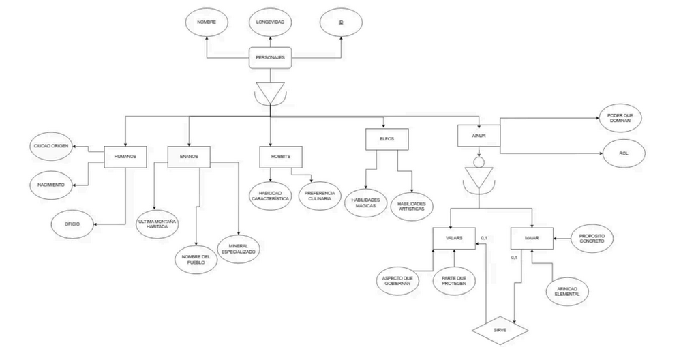

# Premisa Act10_ModeloE-R_TLoTR_aRelacional

Convierte este modelo E-R Relacional de "El Señor de los Anillos" a un modelo Lógico-Relacional.

Realiza la conversión utilizando las 3 posibles estrategias:

1. **EST. TABLA-JERARQUÍA**: **Se crea una única tabla para toda la jerarquía**, incluyendo un campo adicional que indique el "tipo" de especialización que identifica a la subclase a la que pertenece cada registro.
2. **EST. TABLA-SUBCLASE**: Se crea una tabla para cada subclase. A cada tabla se le asigna una ID_pk, el atributo común(indicado en la superclase) y los atributos específicos de la subclase en cuestión. **Es la estrategia más común en bases de datos relacionales.**
3. **EST. TABLA-NIVEL**: Se crea una tabla para la superclase, y otra para cada subclase. La tabla de la superclase contiene los atributos comunes, mientras que las tablas de las subclases contienen los atributos específicos de la subclase en cuestión. Las tablas están **relacionadas mediante claves foráneas**.

> **NOTA**: Recuerda que en el modelo Lógico-Relacional no existen los conceptos de "entidad" y "relación", sino que todo se representa mediante "tablas" (o "relaciones").
