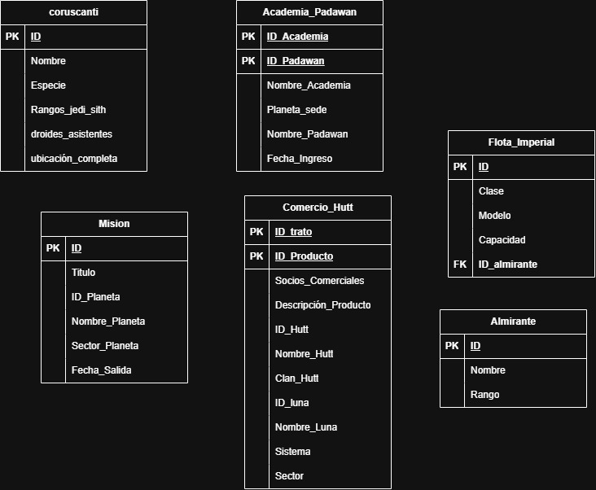
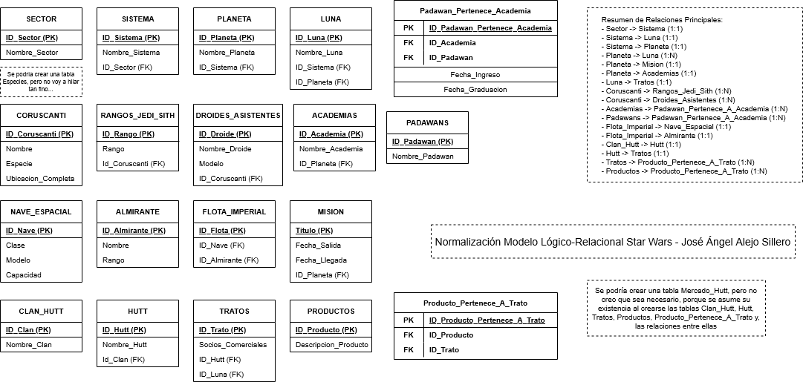

# **PLANTEAMIENTO Y ANÁLISIS - Normalización Modelo Lógico-Relacional Star Wars - Jose Ángel Alejo**

- [**PLANTEAMIENTO Y ANÁLISIS - Normalización Modelo Lógico-Relacional Star Wars - Jose Ángel Alejo**](#planteamiento-y-análisis---normalización-modelo-lógico-relacional-star-wars---jose-ángel-alejo)
  - [**Planteamiento**](#planteamiento)
  - [**Modelo Lógico-Relacional Inicial**](#modelo-lógico-relacional-inicial)
  - [**Análisis**](#análisis)
  - [**Tablas resultantes, relaciones y claves primarias y foráneas resultantes**](#tablas-resultantes-relaciones-y-claves-primarias-y-foráneas-resultantes)
    - [**Tablas Principales Resultantes**](#tablas-principales-resultantes)
    - [**Resumen de Relaciones Principales**](#resumen-de-relaciones-principales)
  - [**Imagen del Modelo Lógico-Relacional Inicial**](#imagen-del-modelo-lógico-relacional-inicial)
  - [**Imagen del Modelo Lógico-Relacional Normalizado**](#imagen-del-modelo-lógico-relacional-normalizado)

---

## **Planteamiento**

Se nos proporciona un modelo Lógico-Relacional que representa información relacionada con el universo de Star Wars. El objetivo es analizar este modelo y llevar a cabo un proceso de normalización para mejorar su estructura y eliminar redundancias.

>Las FN a aplicar son:

1. **Primera Forma Normal (1FN)**: Una relación(tabla) cumplirá la 1FN si cada atributo es atómico, es decir, dicho atributo es indivisible y contiene un único valor posible. Afecta a los atributos multivaluados y compuestos.
   - Los **atributos multivaluados se deben separar en nuevas tablas**, y los **atributos compuestos se descomponen en sus atributos simples**.
2. **Segunda Forma Normal (2FN)**: Una relación(tabla) cumplirá la 2FN sólo si está en 1FN y todos los atributos que no forman parte de la clave primaria dependen completamente de la clave primaria.
   - Esta norma sólo afecta cuando nuestra tabla cuenta con claves primarias compuestas, por ello, si la clave primaria son simple, la tabla siempre estará en 2FN.
3. **Tercera Forma Normal (3FN)**: Una relación(tabla) cumplirá la 3FN sólo si está en 2FN y no existen dependencias transitivas entre los atributos no clave y la clave primaria.
   - Es decir, los atributos no clave no deben depender de otros atributos no clave, sino únicamente de la clave primaria.

> Las Reglas de Integridad de datos y restricciones a considerar son:

- **Integridad de Entidad**: Cada tabla debe tener una clave primaria única que identifique de manera inequívoca cada fila. Ningún valor de clave primaria puede ser nulo. Hace referencia a la FN 1.
- **Integridad Referencial**: Las claves foráneas deben coincidir con valores existentes en las tablas referenciadas o ser nulas si la relación lo permite. Hace referencia a la FN 2.
- **Restricciones adicionales**: Se deben definir restricciones adicionales según las reglas de negocio, como unicidad, no nulidad y validación de datos.

---

## **Modelo Lógico-Relacional Inicial**

El modelo Lógico-Relacional inicial incluye las siguientes entidades(tablas), atributos, claves primarias y claves foráneas:

1. **Tabla Coruscanti**:
   - Atributos: ID (pk) no especificado. Nombre, Especie, Rangos_jedi_sith, Droides_Asistentes, Ubicacion_Completa. Sin FK.
   - Relaciones: Ninguna.
2. **Tabla Academia_Padawan**:
   - Atributos: ID_Academia (PK), ID_Padawan (PK). Nombre_Academia, Planeta_sede, Nombre_Padawan, Fecha_Ingreso. Sin FK.
   - Relaciones: Ninguna.
3. **Tabla Flota_Imperial**:
   - Atributos: ID (PK) no especificado. Clase, Modelo, Capacidad. ID_Almirante (FK).
   - Relaciones: Relacionada con Almirante.
4. **Tabla Almirante**:
   - Atributos: ID (PK) no especificado. Nombre, Rango.
   - Relaciones: Relacionada con Flota_Imperial.
5. **Tabla Mision**:
   - Atributos: ID (PK) no especificado. Titulo, ID_Planeta (no especificado FK o PK), Nombre_Planeta, Sector_Planeta, Fecha_Salida.
   - Relaciones: Se intuye relación con Planeta, pero no está claramente definida.
6. **Tabla Comercio_Hutt**:
   - Atributos: ID_Trato (PK), ID_Producto (PK). Socios_Comerciales, Descripcion_Producto, ID_Hutt (no especificado FK o PK), Nombre_Hutt, Clan_Hutt. ID_Luna (no especificado FK o PK), Nombre Luna, Sistema, Sector.
   - Relaciones: Se intuye relaciones con Hutt, Luna, Sistema y Sector, pero no están claramente definidas ni se representan como entidades separadas.

---

## **Análisis**

Análisis de cada tabla según las FN y reglas de integridad:

1. **Tabla Coruscanti**:
   - **1FN**: Todos los atributos parecen ser atómicos, pero "Rangos_jedi_sith" y "Droides_Asistentes" parece hacer referencia a una entidad Jedi/Sith y Droides respectivamente, por lo que deben separarse en nuevas tablas.
   - **2FN**: La clave primaria es simple (ID), por lo que está en 2FN.
   - **3FN**: No hay dependencias transitivas aparentes.
   - **Integridad**: Asegurar que ID sea único y no nulo.
   - **Conclusión**: Posible necesidad de separar atributos multivaluados en nuevas tablas. La relación entre las nuevas tablas "Rangos_jedi_sith" y "Droides_Asistentes" con "Coruscanti" sería de uno a muchos, por lo que se añadiría una clave foránea en las nuevas tablas que referencie a "Coruscanti".
2. **Tabla Academia_Padawan**:
   1. **1FN**: Todos los atributos son atómicos.
   2. **2FN**:
      1. La clave primaria no puede ser compuesta (ID_Academia, ID_Padawan) porque se intuye la existencia de múltiples academias y padawans. Por lo tanto, debe **separarse en dos tablas: una para Academias y otra para Padawans**, con una tabla intermedia para la relación muchos a muchos, que sería Padawan_Pertenece_A_Academia.
      2. Además, Planeta_sede parece hacer referencia a otra entidad (Planeta) y debería normalizarse.
      3. Fecha_Ingreso es atómico.
   3. **3FN**: Hay dependencias transitivas entre Nombre_Academia y Planeta_sede, por lo que deben separarse.
   4. **Conclusión**: La separación en tablas individuales permitirá una mejor gestión de los datos y evitará redundancias.
3. **Tabla Flota_Imperial**:
   1. **1FN**: Los atributos Clase, Modelo y Capacidad parecen hacer referencia a otra entidad (Nave_Espacial) y deberían normalizarse. La clave foránea ID_Almirante está bien definida.
   2. **2FN**: La clave primaria es simple (ID), por lo que está en 2FN.
   3. **3FN**: Se debe agregar una tabla Nave_Espacial para separar los atributos relacionados con las naves, y se agregaría una clave foránea en Flota_Imperial que referencie a Nave_Espacial.
4. **Tabla Almirante**:
   1. **1FN**: Todos los atributos son atómicos.
   2. **2FN**: La clave primaria es simple (ID), por lo que está en 2FN.
   3. **3FN**: No hay dependencias transitivas aparentes.
   4. **Integridad**: Asegurar que ID sea único y no nulo.
5. **Tabla Mision**:
   1. **1FN**: Todos los atributos parecen ser atómicos, pero Nombre_Planeta y Sector_Planeta parecen hacer referencia a otra entidad (Planeta) y deberían normalizarse.
   2. **2FN**:
      1. La clave primaria es simple (ID), pero debería ser Título, ya que es más representativo.
      2. Además, Nombre_Planeta, Sector_Planeta parecen hacer referencia a otra entidad (Planeta) y deberían normalizarse.
      3. Fecha_Salida debería hacer referencia a una relación entre "Mision" y "Planeta", y debería normalizarse, y si existe una Fecha_Salida, también debería existir una Fecha_Llegada. También, ID_Planeta debería ser clave foránea que referencie a la tabla Planeta.
   3. **3FN**: Hay dependencias transitivas entre Nombre_Planeta y Sector_Planeta, por lo que deben separarse.
   4. **Conclusión**: Se debe crear una tabla Planeta y agregar una clave foránea en Mision que referencie a Planeta.
6. **Tabla Comercio_Hutt**:
   1. **1FN**: Los atributos Socios_Comerciales y Descripcion_Producto parecen hacer referencia a otra entidad (Producto) y deberían normalizarse. Además, Nombre_Hutt y Clan_Hutt parecen hacer referencia a otras entidades (Hutt y Clan_Hutt) y deberían normalizarse. También, Nombre Luna, Sistema y Sector parecen hacer referencia a otras entidades (Luna, Sistema y Sector) y deberían normalizarse.
   2. **2FN**:
      1. La clave primaria es compuesta (ID_Trato, ID_Producto), por lo que debe **separarse en dos tablas: una para Tratos y otra para Productos**, con una tabla intermedia para la relación muchos a muchos, que sería Producto_Pertenece_A_Trato.
      2. Además, Nombre_Hutt y Clan_Hutt deberían normalizarse en una tabla Hutt y una tabla Clan_Hutt respectivamente.
      3. Nombre_Luna, Sistema y Sector deberían normalizarse en tablas Luna, Sistema y Sector respectivamente. Cada una de estas tablas tendría su propia clave primaria, y se agregarían claves foráneas en Comercio_Hutt que referenciarían a estas tablas.
   3. **3FN**: Hay dependencias transitivas entre Nombre_Hutt, Clan_Hutt, Nombre_Luna, Sistema y Sector, por lo que deben separarse.
   4. **Conclusión**: La separación en tablas individuales permitirá una mejor gestión de los datos y evitará redundancias.
7. **Resumen de Cambios Propuestos**:
   - Crear nuevas tablas para entidades separadas como Jedi/Sith, Droides, Academias, Padawans, Naves Espaciales, Planetas, Productos, Hutts, Clanes Hutt, Lunas, Sistemas y Sectores.
   - Establecer claves foráneas adecuadas para mantener las relaciones entre las tablas.
   - Asegurar que todas las tablas cumplan con las reglas de integridad de datos.

---

## **Tablas resultantes, relaciones y claves primarias y foráneas resultantes**

Basado en el análisis de normalización realizado, a continuación se detallan las **tablas resultantes** después de aplicar las formas normales (1FN, 2FN y 3FN), incluyendo las nuevas tablas creadas para eliminar redundancias y dependencias. Se especifican los **atributos**, **claves primarias (PK)**, **claves foráneas (FK)** y las **relaciones** entre tablas.

### **Tablas Principales Resultantes**

1. **Tabla Sector** (Nueva):
    - **Atributos**: ID_Sector (PK), Nombre_Sector.
    - **Clave Primaria**: ID_Sector.
    - **Claves Foráneas**: Ninguna.
    - **Relaciones**: Uno a uno con **Sistema**.
2. **Tabla Sistema** (Nueva):
    - **Atributos**: ID_Sistema (PK), Nombre_Sistema, ID_Sector (FK).
    - **Clave Primaria**: ID_Sistema.
    - **Claves Foráneas**: ID_Sector → Sector.ID_Sector.
    - **Relaciones**:
      - Uno a uno con **Sector**.
      - Uno a uno con **Luna**.
      - Uno a uno con **Planeta**.
3. **Tabla Planeta** (Nueva):
    - **Atributos**: ID_Planeta (PK), Nombre_Planeta, ID_Sistema (FK).
    - **Clave Primaria**: ID_Planeta.
    - **Claves Foráneas**: ID_Sistema → Sistema.ID_Sistema.
    - **Relaciones**:
      - Uno a uno con **Mision**.
      - Uno a uno con **Academias**.
      - Uno a uno con **Sistema**.
      - Uno a muchos con **Luna**.
4. **Tabla Luna** (Nueva):
    - **Atributos**: ID_Luna (PK), Nombre_Luna, ID_Sistema (FK), ID_Planeta (FK).
    - **Clave Primaria**: ID_Luna.
    - **Claves Foráneas**:
      - ID_Sistema → Sistema.ID_Sistema.
      - ID_Planeta → Planeta.ID_Planeta.
    - **Relaciones**:
      - Uno a uno con **Sistema**.
      - Muchos a uno con **Planeta**.
      - Uno a uno con **Tratos**.
5. **Tabla Coruscanti** (Modificada):
    - **Atributos**: ID_Coruscanti (PK), Nombre, Especie, Ubicacion_Completa.
    - **Clave Primaria**: ID_Coruscanti.
    - **Claves Foráneas**: Ninguna.
    - **Relaciones**:
      - Uno a muchos con **Rangos_Jedi_Sith** (FK: ID_Coruscanti).
      - Uno a muchos con **Droides_Asistentes** (FK: ID_Coruscanti).
6. **Tabla Rangos_Jedi_Sith** (Nueva):
    - **Atributos**: ID_Rango (PK), Rango, ID_Coruscanti (FK).
    - **Clave Primaria**: ID_Rango.
    - **Claves Foráneas**: ID_Coruscanti → Coruscanti.ID.
    - **Relaciones**: Muchos a uno con **Coruscanti**.
7. **Tabla Droides_Asistentes** (Nueva):
    - **Atributos**: ID_Droide (PK), Nombre_Droide, Modelo, ID_Coruscanti (FK).
    - **Clave Primaria**: ID_Droide.
    - **Claves Foráneas**: ID_Coruscanti → Coruscanti.ID.
    - **Relaciones**: Muchos a uno con **Coruscanti**.
8. **Tabla Academias** (Nueva, de Academia_Padawan):
    - **Atributos**: ID_Academia (PK), Nombre_Academia, ID_Planeta (FK).
    - **Clave Primaria**: ID_Academia.
    - **Claves Foráneas**: ID_Planeta → Planeta.ID_Planeta.
    - **Relaciones**:
      - Uno a muchos con **Padawan_Pertenece_A_Academia** (FK: ID_Academia).
      - Uno a uno con **Planeta** (FK: ID_Planeta).
9. **Tabla Padawans** (Nueva, de Academia_Padawan):
    - **Atributos**: ID_Padawan (PK), Nombre_Padawan.
    - **Clave Primaria**: ID_Padawan.
    - **Claves Foráneas**: Ninguna.
    - **Relaciones**: Uno a muchos con **Padawan_Pertenece_A_Academia** (FK: ID_Padawan).
10. **Tabla Padawan_Pertenece_A_Academia** (Nueva, tabla intermedia):
    - **Atributos**: ID_Padawan_Pertenece_Academia (PK), ID_Academia (FK), ID_Padawan (FK), Fecha_Ingreso, Fecha_Graduacion.
    - **Clave Primaria**: ID_Padawan_Pertenece_Academia.
    - **Claves Foráneas**:
      - ID_Academia → Academias.ID_Academia.
      - ID_Padawan → Padawans.ID_Padawan.
    - **Relaciones**: Muchos a muchos entre **Academias** y **Padawans**.
11. **Tabla Nave_Espacial** (Nueva):
    - **Atributos**: ID_Nave (PK), Clase, Modelo, Capacidad.
    - **Clave Primaria**: ID_Nave.
    - **Claves Foráneas**: Ninguna.
    - **Relaciones**: Uno a uno con **Flota_Imperial**.
12. **Tabla Almirante** (Sin cambios):
    - **Atributos**: ID_Almirante (PK), Nombre, Rango.
    - **Clave Primaria**: ID_Almirante.
    - **Claves Foráneas**: Ninguna.
    - **Relaciones**: Uno a uno con **Flota_Imperial**.
13. **Tabla Flota_Imperial** (Modificada):
    - **Atributos**: ID_Flota (PK), ID_Nave (FK), ID_Almirante (FK).
    - **Clave Primaria**: ID_Flota.
    - **Claves Foráneas**:
      - ID_Nave → Nave_Espacial.ID_Nave.
      - ID_Almirante → Almirante.ID.
    - **Relaciones**:
      - Uno a uno con **Nave_Espacial**.
      - Uno a uno con **Almirante**.
14. **Tabla Mision** (Modificada):
    - **Atributos**: Titulo (PK), Fecha_Salida, Fecha_Llegada, ID_Planeta (FK).
    - **Clave Primaria**: Titulo.
    - **Claves Foráneas**: ID_Planeta → Planeta.ID_Planeta.
    - **Relaciones**: Uno a uno con **Planeta**.
15. **Tabla Clan_Hutt** (Nueva):
    - **Atributos**: ID_Clan (PK), Nombre_Clan.
    - **Clave Primaria**: ID_Clan.
    - **Claves Foráneas**: Ninguna.
    - **Relaciones**: Uno a uno con **Hutt**.
16. **Tabla Hutt** (Nueva):
    - **Atributos**: ID_Hutt (PK), Nombre_Hutt, ID_Clan (FK).
    - **Clave Primaria**: ID_Hutt.
    - **Claves Foráneas**: ID_Clan → Clan_Hutt.ID_Clan.
    - **Relaciones**:
      - Uno a uno con **Clan_Hutt**.
      - Uno a uno con **Tratos**.
17. **Tabla Tratos** (Nueva, de Comercio_Hutt):
    - **Atributos**: ID_Trato (PK), Socios_Comerciales, ID_Hutt (FK), ID_Luna (FK).
    - **Clave Primaria**: ID_Trato.
    - **Claves Foráneas**:
      - ID_Hutt → Hutt.ID_Hutt.
      - ID_Luna → Luna.ID_Luna.
    - **Relaciones**:
      - Uno a uno con **Hutt**.
      - Uno a uno con **Luna**.
      - Uno a muchos con **Producto_Pertenece_A_Trato** (FK: ID_Trato).
18. **Tabla Productos** (Nueva, de Comercio_Hutt):
    - **Atributos**: ID_Producto (PK), Descripcion_Producto.
    - **Clave Primaria**: ID_Producto.
    - **Claves Foráneas**: Ninguna.
    - **Relaciones**: Uno a muchos con **Producto_Pertenece_A_Trato** (FK: ID_Producto).
19. **Tabla Producto_Pertenece_A_Trato** (Nueva, tabla intermedia):
    - **Atributos**: ID_Producto_Pertenece_A_Trato (PK), ID_Trato (FK), ID_Producto (FK).
    - **Clave Primaria**: ID_Producto_Pertenece_A_Trato.
    - **Claves Foráneas**:
      - ID_Trato → Tratos.ID_Trato.
      - ID_Producto → Productos.ID_Producto.
    - **Relaciones**: Muchos a muchos entre **Tratos** y **Productos**.

---

### **Resumen de Relaciones Principales**

- **Sector** → **Sistema** (1:1)
- **Sistema** → **Luna** (1:1)
- **Sistema** → **Planeta** (1:1)
- **Planeta** → **Luna** (1:N)
- **Planeta** → **Mision** (1:1)
- **Planeta** → **Academias** (1:1)
- **Luna** → **Tratos** (1:1)
- **Coruscanti** → **Rangos_Jedi_Sith** (1:N)
- **Coruscanti** → **Droides_Asistentes** (1:N)
- **Academias** → **Padawan_Pertenece_A_Academia** (1:N)
- **Padawans** → **Padawan_Pertenece_A_Academia** (1:N)
- **Flota_Imperial** → **Nave_Espacial** (1:1)
- **Flota_Imperial** → **Almirante** (1:1)
- **Clan_Hutt** → **Hutt** (1:1)
- **Hutt** → **Tratos** (1:1)
- **Tratos** → **Producto_Pertenece_A_Trato** (1:N)
- **Productos** → **Producto_Pertenece_A_Trato** (1:N)

Este modelo normalizado elimina redundancias, asegura la integridad referencial y cumple con las formas normales propuestas, facilitando una gestión eficiente de los datos del universo de Star Wars.

---

## **Imagen del Modelo Lógico-Relacional Inicial**

---

## **Imagen del Modelo Lógico-Relacional Normalizado**

