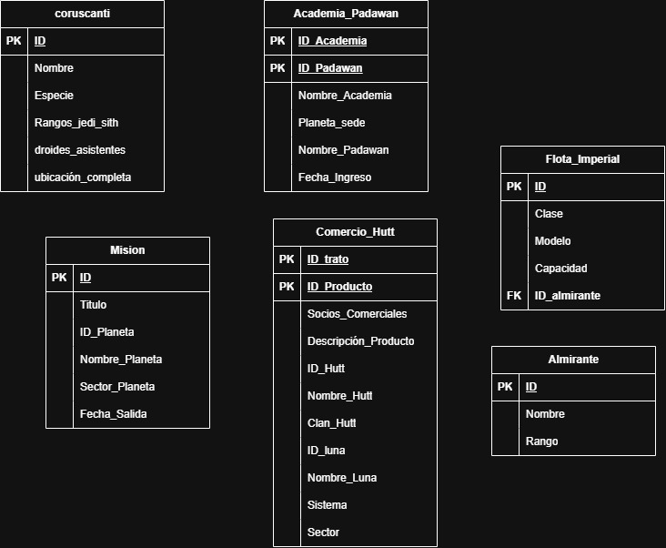

# PREMISA - NORMALIZACION MODELO L-R STAR WARS

Convierte este modelo Lógico-Relacional de "Star Wars" a un modelo Lógico-Relacional Normalizado hasta 3FN.

Recuerda las **reglas de normalización hasta 3FN**:

1. **Primera Forma Normal (1FN)**: Una relación(tabla) cumplirá la 1FN si cada atributo es atómico, es decir, dicho atributo es indivisible y contiene un único valor posible. Afecta a los atributos multivaluados y compuestos.
   - Los **atributos multivaluados se deben separar en nuevas tablas**, y los **atributos compuestos se descomponen en sus atributos simples**.
2. **Segunda Forma Normal (2FN)**: Una relación(tabla) cumplirá la 2FN sólo si está en 1FN y todos los atributos que no forman parte de la clave primaria dependen completamente de la clave primaria.
   - Esta norma sólo afecta cuando nuestra tabla cuenta con claves primarias compuestas, por ello, si la clave primaria son simple, la tabla siempre estará en 2FN.
3. **Tercera Forma Normal (3FN)**: Una relación(tabla) cumplirá la 3FN sólo si está en 2FN y no existen dependencias transitivas entre los atributos no clave y la clave primaria.
   - Es decir, los atributos no clave no deben depender de otros atributos no clave, sino únicamente de la clave primaria.

---

Además, **recuerda los pasos a seguir para realizar modelos Lógicos-Relacionales Normalizados**:

1. **Identificar las entidades**: Cada entidad en el modelo E-R se convierte en una tabla en el modelo relacional.
2. **Definir los atributos**: Los atributos de cada entidad se convierten en filas de la tabla correspondiente.
   - Los atributos multivaluados se separan en tablas adicionales.
   - Los atributos compuestos se descomponen en sus atributos simples.
   - Los atributos derivados no se incluyen en las tablas.
   - Los atributos opcionales se permiten tener valores nulos en la tabla.
3. **Establecer claves primarias**: Se selecciona un atributo que identifique de manera única la entidad que representa la tabla.
4. **Identificar relaciones**: Se analizan las relaciones y se determinan las cardinalidades y participaciones.
5. **Establecer claves foráneas**: Se definen las FKs en las tablas correspondientes para mantener la integridad referencial entre las tablas relacionadas.
6. **Representar relaciones**. Dependerá del tipo de relación(**según cardinalidad**):
   1. **Relaciones uno a muchos (1:N)**: La PK de la tabla/entidad situada en el lado "uno" (1) se añade como FK en la tabla/entidad del lado "muchos" (N).
   2. **Relaciones uno a uno (1:1)**: La PK de una de las tablas se añade como FK en la otra tabla, **dependiendo de las participaciones de cada entidad**. Para ello, tenemos los siguientes casos:
      - Si una entidad participa **(1,1), y la otra con (0,1)**, la **FK se coloca en la tabla de la entidad con participación (1,1)**.
      - Si **ambas entidades participan con (1,1)**, la **FK puede colocarse en cualquiera de las dos tablas**, dependiendo del diseño y las necesidades del sistema.
      - Si **ambas participaciones son (0,1)**, la relación se representará mediante una **tabla intermedia que contenga las PKs de ambas entidades como FKs**.
   3. **Relaciones muchos a muchos (N:M)**: En la práctica se **crea una tabla intermedia** que representa la relación, se **crea una PK para la tabla** y luego se **añaden como FKs las PKs de las dos tablas relacionadas**. Se debe tener en cuenta:
      - Si la relación tiene atributos propios, se incluirán en la tabla intermedia.
