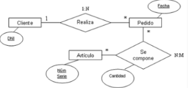
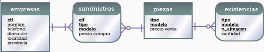
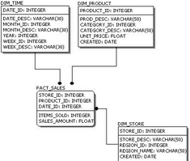
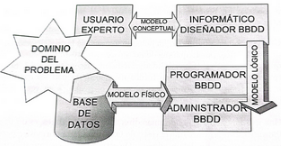
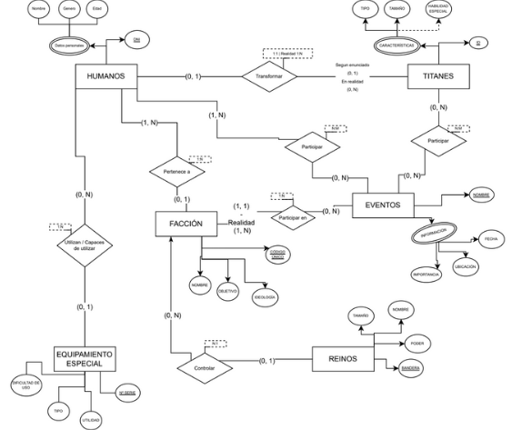

# **U2 - Modelado de Bases de Datos - Apuntes José Ángel Alejo Sillero**

- [**U2 - Modelado de Bases de Datos - Apuntes José Ángel Alejo Sillero**](#u2---modelado-de-bases-de-datos---apuntes-josé-ángel-alejo-sillero)
  - [**1. INTRODUCCIÓN**](#1-introducción)
    - [**1.1 REPRESENTACIÓN DEL PROBLEMA**](#11-representación-del-problema)
    - [**1.2 ETAPAS DEL DESARROLLO DE BBDD | Análisis → Diseño → Implementación → Pruebas → Mantenimiento**](#12-etapas-del-desarrollo-de-bbdd--análisis--diseño--implementación--pruebas--mantenimiento)
  - [**2. MODELIZACIÓN DE BASES DE DATOS**](#2-modelización-de-bases-de-datos)
    - [**MODELO DE DATOS**](#modelo-de-datos)
  - [**3. MODELOS DE BASES DE DATOS - CONCEPTUAL | LÓGICO | FÍSICO**](#3-modelos-de-bases-de-datos---conceptual--lógico--físico)
  - [**4. MODELOS CONCEPTUALES**](#4-modelos-conceptuales)
    - [**4.1 MODELO ENTIDAD-RELACIÓN (E-R)**](#41-modelo-entidad-relación-e-r)
      - [**ENTIDADES - TIPOS**](#entidades---tipos)
      - [**ATRIBUTOS (TIPOS) y DOMINIOS**](#atributos-tipos-y-dominios)
      - [**Atributos de relaciones  | Entidades débiles**](#atributos-de-relaciones---entidades-débiles)
      - [**RELACIONES - TIPOS**](#relaciones---tipos)
      - [**OCURRENCIAS | PARTICIPACIÓN | CARDINALIDADES**](#ocurrencias--participación--cardinalidades)
        - [**Tipos de cardinalidades:**](#tipos-de-cardinalidades)
    - [**NOTACIÓN DE CHEN → Entidades - Atributos - Relaciones**](#notación-de-chen--entidades---atributos---relaciones)
    - [**4.2 MODELO ENTIDAD-RELACIÓN (E-R) AMPLIADO**](#42-modelo-entidad-relación-e-r-ampliado)
      - [**GENERALIZACIÓN**](#generalización)
      - [**ESPECIALIZACIÓN**](#especialización)
        - [**Especialización exclusiva**](#especialización-exclusiva)
        - [**Especialización Inclusiva**](#especialización-inclusiva)
        - [**Especialización Total**](#especialización-total)
        - [**Especialización Parcial**](#especialización-parcial)
    - [**NOTACIÓN DE CHEN → Especialización y Generalización**](#notación-de-chen--especialización-y-generalización)
      - [**Ejemplos combinados**](#ejemplos-combinados)
  - [**5. MODELOS LÓGICOS**](#5-modelos-lógicos)
    - [**5.1 MODELO RELACIONAL**](#51-modelo-relacional)
      - [**Adaptación de Diagramas ER a Esquemas Relacionales**](#adaptación-de-diagramas-er-a-esquemas-relacionales)
      - [**5.1.1 NORMALIZACIÓN EN MODELOS LÓGICOS-RELACIONALES**](#511-normalización-en-modelos-lógicos-relacionales)
      - [**5.1.2 MODELO LÓGICO-RELACIONAL EXTENDIDO - ESPECIALIZACIONES / GENERALIZACIONES**](#512-modelo-lógico-relacional-extendido---especializaciones--generalizaciones)

---

## **1. INTRODUCCIÓN**

### **1.1 REPRESENTACIÓN DEL PROBLEMA**

Para diseñar una BBDD lo primero es extraer los datos relevantes del problema a resolver.

Para ello, realizamos un análisis profundo del problema, obteniendo los datos relevantes que necesitará nuestra BBDD y posteriormente representándolos mediante un modelo.

---

### **1.2 ETAPAS DEL DESARROLLO DE BBDD | Análisis → Diseño → Implementación → Pruebas → Mantenimiento**

1. **ANÁLISIS**: En esta etapa se **estudia el problema a resolver, identificando los requisitos y las necesidades del sistema**; **Comenzamos a identificar Entidades/Tablas/Clases/...**
   1. Se recopilan datos y se definen los objetivos del proyecto. Para ello se realizan entrevistas con el cliente, cuestionarios, análisis de documentos existentes, etc.
2. **DISEÑO**: En esta etapa se **crea un modelo de datos que represente la estructura de la BBDD**; **Definimos las diferentes entidades, atributos, y funciones o métodos si las hubiera**.
3. **IMPLEMENTACIÓN**: **Fase de desarrollo**. Normalmente la fase más extensa. Se lleva a cabo la creación de la BBDD o el programa software.
4. **PRUEBAS**: Fase de testeo. A partir de aquí, podremos retroceder a fases anteriores en caso de ser necesario para corregir errores o mejorar el diseño.
5. **MANTENIMIENTO**: Fase de mantenimiento y actualización del sistema. Se realizan mejoras, correcciones de errores y adaptaciones a nuevos requisitos.

---

## **2. MODELIZACIÓN DE BASES DE DATOS**

La modelización de BBDD es el proceso de **crear un modelo abstracto que represente la estructura y las relaciones de los datos en una BBDD**.

Estos modelos **sirven como una guía para el diseño, implementación y gestión de la BBDD**. Para su creación, es común hacer uso de herramientas de diseño (como DrawIO, Excalidraw, etc...).

### **MODELO DE DATOS**

Para modelar un problema de bases de datos hay que tener en cuenta las siguientes consideraciones:

- Quien **realiza la modelización suele ser un analista informático**, pero no necesariamente será un experto en el problema a resolver; por ello, es necesario contar con un usuario que sí tenga dominio sobre el problema en cuestión.
- Es necesario **modelar siguiendo estándares** para que todos los involucrados en el proyecto puedan entender y comprender nuestro modelo. De esta forma, podremos aprovechar las herramientas del mercado para realizar nuestro diseño.
- La BBDD será **gestionada por un SGBD que tendrá sus propias características**, por lo que la implementación dependerá del SGBD elegido; es decir, no se realizará la implementación de la misma forma en MySQL que en MongoDB o MariaDB.

## **3. MODELOS DE BASES DE DATOS - CONCEPTUAL | LÓGICO | FÍSICO**

| **MODELO**            | **DESCRIPCION**                                                                                                                                                                                                                                    | **EJEMPLO**                                                     |
|-----------------------|----------------------------------------------------------------------------------------------------------------------------------------------------------------------------------------------------------------------------------------------------|-----------------------------------------------------------------|
| **MODELO CONCEPTUAL** | **Tiene gran poder expresivo. Es el más fácil de entender por usuarios inexpertos** en informática. Este modelo nos permite tener un feedback con el usuario para saber si vamos por buen camino.                                                      |  |
| **MODELO LÓGICO**     | Es **más técnico que el conceptual**, pero **tiene una traducción directa al siguiente modelo que entiende el SGBD**. Aquí **dependerá mucho la base de datos que escogeremos** pues no será lo mismo para una que sea orientada a objetos que una relacional. |          |
| **MODELO FÍSICO**     | **Resultado de aplicar el modelo lógico a un SGBD concreto. Generalmente está expresado en un lenguaje de programación de BD tipo SQL.**                                                                                                               |          |

- **INTERACCIÓN ENTRE MODELOS** → 

---

## **4. MODELOS CONCEPTUALES**

Para representar el modelo conceptual podemos utilizar distintos tipos de modelos:

- **Modelo de Entidad-Relación (E-R)**
- Modelo de Diagrama de Clases (UML)
- Modelo de Entidades y Atributos (E-A)
- Modelo de Objetos en Lenguajes de Programación

### **4.1 MODELO ENTIDAD-RELACIÓN (E-R)**

Este modelo **consiste en representar los datos y establecer relaciones entre los mismos**, facilitando así la comprensión y el diseño de la base de datos. Gran parte del éxito de este modelo consiste en que **su notación es muy sencilla y resulta realmente fácil de comprender** por cualquier persona.

Los elementos principales de este modelo son:

- **ENTIDADES**: Representan **objetos o conceptos** del mundo real que tienen **existencia independiente y pueden ser identificados de manera única**. Posibles ejemplos: "Empleado", "Producto" o "Cliente".
- **ATRIBUTOS**: Representan **características o propiedades** de las entidades. Por ejemplo, un "Empleado" puede tener atributos como "Nombre", "Apellido" y "Fecha de Contratación".
- **RELACIONES**: Representan **la forma en que las entidades están conectadas entre sí**. Por ejemplo, un "Empleado" puede estar relacionado con un "Departamento". Estas relaciones poseen propiedades como la cardinalidad y la participación.

---

#### **ENTIDADES - TIPOS**

Las entidades pueden clasificarse en varios tipos según sus características:

- **Entidades Fuertes**: Son aquellas que **existen de manera independiente** y tienen una **clave primaria propia** que las identifica de forma única. Por ejemplo, una entidad "Empleado" con un atributo "ID_Empleado" como clave primaria.
- **Entidades Débiles**: Son aquellas que **no pueden existir de manera independiente** y dependen de una entidad fuerte para su identificación. **No tienen una clave primaria propia** y se identifican mediante una combinación de su atributo parcial y la clave primaria de la entidad fuerte a la que están asociadas. Por ejemplo, una entidad "Dependiente" que depende de la entidad "Empleado" y se identifica mediante el "ID_Empleado" y un "Número de Dependiente".

#### **ATRIBUTOS (TIPOS) y DOMINIOS**

Los atributos de una entidad son las características o propiedades que describen a esa entidad. Pueden clasificarse en varios tipos:

- **Atributos Simples**: Indivisibles en subpartes significativas. Ejemplo: "Nombre", "Edad".
- **Atributos Compuestos**: **Divisibles en subpartes significativas**. Ejemplo: "Nombre Completo" puede dividirse en "Nombre" y "Apellido".
- **Atributos Obligatorios**: **Siempre tendrán un valor, nunca quedarán vacíos**.
- **Atributos Opcionales**: **Pueden o no tener un valor asignado** para cada instancia de la entidad. Ejemplo: "Teléfono Secundario" en una entidad "Empleado".
- **Atributos Derivados**: **Se pueden calcular o derivar a partir de otros atributos**. Ejemplo: "Edad" puede derivarse de "Fecha de Nacimiento".
- **Atributos Multivaluados**: **Pueden tener múltiples valores para una misma entidad**. Ejemplo: "Teléfonos" de un "Empleado" puede tener varios números de teléfono asociados.
- **Atributos Clave**: **Se utilizan para identificar de manera única una entidad dentro de un conjunto**. Por ejemplo, "ID_Empleado" es un atributo clave para la entidad "Empleado".

Los **Dominios** de los atributos definen el **conjunto de valores permitidos para cada atributo**. Por ejemplo, el dominio del atributo "Edad" podría ser un rango de números enteros entre 0 y 120.

#### **Atributos de relaciones  | Entidades débiles**

- **Atributos de relaciones:** No solo las entidades tienen atributos. Las relaciones también pueden tenerlos. Estos atributos son exclusivos de las relaciones, es decir no pueden cederse a ninguna de las entidades ligadas a la relación.
- **Entidades débiles:** Las relaciones que unen una entidad fuerte con una débil también es considerada una relación debil. Existen dos tipos:
  - **Dependencia de existencia:** Expresa que las ocurrencias de una entidad débil dependen de la presencia de una entidad fuerte con la que relacionarlas.
  - **Dependencia de identificación:** Ocurre cuando además de la dependencia de existencia, la entidad débil necesita a la fuerte para poder crear una clave.

---

#### **RELACIONES - TIPOS**

Una relación representa una asociación entre dos o más entidades. Siempre debe intentarse que el nombre de la relación exprese lo más claro posible la relación entre dos entidades, y evitar que ese nombre sea ambiguo.

Por lo general, el nombre de una relación es un verbo, ya que suele ser la forma de describir como dos entidades se relacionan.

Las **relaciones pueden clasificarse en varios tipos según su grado**. El grado de una relación es la cantidad de entidades unidas por la misma relación. Existen tres tipos principales de relaciones:

- **Reflexivas - Grado 1**: Una relación reflexiva es aquella en la que **una entidad se relaciona consigo misma**. Por ejemplo, en una entidad "Empleado", una relación reflexiva podría ser "Supervisa", donde un empleado puede supervisar a otros empleados dentro de la misma entidad.
- **Binarias - Grado 2**: Una relación binaria es aquella que involucra dos entidades diferentes. Es el tipo más común de relación en los modelos E-R. Por ejemplo, una relación binaria podría ser "Trabaja en" entre las entidades "Empleado" y "Departamento".
- **Ternarias - Grado 3**: Una relación ternaria es aquella que involucra tres entidades diferentes. Por ejemplo, una relación ternaria podría ser "Contrata" entre las entidades "Empleado", "Proyecto" y "Cliente".
- **N-arias - Grado >3**: Una relación n-aria es aquella que involucra n entidades diferentes, donde n es mayor que 3. Estas relaciones son menos comunes y pueden ser más complejas de manejar. Un ejemplo podría ser una relación que involucra "Empleado", "Proyecto", "Cliente" y "Proveedor".

**Cualquier relacion N-Aria se puede dividir en varias relaciones binarias o ternarias.**

---

#### **OCURRENCIAS | PARTICIPACIÓN | CARDINALIDADES**

Las **"Ocurrencia de una entidad" se refiere a una instancia específica de dicha entidad**. Cada entidad representa un conjunto de objetos similares, y cada objeto individual dentro de ese conjunto se considera una "ocurrencia" de esa entidad. Por ejemplo, en una entidad "Empleado", cada empleado individual (como Juan Pérez, María Gómez, etc.) es una ocurrencia de la entidad "Empleado".

La **"Participación de una ocurrencia de entidad"** se refiere a la forma en que las ocurrencias de una entidad se relacionan en una relación con otras entidades. La máxima **participación de una ocurrencia** de dos entidades relacionadas se expresa mediante la **cardinalidad** de la relación.

Las **participaciones se representan mediante pares de números** expresando el **mínimo y máximo** de veces que puede aparecer en la relación asociada a otra ocurrencia de la entidad. Las participaciones más comunes son:

- **(0,1)**: Indica que una ocurrencia de la entidad puede no participar en la relación (mínimo 0) o puede participar una sola vez (máximo 1).
- **(1,1)**: Indica que una ocurrencia de la entidad debe participar exactamente una vez en la relación (mínimo 1 y máximo 1).
- **(0,N)**: Indica que una ocurrencia de la entidad puede no participar en la relación (mínimo 0) o puede participar múltiples veces (máximo N).
- **(1,N)**: Indica que una ocurrencia de la entidad debe participar al menos una vez en la relación (mínimo 1) y puede participar múltiples veces (máximo N).

La  **"Cardinalidad de una relación"** indica el número de ocurrencias de una entidad que pueden estar asociadas con una ocurrencia de otra entidad en una relación. Las **cardinalidades más comunes** son:

- **Uno a Uno → 1:1**: Cada ocurrencia de la entidad A está asociada con una única ocurrencia de la entidad B, y viceversa.
- **Uno a Muchos → 1:N**: Cada ocurrencia de la entidad A puede estar asociada con múltiples ocurrencias de la entidad B, pero cada ocurrencia de la entidad B está asociada con una única ocurrencia de la entidad A.
- **Muchos a Uno → N:1**: Cada ocurrencia de la entidad A puede estar asociada con múltiples ocurrencias de la entidad B, pero cada ocurrencia de la entidad B está asociada con una única ocurrencia de la entidad A.
- **Muchos a Muchos → N:M**: Cada ocurrencia de la entidad A puede estar asociada con múltiples ocurrencias de la entidad B, y viceversa. Por ejemplo, en una relación entre "Estudiante" y "Curso", un estudiante puede estar inscrito en múltiples cursos, y cada curso puede tener múltiples estudiantes inscritos.

##### **Tipos de cardinalidades:**

- **Cardinalidades no binarias**: Para calcular estas cardinalidades se tomará una de las tres entidades y se combinan las otras dos. Luego, se calcula la participación de la entidad en la combinación de las otras dos. Posteriormente, se hará lo mismo con las otras dos entidades restantes. Finalmente, tomando los valores máximos de las participaciones se generan las cardinalidades.
- **Cardinalidades reflexivas**: La misma entidad juega dos roles diferentes en la relación. Para extraer su cardinalidad es necesario obtener su participación teniendo en cuenta los dos roles que representa.

### **NOTACIÓN DE CHEN → Entidades - Atributos - Relaciones**

1. **Entidades**: Representadas por rectángulos.
2. **Atributos**: Representados por óvalos conectados a sus respectivas entidades.
   - Atributos **Clave**: Óvalo con contenido subrayado.
   - Atributos **Multivaluados**: Óvalo doble.
   - Atributos **Derivados**: Óvalo punteado con línea entera.
   - Atributo **Opcional**: Óvalo entero con línea punteada.
   - Atributo **Compuesto**: Óvalo doble con sub-ovalos conectados.
   - Atributo **Simple**: Óvalo entero.
3. **Relaciones**: Representadas por rombos conectados a las entidades involucradas.
4. **Participacion**: La participación de una entidad se coloca sobre la línea continua que conecta la entidad con la relación, en el lado contrario a la entidad que participa. **Se indica con formato (X,Y) donde X es el mínimo y Y es el máximo** número de instancias que pueden participar en la relación. Pueden ser:
   - (0,1): Cero o uno.
   - (1,1): Exactamente uno.
   - (0,N): Cero o muchos.
   - (1,N): Uno o muchos.
5. **Cardinalidad**: Se indica junto al rombo de la relación que conecta las entidades. Indica el número máximo de ocurrencias que se relacionan. Se **representa con formato (X:Y), donde X es el máximo de una entidad, e Y es el máximo de la otra entidad**. Pueden ser:
   - **(1:N): Uno a muchos.** - La entidad del lado 1 puede estar asociada con muchas instancias de la entidad del lado N.
   - **(1:1): Uno a uno.** Puede estar formado por participaciones:
     - (1,1) y (0,1) - Una entidad participa obligatoriamente, la otra opcionalmente.
     - (1,1) y (1,1) - Ambas entidades participan obligatoriamente.
     - (0,1) y (0,1) - Ambas entidades participan opcionalmente.
   - **(N:M): Muchos a muchos.** - Ambas entidades pueden estar asociadas con muchas instancias de la otra entidad.

---

### **4.2 MODELO ENTIDAD-RELACIÓN (E-R) AMPLIADO**

#### **GENERALIZACIÓN**

La generalización es un **proceso mediante el cual se identifican atributos y relaciones comunes entre varias entidades y se agrupan en una entidad más general**. Este proceso ayuda a reducir la redundancia y a simplificar el modelo de datos.

#### **ESPECIALIZACIÓN**

La especialización es el proceso inverso a la generalización. **Consiste en dividir una entidad general en varias entidades más específicas basadas en atributos o relaciones particulares**. Esto permite capturar detalles específicos y diferencias entre las entidades especializadas.

##### **Especialización exclusiva**

Cada **ocurrencia de la superclase solo puede materializarse en una especialización**. Por ejemplo, si tenemos una superclase "Empleado" y dos subclases "Gerente" y "Empleado de Ventas", un empleado solo puede ser o un gerente o un empleado de ventas, pero no ambos al mismo tiempo.

##### **Especialización Inclusiva**

Cada **ocurrencia de la superclase puede materializarse en varias ocurrencias de las subclases**. Por ejemplo, si tenemos una superclase "Empleado" y dos subclases "Desarrollador" y "Diseñador", un empleado puede ser tanto un desarrollador como un diseñador al mismo tiempo.

##### **Especialización Total**

La entidad Superclase **tiene que materializarse obligatoriamente en una de las especializaciones**. Por ejemplo, si tenemos una superclase "Desarrollador" y dos subclases "Java" y "Python", cada desarrollador debe ser necesariamente un desarrollador Java o un desarrollador Python.

##### **Especialización Parcial**

La entidad Superclase **no tiene por qué materializarse en una de las especializaciones**. Por ejemplo, si tenemos una superclase "Empleado" y dos subclases "Tiempo Completo" y "Medio Tiempo", un empleado puede no pertenecer a ninguna de las dos categorías.

### **NOTACIÓN DE CHEN → Especialización y Generalización**

- La Generalización se representa mediante un **triángulo con la punta hacia abajo**, conectando la superclase a las subclases.

- La Especialización **Total se representa con un círculo sobre la superclase**. Su **ausencia indica que la especialización es Parcial.**

- La Especialización **Exclusiva se representa con una U** entre la Superclase y las Subclases bajo el triángulo de generalización. **Su ausencia indica que la especialización es Inclusiva.**

---

#### **Ejemplos combinados**

| **Tipo**                | **Notación**               | **Imagen**                                                                                         | **EXPLICACION**                                                                                  |
|-------------------------|----------------------------|----------------------------------------------------------------------------------------------------|--------------------------------------------------------------------------------------------------|
| **Parcial e Inclusiva** | **Solo triángulo**         |  | La Superclase no tiene por qué materializarse en todas las subclases, y puede estar en varias.   |
| **Total e Inclusiva**   | **Triángulo y círculo**    |      | La Superclase estará en al menos una subclase y puede estar en varias.                           |
| **Parcial y Exclusiva** | **Triángulo y U**          |  | La Superclase no tiene por qué materializarse en todas las subclases, y solo puede estar en una. |
| **Total y Exclusiva**   | **Triángulo, círculo y U** |      | La Superclase estará en al menos una subclase y solo puede estar en una.                         |

---

## **5. MODELOS LÓGICOS**

El modelo lógico es una versión más técnica y formal del modelo conceptual. Se organiza de manera similar a como lo hará un SGBD, aunque sin depender aún de un motor concreto.

En esta fase, las **entidades, atributos y relaciones** se convierten en estructuras tabulares que más adelante se transformarán en tablas de bases de datos.

El **objetivo es garantizar que todos los elementos** del modelo conceptual, así como las reglas y dependencias entre ellos **se representen de forma precisa**, sin perder información ni significado.

Los modelos lógicos mantienen la esencia del conceptual, pero comienza a introducir el lenguaje formal de las bases de datos.

En los modelos lógicos, cada **entidad pasa a representarse como una tabla**, las **ocurrencias de la entidad como filas(tuplas)**, los **atributos como columnas**, y las relaciones adoptan la forma de claves ajenas(foráneas, fk) o de tablas adicionales en caso de ser necesario (para relaciones N:M).

- **Los principales tipo de BBDDs y los modelos modelos lógicos con que se relacionan son:**
  - **BBD Relacionales - Modelo Relacional**
  - BBD Orientadas a Objetos - Modelo Orientado a objetos
  - BBD Jerárquicas - Modelo Jerárquico
  - BBD de Redes - Modelo de Redes
  - BBD Documentales - Modelo Documental(NoSQL)

Nosotros nos centraremos en el **Modelo Relacional**, que es el más extendido y utilizado en la actualidad.

Los modelos relaciones se utilizan en la mayoría de SGBD actuales, como MySQL, PostgreSQL, SQL Server u Oracle.

El **Modelo Lógico** se basa en los **principios matemáticos de E. F. Codd**, donde los datos se organizan en tablas (llamadas relaciones), donde cada fila representa una ocurrencia o tupla de una entidad, y cada columna representa un atributo de dicha entidad. Esta teoría indica que aplicamos un **conjunto de transformaciones que garantizan la coherencia estructural del sistema**:

1. **ENTIDADES:**
   1. Cada **entidad fuerte** se convierte en una tabla, con su propia **clave primaria** formada por el atributo o conjunto de atributos que eran atributos clave.
   2. Cada **entidad débil** se transforman en tablas, pero su clave se compone de la **clave parcial más la clave primaria de la entidad fuerte a la que dependen**, formando así una **clave primaria compuesta**.
2. **ATRIBUTOS:**
   1. Los **atributos multivaluados** se separan en nuevas tablas, permitiendo registrar varios valores para una misma entidad.
   2. Los **atributos compuestos** se descomponen en sus atributos simples constituyentes.
   3. Los **atributos derivados** no se incluyen en las tablas, ya que pueden calcularse a partir de otros atributos cuando sea necesario.
3. **RELACIONES:**
   1. Relaciones **1:N**: La clave primaria de la entidad del lado "1" se añade como clave foránea en la tabla del lado "N". Así, cada ocurrencia del lado N puede asociarse con la ocurrencia del lado 1, garantizando la integridad referencial.
   2. Relaciones **1:1**: La clave primaria de una de las entidades puede incorporarse como clave foránea(ajena) enla otra. Para decidir en qué tabla colocarla se observan las participaciones de cada lado.
      1. Si una entidad participa con (1,1), y la otra con (0,1), la clave foránea se coloca en la tabla de la entidad con participación (1,1).
      2. Si ambas entidades participan con (1,1), la clave foránea puede colocarse en cualquiera de las dos tablas, dependiendo del diseño y las necesidades del sistema.
      3. Si ambas participaciones son (0,1), la relación se representará mediante una tabla intermedia que contenga las claves primarias de ambas entidades como claves foráneas.
   3. Relaciones **N:M**: Se representan creando una tabla adicional que actúa como vínculo de las dos entidades conectadas. Esta tabla incluirá como columnas las claves primarias de las dos entidades, que juntas formarán una clave primaria compuesta. Realmente, **en la práctica lo que se hace es crear una clave primaria para la tabla(pk)** y luego se **añaden como claves foráneas las claves primarias de las dos tablas relacionadas**.

---

### **5.1 MODELO RELACIONAL**

Es un tipo de modelo lógico que **organiza los datos en tablas**. Es un **paso intermedio entre el modelo conceptual y el modelo lógico**. Es importante tener claro los conceptos de **Clave Primaria (PK)** y **Clave Foránea (FK)**:

- **Clave Primaria (PK)**: Es un atributo o conjunto de atributos que **identifican de manera única cada fila en una tabla**.
- **Clave Foránea (FK)**: Es un atributo o conjunto de atributos en una tabla que **hace referencia a la PK de otra tabla**. Se utiliza para establecer y reforzar la integridad referencial entre las tablas relacionadas.

Al construir el modelo Relacional es esencial definir las **reglas de integridad de datos y restricciones** que aseguran la consistencia y coherencia del SGBD. Son:

- **Integridad de entidad**: Ninguna clave primaria puede ser nula ni repetida. Hace referencia a la FN1 .
- **Integridad referencial**: Toda FK de una tabla/entidad debe referirse a una PK existente en la tabla/entidad con la que se relaciona. Hace referencia a la FN2.
- **Restricciones adicionales**: Se pueden incluir restricciones semánticas, como límites de valores, condiciones de obligatoriedad o valores por defecto.

#### **Adaptación de Diagramas ER a Esquemas Relacionales**

Como hemos dicho, el **modelo Relacional es un paso intermedio entre el modelo Conceptual Entidad-Relación y el modelo Lógico**, por lo que en la práctica, **se realizan ciertas adaptaciones basadas en las reglas del modelo Lógico, pero con ciertas particularidades**:

1. ***DEFINIR* ENTIDADES:** Se transforman en tablas. La clave primaria (PK) de la entidad se convierte en la PK de la tabla y se indica como la primera fila de la tabla.
2. ***DEFINIR* ATRIBUTOS:** Se transforman en filas de la tabla correspondiente a la entidad.
   1. Los **atributos multivaluados** se separan en nuevas tablas, permitiendo registrar varios valores para una misma entidad. Se establece una relación entre la tabla a la que pertenecía el atributo multivaluado y la nueva tabla creada.
   2. Los **atributos compuestos** se descomponen en sus atributos simples constituyentes dentro de la tabla a la que pertenecía el atributo compuesto.
   3. Los **atributos derivados** no se incluyen en las tablas, ya que pueden calcularse a partir de otros atributos cuando sea necesario.
   4. Los **atributos opcionales** se permiten tener valores nulos en la tabla. Para indicarlos, tenemos dos opciones (aunque normalmente se utiliza la primera):
      1. Junto al nombre del atributo, se añade un asterisco (*) o se indica "NULL" o "(Opcional)" para señalar que el atributo puede tener valores nulos.
      2. Indicar en todos los atributos no opcionales la restricción "NOT NULL", dejando implícito que los demás atributos son opcionales.
3. ***ESTABLECER* CLAVES PRIMARIAS**: Se selecciona un atributo que identifique de manera única la entidad que representa la tabla. Será el atributo clave de la entidad en el modelo E-R.
   1. **Si la clave primaria es compuesta** por varios atributos (siempre que no lo definan), los atributos clave se convierten en atributos simple, y se crea un nuevo ID_PK propio para la tabla.
4. ***IDENTIFICAR* RELACIONES | *ESTABLECER* CLAVES FORÁNEAS**: Se analizan las relaciones y se determinan las cardinalidades y participaciones. **Según la cardinalidad** y las participaciones concretas de la cardinalidad, se representan de la siguiente forma:
   1. **Relaciones uno a muchos (1:N)**: La PK de la tabla/entidad situada en el lado "uno" (1) se añade como FK en la tabla/entidad del lado "muchos" (N).
   2. **Relaciones uno a uno (1:1)**: La PK de una de las tablas se añade como FK en la otra tabla, **dependiendo de las participaciones de cada entidad**. Para ello, tenemos los siguientes casos:
      - **(1,1) y (0,1)** → **FK se coloca en la tabla de la entidad con participación (1,1)**.
      - **(1,1) y (1,1)** → **FK puede colocarse en cualquiera de las dos tablas**.
      - **(0,1) y (0,1)** → **La relación se representará mediante una tabla intermedia con PK propia, y se exportan las PKs de ambas entidades como FKs**. Si la relación tiene atributos propios, se incluirán en la tabla intermedia.
   3. **Relaciones muchos a muchos (N:M)**: Se **crea una tabla intermedia** que representa la relación, se **crea una PK para la tabla** y luego se **añaden como FKs las PKs de las dos tablas relacionadas**. Se debe tener en cuenta:
      - Si la relación tiene atributos propios, se incluirán en la tabla intermedia.

> Estas **adaptaciones nos asegurarán el cumplimiento de las reglas de integridad y coherencia del modelo, así como las tres primeras formas normales, ahorrándonos trabajo en la fase de normalización** al revisar el modelo Lógico-Relacional o al realizar la conversión de Lógico-Relacional a Lógico.

---

#### **5.1.1 NORMALIZACIÓN EN MODELOS LÓGICOS-RELACIONALES**

La **TEORÍA DE NORMALIZACIÓN** es un conjunto de reglas de **normalización** llamadas **Formas Normales** que van de la FN1 a la FN5. Las FN aseguran que nuestro modelo relacional cumple requisitos que **permiten evitar**:

- ***Redundancia* de datos**.
- **Anomalías de *actualización***.
- **Anomalías de *inserción***.
- **Anomalías de *borrado***.

En **la práctica, sólo se utilizan las tres primeras FN**:

1. **Primera Forma Normal (1FN)**: Una relación(tabla) cumplirá la 1FN si cada atributo es atómico, es decir, dicho atributo es indivisible y contiene un único valor posible. Afecta a los atributos multivaluados y compuestos.
   - Los **atributos multivaluados se deben separar en nuevas tablas**, y los **atributos compuestos se descomponen en sus atributos simples**.
2. **Segunda Forma Normal (2FN)**: Una relación(tabla) cumplirá la 2FN sólo si está en 1FN y todos los atributos que no forman parte de la clave primaria dependen completamente de la clave primaria.
   - Esta norma sólo afecta cuando nuestra tabla cuenta con claves primarias compuestas, por ello, si la clave primaria son simple, la tabla siempre estará en 2FN.
3. **Tercera Forma Normal (3FN)**: Una relación(tabla) cumplirá la 3FN sólo si está en 2FN y no existen dependencias transitivas entre los atributos no clave y la clave primaria.
   - Es decir, los atributos no clave no deben depender de otros atributos no clave, sino únicamente de la clave primaria.

---

#### **5.1.2 MODELO LÓGICO-RELACIONAL EXTENDIDO - ESPECIALIZACIONES / GENERALIZACIONES**

En el modelo lógico-relacional extendido, deben adaptarse las **especializaciones y generalizaciones** que aparecen en el modelo Conceptual-Entidad_Relacion. Para ello se representan de manera que se mantenga la integridad y coherencia del modelo, aplicando transformaciones específicas, según el tipo de estrategia elegida para representarla.
Existen **tres estrategias posibles**:

1. **EST. TABLA-JERARQUÍA**: **Se crea una única tabla para toda la jerarquía**, incluyendo un campo adicional que indique el "tipo" de especialización que identifica a la subclase a la que pertenece cada registro.
   - **Ventaja**: Simplicidad en la estructura de la base de datos.
   - **Desventaja**: Puede generar muchos campos nulos si las subclases tienen atributos específicos.
2. **EST. TABLA-SUBCLASE**: Se crea una tabla para cada subclase. A cada tabla se le asigna una ID_pk, el atributo común(indicado en la superclase) y los atributos específicos de la subclase en cuestión. **Es la estrategia más común en bases de datos relacionales.**
   - **Ventaja**: Permite una mejor organización de los datos y evita campos nulos.
   - **Desventaja**: Puede complicar las consultas y aumentar la cantidad de tablas en la base de datos.
3. **EST. TABLA-NIVEL**: Se crea una tabla para la superclase, y otra para cada subclase. La tabla de la superclase contiene los atributos comunes, mientras que las tablas de las subclases contienen los atributos específicos de la subclase en cuestión. Las tablas están **relacionadas mediante claves foráneas**.
   - **Ventaja**: Facilita la consulta de datos a nivel de jerarquía.
   - **Desventaja**: Puede generar redundancia y complicar la estructura de la base de datos.
