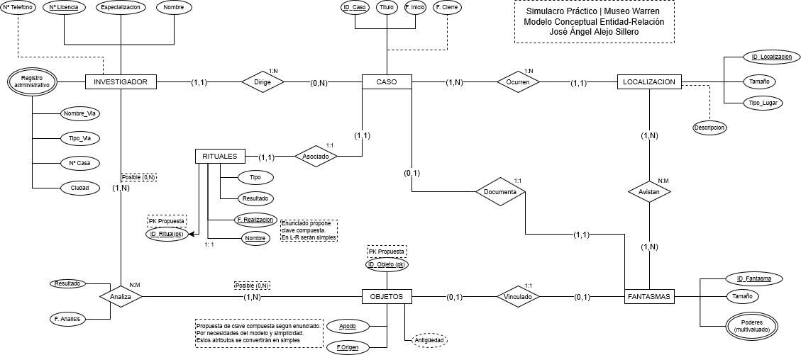
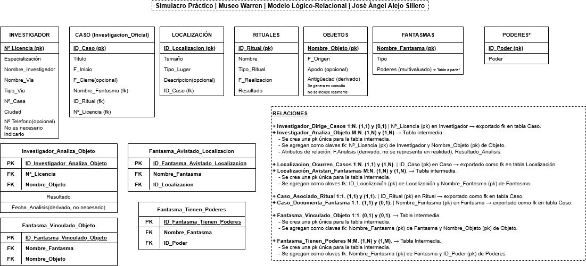

# **Simulacro Modelado de Bases de Datos - Museo de los Warren | José Ángel Alejo Sillero**

- [**Simulacro Modelado de Bases de Datos - Museo de los Warren | José Ángel Alejo Sillero**](#simulacro-modelado-de-bases-de-datos---museo-de-los-warren--josé-ángel-alejo-sillero)
  - [**Enunciado / Premisa del profesor**](#enunciado--premisa-del-profesor)
  - [**Análisis - Entidades | Claves primarias y foráneas (pk | fk) | Atributos | Relaciones**](#análisis---entidades--claves-primarias-y-foráneas-pk--fk--atributos--relaciones)
  - [**Relaciones y atributos de relación(si procede)**](#relaciones-y-atributos-de-relaciónsi-procede)
    - [**Representación de relaciones en Modelo L-R | Exportación de Claves primarias y foráneas (pk | fk)**](#representación-de-relaciones-en-modelo-l-r--exportación-de-claves-primarias-y-foráneas-pk--fk)
  - [**Modelo Entidad-Relacion (ER) y Modelo Lógico-Relacional (MLR)**](#modelo-entidad-relacion-er-y-modelo-lógico-relacional-mlr)
  - [**Correcciones**](#correcciones)

---

## **Enunciado / Premisa del profesor**

Desde mediados del siglo XX, el matrimonio Ed y Lorraine Warren dirigió una institución dedicada a la investigación y documentación de fenómenos paranormales, el hoy conocido como Museo de los Warren se gestiona de forma profesional por un equipo reducido de investigadores con licencia oficial.

Cada investigador que trabaja en el museo actualmente, se especializa en un campo concreto dentro del ámbito paranormal y sensorial, esto con el fin de que siempre haya algún experto para cada tema que puedan encontrarse. Como antes mencionamos estos expertos deben ser licenciados y por ello tienen un Nº de licencia que los identifica de manera única. Cada uno tiene un registro administrativo con su nombre, especialidad, una dirección de contacto (compuesta por el tipo de vía, nombre de la vía, Nº de su casa y ciudad) y, algunos dejan como contacto su número personal de teléfono, mientras que otros que prefieren mantenerse en el anonimato no lo dejan.

Aunque todos los investigadores colaboran entre sí, el museo establece que cada investigación oficial, denominada caso, debe estar dirigida por un único investigador, quien asume la responsabilidad legal y documental. Un mismo investigador puede dirigir varios casos a lo largo de los años, mientras que un caso concreto no puede tener más de un responsable. El registro de cada caso incluye su identificador, un título, la fecha de inicio y, en el caso de que el caso sea cerrado, una fecha de cierre.

Los casos suelen tener lugar en una única localización física, ya sea una casa privada, un cementerio, una iglesia o incluso un bosque. Cada localización queda registrada con su tamaño, tipo de lugar y una descripción del sitio, pero ha decir verdad esta última no siempre se molestan en rellenarla por lo que muchas veces las localizaciones no tienen descripción. No obstante, una misma localización puede haber sido escenario de varios casos distintos a lo largo de las décadas, por lo que no existe exclusividad entre lugar y caso.Ningún caso puede carecer de una localización, pues siempre se realiza en un lugar físico determinado.

Existe un registro de diferentes rituales que puede haber, cada uno de ellos cuenta con un tipo concreto, exorcismos, otros sellados de energía, purificaciones o procesos de liberación espiritual. Cada ritual se identifica por su nombre y la fecha exacta en que se llevó a cabo, pero por separado estas características no identifican únicamente un ritual.Además, se documenta el  resultado (si fue éxito, fallido o inconcluso).

En la base de datos, se considera que cada caso está asociado exactamente a un ritual principal, y que cada ritual pertenece a un único caso, sin posibilidad de que un mismo ritual se repita en distintos contextos.

Los investigadores no solo dirigen casos, también analizan los objetos conservados en el museo, ya que muchos de ellos provienen de sucesos paranormales o exorcismos antiguos. Un objeto puede ser estudiado por varios investigadores a lo largo del tiempo, y un investigador puede analizar distintos objetos. Cada análisis se registra con la fecha en que se realizó y el resultado del análisis (por ejemplo, éxito, parcial o fallido). Cada objeto posee un nombre, su fecha de origen, un apodo, el cual no siempre un objeto puede disponer de un apodo, y su antigüedad, que se calcula a partir del año actual menos el año de su origen.

Los fantasmas constituyen otro tipo de información registrada. Cada espíritu se identifica únicamente por su nombre, y disponen de un tipo (como benevolente, poltergeist o demoníaco). Además, se documentan sus poderes o habilidades, teniendo en cuenta que un mismo fantasma puede tener varios poderes.

En ocasiones, ciertos objetos del museo han quedado vinculados directamente a un fantasma específico, de forma que se considera que el espíritu reside o ejerce influencia permanente sobre el artefacto. No todos los objetos están poseídos, y no todos los fantasmas tienen un objeto que les pertenezca. Un objeto puede tener como máximo un fantasma vinculado, y un fantasma puede tener como máximo un objeto bajo su influencia.

Al documentar las investigaciones, los Warren siempre han buscado registrar pruebas tangibles de lo invisible. Por ello, cada caso documenta exactamente un fantasma principal, el que motivó la apertura del expediente, pero un fantasma puede no haber sido aún documentado en ningún caso si no se le ha podido asociar de forma oficial y solo se le asocia a un único caso, nunca en varios casos diferentes.

Las manifestaciones no siempre se limitan a un único lugar. Hay fantasmas que han sido vistos en múltiples localizaciones y algunos lugares donde se han reportado varias apariciones distintas. Es posible, por tanto, que un mismo fantasma haya sido visto en diferentes ubicaciones, y que un mismo lugar haya sido escenario de múltiples apariciones a lo largo del tiempo.

Finalmente, para cerrar la estructura operativa del museo, hay que considerar que cada investigación (caso) es dirigida por un único investigador, pero un investigador puede haber dirigido muchas a lo largo de su carrera. Del mismo modo, cada caso tiene lugar en una localización concreta, pero una localización puede haber sido escenario de varios casos distintos.

---

## **Análisis - Entidades | Claves primarias y foráneas (pk | fk) | Atributos | Relaciones**

1. **Entidad Investigador**:
   - **Claves pk**: Nº Licencia
   - **Atributos**: Nº Licencia (pk), nombre, especialidad, dirección de contacto (compuesto por-: tipo de vía, nombre de la vía, Nº de su casa, ciudad. En modelo Lógico-Relacional se divide en atributos simples), número de teléfono (opcional).
   - **Relaciones**:
     - Investigador_Dirige_Casos 1:N: Un investigador dirige (0, N) casos.
     - Investigador_Analiza_Objeto M:N: Un investigador analiza (1, N) objetos. Tambien puede ser (0, N) si se considera que un investigador puede no haber analizado ningun objeto aun.
2. **Entidad Caso(InvestigacionOficial)**:
   - **Claves pk**: ID_Caso (pk)
   - **Atributos**: ID_Caso (pk). Título, F.Inicio, F.Cierre (opcional).
   - **Relaciones**:
     - Investigador_Dirige_Casos 1:N. Un caso es dirigido por (1, 1) investigador.
     - Localizacion_Ocurren_Casos 1:N. Un caso ocurre en (1, 1) localización.
     - Caso_Asociado_Ritual 1:1. Un caso está asociado (1, 1) a un ritual principal.
     - Caso_Documenta_Fantasma 1:1. Un caso documenta (1, 1) un fantasma principal.
3. **Entidad Localización**:
   - **Claves pk**: ID_Localizacion (pk)
   - **Atributos**: ID_Localización (pk). Tamaño, tipo de lugar, descripción (opcional).
   - **Relaciones**:
     - Localizacion_Ocurren_Casos 1:N. En una localización ocurren (1, N) casos.
     - Localización_Avistan_Fantasmas M:N. En una localización se avistan (1, N) fantasmas.
4. **Entidad Ritual**:
   - **Claves pk**: ID_Ritual (pk)
     - En el enunciado se propone clave compuesta (nombre, fecha), y así se representa en el modelo Lógico-Relacional.
     - Sin embargo, para facilitar la exportación a un modelo L-Relacional, se añade un ID_Ritual como clave primaria única y se mantiene (nombre, fecha) como atributos simples.
     - Esta decisión se toma bajo la información proporcionada en el enunciado: "Cada ritual se identifica por su nombre y la fecha exacta en que se llevó a cabo, pero por separado estas características no identifican únicamente un ritual".
   - **Atributos**: ID_Ritual (pk). Nombre, Tipo, F.Realización, Resultado.
   - **Relaciones**:
     - Caso_Asociado_Ritual 1:1. Un ritual está asociado (1, 1) a un caso.
5. **Entidad Objeto**:
   - **Claves pk**: Nombre_Objeto (pk)
   - **Atributos**: Nombre_Objeto (pk). F.Origen, Apodo (opcional), Antigüedad (derivado). Antigüedad no requiere ser representado en el modelo L-Relacional.
   - **Relaciones**:
     - Investigador_Analiza_Objeto M:N. Un objeto es analizado por (1, N) investigadores. Puede ser (0, N) si se considera que un objeto puede no haber sido analizado aun.
     - Objeto_Vinculado_Fantasma 1:1. Un objeto puede tener (0, 1) fantasma vinculado.
6. **Entidad Fantasma**:
    - **Claves pk**: Nombre_Fantasma (pk)
    - **Atributos**: Nombre_Fantasma (pk). Tipo, Poderes (multivaluado).
      - En el modelo L-Relacional, los poderes se representan en una tabla aparte por ser multivaluado.
    - **Relaciones**:
    - Localización_Avistan_Fantasmas M:N. Un fantasma es avistado en (1, N) localizaciones.
    - Objeto_Vinculado_Fantasma 1:1. Un fantasma puede tener (0, 1) objeto vinculado.
    - Caso_Documenta_Fantasma 1:1. Un fantasma es documentado en (0, 1) caso.
    - Fantasmas_Tienen_Poderes M:N. Un fantasma puede tener (1, N) poderes. Un poder puede pertenecer a (1, N) fantasmas.
7. **Entidad Poder (atributo multivaluado de Fantasma)**:
   - **Claves pk**: ID_Poder (pk)
   - **Atributos**: Poder (pk)
   - **Relaciones**:
     - Fantasmas_Tienen_Poderes M:N. Un fantasma puede tener (1, N) poderes. Un poder puede pertenecer a (1, N) fantasmas.

---

## **Relaciones y atributos de relación(si procede)**

- Investigador_Dirige_Casos 1:N: Un investigador dirige (0, N) casos. Un caso es dirigido por (1, 1) investigador.
- Investigador_Analiza_Objeto M:N: Un investigador analiza (0, N) objetos. Un objeto es analizado por (0, N) investigadores.
  - Atributos de relación: F.Analisis, Resultado_Analisis.
- Localizacion_Ocurren_Casos 1:N: En una localización ocurren (1, N) casos. Un caso ocurre en (1, 1) localización.
- Localización_Avistan_Fantasmas M:N: En una localización se avistan (1, N) fantasmas, un fantasma es avistado en (1,N) localizaciones.
- Caso_Asociado_Ritual 1:1: Un caso está asociado (1, 1) a un ritual principal. Un ritual está asociado (1, 1) a un caso.
- Caso_Documenta_Fantasma 1:1: Un caso documenta (1, 1) un fantasma principal. Un fantasma es documentado en (0, 1) caso.
- Fantasma_Vinculado_Objeto 1:1: Un objeto puede tener (0, 1) fantasma vinculado. Un fantasma puede tener (0, 1) objeto vinculado.
- Fantasmas_Tienen_Poderes M:N: Un fantasma puede tener (1, N) poderes. Un poder puede pertenecer a (1, N) fantasmas.

### **Representación de relaciones en Modelo L-R | Exportación de Claves primarias y foráneas (pk | fk)**

- **Investigador_Dirige_Casos 1:N. (1,1) y (0,1)**
  - Nº_Licencia (pk) en Investigador → exportado fk en tabla Caso.
- **Investigador_Analiza_Objeto M:N. (1,N) y (1,N)**
  - Se crea una tabla intermedia. Se crea una pk única para la tabla intermedia.
    - Se agregan como claves fk: Nº_Licencia (pk) de Investigador y Nombre_Objeto (pk) de Objeto.
    - Atributos de relación: F.Analisis (derivado, no se representa en realidad), Resultado_Analisis.
- **Localizacion_Ocurren_Casos 1:N. (1,1) y (1,N).**
  - ID_Caso (pk) en Caso → exportado como fk en tabla Localización.
- **Localización_Avistan_Fantasmas M:N. (1,N) y (1,N).**
  - Se crea una tabla intermedia. Se crea una pk única para la tabla intermedia.
    - Se agregan como claves fk: ID_Localización (pk) de Localización y Nombre_Fantasma (pk) de Fantasma.
- **Caso_Asociado_Ritual 1:1. (1,1) y (1,1).**
  - ID_Ritual (pk) en Ritual → exportado como fk en tabla Caso.
- **Caso_Documenta_Fantasma 1:1. (1,1) y (0,1).**
  - Nombre_Fantasma (pk) en Fantasma → exportado como fk en tabla Caso.
- **Fantasma_Vinculado_Objeto 1:1. (0,1) y (0,1).**
  - Se crea una tabla intermedia. Se crea una pk única para la tabla intermedia.
    - Se agregan como claves fk: Nombre_Fantasma (pk) de Fantasma y Nombre_Objeto (pk) de Objeto.
- **Fantasmas_Tienen_Poderes M:N. (1,N) y (1,N).**
  - Se crea una tabla intermedia. Se crea una pk única para la tabla intermedia.
    - Se agregan como claves fk: Nombre_Fantasma (pk) de Fantasma y ID_Poder.

---

## **Modelo Entidad-Relacion (ER) y Modelo Lógico-Relacional (MLR)**

## **Correcciones**

- Entidades, atributos y tablas representadas correctamente.
- Relaciones, participaciones y cardinalidades representadas correctamente.
- Claves primarias y foráneas exportadas correctamente.
- Atributos de relación representados correctamente en ambos modelos.
