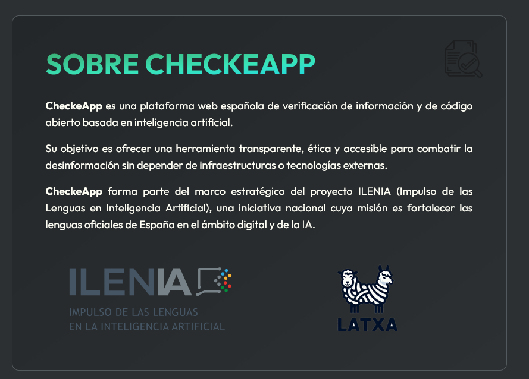

# **Feria de la Digitalización - José Ángel Alejo Sillero**

- [**Feria de la Digitalización - José Ángel Alejo Sillero**](#feria-de-la-digitalización---josé-ángel-alejo-sillero)
  - [**RETO 1**](#reto-1)
  - [**RETO 2**](#reto-2)
  - [**RETO 3**](#reto-3)
  - [**RETO 4**](#reto-4)

---

## **RETO 1**

Entre las principales tecnologías clave e invenciones de la 1ª Revolución Industrial se encuentran la máquina de vapor, el telar mecánico y la hiladora Jenny. Estas invenciones permitieron una producción más rápida y eficiente, transformando la industria textil y otros sectores.

Si bien la máquina de vapor se suele representar como la invención más emblemática de esta época al habilitar grandes avances en el transporte y la manufactura (así como posteriores avances en otras revoluciones industriales), a menudo pasamos por alto la importancia de la hiladora Jenny en la transformación de la industria textil.

La hiladora Jenny habilitó a un solo trabajador/a a producir múltiples hilos simultáneamente, lo que resultó en un incremento significativo en la producción textil, lo que a su vez facilitó la disponibilidad de telas a precios más accesibles.

Las **condiciones laborales en las fábricas y factorías** durante la Revolución Industrial eran extremadamente duras. Los trabajadores enfrentaban *largas jornadas laborales*, a menudo de 12 a 16 horas diarias, con *salarios bajos y poca seguridad en el trabajo*. La **calidad de vida** de los trabajadores era precaria, con *viviendas insalubres* y *falta de acceso a servicios básicos*. Es a raíz de estas condiciones laborales que **surgieron los primeros movimientos sindicales y luchas por los derechos laborales**, que eventualmente llevaron a reformas en las leyes laborales, y la consolidación de movimientos obreros que buscaban mejorar las condiciones de trabajo y vida de los trabajadores (como el movimiento marxista o el ludismo), lo que provocó cambios significativos en la sociedad industrial.

Ahora bien, **la incorporación de maquinaria en las fábricas transformó la organización del trabajo**. El trabajo artesanal, que se realizaba de manera individual o en pequeños talleres, fue reemplazado por la producción en masa en fábricas mecanizadas. Esto llevó a una **división del trabajo más estricta**, donde los trabajadores realizaban tareas específicas y repetitivas, lo que aumentó la eficiencia pero también redujo la autonomía y habilidades de los trabajadores. Estos cambios no siempre eran bien recibidos por los trabajadores, quienes a menudo se sentían incómodos, alienados y deshumanizados en el entorno de la fábrica y el miedo a la pérdida de empleo debido a la mecanización.

Por tanto, podríamos decir que la **principal diferencia entre el trabajo en la manufactura artesanal y el trabajo en las fábricas mecanizadas radica en la escala y la organización del trabajo**. La manufactura artesanal se caracterizaba por la producción a pequeña escala y la habilidad individual, mientras que las fábricas mecanizadas se centraban en la producción masiva y la eficiencia a través de la especialización y la división del trabajo.

La Revolución Industrial tuvo un **impacto profundo en la economía de las ciudades**. La industrialización llevó a un **crecimiento económico significativo**, con un *aumento en la producción y el comercio*. Las ciudades se convirtieron en **centros industriales**, atrayendo a una gran cantidad de trabajadores rurales en busca de empleo. Esto resultó en **beneficios** como un rápido crecimiento urbano, pero también en **problemas sociales** como la pobreza, la sobrepoblación y la falta de infraestructura adecuada. A largo plazo, la Revolución Industrial sentó las bases para el desarrollo económico moderno y la expansión del capitalismo industrial.

---

## **RETO 2**

Los avances tecnológicos que caracterizan la Segunda Revolución Industrial son el crecimiento de la electricidad, el desarrollo del motor a combustión interna y la invención de nuevas formas de comunicación, como la radio.

La **radio influyó en la sociedad de la época** de varias maneras:

- Permitió que las noticias, la música y los programas de entretenimiento llegaran a miles de hogares al mismo tiempo **sin necesidad de presencia física**.
- Provocó una **disminución en el aislamiento** de las comunidades al permitir compartir experiencias a través de transmisiones comunes.
- Se convirtió en un **instrumento de propaganda**, especialmente en tiempos de guerra.

Durante la Primera Guerra Mundial, la radio se utilizó para **mantener al público informado sobre el avance de los conflictos**.

Si **la radio no hubiera existido**, la sociedad actual podría haber evolucionado de forma diferente en los medios de comunicación masiva. Esto podría haber **retrasado o alterado** el desarrollo de tecnologías posteriores, como *la televisión y la radio moderna*, ya que la radio **sentó las bases** para la *difusión inmediata de información y entretenimiento*.

Además de lo expuesto en el texto, **otros avances principales durante la Segunda Revolución Industrial** incluyen:

- La invención del teléfono por Alexander Graham Bell.
- La invención de la bombilla incandescente por Thomas Edison.
- El desarrollo de la corriente alterna por Nikola Tesla, que facilitó la distribución masiva de electricidad.
- La producción en masa de automóviles con la línea de ensamblaje de Henry Ford.
- Los primeros vuelos motorizados con los hermanos Wright.

---

## **RETO 3**

El uso de las **TIC** en las empresas es fundamental porque permiten automatizar tareas rudimentarias, mejorar la eficiencia operativa, facilitar la comunicación interna y externa, y acceder a grandes volúmenes de información para tomar decisiones informadas. Las **TIC** incluyen herramientas para procesar, administrar y distribuir información, lo que contribuye a la *digitalización* y la competitividad en la era de la información.

Tres ejemplos de **sistemas electrónicos** distintos a los mencionados en la presentación (como ordenadores, teléfonos móviles, tablets y cámaras digitales) son:

- **Chips** en tarjetas inteligentes, como las tarjetas de crédito o débito, que utilizan **microprocesadores** para almacenar y procesar datos de forma segura.
- **Microprocesadores** en sistemas de climatización y control de edificios, que regulan la temperatura y el consumo energético de manera automática.
- **Sensores electrónicos** en dispositivos médicos, como monitores de ritmo cardíaco o glucómetros, que recopilan datos en tiempo real para diagnósticos precisos.
- **Tacógrafos** y tarjetas de tacógrafo en camiones, que son dispositivos electrónicos(digitales) o analógicos que registran datos de conducción como velocidad, distancia y tiempos de descanso, utilizando **chips** y sensores para cumplir con normativas de seguridad y transporte.

Respecto a los **tacógrafos** en España, existen versiones *analógicas* y *digitales*. Los *analógicos* utilizan discos de papel para registrar manualmente datos de conducción como velocidad, distancia y tiempos de descanso, mientras que los *digitales*, obligatorios desde 2006 para vehículos comerciales con peso superior a 3,5 toneladas o capacidad para más de 9 personas, emplean tarjetas con **chips electrónicos** y sensores para un registro automático y preciso, cumpliendo con el Reglamento (UE) nº 165/2014 para garantizar la seguridad en el transporte.

---

## **RETO 4**

[**Entrevista a Jesús Copado, Surlabs - XII Feria de Innovación**](https://www.youtube.com/watch?v=aGvvd6w6k3k)

En este vídeo de la **XII Feria de Innovación** realizada en Sevilla, se realiza una entrevista a **Jesús Copado**, **CEO y Fundador** de **Surlabs**, una empresa especializada en soluciones tecnológicas avanzadas. Durante la entrevista, **Jesús Copado** destaca cómo la empresa está utilizando tecnologías clave de la **4ª Revolución Industrial**, como la **inteligencia artificial (IA)**, el **Internet de las cosas (IoT)** y el **análisis de big data**, para desarrollar soluciones innovadoras que mejoran la eficiencia y productividad en diversos sectores.

Concretamente destaca la creación por parte de **Surlabs** junto a la **Universidad del País Vasco (UPV)**, de un software *GRATUITO* basado en **IA** que analiza noticias para detectar posibles sesgos y desinformación (o "*fake news*"). Este software está disponible en la página web [**checkeapp.com**](https://checkeapp.com/).

Para **utilizarla debemos acceder a la web**, subir el texto o enlace de la noticia que queremos analizar, y el software nos proporcionará un informe detallado sobre la veracidad y posibles sesgos presentes en la información, ayudando así a combatir la desinformación en la era digital.

A continuación, un enlace a una  verificación de una noticia utilizando esta herramienta: [**Verificación de noticia**](https://checkeapp.com/verify/04097173-e69d-4a97-816f-4fd8420adba8/finalResult).

