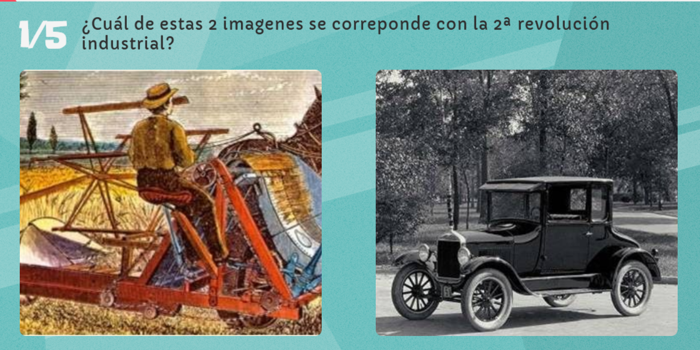
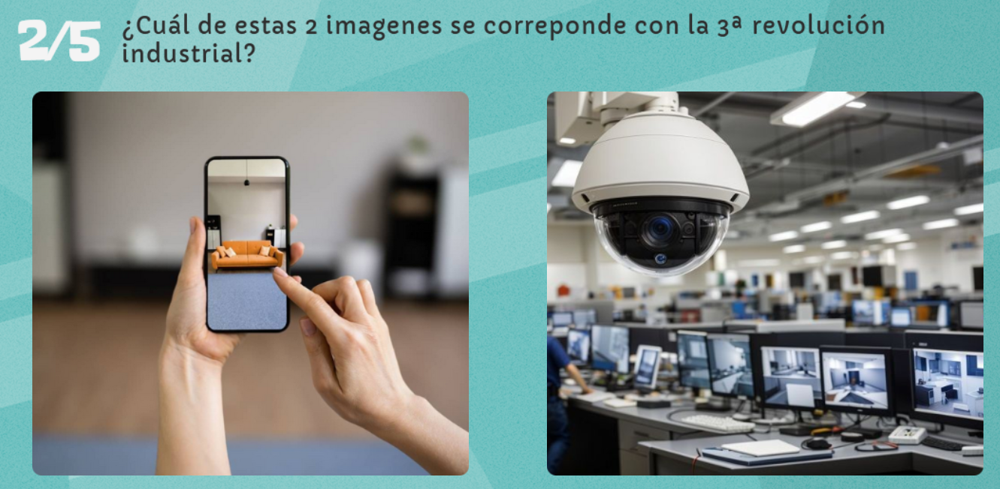
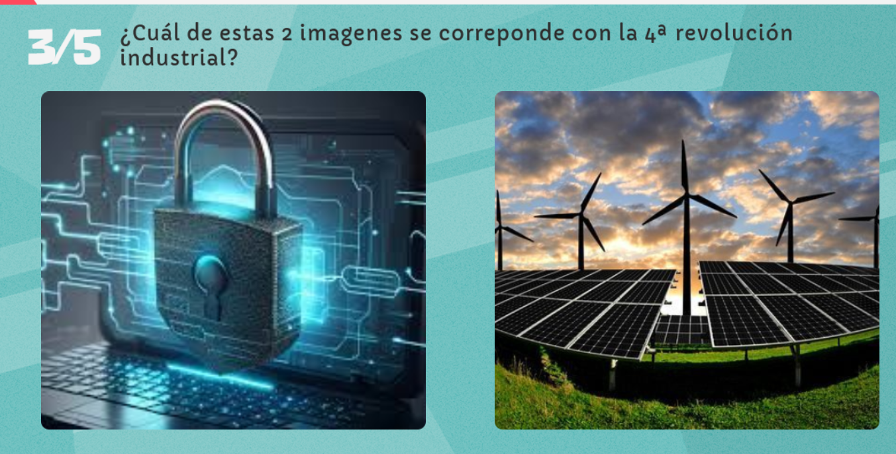
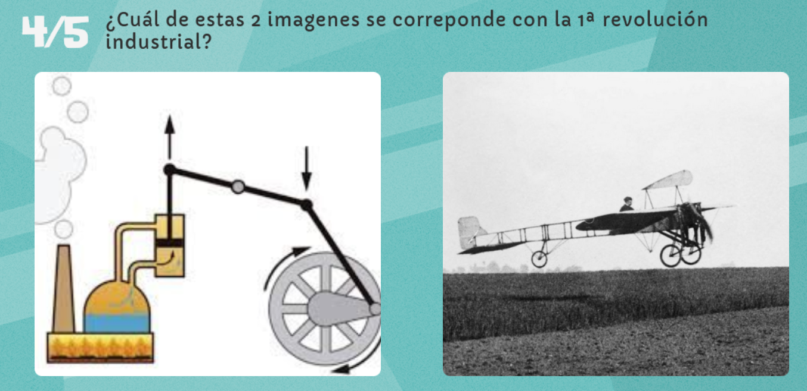
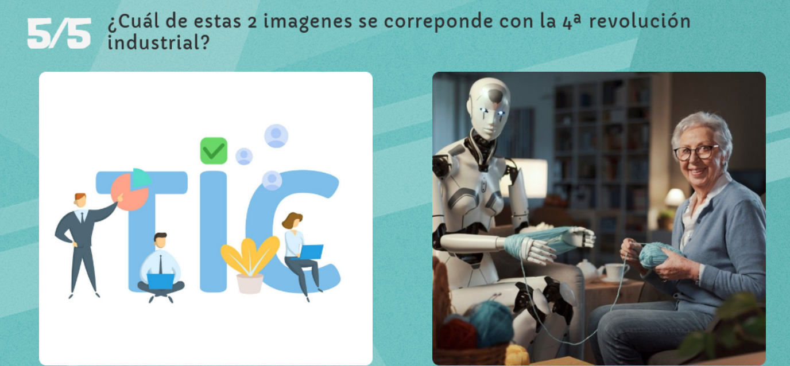

# Preguntas Feria de la Digitalización - José Ángel Alejo Sillero

[Enlace a feria de la digitalización](https://view.genially.com/673f78ec296fde745e2119d5/interactive-content-actividad-evaluable-final-tema-2-digitalizacion)

## APARTADO 1

1. LA REVOLUCIÓN INDUSTRIAL ES UN IMPORTANTE PROCESO DE TRANSFORMACIONES:
   1. Sociales, económicas, históricas y tradicionales.
   2. Sociales, económicas, culturales y políticas.
   3. **Sociales, económicas, culturales y tecnológicas**
2. LA SEGUNDA REVOLUCIÓN INDUSTRIAL VA DESDE:
   1. **Segunda mitad del siglo XIX al siglo XX**
   2. Siglo XX al XXI
   3. Segunda mitad del siglo XVIII al siglo XIX
3. EL INICIO DE LA PRIMERA REVOLUCIÓN INDUSTRIAL COINCIDE CON LA:
   1. Invención de las fábricas.
   2. Invención del vehículo.
   3. **Invención de la máquina de vapor**
4. SI HABLAMOS DE CONECTIVIDAD HABLAMOS DE:
   1. Segunda revolución industrial.
   2. **Cuarta revolución industrial**
   3. Tercera revolución industrial.
5. CUANDO HABLAMOS DE TECNOLOGÍA Y DIGITALIZACIÓN NOS REFERIMOS A LA REVOLUCIÓN:
   1. **3.0**
   2. 2.0
   3. 4.0

## APARTADO 2

- 
  - **Coche**
- 
  - **Cámara**
- 
  - **Candado**
- 
  - **Máquina de vapor**
- 
  - **Robot ayudando a persona de tercera edad**

## APARTADO 3

1. LOS SISTEMAS CIBERFÍSICOS COMBINAN:
   1. El mundo físico y el mundo ficticio.
   2. **El mundo físico y el mundo virtual.**
   3. El mundo físico y el mundo real.
2. LOS SISTEMAS CIBERFÍSICOS UTILIZAN:
   1. GPS.
   2. Ordenadores.
   3. **Sensores.**
3. EL INTERNET DE LAS COSAS TAMBIÉN SE DENOMINA COMO:
   1. **IoT**
   2. Olt
   3. Tol
4. La robótica avanzada es una tecnología clave de:
   1. **La 4ª revolución industrial.**
   2. La 3ª revolución industrial.
   3. La 2ª revolución industrial.
5. La inteligencia artifical es:
   1. Una rama de la realidad virtual.
   2. Una rama de la digitalización.
   3. **Una rama de la informática.**

## APARTADO 4

1. LA DIGITALIZACIÓN ES LA TRANSFORMACIÓN DE:
   1. **Procesos análogos y objetos físicos al formato digital.**
   2. Procesos análogos y objetos virtuales al formato digital.
   3. Procesos análogos y objetos biodegradables al virtual.
2. DENTRO DE LOS PUNTOS CLAVES DE LA IA ENCONTRAMOS:
   1. La realidad aumentada.
   2. El internet de las cosas.
   3. **Algoritmos.**
3. LA MANUFACTURA 3D ES SINÓNIMO DE:
   1. Impresión 2D.
   2. **Impresión 3D.**
   3. Impresión 4D.
4. EL BIG DATA SE REFIERE A:
   1. **Grandes volúmenes de datos.** <!-- No es del todo correcto, pero es lo más aproximado. En realidad, cuando hablamos de Big Data nos referimos al almacenamiento, procesamiento y análisis de grandes volúmenes de datos para obtener información útil y tomar decisiones informadas-->
   2. Datos de grandes empresas.
   3. Datos tecnológicos.
5. LA REALIDAD VIRTUAL:
   1. Superpone elementos virtuales sobre el entorno real.
   2. Protege las computadoras.
   3. **Te sumerge en un entorno digital.**
