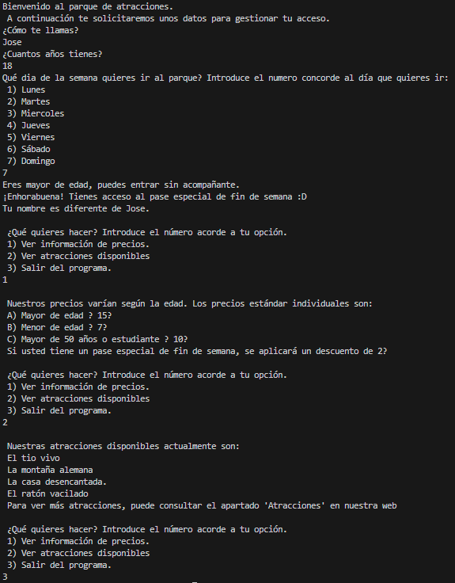
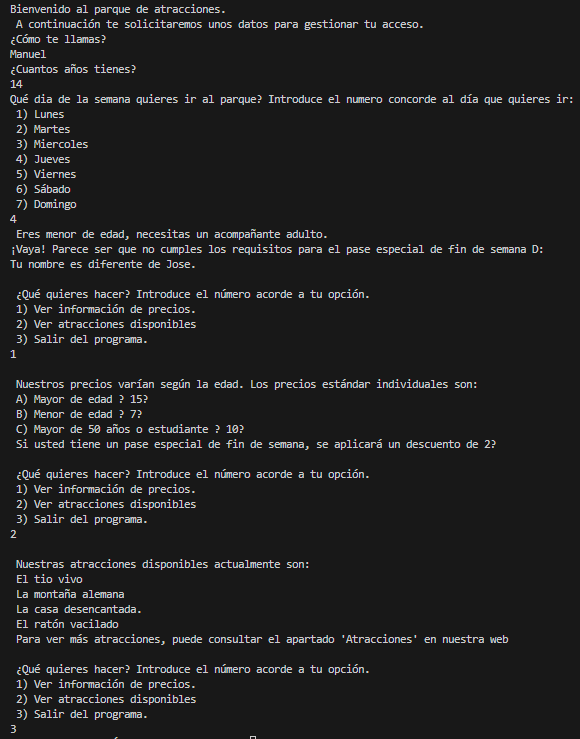

# **Entrega ActEvaluable1_U3JAAlejo**

- [**Entrega ActEvaluable1\_U3JAAlejo**](#entrega-actevaluable1_u3jaalejo)
  - [**Código del archivo ActEvaluable1\_U3JAAlejo.java**](#código-del-archivo-actevaluable1_u3jaalejojava)
  - [**Consideraciones y capturas de pantalla**](#consideraciones-y-capturas-de-pantalla)
    - [**Output 1 - Nombre Jose, edad 18, día 7 - Opciones Multiples en Menu**](#output-1---nombre-jose-edad-18-día-7---opciones-multiples-en-menu)
    - [**Output 2 - Nombre Manuel, edad 14, día 4 - Opciones Multiples en Menu**](#output-2---nombre-manuel-edad-14-día-4---opciones-multiples-en-menu)

---
<div style="page-break-after: always;"></div>

## **Código del archivo ActEvaluable1_U3JAAlejo.java**

```java
import java.util.Scanner;

public class ActEvaluable1_U3JAAlejo {

    public static void main(String[] args) {
    Scanner scanner = new Scanner(System.in);

    System.out.println("Bienvenido al parque de atracciones. \n A continuación te solicitaremos unos datos para gestionar tu acceso.");

    System.out.println("¿Cómo te llamas?");

        String nombre = scanner.nextLine();

    System.out.println("¿Cuantos años tienes?");

        int edad = scanner.nextInt();

    System.out.println("Qué dia de la semana quieres ir al parque? Introduce el numero concorde al día que quieres ir: \n 1) Lunes \n 2) Martes \n 3) Miercoles \n 4) Jueves \n 5) Viernes \n 6) Sábado \n 7) Domingo");

        int diaSemana = scanner.nextInt();

    if (edad >= 18){
        System.out.println("Eres mayor de edad, puedes entrar sin acompañante.");
    } else if (edad > 0 && edad < 18) {
        System.out.println(" Eres menor de edad, necesitas un acompañante adulto.");

    }

    if ( edad >= 18 && (diaSemana==6 || diaSemana==7)) {
        System.out.println("¡Enhorabuena! Tienes acceso al pase especial de fin de semana :D");
    } else {
        System.out.println("¡Vaya! Parece ser que no cumples los requisitos para el pase especial de fin de semana D:");
    }

    if (nombre != "Jose" && nombre != "jose"){                          // Siempre imprime "Tu nombre es diferente de Jose.", aunque el nombre sea "Jose" o "jose". Supuestamente porque para comparar Strings en Java no se usa "!=" sino el método .equals(), pero como no lo hemos dado en clase no pueod usarlo.
        System.out.println("Tu nombre es diferente de Jose.");
    }

    /*Si usara .equals() (pero sin utilizar ignoreCase)sería así:
     * if (!nombre.equals("Jose") && !nombre.equals("jose")){
     *    System.out.println("Tu nombre es diferente de Jose.");
     *  }
     */
    System.out.println("\n ¿Qué quieres hacer? Introduce el número acorde a tu opción. \n 1) Ver información de precios. \n 2) Ver atracciones disponibles \n 3) Salir del programa.");

    int menu1 = scanner.nextInt();

    while (menu1 != 3){

        if (menu1 == 1) {
            System.out.println("\n Nuestros precios varían según la edad. Los precios estándar individuales son: \n A) Mayor de edad → 15€ \n B) Menor de edad → 7€ \n C) Mayor de 50 años o estudiante → 10€ \n Si usted tiene un pase especial de fin de semana, se aplicará un descuento de 2€");

        } else if (menu1 == 2) {
            System.out.println("\n Nuestras atracciones disponibles actualmente son: \n El tio vivo \n La montaña alemana \n La casa desencantada. \n El ratón vacilado \n Para ver más atracciones, puede consultar el apartado 'Atracciones' en nuestra web");

        } else if (menu1 == 3) {
            System.out.println(" Adiós :D");
        }
        else {
            System.out.println("\n Número no válido");
        }

        System.out.println("\n ¿Qué quieres hacer? Introduce el número acorde a tu opción. \n 1) Ver información de precios. \n 2) Ver atracciones disponibles \n 3) Salir del programa.");

        menu1 = scanner.nextInt();
    }

    scanner.close();
    }
    
}
```

---
<div style="page-break-after: always;"></div>

## **Consideraciones y capturas de pantalla**

Si no quieres que utilice equals o equalsIgnoreCase en la comparación de Strings, la comparación con "!=" siempre imprimirá que el nombre es diferente de "Jose", aunque el nombre introducido sea "Jose" o "jose". Por eso dejo las dos capturas de pantalla, una con el nombre "Jose" y otra con un nombre diferente.

Además, te lo he dejado comentado en el código cómo sería la comparación utilizando equals. (que no equalsIgnoreCase). Se que equals y equalsIgnoreCase no se han dado en clase, pero es que la comparación con "!=" no funciona correctamente para Strings en Java, y hay ejercicios del módulo de programación (con Marga) donde hemos usado equals y equalsIgnoreCase para comparar Strings.

### **Output 1 - Nombre Jose, edad 18, día 7 - Opciones Multiples en Menu**



### **Output 2 - Nombre Manuel, edad 14, día 4 - Opciones Multiples en Menu**


