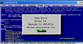
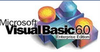
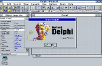
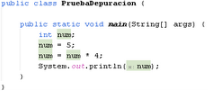
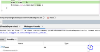
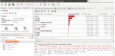

# **UNIDAD 2 - EVALUACIÓN DE ENTORNOS INTEGRADOS DE DESARROLLO**

- [**UNIDAD 2 - EVALUACIÓN DE ENTORNOS INTEGRADOS DE DESARROLLO**](#unidad-2---evaluación-de-entornos-integrados-de-desarrollo)
  - [**1. INTRODUCCIÓN**](#1-introducción)
  - [**2. GLOSARIO**](#2-glosario)
  - [**3. PRIMEROS ENTORNOS DE DESARROLLO INTEGRADOS (IDE)**](#3-primeros-entornos-de-desarrollo-integrados-ide)
  - [**4. ENTORNOS DE DESARROLLO INTEGRADOS (IDEs) ACTUALES**](#4-entornos-de-desarrollo-integrados-ides-actuales)
  - [**5. INSTALACIÓN DE UN ENTORNO INTEGRADO DE DESARROLLO (IDE)**](#5-instalación-de-un-entorno-integrado-de-desarrollo-ide)
    - [**El compilador Java**](#el-compilador-java)
  - [**6. HERRAMIENTAS CASE**](#6-herramientas-case)
    - [**6.1 DEBUGGER - Depurar un programa**](#61-debugger---depurar-un-programa)
    - [**6.2 PROFILER - Análisis de aplicaciones**](#62-profiler---análisis-de-aplicaciones)
    - [**6.3 Generación automática de documentación**](#63-generación-automática-de-documentación)
    - [**6.4 Gestión de módulos**](#64-gestión-de-módulos)

---

## **1. INTRODUCCIÓN**

Los IDE (Entornos de Desarrollo Integrados) son herramientas dirigidas a programadores que les permiten crear aplicaciones de manera más eficiente.
Los IDE pueden estar pensados para su utilización con un único lenguaje de programación o bien con varios lenguajes.
Existen plugins que realizan diagramas de clases, de uso, etc.
Aunque se puede programar con un editor y compilador, en entornos profesionales se utilizan IDEs ya que constan de las siguientes herramientas:

- Editor de texto/código fuente
- Compilador/Intérprete
- Depurador (Debugger)
- Constructor de interfaces gráficas (GUI Builder)
- Herramientas de control de versiones

---

## **2. GLOSARIO**

- **Editor de texto/código fuente**: Sección del IDE donde se escribe el código fuente del programa. Ofrece funcionens propias de la edición como copiar, cortar, pegar o buscar. Además, ofrece funciones adiciones como resaltado/coloreado de sintaxis para diferenciar variables, cadenas de caracteres, instrucciones, bucles, etc. De esta forma, se facilita la lectura del código.
- **Herramientas CASE (Computer-Aided Software Engineering)**: Herramientas que facilitan el desarrollo de software mediante la detección de errores, el soporte a la depuración de programas y pruebas, y la automatización de la documentación de una aplicación.
- **Compilador/Intérprete**: Herramienta que traduce el código fuente escrito en un lenguaje de programación a código máquina o a un lenguaje intermedio que pueda ser ejecutado por la máquina. Dependiendo del lenguaje, se utilizará un compilador (traduce todo el código de una vez) o un intérprete (traduce y ejecuta línea por línea).
- **Depurador (Debugger)**: Herramienta que permite identificar y corregir errores en el código fuente. Permite ejecutar el programa paso a paso, inspeccionar variables, establecer puntos de interrupción (breakpoints) y analizar el flujo de ejecución. El depurador permite detener el programa en cualquier punto de ruptura.
- **Constructor de interfaces gráficas (GUI Builder)**: Herramienta que facilita la creación de interfaces gráficas de usuario mediante un entorno visual. Permite arrastrar y soltar componentes gráficos (botones, cuadros de texto, menús, etc.) para diseñar la interfaz sin necesidad de escribir código manualmente. Algunas IDEs incorporan estas herramientas con el plugin correspondiente.

---

## **3. PRIMEROS ENTORNOS DE DESARROLLO INTEGRADOS (IDE)**

|      **IDE**       | **IMAGEN**                                      | **DESCRIPCIÓN**                                                                                                                                                                                                                                                                                               |
|:------------------:|-------------------------------------------------|---------------------------------------------------------------------------------------------------------------------------------------------------------------------------------------------------------------------------------------------------------------------------------------------------------------|
|  **Turbo Pascal**  |     | IDE lanzado en 1983 por la empresa Borland, el **más importante de la época. Funcionaba con MS-DOS** aunque posteriormente **se creó una versión para Windows**.                                                                                                                                              |
| **Visual Basic 6** |  | **IDE para Windows** que desarrollaba interfaces de manera rápida y eficiente a partir de componentes visuales. Podían instalarse plugins de terceros. Hoy día se utiliza Visual Basic(VBA), que permite grabar, crear y editar macros para automatizar tareas en aplicaciones de office sin ser programador. |
|     **Delphi**     |                | Evolución de Turbo Pascal, lanzado también por Borland, que además de sacar Delphi también sacó JBuilder, un **IDE de Java que tenía la ventaja de estar disponible también para Windows**.                                                                                                                   |
|   **Visual C++**   |         | **IDE para Windows que se programaba en C y C++**. Incluye bibliotecas de Windows como las de Microsoft Foundation Classes y el framework .NET.                                                                                                                                                               |

## **4. ENTORNOS DE DESARROLLO INTEGRADOS (IDEs) ACTUALES**

|        **IDE**         | **IMAGEN**                                         | **DESCRIPCIÓN**                                                                                                                                                                                                                                                                                                                                                |
|:----------------------:|----------------------------------------------------|-----------------------------------------------------------------------------------------------------------------------------------------------------------------------------------------------------------------------------------------------------------------------------------------------------------|
|       **XCode**        |                     | **Desarrollado por Apple** para la creación de aplicaciones en **macOS y iOS**. De licencia gratuita, pero para publicar aplicaciones hay que pagar una suscripción anual. Los lenguajes que **soporta son Swift y Objective-C**.                                                                                                                              |
|      **Netbeans**      |               | **IDE de código abierto desarrollado por Apache Software Foundation**. Está escrito en JAVA, habilitandolo en muchos SO. Se creó para desarrollar aplicaciones Java, pero actualmente tambien se puede programar en Python, PHP, HTML5 y C/C++, Javacript y CSS. **Se basa en la modularidad**. |
|      **Eclipse**       |                 | **IDE de código abierto desarrollado por IBM**, actualmente es propiedad de la fundación Eclipse. Tenía licencia GPL, pero se cambió por una EPL. Pensado para **trabajar con Java**, pero ofrece soporte para otros lenguajes mediante plugins, como: C++, C#, JavaScript, Python, o PHP entre otros. **Disponible para Mac, Windows y Linux**           |
|   **Visual Studio**    |      | **IDE de Microsoft con licencia propietaria y programado en C++ y C#**. Contiene framework .NET y los frameworks de desarrollo web ASP.NET, está disponible para Windows. **Permite programar en varios lenguajes como C++, C#, Python, HTML5 y Javascript entre otros**.                                                                                      |
|   **IntelliJ IDEA**    |      | **IDE de JetBrains** para el **desarrollo en Java y Kotlin**. Es conocido por su destacado soporte de refactorización, depuración y productividad. Existe una **versión gratuita llamada IntelliJ IDEA Community**, así como una **versión Ultimate**.                                                                         |
| **Visual Studio Code** |  | **Editor de código fuente altamente personalizable** de Microsoft que soporta múltiples lenguajes y ofrece una amplia gama de extensiones. Ideal para desarrollo web y de aplicaciones en la nube. **Es multiplataforma y funciona en Windows, macOS y Linux**                                                                                                 |

---

## **5. INSTALACIÓN DE UN ENTORNO INTEGRADO DE DESARROLLO (IDE)**

Para instalar un IDE, se deben seguir los siguientes pasos generales: **Instalación de compilador → Instalar IDE → Configurar IDE → Instalar plugins adicionales**

1. **Instalar el compilador correspondiente** al lenguaje de programación que se va a utilizar (por ejemplo, JDK para Java, GCC para C/C++, etc.).
2. **Instalar el IDE**: Descargar el instalador del IDE desde su sitio web oficial y seguir las instrucciones de instalación.
3. **Configurar el IDE**: Una vez instalado, abrir el IDE y configurar las preferencias según las necesidades del usuario, como la ubicación del proyecto, las opciones de compilación, etc.
4. **Instalar plugins adicionales**: Si es necesario, instalar plugins o extensiones adicionales para ampliar las funcionalidades del IDE.

---

### **El compilador Java**

El compilador Java, también conocido como  **Javac**, es un paquete de desarrollo que se llama JDK (Java Development Kit).
Este paquete de desarrollo incluye el JRE (Java Runtime Environment) y el JVM (Java Virtual Machine), que son necesarios para programar y ejecutar aplicaciones Java.

- **JDK**: Compilador java.
- **JRE**: Entorno de ejecución de Java.
- **JVM**: Programa que ejecuta el código Java compilado por el compilador Java (máquina virtual Java).

Por tanto, **para programar en Java es necesario instalar el JDK en la máquina donde se vaya a programar** y ejecutar los programas Java, **el sistema donde los ejecute deberá tener un JRE y el JVM.**
Java, al ser multiplataforma no necesita compilar cada programa para cada sistema operativo, ya que al obtener el código ejecutable(.jar) funcionará en cualquier sistema siempre que se tenga instalada la JVM.

1. **¿Cómo se si está instalado el JVM en mi sistema?**
   1. Abrimos una terminal (cmd en Windows, terminal en Linux/Mac).
   2. Escribimos el comando `java -version`.
   3. Si está instalado, nos mostrará la versión instalada. Si no está instalado, nos indicará que el comando no se reconoce.
2. **¿Como sé si está instalado el JDK en mi sistema?**
   1. Abrimos una terminal (cmd en Windows, terminal en Linux/Mac).
   2. Escribimos el comando `javac -version`.
   3. Si está instalado, nos mostrará la versión instalada. Si no está instalado, nos indicará que el comando no se reconoce.
3. **¿Cómo instalar el JDK?**
   1. Ir a la página oficial de Oracle o a la página de OpenJDK. <https://download.oracle.com/java/25/latest/jdk-25_windows-x64_bin.zip>
   2. Descargar la versión correspondiente al sistema operativo.
   3. Seguir las instrucciones de instalación.
   4. Configurar las variables de entorno (JAVA_HOME y PATH) si es necesario.

---

## **6. HERRAMIENTAS CASE**

Las herramientas CASE son **herramientas que facilitan el desarrollo de software** mediante la detección de errores, el soporte a la depuración de programas y pruebas, y la automatización de la documentación de una aplicación.  
Entre estas herramientas encontramos el **depurador de programas**, el **profiler o análisis de aplicaciones**, la **generación automática de documentación** y la **gestión de módulos**.

### **6.1 DEBUGGER - Depurar un programa**

Habitualmente, durante el desarrollo de un programa surgen errores que dificultan su funcionamiento, haciendo necesario el uso de herramientas que permitan localizar y corregir dichos errores. 
**El debugger permite depurar fallos y verificar que lo que se está haciendo corresponde con el output esperado**. En Netbeans, por ejemplo, podemos utilizar la ejecución en modo depuración, estableciendo puntos de ruptura y analizando el valor de las variables con las que se trabaja.  
A continuación, mostramos un ejemplo:  

1. **Establecemos un breakpoint(punto de ruptura)**, que nos permitirá que el programa se detenga en esa línea para analizar el estado de las variables. Una vez establecido el breakpoint, **marcamos la variable que queremos observar, y se pulsa sobre el botón derecho del ratón eligiendo `new watch`**.
2. **Accedemos a la herramienta de depuración.** 
3. **El programa se depura y vemos el valor de la variable hasta el punto de ruptura establecido.**

---

### **6.2 PROFILER - Análisis de aplicaciones**

El Profiler analiza el rendimiento de una aplicación cuando está desarrollada o en periodo de prueba. En el siguiente ejemplo en Netbeans se muestra cómo se analiza la memoria que consume cada uno de los procesos del programa del ejemplo anterior.

1. **Iniciamos el Profiler**.
2. Ejecutamos la aplicación bajo el Profiler y **observamos/analizamos los resultados**.   

---

### **6.3 Generación automática de documentación**

Las aplicaciones o programas deben estar **perfectamente documentas** para facilitar su mantenimiento y compresión. En Java, la documentación del código se escribe dentro del propio lenguaje.  
Hay una herramienta llamada Javadoc que **genera automáticamente la documentación a partir de los comentarios escritos en el código fuente**. Para ello extrae los textos y comentarios del código fuente y los transforma en páginas web (formato HTML). 
Para generar la documentación con Javadoc en Netbeans, vamos al **menú `Run` y seleccionar la opción `Generate Javadoc`**.

---

### **6.4 Gestión de módulos**

Los entornos como Netbeans o Eclipse aumentan su "potencia" mediante módulos, para ello permiten gestionar módulos o librerías externas que se pueden añadir a un proyecto para ampliar sus funcionalidades, entre otras creación de informes, trabajar con otros lenguajes de programación no incluidos nativamente en el IDE, etc.  

1. Primeramente debemos descargar los módulos o librerías que queremos añadir, para ello nos dirigimos a <https://plugins.netbeans.apache.org/>
2. Una vez descargados nos vamos a `Tools` → `Plugins` → `Downloaded` → `Add Plugins`.  
3. En esta ventana podemos instalar, desinstalar, activar, desactivar y actualizar los módulos o plugins que tenemos instalados en nuestro IDE.

---
