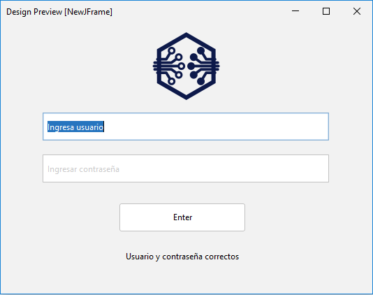

# Premisa de Actividad Evaluable 1

Crea el diseño de un sistema de login básico con las siguientes funcionalidades:

Al pulsar el botón:

1. Si el usuario y la contraseña no son correctos: mensaje que diga usuario y contraseña incorrectos.
2. Si el usuario y la contraseña son correctos: mensaje que diga usuario y contraseña correctos.
3. Si alguno de los dos campos esta vacío: mensaje que diga faltan campos por rellenar.

Entrega un vídeo mostrando el funcionamiento del sistema.

Adjunto imagen de ejemplo

El proyecto debe hacerse en NetBeans utilizando la librería Swing, y la GUI estará en un archivo JFrame Form.

El archivo .java se encuentra en "MisApuntesITPDAW\ENTORNOS DE DESARROLLO\Unidad3_LibreriaSwing\PracticaSwing\src\main\java\com\mycompany\practicaswing\JFrameAct1.java"

El archivo .form en "MisApuntesITPDAW\ENTORNOS DE DESARROLLO\Unidad3_LibreriaSwing\PracticaSwing\src\main\java\com\mycompany\practicaswing\JFrameAct1.form".
