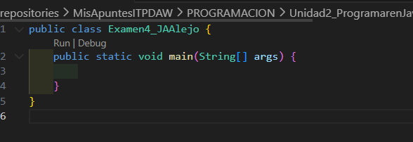

# Examen 4 de Jose Angel Alejo Sillero

## CODIGO INICIAL

```java

```

## DEBUG

> Puntos de ruptura que propongo:

- A
- B

> New Watchs que propongo:

- a
- b

### Mejoras propuestas

## CODIGO FINAL y debug

aaaa

