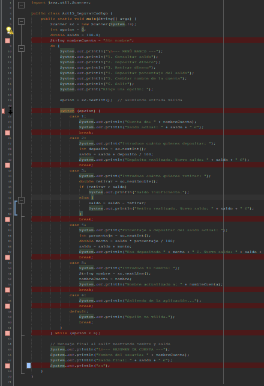
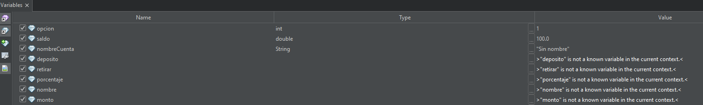
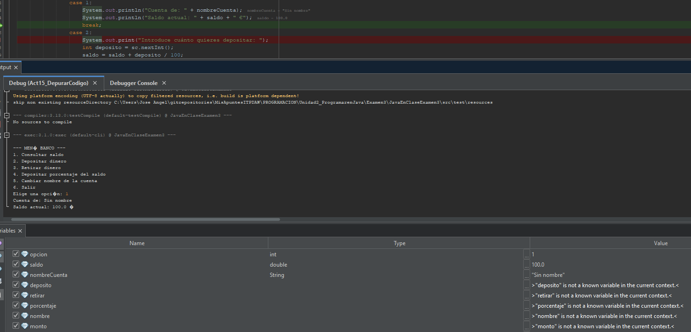
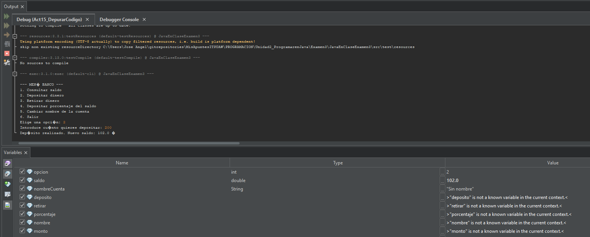
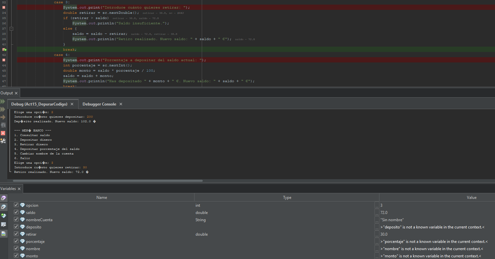
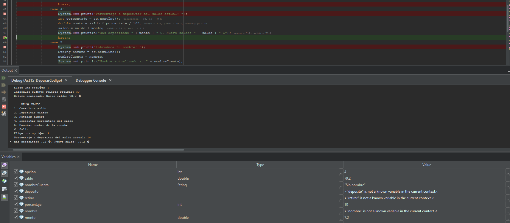
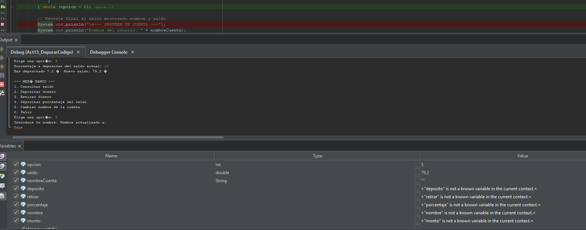
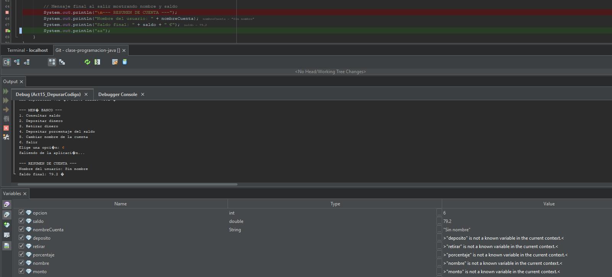
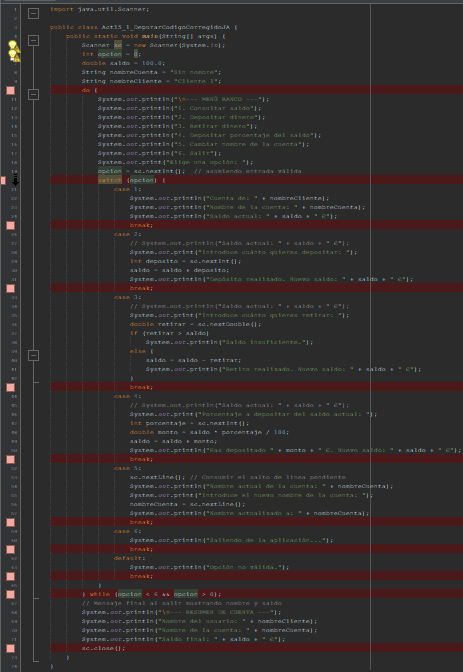
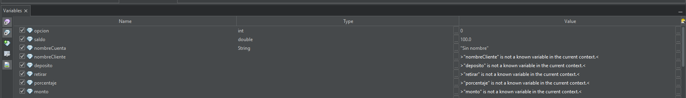

# **Act 15 - Prácticar depuración | Netbeans | JAAlejo**

>**Índice/Tabla de Contenidos**

- [**Act 15 - Prácticar depuración | Netbeans | JAAlejo**](#act-15---prácticar-depuración--netbeans--jaalejo)
  - [**Enunciado/Premisa**](#enunciadopremisa)
  - [**Respuestas | Errores que has contemplado**](#respuestas--errores-que-has-contemplado)
    - [**Análisis de cada opción del menú y errores encontrados en Debugger:**](#análisis-de-cada-opción-del-menú-y-errores-encontrados-en-debugger)
    - [**Correcciones propuestas**](#correcciones-propuestas)
  - [**Código corregido**](#código-corregido)
    - [**Puntos de ruptura y new watchs tras correcciones**](#puntos-de-ruptura-y-new-watchs-tras-correcciones)
      - [**Captura de pantalla de los breakpoints y watches tras correcciones**](#captura-de-pantalla-de-los-breakpoints-y-watches-tras-correcciones)

---
<div style="page-break-after: always;"></div>

## **Enunciado/Premisa**

Se os ha pedido hacer el siguiente programa:

"Implementar un programa en Java que simule una pequeña aplicación bancaria con menú y bucle, que permita consultar saldo, depositar y retirar dinero, modificar el nombre de la cuenta y realizar depósitos basados en porcentaje. El programa debe mostrar un resumen final al salir . "

Al ejecutarlo te das cuenta que no no funciona bien. **Depura el siguiente código y encuentra los fallos para que el código funcione correctamente.**

```java
import java.util.Scanner;

public class BancoConErrores {
    public static void main(String[] args) {
        Scanner sc = new Scanner(System.in);
        int opcion = 0;
        double saldo = 100.0; 
        String nombreCuenta = "Sin nombre"; 

        do {
            System.out.println("\n--- MENÚ BANCO ---");
            System.out.println("1. Consultar saldo");
            System.out.println("2. Depositar dinero");
            System.out.println("3. Retirar dinero");
            System.out.println("4. Depositar porcentaje del saldo");
            System.out.println("5. Cambiar nombre de la cuenta");
            System.out.println("6. Salir");
            System.out.print("Elige una opción: ");

            opcion = sc.nextInt();  // asumiendo entrada válida

            switch (opcion) {
                case 1:
                    System.out.println("Cuenta de: " + nombreCuenta);
                    System.out.println("Saldo actual: " + saldo + " €");
                    break;

                case 2:
                    System.out.print("Introduce cuánto quieres depositar: ");
                    int deposito = sc.nextInt(); 
                    saldo = saldo + deposito / 100;
                    System.out.println("Depósito realizado. Nuevo saldo: " + saldo + " €");
                    break;

                case 3:
                    System.out.print("Introduce cuánto quieres retirar: ");
                    double retirar = sc.nextDouble();
                    if (retirar > saldo)
                        System.out.println("Saldo insuficiente.");
                    else {
                        saldo = saldo - retirar;
                        System.out.println("Retiro realizado. Nuevo saldo: " + saldo + " €");
                    }
                    break;

                case 4:
                 
                    System.out.print("Porcentaje a depositar del saldo actual: ");
                    int porcentaje = sc.nextInt();
                    double monto = saldo * porcentaje / 100;
                    saldo = saldo + monto;
                    System.out.println("Has depositado " + monto + " €. Nuevo saldo: " + saldo + " €");
                    break;

                case 5:
                    System.out.print("Introduce tu nombre: ");
                    String nombre = sc.nextLine(); 
                    nombreCuenta = nombre;
                    System.out.println("Nombre actualizado a: " + nombreCuenta);
                    break;

                case 6:
                    System.out.println("Saliendo de la aplicación...");
                    break;

                default:
                    System.out.println("Opción no válida.");
                    break;
            }
        } while (opcion < 6);

        // Mensaje final al salir mostrando nombre y saldo
        System.out.println("\n--- RESUMEN DE CUENTA ---");
        System.out.println("Nombre del usuario: " + nombreCuenta);
        System.out.println("Saldo final: " + saldo + " €");

    }
}
```

---
<div style="page-break-after: always;"></div>

## **Respuestas | Errores que has contemplado**

- **Puntos de ruptura que propongo**:
  - **Línea 8**: Antes de entrar en el bucle do-while.
  - **Línea 21**: Encima del Switch, tras leer la opción del usuario, así podemos ver qué valores tienen las variables antes de entrar de nuevo en el switch.
  - **Línea 25**: Dentro del case 1, encima del break.
  - **Línea 31**: Dentro del case 2, encima del break.
  - **Línea 41**: Dentro del case 3, encima del break.
  - **Línea 48**: Dentro del case 4, encima del break.
  - **Línea 53**: Dentro del case 5, encima del break.
  - **Línea 56**: Dentro del case 6, encima del break.
  - **Línea 62**: Encima del cierre del bucle, por si hay algún error antes de salir.
  - **Línea 68**: Tras el System.out.println final (para poder colocar el breakpoint, he escrito una línea "System.out.println("aa");")



---
<div style="page-break-after: always;"></div>

- **New watchs que propongo para variables:**
  - **opcion**: para ver qué opción ha elegido el usuario en cada iteración.
  - **saldo**: para monitorizar los cambios en el saldo de la cuenta tras depósitos y retiros.
  - **nombreCuenta**: para verificar que el nombre de la cuenta se actualiza correctamente.
  - **deposito**: para ver el valor que el usuario intenta depositar.
  - **retirar**: para ver el valor que el usuario intenta retirar.
  - **porcentaje**: para ver el porcentaje que el usuario quiere depositar del saldo.
  - **nombre**: para verificar el nombre que el usuario introduce.
  - **monto**: para ver el monto que se va a depositar en el caso 4.



Antes de empezar con la depuración, notar que en el case 5, en la línea 51, se debería agregar justo antes un `sc.nextLine();` sin asignar a ninguna variable. Así, no nos dará error posteriormente gracias a una lectura y asignación adecuada para `String nombre = sc.nextLine();`. Además, no se ha cerrado el scanner al final del programa, y eso es un problema.

A continuación, ejecutamos el debugger paso a paso (F5) y vamos observando los valores de las variables en los puntos de ruptura establecidos.

---
<div style="page-break-after: always;"></div>

### **Análisis de cada opción del menú y errores encontrados en Debugger:**

**Si elegimos la opción 1,** en principio todo funciona correctamente. La variable opción vale 1, el saldo es 100.0 y el nombre de la cuenta es "Sin nombre". Aunque hay que tener en cuenta que estamos imprimiendo el nombreCuenta, no el nombre del cliente... Así que sería mejor cambiar el nombre de la variable a nombreCliente o similar (acordándonos de declarar la variable al inicio del programa).



**Si elegimos la opción 2,** vemos que al depositar dinero, el saldo no se actualiza correctamente. Esto pasa porque dividimos el depósito entre 100, lo cual es incorrecto. Deberíamos simplemente sumar el depósito al saldo: `saldo = saldo + deposito;`. De momento, el saldo es 102, porque hemos depositado 200, pero al dividir entre 100, solo se suma 2 al saldo.



---
<div style="page-break-after: always;"></div>

**Si elegimos la opción 3,** al intentar retirar dinero, si el monto a retirar es mayor que el saldo, se muestra el mensaje de "Saldo insuficiente", lo cual es correcto. Pero si el monto es menor o igual al saldo, el retiro se realiza correctamente y el saldo se actualiza bien. No hay errores aquí. He retirado 30, así que ahora el saldo es 72.



**Ahora, al elegir la opción 4,** al depositar un porcentaje del saldo, el cálculo del monto a depositar es correcto, y el saldo se actualiza adecuadamente. No hay errores aquí. He depositado un 10% del saldo actual (72), así que el monto es 7.2 y el nuevo saldo es 79.2.



---
<div style="page-break-after: always;"></div>

**En la opción 5,** al cambiar el nombre de la cuenta, el nombre no se actualiza bien, esto se debe a que como he dicho antes, debemos introducir un `sc.nextLine();` antes de leer el nombre para consumir el salto de línea pendiente. Además, como decía antes, sería mejor eliminar la asignación de nombre y sustituirla por nombreCuenta.

Así, el nombre del cliente no se cambia, y el nombreCuenta se actualiza bien, cumpliendo con la función que ha pedido el cliente/enunciado (poder cambiar el nombre de la cuenta).

Antes de la corrección, el nombreCuenta es "Sin nombre" y el nombre no tiene nada asignado. Si escribo "Pepe", "nombreCuenta" y "nombre" ya no tienen valor asignado, han quedado vacíos. Además, al salir del case 5, el programa da un error al intentar imprimir el resumen final, porque el nombreCuenta está vacío.



**Por último, si escojo la opción 6,** (sin haber corregido los errores anteriores pero sin usar la opción 5), el programa imprime que el Nombre del usuario es "Sin nombre"(está imprimiendo el nombre de la cuenta, no el de usuario) y el saldo final es correcto.



---
<div style="page-break-after: always;"></div>

### **Correcciones propuestas**

1. Cambiar el nombre de la variable `nombre` a `nombreCliente` para mayor claridad.
2. Declarar `nombreCliente` al inicio del programa. (por defecto "Cliente 1")
3. En el case 1, imprimir el nombre del cliente, el nombre de la cuenta y el saldo actual.
4. En el case 2, corregimos la línea del depósito para que sume correctamente: `saldo = saldo + deposito;`. Además, creo que será bueno mostrar el saldo antiguo antes de hacer el depósito. (lo agrego en una línea comentada)
5. En el case 3, en principio todo está correcto, pero voy a agregar también una línea comentada para mostrar el saldo antiguo antes de hacer el retiro.
6. En el case 4, el cálculo del monto a depositar es correcto, y el saldo se actualiza adecuadamente. Pero también agregaré una línea comentada para mostrar el saldo antiguo antes de hacer el depósito.
7. En el case 5, añadimos `sc.nextLine();` antes de leer el nombre para consumir el salto de línea pendiente.
8. En el case 5, cambiamos la lectura del nombre para asignarlo directamente a nombreCuenta: `nombreCuenta = sc.nextLine();`, y no a nombre, porque queremos actualizar el nombre de la cuenta, no el del cliente.
   1. Cambiamos los System.out.println en consecuencia.
   2. Además, voy a agregar un System.out.println que muestre el nombre antes de hacer el cambio.
9. El case 6 no lo voy a tocar, y el default tampoco...
10. Creo que sería buena idea cambiar la condición del do_while a `while (opcion <6 && opcion >0);` para evitar seguir evitando entradas inválidas, pero que no afecte al funcionamiento del programa.
11. Cambio el System.out.println final para que imprima tanto el nombre del cliente como el nombre de la cuenta y el saldo.
12. Cerramos el scanner al final del programa con `sc.close();`.

- Si quisieramos ser un poco más "tiquismiquis", podríamos cambiar los tipos de datos Double a Float, para ahorrar memoria, pero para un programa tan pequeño no hace falta realmente.
  - En la declaración inicial del saldo, habría que cambiarlo de `double saldo = 100.0;` a `float saldo = 100.0f;`.
  - Tendríamos que cambiar los scanner.nextDouble() a scanner.nextFloat() en consecuencia.
  - No hace falta cambiar los enteros, porque los enteros "caben" en float sin problema.

---
<div style="page-break-after: always;"></div>

## **Código corregido**

```java
import java.util.Scanner;

public class Act15_1_DepurarCodigoCorregidoJA {
    public static void main(String[] args) {
        Scanner sc = new Scanner(System.in);
        int opcion = 0;
        double saldo = 100.0; 
        String nombreCuenta = "Sin nombre";
        String nombreCliente = "Cliente 1";
        do {
            System.out.println("\n--- MENÚ BANCO ---");
            System.out.println("1. Consultar saldo");
            System.out.println("2. Depositar dinero");
            System.out.println("3. Retirar dinero");
            System.out.println("4. Depositar porcentaje del saldo");
            System.out.println("5. Cambiar nombre de la cuenta");
            System.out.println("6. Salir");
            System.out.print("Elige una opción: ");
            opcion = sc.nextInt();  // asumiendo entrada válida
            switch (opcion) {
                case 1:
                    System.out.println("Cuenta de: " + nombreCliente);
                    System.out.println("Nombre de la cuenta: " + nombreCuenta);
                    System.out.println("Saldo actual: " + saldo + " €");
                    break;
                case 2:
                    // System.out.println("Saldo actual: " + saldo + " €");
                    System.out.print("Introduce cuánto quieres depositar: ");
                    int deposito = sc.nextInt();
                    saldo = saldo + deposito;
                    System.out.println("Depósito realizado. Nuevo saldo: " + saldo + " €");
                    break;
                case 3:
                    // System.out.println("Saldo actual: " + saldo + " €");
                    System.out.print("Introduce cuánto quieres retirar: ");
                    double retirar = sc.nextDouble();
                    if (retirar > saldo)
                        System.out.println("Saldo insuficiente.");
                    else {
                        saldo = saldo - retirar;
                        System.out.println("Retiro realizado. Nuevo saldo: " + saldo + " €");
                    }
                    break;
                case 4:
                    // System.out.println("Saldo actual: " + saldo + " €");
                    System.out.print("Porcentaje a depositar del saldo actual: ");
                    int porcentaje = sc.nextInt();
                    double monto = saldo * porcentaje / 100;
                    saldo = saldo + monto;
                    System.out.println("Has depositado " + monto + " €. Nuevo saldo: " + saldo + " €");
                    break;
                case 5:
                    sc.nextLine(); // Consumir el salto de línea pendiente
                    System.out.println("Nombre actual de la cuenta: " + nombreCuenta);
                    System.out.print("Introduce el nuevo nombre de la cuenta: ");
                    nombreCuenta = sc.nextLine();
                    System.out.println("Nombre actualizado a: " + nombreCuenta);
                    break;
                case 6:
                    System.out.println("Saliendo de la aplicación...");
                    break;
                default:
                    System.out.println("Opción no válida.");
                    break;
            }
        } while (opcion < 6 && opcion > 0);
        // Mensaje final al salir mostrando nombre y saldo
        System.out.println("\n--- RESUMEN DE CUENTA ---");
        System.out.println("Nombre del usuario: " + nombreCliente);
        System.out.println("Nombre de la cuenta: " + nombreCuenta);
        System.out.println("Saldo final: " + saldo + " €");
        sc.close();
    }
}
```

Ahora el programa debería funcionar bien, cumpliendo con los requisitos del enunciado o, la petición del cliente.

---
<div style="page-break-after: always;"></div>

### **Puntos de ruptura y new watchs tras correcciones**

Si quisieramos hacer un debug nuevamente, podríamos establecer los puntos de ruptura en las mismas líneas que antes (ajustando las líneas según los cambios realizados), y verificar que las variables tienen los valores esperados en cada paso del programa, adaptando también los new watchs.

- Ahora, **los puntos de ruptura serían**:
  - **Línea 1o**: Encima del do-while, antes de entrar en el bucle.
  - **Línea 20**: Encima del Switch, tras leer la opción del usuario.
  - **Línea 25**: Dentro del case 1, encima del break.
  - **Línea 32**: Dentro del case 2, encima del break.
  - **Línea 43**: Dentro del case 3, encima del break.
  - **Línea 51**: Dentro del case 4, encima del break.
  - **Línea 58**: Dentro del case 5, encima del break.
  - **Línea 61**: Dentro del case 6, encima del break.
  - **Línea 64**: Dentro del default, encima del break.
  - **Línea 66**: Encima del cierre del bucle, por si hay algún error antes de salir del bucle.
  - **Línea 72**: Tras el System.out.println final, encima del `sc.close();`, para poder verificar todos los valores finales de las variables antes de cerrar el scanner y salir del programa.
- **Los new watchs para las variables ahora serían**:
  - `nombreCliente`
  - `nombreCuenta`
  - `saldo`
  - `opcion`
  - `deposito`
  - `retirar`
  - `porcentaje`
  - `monto`

> El watch `nombre` ya no es necesario al haber borrado la variable, así que lo eliminamos.

---
<div style="page-break-after: always;"></div>

#### **Captura de pantalla de los breakpoints y watches tras correcciones**




