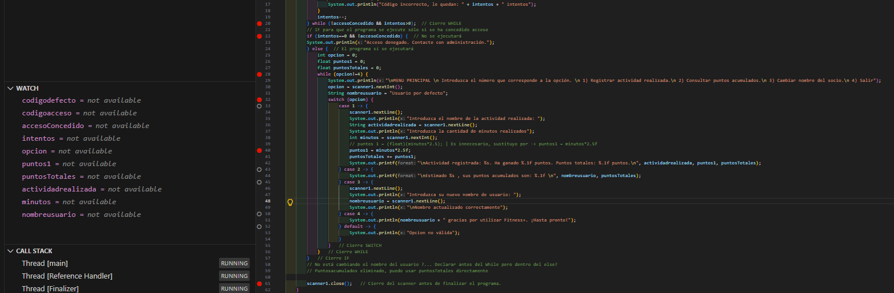
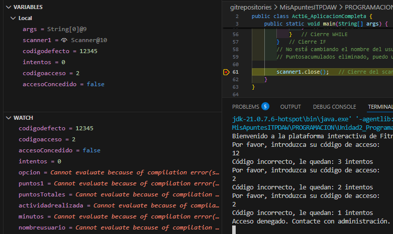
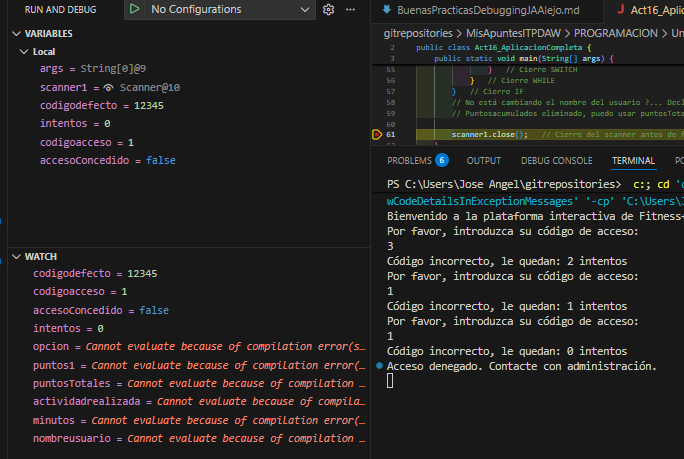
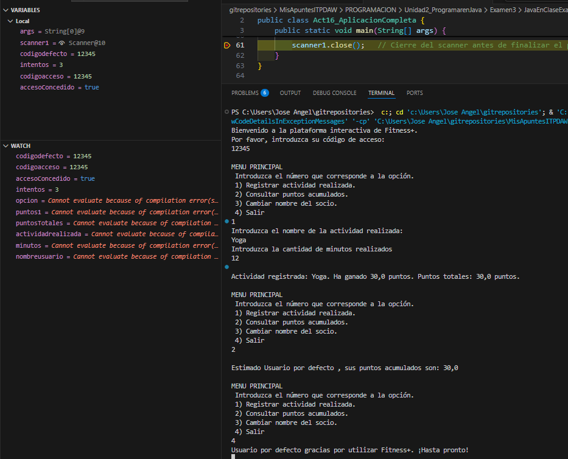
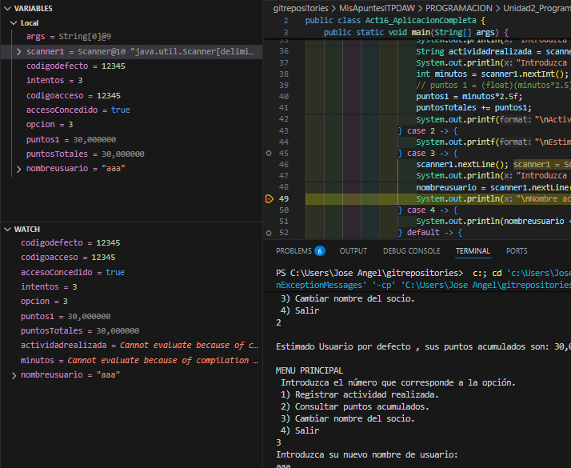
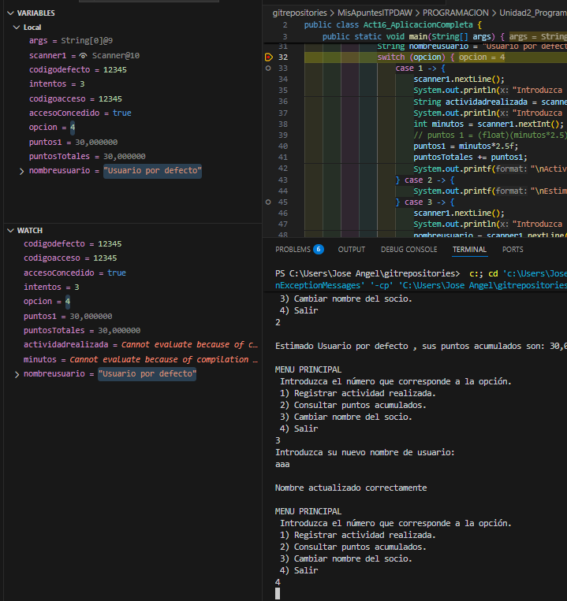
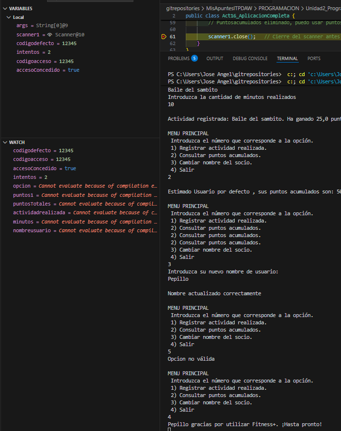

# **Actividad 16 - Aplicación Completa y Debug - Jose Angel Alejo**

- [**Actividad 16 - Aplicación Completa y Debug - Jose Angel Alejo**](#actividad-16---aplicación-completa-y-debug---jose-angel-alejo)
  - [**PREMISA**](#premisa)
  - [**MI CÓDIGO**](#mi-código)
  - [**MI DEBUGGING**](#mi-debugging)

---
<div style="page-break-after: always;"></div>

## **PREMISA**

El gimnasio Fitness+ quiere una aplicación para gestionar el acceso de sus socios y las operaciones básicas de su cuenta interna de actividades. Debes construir un programa completo en Java con su clase principal y toda la lógica necesaria que cumpla los siguientes requisitos:

1. Acceso al sistema
   1. El socio debe introducir su código de acceso, que es un ENTERO CONSTANTE definido en el programa.
   2. Dispone de 3 intentos para acertarlo.
   3. Si falla, debe mostrarse: "Código incorrecto, le quedan X intentos. "Tras agotar los 3 intentos, debe aparecer: "Acceso denegado. Contacte con administración." y el programa finaliza.
   4. Cuando el usuario introduce correctamente el código, el programa continúa.
2. Menu Principal: Una vez dentro, se mostrará un menú que debe repetirse hasta que el usuario seleccione la opción de salir:
      1. Registrar actividad realizada.
      2. Consultar puntos acumulados.
      3. Cambiar nombre del socio.
      4. Salir.
      5. Consideración: Si la opción no es válida, se debe mostrar "Opción no válida" y volver a mostrar el menú.
3. Opciones en el menú:
   1. Registrar actividad realizada:
      1. El usuario debe introducir el nombre de la actividad (por ejemplo: Spinning, Yoga, Natación) y la cantidad de minutos realizados (en ese orden).
      2. Los minutos se convierten en puntos según la regla: 1 minuto = 2'5 puntos.
      3. Los puntos obtenidos se suman al total acumulado.
      4. Después debe mostrarse un mensaje usando la impresión con formato como: "Actividad registrada: Spinning. Ha ganado 120.5 puntos. Puntos totales: 540.0."
   2. Consultar puntos:
      1. Debe mostrar el número total de puntos acumulados con un decimal junto con el nombre del socio. Por ejemplo: "Estimado Luis, sus puntos acumulados son: 540.0"
   3. Cambiar nombre del socio:
      1. El programa pedirá el nuevo nombre y lo almacenará. Luego mostrará: "Nombre actualizado correctamente."
   4. Opicon 4: Salir.
      1. El programa se despide mostrando: "Luis gracias por utilizar Fitness+. ¡Hasta pronto!"

---
<div style="page-break-after: always;"></div>

## **MI CÓDIGO**

```java
import java.util.Scanner;
public class Act16_AplicacionCompleta {
    public static void main(String[] args) {
        Scanner scanner1 = new Scanner(System.in);  // Apertura del scanner (scanner1)
        final int codigodefecto = 12345;    // He agreado "final" para definir que la variable entera codigodefecto es constante
        int intentos = 3;
        System.out.println("Bienvenido a la plataforma interactiva de Fitness+.");
        int codigoacceso;
        boolean accesoConcedido;
        
        // WHILE para controlar acceso
        do {
            System.out.println("Por favor, introduzca su código de acceso: ");
            codigoacceso = scanner1.nextInt();
            accesoConcedido = (codigoacceso == codigodefecto);
            if (!accesoConcedido) {
                System.out.println("Código incorrecto, le quedan: " + intentos + " intentos");
            }
            intentos--;
        } while (!accesoConcedido && intentos>0);  // Cierre WHILE
        // IF para que el programa se ejecute sólo si se ha concedido acceso
        if (intentos==0 && !accesoConcedido) {  // No se ejecutará
        System.out.println("Acceso denegado. Contacte con administración.");
        } else {  // El programa sí se ejecutará
            int opcion = 0;
            float puntos1 = 0;
            float puntosTotales = 0;
            while (opcion!=4) {
                System.out.println("\nMENU PRINCIPAL \n Introduzca el número que corresponde a la opción. \n 1) Registrar actividad realizada.\n 2) Consultar puntos acumulados.\n 3) Cambiar nombre del socio.\n 4) Salir");
                opcion = scanner1.nextInt();
                String nombreusuario = "Usuario por defecto";
                switch (opcion) {
                    case 1 -> {
                        scanner1.nextLine();
                        System.out.println("Introduzca el nombre de la actividad realizada: ");
                        String actividadrealizada = scanner1.nextLine();
                        System.out.println("Introduzca la cantidad de minutos realizados");
                        int minutos = scanner1.nextInt();
                        // puntos 1 = (float)(minutos*2.5); | Es innecesario, sustituyo por -> puntos1 = minutos*2.5f
                        puntos1 = minutos*2.5f;
                        puntosTotales += puntos1;
                        System.out.printf("\nActividad registrada: %s. Ha ganado %.1f puntos. Puntos totales: %.1f puntos.\n", actividadrealizada, puntos1, puntosTotales);
                    } case 2 -> {
                        System.out.printf("\nEstimado %s , sus puntos acumulados son: %.1f \n", nombreusuario, puntosTotales);
                    } case 3 -> {
                        scanner1.nextLine();
                        System.out.println("Introduzca su nuevo nombre de usuario: ");
                        nombreusuario = scanner1.nextLine();
                        System.out.println("\nNombre actualizado correctamente");
                    } case 4 -> {
                        System.out.println(nombreusuario + " gracias por utilizar Fitness+. ¡Hasta pronto!");
                    } default -> {
                        System.out.println("Opcion no válida");
                    }   
                }   // Cierre SWITCH
            }   // Cierre WHILE
        }   // Cierre IF
        // No está cambiando el nombre del usuario ?... Declarar antes del While pero dentro del else?
        // Puntosacumulados eliminado, puedo usar puntosTotales directamente

        scanner1.close();   // Cierre del scanner antes de finalizar el programa.
    }
}
```

Al **ejecutar el programa por completo, me he dado cuenta de que el nombre de usuario no se mantiene entre algunas iteraciones**, voy a hacer debugging para ver qué ocurre y revisar que todo funciona correctamente.

---
<div style="page-break-after: always;"></div>

## **MI DEBUGGING**

- **Puntos de ruptura que propongo**:
  - **Línea 20**: `} while (!accesoConcedido && intentos>0);` para *comprobar el funcionamiento del bucle de acceso*.
  - **Línea 22**: `if (intentos==0 && !accesoConcedido) {` para *comprobar si el acceso se concede o no*.
  - **Línea 28**: `while (opcion!=4) {` para *comprobar el estado inicial del menú y las variables declaradas* dentro del `else`.
  - **Línea 31**: `switch (opcion) {` para comprobar *qué opción se selecciona*.
  - **Línea 33**: `case 1 -> {` para comprobar la opción de registrar actividad.
  - **Línea 40** `puntos1 = minutos*2.5f;` para comprobar el cálculo de puntos, los minutos introducidos y los puntos obtenidos.
  - **Línea 45**: `case 3 -> {` para *comprobar la opción de cambiar nombre*.
  - **Línea 50**: `case 4 -> {` para *comprobar la opción de salir*.
  - **Línea 52**: `default -> {` para *comprobar la opción no válida*.
  - **Línea 61**: `scanner1.close();` para *comprobar el estado final de las variables* antes de cerrar el scanner (y salir del programa).
- **Watchs que propongo**:
  - codigoacceso
  - codigodefecto
  - accesoConcedido
  - intentos
  - opcion
  - puntos1
  - puntosTotales
  - nombreusuario
  - actividadrealizada
  - minutos



---
<div style="page-break-after: always;"></div>

**Durante el debug.**

- Si **fallamos 3 veces en el código de acceso**:


- Los **intentos no disminuyen correctamente**, así que cambio el contador `intentos--` a la línea 19 del `System.out.println("Código incorrecto, le quedan: " + intentos + " intentos");`
- Después de hacer el cambio, volvemos a ejecutar el debug y ahora **los intentos disminuyen correctamente**:


- **Probamos a introducir el código correcto**, acceder al menú principal, usar la opción 1 para registrar una actividad, la 2 para consultar los puntos acumulados y la 4 para salir.


- Todo parece funcionar bien, así que ahora podemos desactivar los breakpoints de las líneas 20, 22, 40, 43 y 50.

---
<div style="page-break-after: always;"></div>

- **Ahora, vamos a probar una opción no válida** como la 5, para ver si el default se muestra bien, después probar la opción 1, 2 y por último la 3 para cambiar el nombre del socio y ver si la opcion 3 funciona bien, agregando un breakpoint en la línea 49.


- **No parece haber ningún problema** antes de salir del case...


---
<div style="page-break-after: always;"></div>

- **Pero al salir del switch**, el nombre del usuario vuelve a "Usuario por defecto", así que hay un problema con la declaración de `nombreusuario`.
- **Si nos fijamos**, `nombreusuario` está declarada dentro del while, por eso se resetea en cada iteración.
- **Vamos a mover** la declaración de `String nombreusuario = "Usuario por defecto";` a la línea 28, justo antes del while (pero dentro del else) para ver si eso lo soluciona.
- **Ejecutamos esta vez** todo el debug, con breakpoint únicamente en el `scanner1.close();`

Los **pasos seguidos en esta última ejecución** han sido:

1. Introducir **código incorrecto 1 vez** y luego correcto.
2. Introducir **opción 1**, registrar actividad "Yoga" 10 minutos y nuevamente **opción 1**, registrar *"Baile del sambito" 10 minutos*. Los *puntos se acumulan correctamente*.
3. Introducir **opción 2** para consultar puntos acumulados, *se muestran correctamente (50 puntos)*.
4. Introducir **opción 3** para cambiar *nombre a "Pepillo"*.
5. Introducir **opción 5** para ver *opción no válida*.
6. Introducir **opción 4** para salir, y *el programa se despide correctamente con el nombre "Pepillo"* (pausa en el breakpooint `scanner1.close();` línea 61).



---
<div style="page-break-after: always;"></div>

El **código resultante tras el debugging** es:

```java
import java.util.Scanner;
public class Act16_AplicacionCompleta {
    public static void main(String[] args) {
        Scanner scanner1 = new Scanner(System.in);  // Apertura del scanner (scanner1)
        final int codigodefecto = 12345;    // He agreado "final" para definir que la variable entera codigodefecto es constante
        int intentos = 3;
        System.out.println("Bienvenido a la plataforma interactiva de Fitness+.");
        int codigoacceso;
        boolean accesoConcedido;
        
        // WHILE para controlar acceso
        do {
            System.out.println("Por favor, introduzca su código de acceso: ");
            codigoacceso = scanner1.nextInt();
            accesoConcedido = (codigoacceso == codigodefecto);
            if (!accesoConcedido) {
                intentos--;
                System.out.println("Código incorrecto, le quedan: " + intentos + " intentos");
            }
        } while (!accesoConcedido && intentos>0);  // Cierre WHILE
        // IF para que el programa se ejecute sólo si se ha concedido acceso
        if (intentos==0 && !accesoConcedido) {  // No se ejecutará
        System.out.println("Acceso denegado. Contacte con administración.");
        } else {  // El programa sí se ejecutará
            int opcion = 0;
            float puntos1 = 0;
            float puntosTotales = 0;
            String nombreusuario = "Usuario por defecto";
            while (opcion!=4) {
                System.out.println("\nMENU PRINCIPAL \n Introduzca el número que corresponde a la opción. \n 1) Registrar actividad realizada.\n 2) Consultar puntos acumulados.\n 3) Cambiar nombre del socio.\n 4) Salir");
                opcion = scanner1.nextInt();
                switch (opcion) {
                    case 1 -> {
                        scanner1.nextLine();
                        System.out.println("Introduzca el nombre de la actividad realizada: ");
                        String actividadrealizada = scanner1.nextLine();
                        System.out.println("Introduzca la cantidad de minutos realizados");
                        int minutos = scanner1.nextInt();
                        // puntos 1 = (float)(minutos*2.5); | Es innecesario, sustituyo por -> puntos1 = minutos*2.5f
                        puntos1 = minutos*2.5f;
                        puntosTotales += puntos1;
                        System.out.printf("\nActividad registrada: %s. Ha ganado %.1f puntos. Puntos totales: %.1f puntos.\n", actividadrealizada, puntos1, puntosTotales);
                    } case 2 -> {
                        System.out.printf("\nEstimado %s , sus puntos acumulados son: %.1f \n", nombreusuario, puntosTotales);
                    } case 3 -> {
                        scanner1.nextLine();
                        System.out.println("Introduzca su nuevo nombre de usuario: ");
                        nombreusuario = scanner1.nextLine();
                        System.out.println("\nNombre actualizado correctamente");
                    } case 4 -> {
                        System.out.println(nombreusuario + " gracias por utilizar Fitness+. ¡Hasta pronto!");
                    } default -> {
                        System.out.println("Opcion no válida");
                    }   
                }   // Cierre SWITCH
            }   // Cierre WHILE
        }   // Cierre IF
        scanner1.close();   // Cierre del scanner antes de finalizar el programa.
    }
}
```

El debug ha terminado, el programa funciona correctamente, y debería estar listo para su entrega. Es posible que se puedan realizar pequeñas microoptimizaciones, pero de momento no debería ser necesario, ni es requerido en la actividad...
