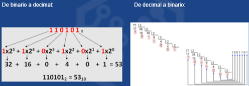
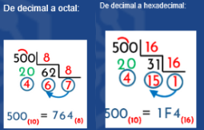
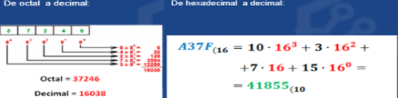
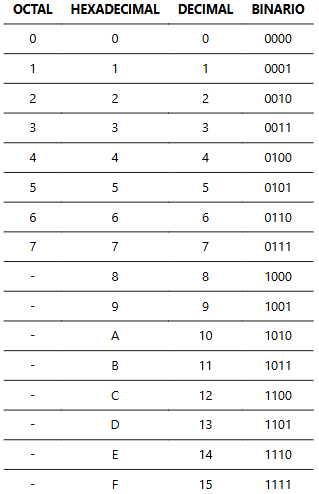
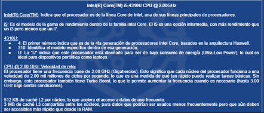

# **ESENCIAL EXAMEN U1 - Introducción Sistemas Informáticos** - JOSÉ ÁNGEL ALEJO SILLERO

- [**ESENCIAL EXAMEN U1 - Introducción Sistemas Informáticos** - JOSÉ ÁNGEL ALEJO SILLERO](#esencial-examen-u1---introducción-sistemas-informáticos---josé-ángel-alejo-sillero)
  - [**1. INTRODUCCIÓN A CONCEPTOS BÁSICOS INFORMÁTICOS**](#1-introducción-a-conceptos-básicos-informáticos)
  - [**2. SISTEMAS DE NUMERACIÓN**](#2-sistemas-de-numeración)
    - [**Equivalencia Bytes-Bits**](#equivalencia-bytes-bits)
    - [**TABLA DIFERENCIAS OCTAL-HEXADECIMAL-DECIMAL-BINARIO**](#tabla-diferencias-octal-hexadecimal-decimal-binario)
    - [**CONVERSIONES ENTRE SISTEMAS DE NUMERACIÓN**](#conversiones-entre-sistemas-de-numeración)
      - [**Tabla de Equivalencias DIGITOS - OCTAL-HEXADECIMAL-DECIMAL-BINARIO**](#tabla-de-equivalencias-digitos---octal-hexadecimal-decimal-binario)
    - [**Ejemplos de Conversiones entre Sistemas de Numeración**](#ejemplos-de-conversiones-entre-sistemas-de-numeración)
  - [**3. ELEMENTOS DE UN ORDENADOR DIGITAL**](#3-elementos-de-un-ordenador-digital)
    - [**ARQUITECTURA DE VON NEUMANN**](#arquitectura-de-von-neumann)
      - [**Componentes de un ordenador en la Arquitectura de Von Neumann:**](#componentes-de-un-ordenador-en-la-arquitectura-de-von-neumann)
  - [**4. TIPOS DE SOFTWARE**](#4-tipos-de-software)
  - [**5. PROCESO DE ARRANQUE DE UN ORDENADOR**](#5-proceso-de-arranque-de-un-ordenador)
  - [**6. COMPONENTES CRÍTICOS DE UN ORDENADOR**](#6-componentes-críticos-de-un-ordenador)
    - [**6.1 PLACA BASE**](#61-placa-base)
    - [**6.2 BUSES**](#62-buses)
    - [**6.3 CPU Y MICROPROCESADORES**](#63-cpu-y-microprocesadores)
      - [**NOMENCLATURA ESTÁNDAR**](#nomenclatura-estándar)
      - [**Conceptos clave de la CPU**](#conceptos-clave-de-la-cpu)
    - [**6.4 MEMORIAS PRINCIPALES, SECUNDARIAS Y ROM**](#64-memorias-principales-secundarias-y-rom)
    - [**6.5 TARJETA GRÁFICA - GPU**](#65-tarjeta-gráfica---gpu)
    - [**6.6 PERIFÉRICOS DE ENTRADA/SALIDA Y HÍBRIDOS**](#66-periféricos-de-entradasalida-y-híbridos)

## **1. INTRODUCCIÓN A CONCEPTOS BÁSICOS INFORMÁTICOS**

>- **Informática**: Nace de la combinación de "información" y "automática". Conjunto de conocimientos científicos y técnicas que hacen posible el tratamiento automático de la información mediante dispositivos electrónicos.
>- **Ordenador**: Máquina que permite almacenar, transmitir y gestionar información a través de dispositivos electrónicos de entrada y salida.
>- **Sistema Informático**: Conjunto de elementos que se relacionan entre sí para procesar y almacenar información. Incluye:
>   - **Hardware**: Parte física del sistema informático (componentes electrónicos, eléctricos, mecánicos).
>   - **Software**: Conjunto de programas y aplicaciones que permiten el funcionamiento del hardware.

Algunas de las aplicaciones/software más significativas son:

>- **Comunicación:** Email, redes sociales y mensajería instantánea.
>- **Educación:** Herramientas de aprendizaje en línea, bibliotecas digitales y plataformas educativas.
>- **Economía:** Banca en línea, comercio electrónico y gestión financiera.
>- **Salud:** Gestión hospitalaria, telemedicina y análisis de datos médicos.
>- **Entretenimiento:** Videojuegos, streaming de video y música.

## **2. SISTEMAS DE NUMERACIÓN**

Los **Sistemas de Numeración** representan valores numéricos. Son el conjunto de reglas, convenios y símbolos que permiten expresar un número. Según el **teorema fundamental de la numeración**, cualquier número puede ser representado en diferentes bases, lo que permite la conversión de números representados en binario, octal o decimal.

### **Equivalencia Bytes-Bits**

- **Bit**: Unidad mínima de información en un sistema binario, puede tener dos valores (0 o 1).
- **Byte**: Conjunto de 8 bits. Representa un carácter (letra, número o símbolo) en la mayoría de los sistemas informáticos.

**Un byte en Binario son 8 bits, en Decimal serán 8 bits, en Octal son 10 bits y en Hexadecimal son 2 bits.**
Ejemplo: 01000001 en Binario es 65 en Decimal, 101 en Octal y 41 en Hexadecimal.

### **TABLA DIFERENCIAS OCTAL-HEXADECIMAL-DECIMAL-BINARIO**

| **SISTEMA DE NUMERACIÓN**      | **SÍMBOLOS UTILIZADOS** | **REPRESENTA CADA POSICIÓN** | **BITS POR DÍGITO** | **BYTES POR DÍGITO** | **CUÁNDO USAR**                                                      |
|:-------------------------------|:------------------------|:-----------------------------|:--------------------|:---------------------|:---------------------------------------------------------------------|
| **DECIMAL 10, (0→9)**          | Potencia 10          | N/A (no binario)             | N/A                 | N/A                  | Para cálculos humanos, contabilidad.                                 |
| **BINARIO (0, 1)**             | Potencia 2           | 1 bit                        | 1 bit               | 8 dígitos = 1 byte   | Para hardware, procesamiento interno, lógica digital.                |
| **OCTAL 8, (0→7)**             | Potencia 8           | 3 bits                       | 3 bits              | 8 dígitos ≈ 3 bytes  | Para agrupar bits en grupos de 3, menos común hoy.                   |
| **HEXADECIMAL 16, (0→9, A→F)** | Potencia 16          | 4 bits                       | 4 bits              | 2 dígitos = 1 byte   | Para direcciones de memoria, largas secuencias binarias, depuración. |

### **CONVERSIONES ENTRE SISTEMAS DE NUMERACIÓN**

- **De `Binario` a `Decimal`**: Se multiplica cada bit por 2 elevado a la posición del bit (de derecha a izquierda, comenzando en 0) y se suman los resultados.
- **De `Decimal` a `Binario`**: Se divide el número decimal entre 2, anotando el residuo. Se repite el proceso con el cociente hasta que sea 0. Los residuos leídos en orden inverso forman el número binario.
- **De `Decimal` a `Octal/Hexadecimal`**: Similar al proceso de conversión a binario, pero dividiendo entre 8 para octal y 16 para hexadecimal.
- **De `Octal`/`Hexadecimal` a `Decimal`**: Se multiplica cada dígito por 8 (octal) o 16 (hexadecimal) elevado a la posición del dígito y se suman los resultados.
- **Entre `Binario`, `Octal` y `Hexadecimal`**: Se agrupan los bits en conjuntos de 3 (para octal) o 4 (para hexadecimal) y se convierten directamente a su equivalente en la base deseada.

#### **Tabla de Equivalencias DIGITOS - OCTAL-HEXADECIMAL-DECIMAL-BINARIO**

### **Ejemplos de Conversiones entre Sistemas de Numeración**

| Conversión            | Ejemplo   | Proceso Simplificado                                 | Resultado |
|-----------------------|-----------|------------------------------------------------------|-----------|
| Binario a Decimal     | 1011₂     | Suma ponderada: (1×8) + (0×4) + (1×2) + (1×1)        | 11₁₀      |
| Octal a Decimal       | 52₈       | Suma ponderada: (5×8) + (2×1)                        | 42₁₀      |
| Hexadecimal a Decimal | FF₁₆      | Suma ponderada: (15×16) + (15×1)                     | 255₁₀     |
| Decimal a Binario     | 13₁₀      | Dividir por 2: residuos 1,0,1,1 (orden inverso)      | 1101₂     |
| Decimal a Octal       | 42₁₀      | Dividir por 8: residuos 2,5 (orden inverso)          | 52₈       |
| Decimal a Hexadecimal | 255₁₀     | Dividir por 16: residuos 15(F),15(F) (orden inverso) | FF₁₆      |
| Binario a Octal       | 101101₂   | Agrupar en 3 bits: 101=5, 101=5                      | 55₈       |
| Binario a Hexadecimal | 11111111₂ | Agrupar en 4 bits: 1111=F, 1111=F                    | FF₁₆      |
| Octal a Binario       | 52₈       | Convertir cada dígito: 5=101, 2=010                  | 101010₂   |
| Hexadecimal a Binario | FF₁₆      | Convertir cada dígito: F=1111, F=1111                | 11111111₂ |

## **3. ELEMENTOS DE UN ORDENADOR DIGITAL**

| **ELEMENTO**              | **FORMADO POR**                      | **DESCRIPCIÓN**                                                                                                                      |
|---------------------------|--------------------------------------|--------------------------------------------------------------------------------------------------------------------------------------|
| **ELEMENTOS ELÉCTRICOS**  | **Componentes electrónicos básicos** | Multitud de resistencias, transistores, condensadores, etc., que forman los circuitos electrónicos.                                  |
| **PUERTAS LÓGICAS**       | **Elementos eléctricos**             | Pequeños circuitos que pueden estar abiertos (sin voltaje) o cerrados (con corriente).                                               |
| **CIRCUITOS INTEGRADOS**  | **Puertas lógicas**                  | Conjunto de puertas lógicas que reciben datos de entrada y producen una salida específica mediante combinaciones de puertas lógicas. |
| **SISTEMA DE NUMERACIÓN** | **Circuitos integrados**             | Formados por circuitos integrados, los datos son valores numéricos en un sistema de numeración, como el binario en ordenadores.      |

### **ARQUITECTURA DE VON NEUMANN**

Modelo de diseño para un sistema informático que describe una estructura básica y que define el comportamiento de un ordenador digital.

Se basa en la idea de que un ordenador puede ser descrito en términos de sus componentes principales y sus interacciones. Imagina que el ordenador es una cocina en la que tienes un cocinero (la CPU), una lista de recetas (instrucciones en la memoria), ingredientes (datos en la memoria), y un camino entre la despensa y el cocinero (el bus de datos). Así es como se ve el proceso:

1. La **CPU - Cocinero** obtiene una instrucción de la memoria. (como buscar una receta).
2. La **UC (Unidad de Control)** interpreta la instrucción y decide qué hacer (como leer la receta para ver qué paso seguir).
3. Si necesita los datos, los **recoge de la memoria** (como tomar los ingredientes de la despensa).
4. La **ALU (Unidad Aritmético-Lógica)** realiza las operaciones necesarias (como mezclar ingredientes o cocinar).
5. **Guardar el resultado de vuelta en la memoria** (como poner el plato terminado en la mesa).
6. Los **BUS - Camino** (series de conexiones eléctricas que conectan la CPU, la memoria y los dispositivos de entrada/salida) conectan todos estos componentes, permitiendo que la información fluya entre ellos (como el camino entre la despensa y el cocinero).

#### **Componentes de un ordenador en la Arquitectura de Von Neumann:**

| **ELEMENTO**                        | **FORMADO POR**                                         | **DESCRIPCIÓN**                                                                            |
|-------------------------------------|---------------------------------------------------------|--------------------------------------------------------------------------------------------|
| **UNIDAD DE ENTRADA**               | Dispositivos de entrada (teclado, ratón, escáner)       | Permite al usuario introducir datos e instrucciones en el sistema.                         |
| **UNIDAD DE SALIDA**                | Dispositivos de salida (monitor, impresora, altavoces)  | Muestra o transmite los resultados del procesamiento al usuario.                           |
| **UNIDAD CENTRAL DE PROCESO (CPU)** | Unidad Aritmético-Lógica (ALU) y Unidad de Control (UC) | Es el cerebro del ordenador, encargado de ejecutar las instrucciones y procesar los datos. |
| **UNIDAD ARITMÉTICO-LÓGICA (ALU)**  | Parte de la CPU                                         | Realiza operaciones matemáticas y lógicas.                                                 |
| **UNIDAD DE CONTROL (UC)**          | Parte de la CPU                                         | Dirige el flujo de datos e instrucciones dentro del sistema.                               |

## **4. TIPOS DE SOFTWARE**

| **TIPO DE SOFTWARE**         | **CARACTERÍSTICAS PRINCIPALES**                                                                                                            | **ASPECTOS DISTINTIVOS**                                                                                      |
|:-----------------------------|:-------------------------------------------------------------------------------------------------------------------------------------------|:--------------------------------------------------------------------------------------------------------------|
| **SOFTWARE DE SISTEMA**      | Gestiona recursos del hardware y proporciona plataforma para ejecutar aplicaciones; incluye sistemas operativos, firmware y controladores. | Esencial para el funcionamiento básico del hardware; no interactúa directamente con el usuario final.         |
| **SOFTWARE DE APLICACIÓN**   | Programas diseñados para realizar tareas específicas para el usuario; se ejecuta sobre el software de sistema.                             | Interactúa directamente con el usuario para tareas concretas; depende del software de sistema para funcionar. |
| **SOFTWARE DE PROGRAMACIÓN** | Herramientas y entornos que facilitan el desarrollo de software; incluye compiladores, IDEs y depuradores.                                 | Utilizado por programadores para crear otros programas; no es para uso general del usuario final.             |

## **5. PROCESO DE ARRANQUE DE UN ORDENADOR**

| **PASO**                              | **DESCRIPCIÓN**                                                                           | **COMPONENTE PRINCIPAL**                     |
|:--------------------------------------|:------------------------------------------------------------------------------------------|:---------------------------------------------|
| **ENCENDIDO**                         | Al encender el equipo, el procesador busca el programa de arranque en memoria no volátil. | Procesador.                                  |
| **FIRMWARE (BIOS/UEFI)**              | Realiza pruebas iniciales (POST) para verificar componentes esenciales del hardware.      | Firmware (BIOS/UEFI) en ROM.                 |
| **CARGADOR DE ARRANQUE (BOOTLOADER)** | Busca y carga el sistema operativo en la memoria RAM.                                     | Bootloader en dispositivo de almacenamiento. |
| **INICIO DEL SISTEMA OPERATIVO**      | Carga el kernel y inicializa componentes y servicios del SO.                              | Sistema Operativo.                           |
| **LISTO PARA EL USUARIO**             | Presenta interfaz de usuario y está listo para comandos.                                  | Sistema Operativo.                           |

## **6. COMPONENTES CRÍTICOS DE UN ORDENADOR**

| **COMPONENTE CRÍTICO**                 | **FUNCIÓN PRINCIPAL**                                                                       | **PARTES DESTACADAS**                                                                                                    |
|:---------------------------------------|:--------------------------------------------------------------------------------------------|:-------------------------------------------------------------------------------------------------------------------------|
| **Placa base (Motherboard)**           | Conecta todos los componentes del ordenador, permitiendo la comunicación entre ellos.       | Zócalo del procesador (alojar CPU); Ranuras de memoria (RAM); Chipset (gestionar comunicaciones).                        |
| **Buses**                              | Series de conexiones eléctricas que conectan CPU, memoria y dispositivos de entrada/salida. | Bus de Sistema (conectar CPU y memoria); Bus de Datos (transportar datos); Bus de Direcciones (transportar direcciones). |
| **Procesador (CPU)**                   | Ejecuta instrucciones y procesa datos; su velocidad afecta el rendimiento.                  | Microprocesador (chip con ALU y UC para cálculos e instrucciones).                                                       |
| **Memorias principales y secundarias** | Almacenan datos e instrucciones; RAM para acceso rápido, secundarias para largo plazo.      | RAM (acceso rápido por CPU); HDD/SSD (almacenamiento persistente); ROM (firmware permanente).                            |
| **Tarjeta gráfica (GPU)**              | Procesa gráficos y visualización; importante para juegos y edición.                         | GPU integrada (básica en CPU); GPU dedicada (alto rendimiento); GPU profesional (precisión para workstations).           |

### **6.1 PLACA BASE**

| **COMPONENTE / PARTE**                   | **FUNCIÓN PRINCIPAL**                                                                                          |
|:-----------------------------------------|:---------------------------------------------------------------------------------------------------------------|
| **PLACA BASE (Motherboard)**             | **Conectar y coordinar CPU, memoria, almacenamiento y periféricos; distribuir alimentación y comunicaciones.** |
| Zócalo del procesador (CPU socket)       | Aloja e interconecta el procesador.                                                                            |
| Ranuras de memoria RAM                   | Alojamiento de los módulos de memoria principal (RAM).                                                         |
| Chipset                                  | Gestiona las comunicaciones entre CPU, memoria y periféricos.                                                  |
| Conectores de alimentación               | Reciben y distribuyen la energía eléctrica a los componentes.                                                  |
| Puertos de expansión (PCIe)              | Permiten añadir tarjetas de expansión (GPU, red, sonido).                                                      |
| Conectores de almacenamiento (SATA, M.2) | Conectan discos HDD/SSD y unidades NVMe para almacenamiento.                                                   |

### **6.2 BUSES**

| **TIPO DE BUS**                             | **FUNCIÓN PRINCIPAL**                                                                              |
|:--------------------------------------------|:---------------------------------------------------------------------------------------------------|
| Bus de Sistema                              | Conecta CPU con memoria y componentes, transfiriendo datos e instrucciones.                        |
| Bus de Datos                                | Transporta datos entre CPU, memoria y periféricos; su ancho influye en el rendimiento.             |
| Bus de Direcciones                          | Transporta direcciones de memoria para lectura/escritura; su tamaño limita la memoria máxima.      |
| Bus de Control                              | Transporta señales de control para coordinar operaciones, como lectura/escritura e interrupciones. |
| Bus PCI (Peripheral Component Interconnect) | Un estándar común para conectar tarjetas de expansión a la placa base.                             |
| Bus PCI Express (PCIe)                      | Versión rápida y moderna del PCI, usada para GPUs y dispositivos de alto rendimiento.              |
| Bus USB (Universal Serial Bus)              | Estándar para conectar periféricos externos como teclados, ratones y almacenamiento.               |
| Bus de Expansión                            | Conecta tarjetas y periféricos adicionales, ampliando capacidades del sistema.                     |

### **6.3 CPU Y MICROPROCESADORES**

| **CONCEPTO**        | **COMPUESTO POR**                                                   | **DESCRIPCIÓN**                                                  | **FUNCIÓN PRINCIPAL**                                    |
|:--------------------|:--------------------------------------------------------------------|:-----------------------------------------------------------------|:---------------------------------------------------------|
| **CPU**             | ALU (operaciones matemáticas/lógicas) y UC (dirige flujo de datos). | Unidad Central de Proceso (CPU).                                 | Ejecuta instrucciones y procesa datos.                   |
| **Microprocesador** | ALU y UC. Múltiples núcleos.                                        | Integra ALU y UC. Múltiples núcleos permiten tareas simultáneas. | Ejecuta instrucciones y cálculos, mejorando rendimiento. |

**Tipos de Microprocesadores** → Procesadores x86 (Intel, AMD), ARM (para dispositivos móviles y embebidos).
**Tipos de Memoria en CPU** → **Registros:** almacenamiento temporal para datos en proceso. / **Memoria Caché:** alta velocidad para datos frecuentes.

---

#### **NOMENCLATURA ESTÁNDAR**

#### **Conceptos clave de la CPU**

- **Velocidad de Reloj (GHz)**: Frecuencia a la que opera la CPU; mayor velocidad generalmente significa mejor rendimiento.
- **Núcleo**: Número de núcleos físicos en la CPU; más núcleos permiten ejecutar múltiples tareas simultáneamente.
- **Caché**: Memoria rápida integrada en la CPU para almacenar datos e instrucciones frecuentemente usados; mayor caché mejora el rendimiento. Tiene niveles:
  - **Caché L1**: Más rápida y pequeña. Almacena datos e instrucciones de acceso inmediato. Cada núcleo tiene su propia caché L1.
  - **Caché L2**: Más grande y un poco más lenta que L1. Almacena datos e instrucciones de acceso frecuente que no cabe en L1. Cada núcleo tiene su propia cache L2.
  - **Caché L3**: Más grande y lenta. Almacena datos menos usados, pero de acceso más rápido que la RAM. Compartida entre todos los núcleos.
- **Hilos (Threads)**: Cada núcleo puede manejar múltiples hilos, mejorando la multitarea y el rendimiento en aplicaciones optimizadas.
- **Arquitectura**: Diseño interno de la CPU, incluyendo conjuntos de instrucciones y eficiencia energética; arquitecturas más avanzadas suelen ofrecer mejor rendimiento.
- **Tecnología Hyper-Threading**: Permite que un solo núcleo maneje múltiples hilos, mejorando la eficiencia en tareas concurrentes.

### **6.4 MEMORIAS PRINCIPALES, SECUNDARIAS Y ROM**

| **TIPO DE MEMORIA**                | **FUNCIÓN PRINCIPAL**                                          | **PROCESOS**                                                                 | **COMPONENTE QUE INTERVIENE**       |
|------------------------------------|----------------------------------------------------------------|------------------------------------------------------------------------------|-------------------------------------|
| **Memorias Principales (RAM)**     | Almacenar datos e instrucciones para acceso rápido por la CPU. | Procesamiento de datos en ejecución, multitarea.                             | CPU.                                |
| **Memorias Secundarias (HDD/SSD)** | Almacenamiento a largo plazo de datos y programas.             | Archivos, instalación de software, backup.                                   | Disco duro o SSD.                   |
| **ROM**                            | Almacenar firmware permanente y datos no modificables.         | Arranque del sistema, configuración básica.                                  | Placa base.                         |
| **BIOS/UEFI**                      | Inicializar hardware y gestionar el proceso de arranque.       | POST (Power-On Self-Test), carga del sistema operativo.                      | ROM en la placa base.               |
| **Memoria Virtual**                | TÉCNICA para Simular RAM adicional usando espacio en disco.    | Manejo de memoria cuando la RAM física está llena (paginación/segmentación). | Disco duro (archivo de paginación). |

### **6.5 TARJETA GRÁFICA - GPU**

| **TIPO DE TARJETA GRÁFICA** | **FUNCIÓN PRINCIPAL**                                                                            | **EJEMPLO**              |
|:----------------------------|:-------------------------------------------------------------------------------------------------|:-------------------------|
| **INTEGRADAS**              | Acelerar gráficos básicos; integradas en CPU o chipset para tareas simples.                      | Intel HD Graphics.       |
| **DEDICADAS**               | Alto rendimiento para juegos, edición de video y aplicaciones gráficas intensivas.               | NVIDIA GeForce RTX 3080. |
| **PROFESIONALES**           | Diseñadas para estaciones de trabajo; mayor precisión y soporte para aplicaciones profesionales. | NVIDIA Quadro.           |

### **6.6 PERIFÉRICOS DE ENTRADA/SALIDA Y HÍBRIDOS**

| **TIPO DE PERIFÉRICO** | **FUNCIÓN PRINCIPAL**                                  | **EJEMPLO**                |
|:-----------------------|:-------------------------------------------------------|:---------------------------|
| **ENTRADA**            | Introducir datos e instrucciones en el sistema.        | Teclado.                   |
| **SALIDA**             | Mostrar o transmitir los resultados del procesamiento. | Monitor.                   |
| **HÍBRIDOS**           | Combinar funciones de entrada y salida.                | Pantalla táctil. Gafas VR. |
