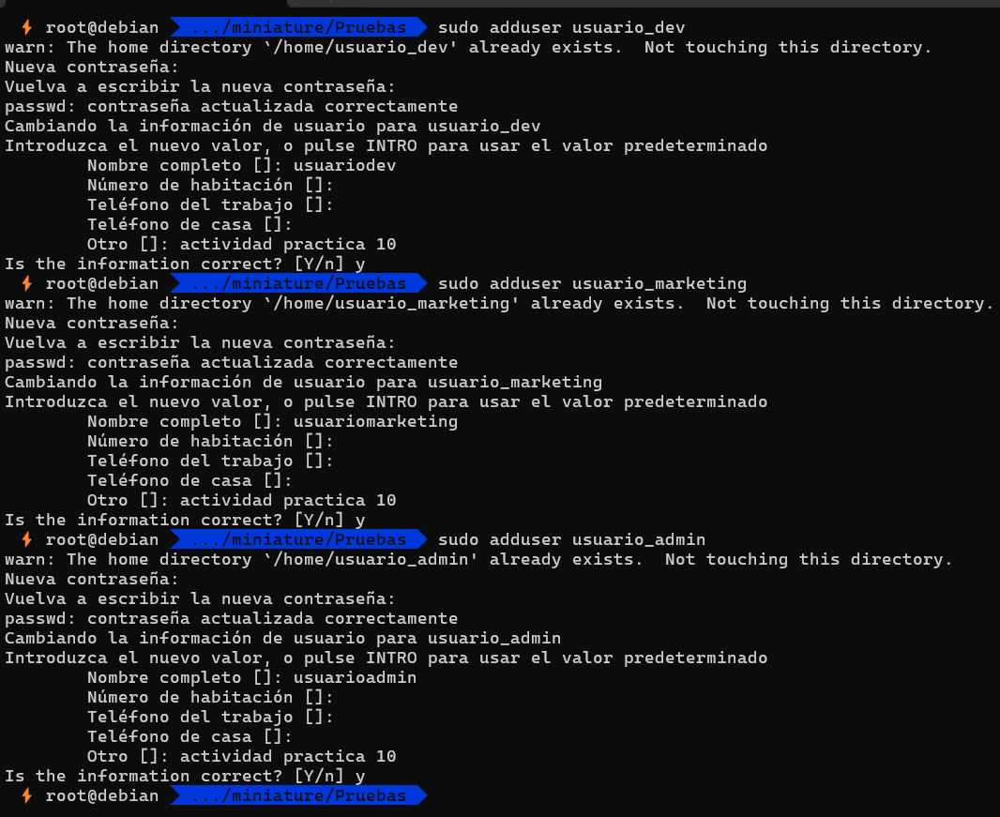
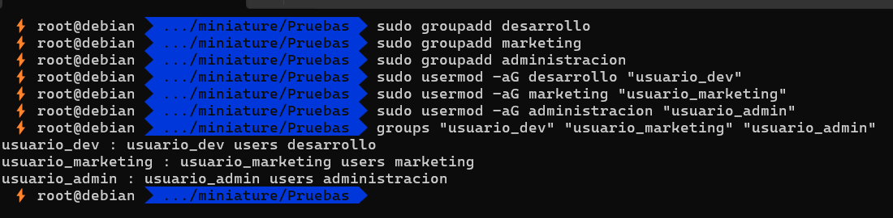
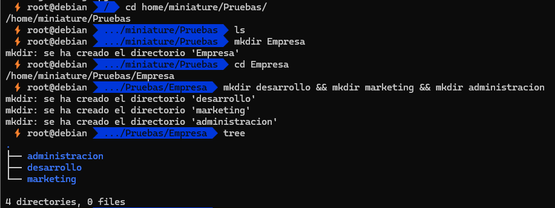
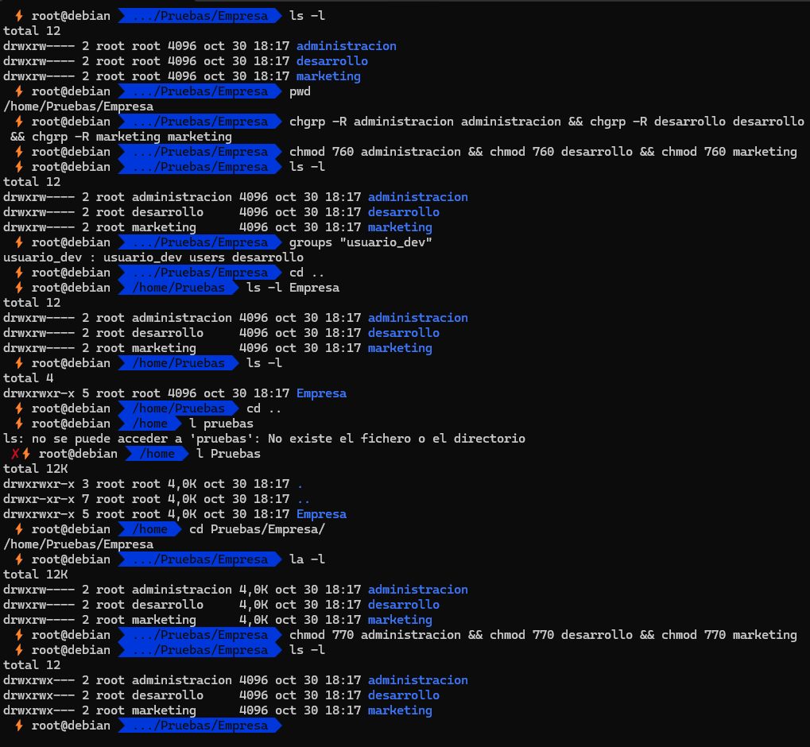
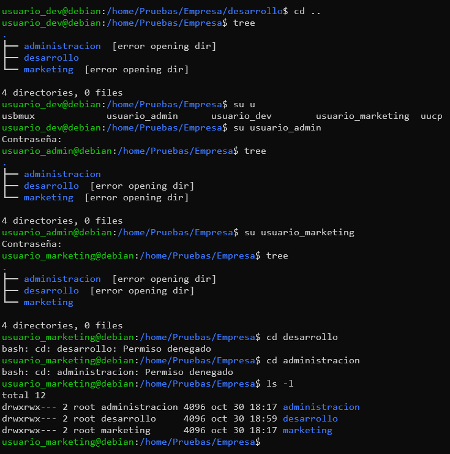
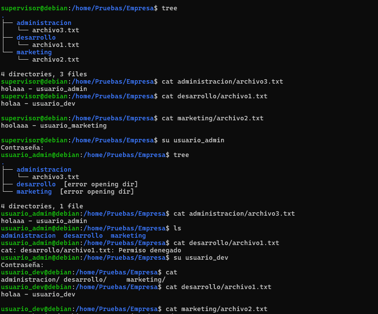
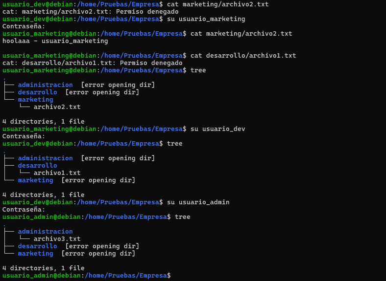
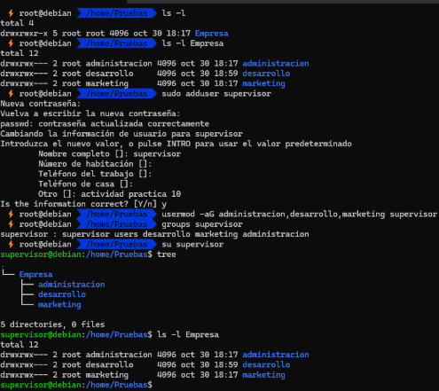
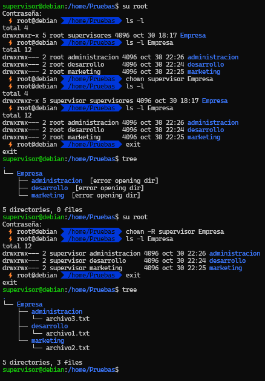

# **Actividad 10 José Ángel Alejo Sillero - ITPFP 1º DAW - Sistemas Informáticos**

- [**Actividad 10 José Ángel Alejo Sillero - ITPFP 1º DAW - Sistemas Informáticos**](#actividad-10-josé-ángel-alejo-sillero---itpfp-1º-daw---sistemas-informáticos)
  - [**Creación de Usuarios y Grupos**](#creación-de-usuarios-y-grupos)
  - [**Estructura de Directorios**](#estructura-de-directorios)
  - [**Asignación de Permisos**](#asignación-de-permisos)
  - [**Creación de Archivos y Prueba de Permisos**](#creación-de-archivos-y-prueba-de-permisos)
  - [**Gestión de Permisos Avanzados**](#gestión-de-permisos-avanzados)
  - [**Creación de un Usuario Administrador**](#creación-de-un-usuario-administrador)

---

## **Creación de Usuarios y Grupos**

- Crea tres usuarios que representen roles de cada departamento. Asigna nombres significativos para cada uno, por ejemplo: usuario_dev, usuario_marketing y usuario_admin.   
- Crea grupos correspondientes a cada departamento: Desarrollo, Marketing y Administración.
- Asignar cada usuario a su grupo respectivo.   

---

## **Estructura de Directorios**

- Dentro del directorio  principal, el usuario root que cree el directorio /empresa, crea subdirectorios para cada departamento:
  - /empresa/desarrollo
  - /empresa/marketing
  - /empresa/administracion
  - 
- Cada uno de estos directorios debe estar configurado para que solo los usuarios del departamento correspondiente puedan acceder y modificar su contenido.
- 
- **ANOTACIÓN José Ángel**: Es importante que al dar permisos a un grupo, le otorguemos permisos de ejecución, ya que si no, los usuarios del grupo no podrán acceder al directorio. Esto ocurre porque en Linux, los directorios se consideran ficheros especiales, y para acceder a ellos también se necesita el permiso de ejecución.

---

## **Asignación de Permisos**

- Establece permisos específicos para cada directorio:
  - Solo los miembros del grupo Desarrollo deben tener acceso de lectura y escritura al directorio /empresa/desarrollo.
  - Solo los miembros del grupo Marketing deben tener acceso de lectura y escritura al directorio /empresa/marketing.
  - Solo los miembros del grupo Administración deben tener acceso de lectura y escritura al directorio /empresa/administracion.
- Configura los permisos para que otros usuarios no puedan ver ni acceder al contenido de los directorios de los otros departamentos.
- 
- **ANOTACIÓN José Ángel**: Aquí podemos ver cómo al intentar entrar en cada directorio con distintos usuarios no nos deja, ya que he asignado los grupos y los permisos para cada grupo y "otros" adecuadamente.

---

## **Creación de Archivos y Prueba de Permisos**

- En equipo, cada miembro debe crear un archivo dentro del directorio de su departamento y asignarle permisos de manera que:
  - Los miembros de su mismo departamento puedan leer y modificar el archivo.
  - Los usuarios de otros departamentos no tengan acceso de lectura, escritura o ejecución sobre el archivo.
- Verifiquen que los permisos están correctamente configurados intentando acceder a los archivos de otros departamentos.
- 
- 
- **ANOTACIÓN José Ángel**: Aquí podemos ver como cada usuario sólo puede ver el contenido y modificar el contenido de aquellos directorios y archivos asignados al grupo(departamento) al que pertenecen.

---

## **Gestión de Permisos Avanzados**
  
- Para reforzar el control de acceso, utilicen los comandos para modificar permisos simbólicamente y numéricamente (ejemplo: chmod 770 para los directorios de cada departamento).
- Experimenten con la asignación de permisos de solo lectura y ejecución en algunos archivos.
- **ANOTACIÓN José Ángel**: **La gestión avanzada de permisos para cada subdirectorio contenido en "Empresa" lo hice en el apartado [**Estructura de Directorios**](#estructura-de-directorios), donde asigné los permisos adecuados a cada grupo y negué los permisos a "otros" para cada subdirectorio.** Es por esto que no asigno una nueva captura.

---

## **Creación de un Usuario Administrador**

- Crea un usuario adicional llamado supervisor que tenga permisos para acceder a todos los directorios de la empresa.
- Asigna este usuario a un grupo que tenga acceso completo (lectura, escritura, ejecución) a los directorios de los tres departamentos.
  - 
- **ANOTACIÓN José Ángel**: Primeramente había agregado el usuario supervisor a los tres grupos (desarrollo, marketing y administración).
- **Otra forma de hacerlo es asignar al usuario supervisor como propietario de Empresa y de sus subdirectorios**, y así tener acceso completo a todos los directorios sin necesidad de pertenecer a los grupos de cada departamento.
  - 
