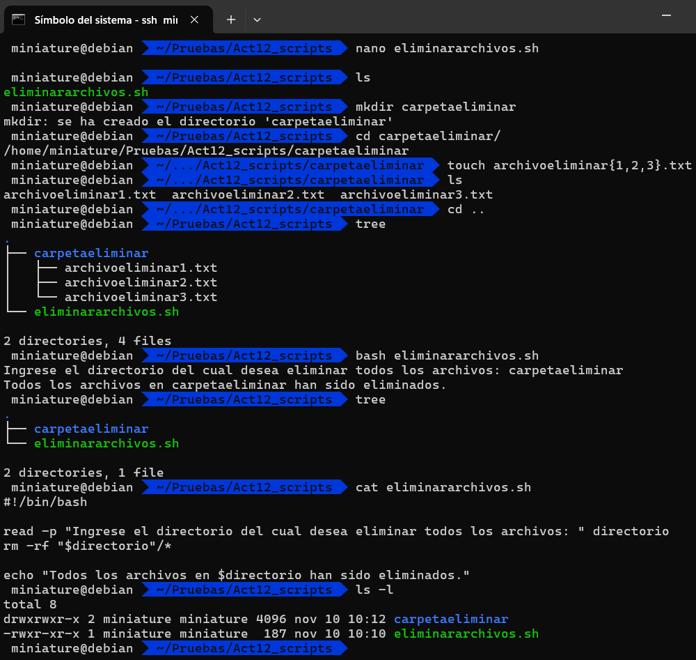
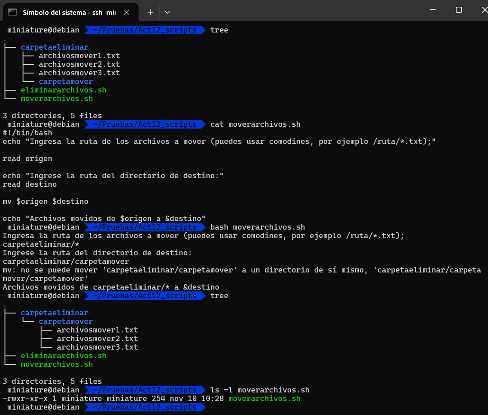
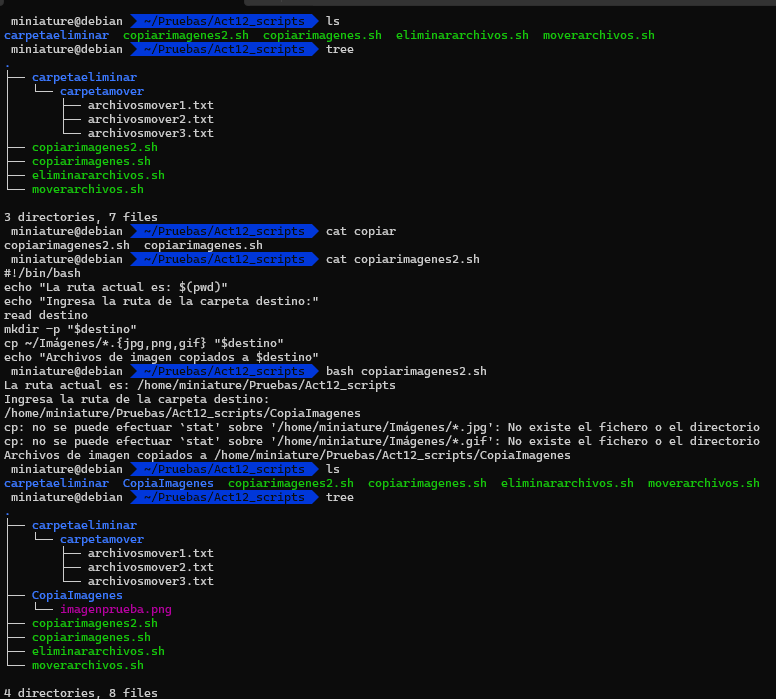
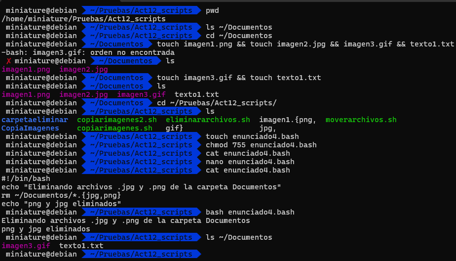
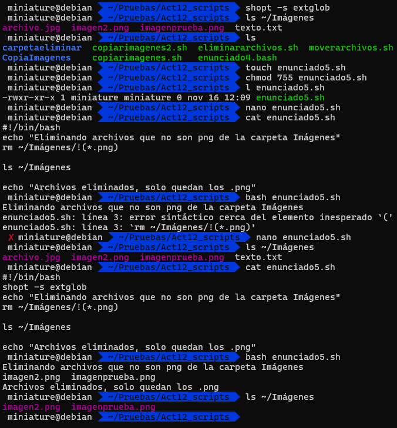
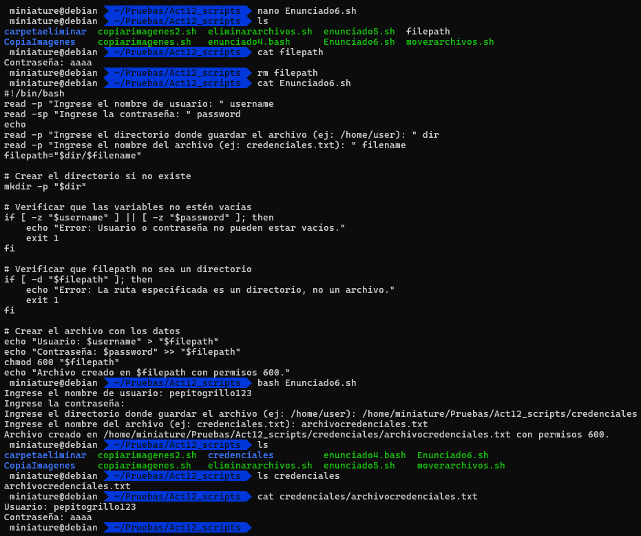

# **Act12 Shell Script Debian José Ángel Alejo Sillero**

- [**Act12 Shell Script Debian José Ángel Alejo Sillero**](#act12-shell-script-debian-josé-ángel-alejo-sillero)
  - [**Enunciados**](#enunciados)
  - [**Soluciones**](#soluciones)
    - [**1**](#1)
    - [**2**](#2)
    - [**3**](#3)
    - [**4**](#4)
    - [**5**](#5)
    - [**6**](#6)

## **Enunciados**

1. Eliminar todos los archivos de un directorio, pedir al usuario que ingrese el directorio.

2. Mover los archivos de un directorio a otro, pedir al usuario que ingrese los archivos de origen y el directorio de destino.

3. Copiar todos los archivos tipo imagen de la carpeta imágenes a otra carpeta. Pedir al usuario crear carpeta destino.

4. Elimina solo los archivos .jpg y .png  de la carpeta documentos. Al ejecutar el script debe aparecer un mensaje en consola que diga: png y jpg eliminados.

5. Elimina todos los archivos menos los png de la carpeta imágenes. HAY QUE HABILITAR LA EXTENSIÓN DE SHELL EXTGLOB:  shopt -s extglob. Después puedes usar la sintaxis !(*.png) para eliminar todos los archivos excepto aquellos con la extensión .png.

6. Pide al usuario que ingrese una contraseña y un nombre de usuario y una ruta donde deba almacenarse un archivo que tenga solo permisos el usuario, en una ruta determinada en ese archivo debe imprimirse la contraseña y usuario generada. Cuando se introduzca el password no debe mostrarse en consola.

---

## **Soluciones**

### **1**

---

### **2**

---

### **3**

---

### **4**

---

### **5**

---

### **6**

