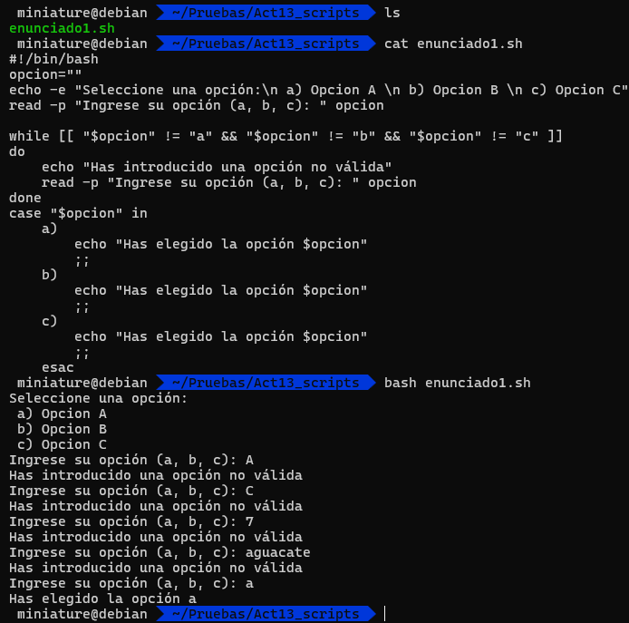

# SO - Act 13 Estructuras de control en Shell Scripts Debian - José Ángel Alejo Sillero

## Enunciado 1

Crear un menú con 3 opciones (a,b,c), al pulsar la opción que se muestre en consola, mostrar un mensaje indicando la opción seleccionada. Utilizar la estructura de control case para implementar el menú.

Si se pulsa una opción incorrecta, que me muestre un mensaje de error y me solicite introducir una opción válida (while).



```bash
  GNU nano 8.4                    enunciado1.sh
#!/bin/bash
opcion=""
echo -e "Seleccione una opción:\n a) Opcion A \n b) Opcion B \n c) Opcion C"
read -p "Ingrese su opción (a, b, c): " opcion

while [[ "$opcion" != "a" && "$opcion" != "b" && "$opcion" != "c" ]]
do
    echo "Has introducido una opción no válida"
    read -p "Ingrese su opción (a, b, c): " opcion
done
case "$opcion" in
    a)
        echo "Has elegido la opción $opcion"
        ;;
    b)
        echo "Has elegido la opción $opcion"
        ;;
    c)
        echo "Has elegido la opción $opcion"
        ;;
    esac
```

---
<div style="page-break-after: always;"></div>

## Enunciado 2

Pedir al usuario cuántos archivos.txt crear, solicitar una ruta que sea válida, si no es válida, solicitar la ruta de nuevo, los archivos se tienen que llamar arch1.txt, arch2.txt, arch3.txt, etc. (for).
