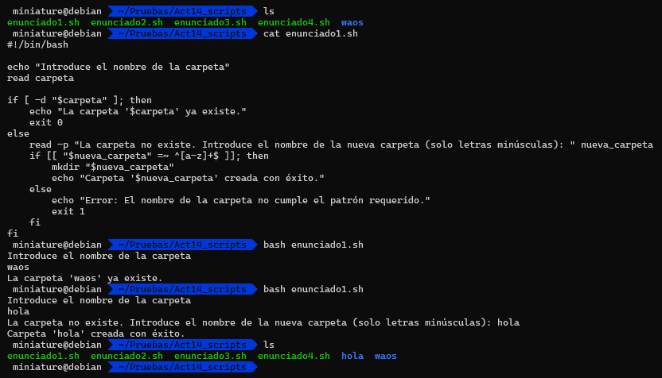
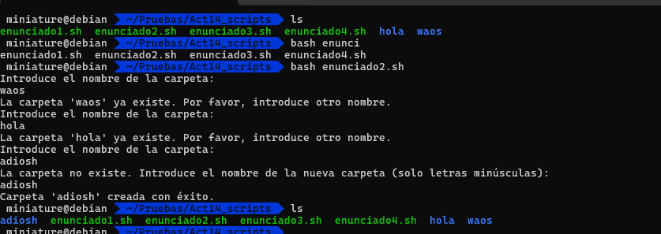
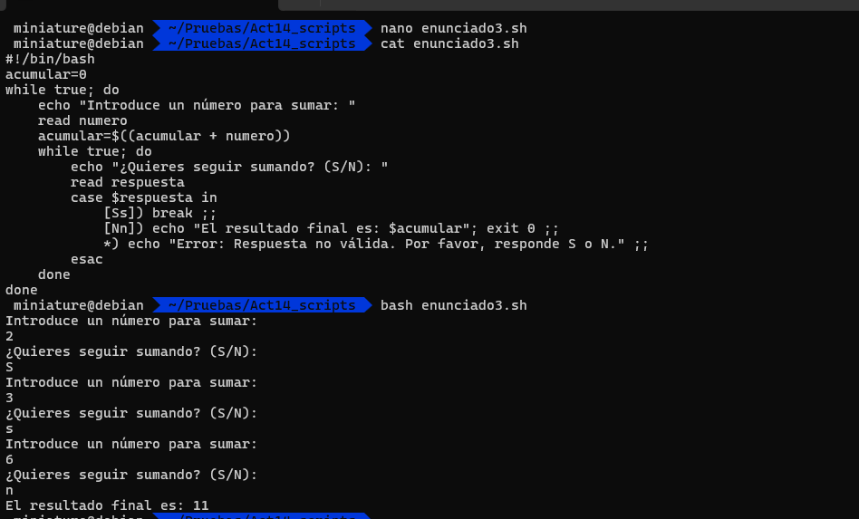
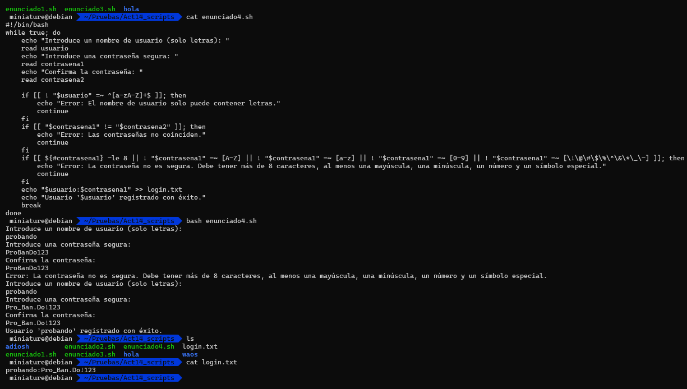

# **SO | Act 14 Shell Script, Estructuras de control y patrones | José Ángel Alejo Sillero**

> **ÍNDICE**

- [**SO | Act 14 Shell Script, Estructuras de control y patrones | José Ángel Alejo Sillero**](#so--act-14-shell-script-estructuras-de-control-y-patrones--josé-ángel-alejo-sillero)
  - [**Enunciado 1** - Verificación de carpeta con IF y patrón de nombre](#enunciado-1---verificación-de-carpeta-con-if-y-patrón-de-nombre)
  - [**Enunciado 2** - Verificación con WHILE (repetir hasta que sea correcto)](#enunciado-2---verificación-con-while-repetir-hasta-que-sea-correcto)
  - [**Enunciado 3** - Script para sumar números de forma consecutiva](#enunciado-3---script-para-sumar-números-de-forma-consecutiva)
  - [**Enunciado 4** - Crear un script Bash que implemente un sistema completo de registro de usuarios](#enunciado-4---crear-un-script-bash-que-implemente-un-sistema-completo-de-registro-de-usuarios)
  - [**Respuestas**](#respuestas)
    - [Enunciado 1](#enunciado-1)
    - [Enunciado 2](#enunciado-2)
    - [Enunciado 3](#enunciado-3)
    - [Enunciado 4](#enunciado-4)

---
<div style="page-break-after: always;"></div>

## **Enunciado 1** - Verificación de carpeta con IF y patrón de nombre

Crea un script que:

1. Pida al usuario el nombre de una carpeta.
2. Compruebe con un IF si la carpeta existe (en el directorio actual del script):
   1. Si la carpeta NO existe:
      1. Debe crear una nueva carpeta cuyo nombre contenga solo letras minúsculas.
      2. Antes de crearla, comprobar con una expresión regular que el nombre cumple el patrón. Si NO cumple el patrón, mostrar un error y finalizar el script.
   2. Si la carpeta  existe:
      1. Mostrar un mensaje indicando que la carpeta existe y finalizar el script.

## **Enunciado 2** - Verificación con WHILE (repetir hasta que sea correcto)

Crea un script que haga lo mismo que el ejercicio anterior, pero usando un while:

1. Pedirá al usuario el nombre de la carpeta en un bucle.
2. Mientras la carpeta SI exista, seguirá pidiendo al usuario que introduzca el nombre.
3. Cuando la carpeta NO exista:
   1. Pedirá el nombre de la nueva carpeta.
   2. Comprobará con una expresión regular que el nombre tiene solo letras minúsculas.
      1. Si NO cumple el patrón:
         1. Mostrar error y volver a pedirlo.
      2. SI cumple el patrón:
         1. Crear la carpeta y finalizar el script.

## **Enunciado 3** - Script para sumar números de forma consecutiva

Crea un script que:

1. Tenga una variable acumuladora iniciada en 0.
2. Pida un número al usuario y lo sume al acumulador.
3. Tras cada suma, pregunte "¿Quieres seguir sumando? (S/N):"
4. Si el usuario responde:
   1. S/s → seguir sumando.
   2. N/n → Mostrar el resultado final y finalizar el script.
   3. Cualquier otra cosa → mostrar un error y volver a preguntar.
5. El script solo termina cuando la respuesta es N o n.

## **Enunciado 4** - Crear un script Bash que implemente un sistema completo de registro de usuarios

1. Solicitar un nombre de usuario que sólo pueda contener letras.
2. Solicitar una contraseña (visible en pantalla) segura que cumpla:
   1. Más de 8 caracteres.
   2. Al menos una letra mayúscula.
   3. Al menos una letra minúscula.
   4. Al menos un número.
   5. Al menos un símbolo especial (por ejemplo: !, @, #, $, %, ^, &, *, _, -).
3. Solicitar la contraseña dos veces para verificarla.
4. Si no coincide o no es segura, volver a solicitarla.
5. Cuando usuario y contraseña sean válidos y verificados, guardan en login.txt con el mismo formato anterior (usuario:contraseña).
6. El archivo login.txt debe añadir nuevos usuarios al final sin borrar los anteriores.

---
<div style="page-break-after: always;"></div>

## **Respuestas**

### Enunciado 1



```bash
#!/bin/bash
ecoh "Introduce el nombre de la carpeta: "
read carpeta
if [ -d "$carpeta" ]; then
    echo "La carpeta '$carpeta' ya existe."
    exit 0
else
    read -p "La carpeta no existe. Introduce el nombre de la nueva carpeta (solo letras minúsculas): " nueva_carpeta
    if [[ "$nueva_carpeta" =~ ^[a-z]+$ ]]; then
        mkdir "$nueva_carpeta"
        echo "Carpeta '$nueva_carpeta' creada con éxito."
    else
        echo "Error: El nombre de la carpeta no cumple el patrón requerido."
        exit 1
    fi
fi
```

> **CORRECCIÓN**: Es correcto.

---

### Enunciado 2



```bash
#!/bin/bash
while true; do
    echo "Introduce el nombre de la carpeta: "
    read carpeta
    if [ -d "$carpeta" ]; then
        echo "La carpeta '$carpeta' ya existe. Por favor, introduce otro nombre."
    else
        while true; do
            echo "La carpeta no existe. Introduce el nombre de la nueva carpeta (solo letras minúsculas): "
            read nueva_carpeta
            if [[ "$nueva_carpeta" =~ ^[a-z]+$ ]]; then
                mkdir "$nueva_carpeta"
                echo "Carpeta '$nueva_carpeta' creada con éxito."
                exit 0
            else
                echo "Error: El nombre de la carpeta no cumple el patrón requerido. Inténtalo de nuevo."
            fi
        done
    fi
done
```

---

### Enunciado 3



```bash
#!/bin/bash
acumular=0
while true; do
    echo "Introduce un número para sumar: "
    read numero
    acumular=$((acumular + numero))
    while true; do
        echo "¿Quieres seguir sumando? (S/N): "
        read respuesta
        case $respuesta in
            [Ss]) break ;;
            [Nn]) echo "El resultado final es: $acumular"; exit 0 ;;
            *) echo "Error: Respuesta no válida. Por favor, responde S o N." ;;
        esac
    done
done
```

### Enunciado 4



```bash
#!/bin/bash
while true; do
    echo "Introduce un nombre de usuario (solo letras): "
    read usuario
    echo "Introduce una contraseña segura: "
    read contrasena1
    echo "Confirma la contraseña: "
    read contrasena2

    if [[ ! "$usuario" =~ ^[a-zA-Z]+$ ]]; then
        echo "Error: El nombre de usuario solo puede contener letras."
        continue
    fi
    if [[ "$contrasena1" != "$contrasena2" ]]; then
        echo "Error: Las contraseñas no coinciden."
        continue
    fi
    if [[ ${#contrasena1} -le 8 || ! "$contrasena1" =~ [A-Z] || ! "$contrasena1" =~ [a-z] || ! "$contrasena1" =~ [0-9] || ! "$contrasena1" =~ [\!\@\#\$\%\^\&\*\_\-] ]]; then
        echo "Error: La contraseña no es segura. Debe tener más de 8 caracteres, al menos una mayúscula, una minúscula, un número y un símbolo especial."
        continue
    fi
    echo "$usuario:$contrasena1" >> login.txt
    echo "Usuario '$usuario' registrado con éxito."
    break
done
```
