# Actividad 9: Comandos básicos de Debian - José Ángel Alejo

- Utiliza el comando ls para listar el contenido de un directorio.
- Usa cd para cambiar al directorio que desees.
- Emplea pwd para verificar la ruta actual.
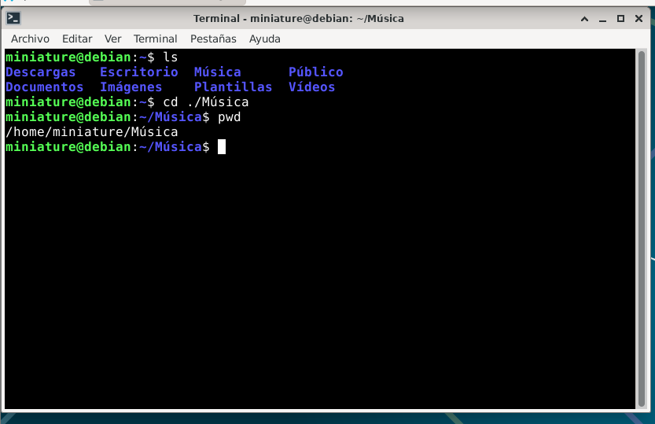

---

- Crea un nuevo directorio con mkdir.
- Crea archivos vacíos con touch.
- Muestra la fecha actual
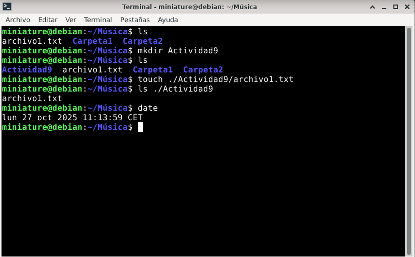

---

- Copia archivos y directorios con cp.
- Mueve archivos y directorios con mv.
- Elimina archivos y directorios con rm.
- Utiliza cat para mostrar el contenido de un archivo.
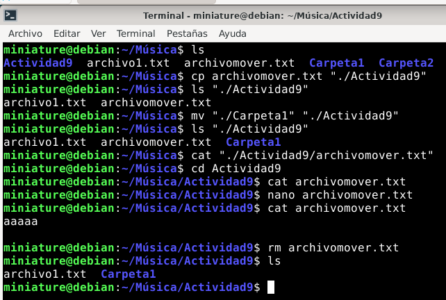

---

- Emplea grep para buscar patrones en un archivo de texto.
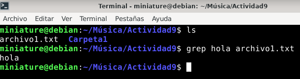

---

- Cambia al usuario superusuario (root) utilizando su.
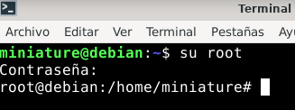

---

- Cambia la contraseña del usuario actual con passwd.
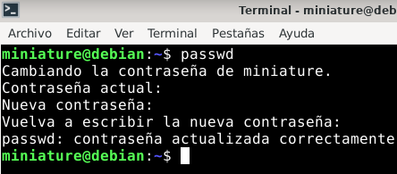

---

- Cambia la contraseña de otro usuario utilizando sudo passwd usuario.
- Cambiar la contraseña del usuario root  
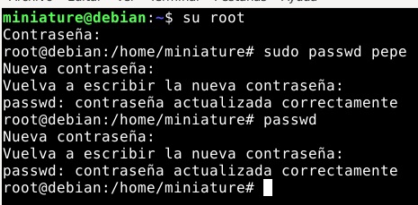

---

- Crear un nuevo usuario
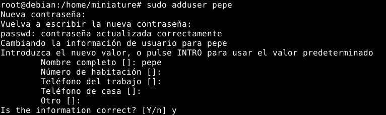

---

- Modificar el nombre de usuario
- Cambiar al usuario creado
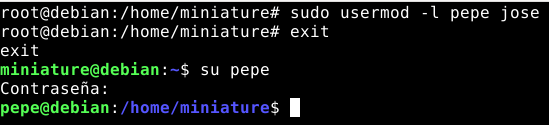

---

- Agregar un grupo de usuario
- Agregar un usuario a ese grupo.
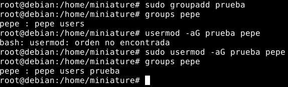

---

- Crea un archivo y asigna permisos completos al propietario, y solo permisos de lectura al grupo y a otros.
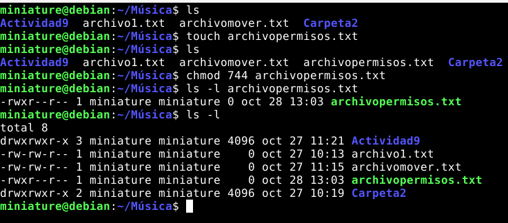

---

- Crea un directorio y asigna permisos de lectura, escritura y ejecución al propietario y al grupo, pero solo permisos de lectura a otros.
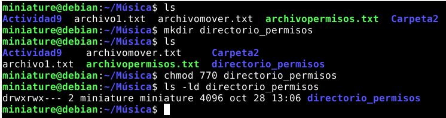

---

- Crea un directorio llamado "archivos" en tu directorio de documentos. Dentro de "archivos", crea tres archivos: "archivo1.txt", "archivo2.txt" y "archivo3.txt".Asigna permisos de escritura y lectura al propietario y al grupo para todos los archivos y el directorio.
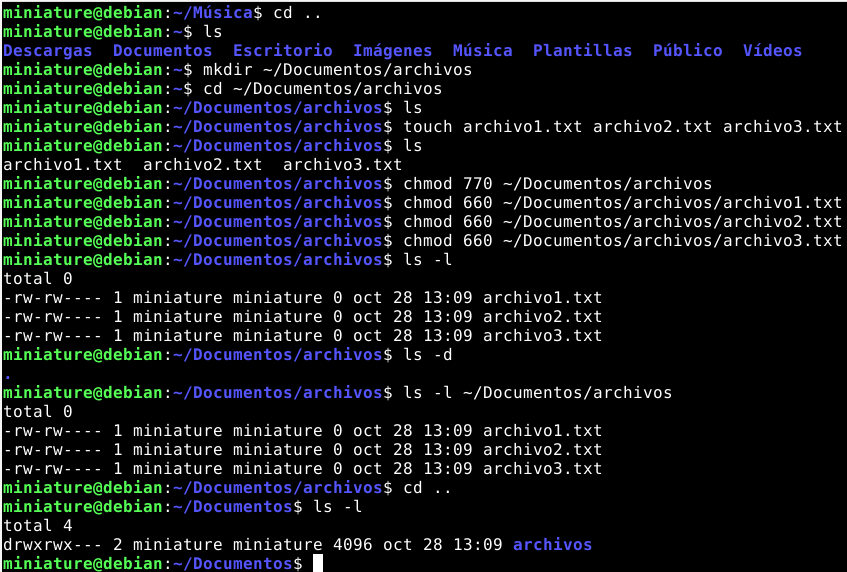

---

- Crea un usuario llamado "colaborador". Cambia el propietario  del directorio "archivos" creado anteriormente al usuario "colaborador".
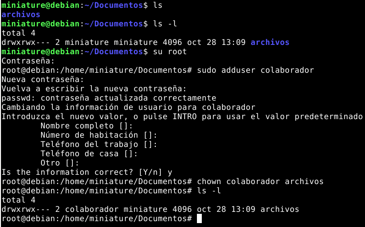
