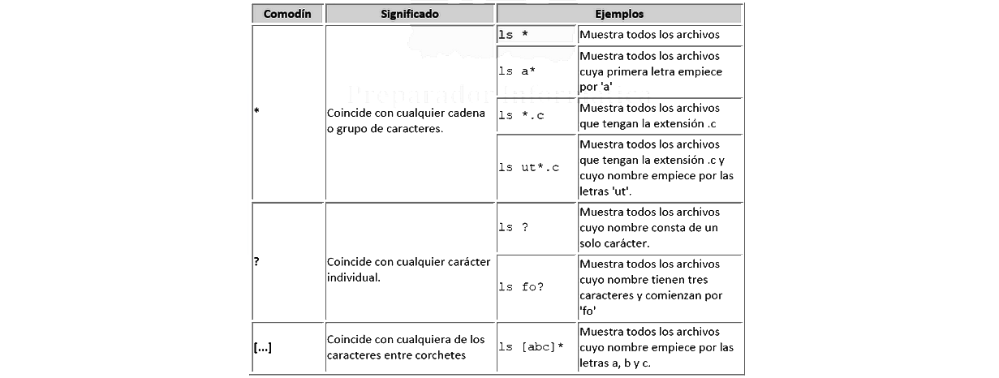

# **Apuntes de Shell Scripts en Debian - José Ángel Alejo Sillero**

- [**Apuntes de Shell Scripts en Debian - José Ángel Alejo Sillero**](#apuntes-de-shell-scripts-en-debian---josé-ángel-alejo-sillero)
  - [**1. SHELL SCRIPTS Y GENERACIÓN PROCEDURAL**](#1-shell-scripts-y-generación-procedural)
  - [**2. CREAR | ESCRIBIR | EJECUTAR UN SHELL SCRIPT**](#2-crear--escribir--ejecutar-un-shell-script)
  - [**3. VARIABLES EN SHELL SCRIPTS**](#3-variables-en-shell-scripts)
    - [**3.1 DE SISTEMA**](#31-de-sistema)
    - [**3.2 DEFINIDAS POR EL USUARIO | REGLAS**](#32-definidas-por-el-usuario--reglas)
  - [**4. COMODINES | EXTGLOB**](#4-comodines--extglob)
  - [**5. COMANDO ECHO | SALIDA**](#5-comando-echo--salida)
  - [**6. COMANDO READ | ENTRADA**](#6-comando-read--entrada)
  - [**7. OPERACIONES ARITMÉTICAS**](#7-operaciones-aritméticas)
  - [**8. REDIRECCIÓN DE ENTRADA Y SALIDA**](#8-redirección-de-entrada-y-salida)
  - [**9. ESTRUCTURAS DE CONTROL DE FLUJO**](#9-estructuras-de-control-de-flujo)
    - [**9.1 IF-ELSE-FI | IF-ELIF-ELSE-FI**](#91-if-else-fi--if-elif-else-fi)
    - [**9.2 EXPRESIONES DE EVALUACIÓN DE CONDICIONES**](#92-expresiones-de-evaluación-de-condiciones)
      - [**EXPRESIONES NUMÉRICAS**](#expresiones-numéricas)
      - [**EXPRESIONES DE CADENAS / CARACTERES**](#expresiones-de-cadenas--caracteres)
      - [**COMPARACIONES LÓGICAS**](#comparaciones-lógicas)
      - [**COMPROBACIÓN DE ARCHIVOS | DIRECTORIOS | RUTAS**](#comprobación-de-archivos--directorios--rutas)
    - [**9.3 WHILE-DO-DONE**](#93-while-do-done)
    - [**9.4 FOR (VARIABLE IN LISTA)-DO-DONE**](#94-for-variable-in-lista-do-done)
      - [FOR ((VARIABLE=VALOR; CONDICION; INCREMENTO))-DO-DONE](#for-variablevalor-condicion-incremento-do-done)
    - [**9.5 SWITCH | CASE-IN-ESAC**](#95-switch--case-in-esac)
  - [**10. EJEMPLOS DE SHELL SCRIPTS - ESTRUCTURAS DE CONTROL DE FLUJO**](#10-ejemplos-de-shell-scripts---estructuras-de-control-de-flujo)
    - [**Ejemplo 1: Calculadora | IF y SWITCH(case)**](#ejemplo-1-calculadora--if-y-switchcase)
    - [**Ejemplo 2: Crear N cantidad de carpetas | While y For**](#ejemplo-2-crear-n-cantidad-de-carpetas--while-y-for)
    - [**Ejemplo 3: Opciones de a hasta c. Mostrar mensaje según opción | While y Case**](#ejemplo-3-opciones-de-a-hasta-c-mostrar-mensaje-según-opción--while-y-case)
  - [**11. PATRONES EN IF**](#11-patrones-en-if)
  - [**12. COMBINACIÓN DE PATRONES**](#12-combinación-de-patrones)
    - [EJ 1: Verificar si el dato introducido contiene un dígito](#ej-1-verificar-si-el-dato-introducido-contiene-un-dígito)
    - [EJ 2: Verificar que el dato introducido comienza con un dígito](#ej-2-verificar-que-el-dato-introducido-comienza-con-un-dígito)
    - [EJ 3: Verificar que el dato introducido acaba con un dígito](#ej-3-verificar-que-el-dato-introducido-acaba-con-un-dígito)
    - [EJ 4: Verificar que el dato introducido tiene sólo números](#ej-4-verificar-que-el-dato-introducido-tiene-sólo-números)
    - [EJ 5: Verificar que el dato introducido tiene sólo letras mayúsculas](#ej-5-verificar-que-el-dato-introducido-tiene-sólo-letras-mayúsculas)
    - [EJ 6: Verificar que el dato introducido tiene sólo letras minúsculas](#ej-6-verificar-que-el-dato-introducido-tiene-sólo-letras-minúsculas)
    - [EJ 7: El dato introducido empieza y acaba por números, y en el medio tiene letras mayúsculas](#ej-7-el-dato-introducido-empieza-y-acaba-por-números-y-en-el-medio-tiene-letras-mayúsculas)
    - [EJ 8: El dato empieza y acaba por números, contiene letras y tiene longitud máxima de 5 dígitos](#ej-8-el-dato-empieza-y-acaba-por-números-contiene-letras-y-tiene-longitud-máxima-de-5-dígitos)
    - [EJ 9: El dato empieza y acaba por números, contiene letras, y tiene longitud mínima de 5 dígitos](#ej-9-el-dato-empieza-y-acaba-por-números-contiene-letras-y-tiene-longitud-mínima-de-5-dígitos)
    - [EJ 10: Verificar números positivos y negativos enteros](#ej-10-verificar-números-positivos-y-negativos-enteros)
    - [EJ 11: Verificar números positivos y negativos (enteros y decimales)](#ej-11-verificar-números-positivos-y-negativos-enteros-y-decimales)
    - [EJ 12: Verificar números con carácteres especiales](#ej-12-verificar-números-con-carácteres-especiales)
    - [EJ 13: Un número de teléfono español, que empieza por 6 o 7, tiene 9 dígitos y sólo contiene números](#ej-13-un-número-de-teléfono-español-que-empieza-por-6-o-7-tiene-9-dígitos-y-sólo-contiene-números)
    - [EJ 14: Una dirección de correo electrónico básica](#ej-14-una-dirección-de-correo-electrónico-básica)
      - [EJ 14a: Dirección de correo electrónico ampliada](#ej-14a-dirección-de-correo-electrónico-ampliada)
      - [EJ 14b: Dirección de correo electrónico con restricciones de usuario](#ej-14b-dirección-de-correo-electrónico-con-restricciones-de-usuario)
  - [**13. EJEMPLOS DE USO DE DE ESTRUCTURAS DE CONTROL DE FLUJO CON / SIN PATRONES**](#13-ejemplos-de-uso-de-de-estructuras-de-control-de-flujo-con--sin-patrones)
    - [EJ 1: Pedir directorio a usuario y eliminar todos los archivos](#ej-1-pedir-directorio-a-usuario-y-eliminar-todos-los-archivos)
    - [EJ 2: Pedir a usuario directorio origen y destino y mover todos los archivos](#ej-2-pedir-a-usuario-directorio-origen-y-destino-y-mover-todos-los-archivos)
    - [EJ 3: Pedir al usuario una ruta destino y copiar archivos png desde la carpeta Imágenes](#ej-3-pedir-al-usuario-una-ruta-destino-y-copiar-archivos-png-desde-la-carpeta-imágenes)
    - [EJ 4: Eliminar todos los archivos tipo jpg y png](#ej-4-eliminar-todos-los-archivos-tipo-jpg-y-png)
    - [EJ 5: Eliminar todos los archivos de la carpeta imágenes excepto los png](#ej-5-eliminar-todos-los-archivos-de-la-carpeta-imágenes-excepto-los-png)
    - [EJ 6: Pedir contraseña, nombre de usuario y ruta de redirección de salida](#ej-6-pedir-contraseña-nombre-de-usuario-y-ruta-de-redirección-de-salida)
    - [EJ 7: Mostrar un menú con tres opciones y mostrar mensaje según opción, repetir hasta que elija una opción válida](#ej-7-mostrar-un-menú-con-tres-opciones-y-mostrar-mensaje-según-opción-repetir-hasta-que-elija-una-opción-válida)
    - [EJ 8: Pedir al usuario cuántos txt quiere crear, solicitar ruta y nombre base, crear los archivos](#ej-8-pedir-al-usuario-cuántos-txt-quiere-crear-solicitar-ruta-y-nombre-base-crear-los-archivos)
    - [EJ 9: Verificación de carpeta con IF y patrón de nombre](#ej-9-verificación-de-carpeta-con-if-y-patrón-de-nombre)
    - [EJ 10: Verificacion de carpeta con WHILE y patrón de nombre](#ej-10-verificacion-de-carpeta-con-while-y-patrón-de-nombre)
    - [EJ 11: Sumar números de forma consecutiva](#ej-11-sumar-números-de-forma-consecutiva)
    - [EJ 12: Script Bash de sistema de registro de usuarios con validación](#ej-12-script-bash-de-sistema-de-registro-de-usuarios-con-validación)

---
<div style="page-break-after: always;"></div>

## **1. SHELL SCRIPTS Y GENERACIÓN PROCEDURAL**

Los shell Scripts son **archivos de texto que contienen una serie de comandos que el intérprete de comandos (shell) puede ejecutar**. Son una herramienta poderosa para automatizar tareas repetitivas, gestionar sistemas y realizar configuraciones.

Los shell Scripts se **basan en la generación procedural**, lo que significa que **los comandos se ejecutan en un orden específico, uno tras otro**. Esto permite a los usuarios crear secuencias de comandos que pueden realizar tareas complejas de manera eficiente.

El **objetivo** de los shell Scripts es **automatizar tareas que de otro modo requerirían intervención manual**, lo que ahorra tiempo y reduce la posibilidad de errores humanos. Los scripts pueden incluir comandos para manipular archivos, gestionar procesos, configurar sistemas y mucho más.

- Las extensiones comunes de los scripts, según el SO suelen ser:
  - `.sh`: Para sistemas Unix y Linux.
  - `.bat`: Para Windows.

## **2. CREAR | ESCRIBIR | EJECUTAR UN SHELL SCRIPT**

Para crear, escribir y ejecutar un shell script en un sistema Debian, se deben seguir los siguientes pasos:

1. **CREAR el archivo del script**: Utizando `touch nombre_script.sh` o un editor de texto como `nano nombre_script.sh`.
2. **ESCRIBIR el script**: Abriendo el archivo con un editor de texto (como `nano`, `vim`, etc.) y escribiendo los comandos que se desean ejecutar. Es recomendable comenzar el script con la línea `#!/bin/bash` para indicar que se utilizará el intérprete de Bash.
3. **DAR PERMISOS**: Utilizando el comando `chmod +x nombre_script.sh` O `chmod 755 nombre_script.sh`. Para dar permisos de lectura, escritura y ejecución al propietario, y permisos de lectura y ejecución al grupo y otros usuarios.
4. **EJECUTAR**: Utilizando `./nombre_script.sh` desde la terminal si se encuentra en el mismo directorio, o especificando la ruta completa si está en otro lugar. o bien `bash nombre_script.sh` para ejecutarlo con Bash.

Ahora bien, algunas **consideraciones adicionales o buenas prácticas** al crear y ejecutar shell scripts son:

- **SHE-BANG**: La **primera línea del script** debe ser `#!/bin/bash` para especificar el intérprete de comandos. Se indica la ruta absoluta en la que está el intérprete.
- **COMENTARIOS**: Utilizar `#` para agregar comentarios que expliquen el propósito del script y las secciones del código.
  - En la segunda línea, es común incluir un comentario para el propósito del script.
- **CLEAR**: Normalmente tras el SHE-BANG y el primer comentario, se suele incluir el comando `clear` para limpiar la pantalla al ejecutar el script.

## **3. VARIABLES EN SHELL SCRIPTS**

Las variables en shell scripts son **contenedores que almacenan datos o valores que pueden ser utilizados y manipulados durante la ejecución del script**. Las podemos clasificar en dos tipos principales:

- **Variables de sistema**: Predefinidas por el sistema operativo y el shell. Se definen en mayúsculas y tienen significados específicos. Se usa el prefijo `$` para acceder a su valor.
- **Variables definidas por el usuario**: Creadas y mantenidas por el usuario para almacenar valores personalizados.

### **3.1 DE SISTEMA**

- **$HOME**: Imprime la ruta del directorio home del usuario actual.
- **$USER**: Imprime el nombre del usuario actual.
- **$LOGNAME**: Imprime el nombre de inicio de sesión del usuario actual.
- **$PATH**: Imprime las rutas de los directorios de la SHELL, al ejecutar un comando, el sistema busca en las rutas especificadas en la variable PATH. Si el sistema encuentra el comando en uno de estos directorios, lo ejecuta. Si no lo encuentra, muestra un mensaje de error indicando que el comando no se encontró.
- **PWD**: Imprime el directorio de trabajo actual.
- **$SHELL**: Imprime la ruta del intérprete de comandos (shell) que se está utilizando.
- **$UID**: Imprime el ID del usuario actual.
- **$DATE**: Imprime la fecha y hora actuales.

- Para **acceder al valor de una variable**, se utiliza el prefijo `$` seguido del nombre de la variable.
  - Por ejemplo, para imprimir el valor de la variable `HOME`, se usaría `echo $HOME`.
- **Para ejecutar una variable del sistema dentro de un mensaje de un ECHO**, se usa la sintaxis `echo "Texto: $(VARIABLE)"`.
  - Por ejemplo, para la fecha actual: `echo "Fecha actual: $(date)"`.

### **3.2 DEFINIDAS POR EL USUARIO | REGLAS**

Para **definir una variable, se le debe asignar un valor**. La sintaxis básica es `NOMBRE_VARIABLE=valor`.

- **Por ejemplo, podemos asignar**:
  - **Número**: `num1=3`.
  - **Cadena de texto**: `mensaje="Hola Mundo"`.
  - **Caracter especial**: `caracter='@'`.
  - **Otra variable a una nueva variable**: `var2=$var1`.
  - **Resultado de un comando a una variable**: `fecha_actual=$(date)`.
  - **Resultado de una operación aritmética a una variable**: `suma=$((num1 + num2))`.

- Para **imprimir el valor de la variable**, utilizamos echo `$NOMBRE_VARIABLE`. Por ejemplo:
  - `echo $num1`. Imprimirá `3`.
  - `echo $mensaje`. Imprimirá `Hola Mundo`.
  - `echo $caracter`. Imprimirá `@`.
  - `echo $fecha_actual`. Imprimirá la fecha actual.
  - `echo $suma`. Imprimirá el resultado de la suma. Si num1=3 y num2=5, imprimirá `8`.

Tenemos dos **reglas clave** al trabajar con variables definidas por el usuario:

1. **No usar espacios alrededor del signo de igualdad (=)** al asignar valores a las variables. Por ejemplo, `num1=3` es correcto, `num1 = 3` generará un error.
2. **Usar el prefijo `$` para acceder al valor de una variable**.

## **4. COMODINES | EXTGLOB**



- `[..-..]`: Dos carácteres separados por `-` indican un **rango de caracteres**.
  - Ejemplo 1: `[a-z]` coincide con cualquier letra minúscula.
  - Ejemplo 2: `[0-9]` coincide con cualquier dígito del 0 al 9.
- `*`: **Coincide con cero o más caracteres**.
  - Ejemplo 1: `archivo*` coincide con cualquier archivo que comience con "archivo", como "archivo1", "archivo_final", etc.
  - Ejemplo 2: `*.txt` coincide con cualquier archivo que termine con la extensión ".txt".
- `[!..]` O `[^..]`: **Coincide con cualquier carácter que no esté en el conjunto especificado**.
  - Ejemplo 1: `[!a-z]` coincide con cualquier carácter que no sea una letra minúscula.
  - Ejemplo 2: `[^0-9]` coincide con cualquier carácter que no sea un dígito del 0 al 9.

Hay que **habilitar la extensión shell extglob** para poder usar los siguientes comodines avanzados:

- `?(patrón)`: Coincide con cero o una ocurrencia del patrón.
  - Ejemplo: `archivo?(1)` coincide con "archivo" o "archivo1".
- `*(patrón)`: Coincide con cero o más ocurrencias del patrón.
  - Ejemplo: `archivo*(1)` coincide con "archivo", "archivo1", "archivo11", etc.
- `+(patrón)`: Coincide con una o más ocurrencias del patrón.
  - Ejemplo: `archivo+(1)` coincide con "archivo1", "archivo11", pero no con "archivo".
- `@(patrón)`: Coincide exactamente con una ocurrencia del patrón.
  - Ejemplo: `archivo@(1|2)` coincide con "archivo1" o "archivo2".
- `!(patrón)`: Coincide con cualquier cosa que no coincida con el patrón.
  - Ejemplo: `archivo!(1)` coincide con "archivo" o "archivo2", pero no con "archivo1".

Para ello se debe ejecutar el comando: `shopt -s extglob` al inicio del script, o antes de usar el comodín avanzado.

## **5. COMANDO ECHO | SALIDA**

Imprime texto o variables en la salida estándar (normalmente la pantalla).

Su sintaxis básica es: `echo [opciones] "[texto o variable]"`.

- Tenemos **dos opciones comunes**:
  - `-n`: **No imprimir una nueva línea al final**.
    - Ejemplo: `echo -n "Hola"` imprimirá "Hola" sin saltar a la siguiente línea.
  - `-e`: **Habilitar secuencias de escape**. Algunas secuencias comunes son:
    - `\a`: Alerta (sonido).
    - `\b`: Retroceso.
    - `\c`: No imprimir la nueva línea al final, suprime texto a la derecha.
    - `\r`: Retorno de carro. Suprime texto a la izquierda.
    - `\n`: Nueva línea.
    - `\t`: Tabulación horizontal.
    - `\v`: Tabulación vertical (en la columna en la que esté).

Podemos usar `-n` en un echo anterior a un read para que la entrada del usuario aparezca a continuación del mensaje.

## **6. COMANDO READ | ENTRADA**

Permite leer la entrada del usuario desde la línea de comandos y asignarla a una variable.

Su sintaxis básica es: `read [opciones] NOMBRE_VARIABLE`.

Tenemos **dos opciones comunes**:

- `-p "mensaje"`: Muestra un mensaje antes de leer la entrada. Sirve como reemplazo del comando ECHO previo al READ.
  - Ejemplo: `read -p "Ingrese su nombre: " nombre` mostrará el mensaje y esperará a que el usuario ingrese su nombre, que se almacenará en la variable `nombre`.
- `-s`: Oculta la entrada del usuario (útil para contraseñas).
  - Ejemplo: `read -s -p "Ingrese su contraseña: " password` ocultará la entrada mientras el usuario escribe su contraseña.

## **7. OPERACIONES ARITMÉTICAS**

Para hacer operaciones aritméticas básicas primero debemos definir las variables con valores numéricos. Luego, podemos usar la sintaxis `$((expresión))` para realizar las operaciones.

- Las **operaciones aritméticas básicas** son:
  - Suma: `((a + b))`
  - Resta: `((a - b))`
  - Multiplicación: `((a * b))`
  - División: `((a / b))`
  - Módulo: `((a % b))`. Da el resto de la división entre `a` y `b`.

Las **operaciones sólo aceptarán valores enteros** y no decimales, sean positivos o negativos.

Las **divisiones y módulos devolverán sólo la parte entera**, descartando los decimales.

Por ejemplo, para sumar dos números almacenados en variables `num1` y `num2`, podemos hacer lo siguiente:

```bash
num1=3
num2=5
suma=$((num1 + num2))
echo "La suma es: $suma"
```

Si queremos que los números los ingrese el usuario, usamos echo y read:

```bash
read -p "Ingrese el primer número: " num1
read -p "Ingrese el segundo número: " num2
suma=$((num1 + num2))
echo "La suma es: $suma"
```

## **8. REDIRECCIÓN DE ENTRADA Y SALIDA**

Es posible redirigir la entrada y salida de comandos en un shell script utilizando operadores especiales. Los **básicos son `>`, `>>`,`<`.**

- **`comando > archivo`: Redirige la salida estándar a un archivo, sobrescribiéndolo**.
  - Ejemplo: `echo "Hola" > archivo.txt` creará (o sobrescribirá) `archivo.txt` con el contenido "Hola".
- **`comando >> archivo`: Redirige la salida estándar a un archivo, añadiendo al final**.
  - Ejemplo: `echo "Hola" >> archivo.txt` añadirá "Hola" al final de `archivo.txt`.
- **`comando < archivo`: Redirige la entrada estándar desde un archivo**.
  - Ejemplo: `sort < archivo.txt` ordenará las líneas de `archivo.txt`.
- **`comando 2> archivo`: Redirige la salida de error a un archivo**.
  - Ejemplo: `comando_inexistente 2> error.txt` guardará el mensaje de error en `error.txt`.
- **`comando &> archivo`: Redirige tanto la salida estándar como la de error a un archivo**.
  - Ejemplo: `comando &> salida.txt` redirige ambas salidas a `salida.txt`.

## **9. ESTRUCTURAS DE CONTROL DE FLUJO**

### **9.1 IF-ELSE-FI | IF-ELIF-ELSE-FI**

La instrucción `if` permite ejecutar bloques de código entre alternativos según se cumplan o no ciertas condiciones.

La sintaxis básica de un `if` simple es:

```bash
if [ condición ]; then
    # Bloque de código a ejecutar si la condición es verdadera
fi
```

Para un if then else:

```bash
if [ condición ]; then
    # Bloque de código a ejecutar si la condición es verdadera
else
    # Bloque de código a ejecutar si la condición es falsa
fi
```

**Y si queremos múltiples condiciones,** usamos `elif`:

```bash
if [ condición1 ]; then
    # Bloque de código a ejecutar si la condición1 es verdadera
elif [ condición2 ]; then
    # Bloque de código a ejecutar si la condición2 es verdadera
else
    # Bloque de código a ejecutar si ninguna condición es verdadera
fi
```

Podemos **anidar múltiples `if` dentro de otros `if` usando `then`, `elif`, `else` y `fi`** según sea necesario.

Por ejemplo, para verificar si un número es positivo, negativo o cero:

```bash
if [ $num -gt 0 ]; then
    echo "El número es positivo."
elif [ $num -lt 0 ]; then
    echo "El número es negativo."
else
    echo "El número es cero."
fi
```

Además, **podemos combinar múltiples condiciones usando operadores lógicos** como `&&` (AND) y `||` (OR).

Por ejemplo, para verificar si un número está entre 1 y 10, o entre 11 y 20:

```bash
if [ $num -ge 1 ] && [ $num -le 10 ]; then
    echo "El número está entre 1 y 10."
elif [ $num -ge 11 ] && [ $num -le 20 ]; then
    echo "El número está entre 11 y 20."
else
    echo "El número no está entre 1 y 20."
fi
```

Un ejemplo de comprobación de números usando `if-elif-else` con operadores lógicos `&&` y `||` sería:

```bash
if [ $num -lt 1 ] || [ $num -gt 20 ]; then
    echo "El número está fuera del rango de 1 a 20."
else
    echo "El número está dentro del rango de 1 a 20."
fi
```

> En este ejemplo, si el número es menor que 1 o mayor que 20, se imprimirá que está fuera del rango; de lo contrario, se indicará que está dentro del rango.

### **9.2 EXPRESIONES DE EVALUACIÓN DE CONDICIONES**

Dentro de las estructuras de control de flujo, usamos distintas expresiones para evaluar condiciones. Si la expresión es verdadera, se ejecuta el bloque de código correspondiente.

- Principalmente tenemos **tres tipos**:
  - **EXPRESIONES NUMÉRICAS**: Comparar valores numéricos.
  - **EXPRESIONES DE CADENAS / CARACTERES**: Comparar cadenas de texto.
  - **COMPARACIONES LÓGICAS**: Combinar múltiples condiciones lógicas.

- Y **dos tipos adicionales**:
  - **COMPROBACIÓN DE ARCHIVOS Y DIRECTORIOS**: Verificar la existencia y propiedades de archivos y directorios.
  - **COMPROBACIÓN DE RUTAS**: Verificar la existencia y propiedades de rutas en el sistema de archivos.

Para usar estas expresiones, se emplean corchetes `[` y `]` o dobles corchetes `[[` y `]]` en las condiciones del `if`.

Es muy importante **dejar espacios entre los corchetes y la expresión** para que el shell lo interprete correctamente.

Además, es recomendable usar **dobles corchetes `[[` y `]]`** para mayor flexibilidad y evitar problemas con ciertos caracteres especiales.

Podemos **combinar o negar expresiones usando** `-a` (AND), `-o` (OR) y `!` (NOT).

#### **EXPRESIONES NUMÉRICAS**

Tenemos las siguientes expresiones para comparar números enteros:

- `[a -eq b ]`: Igual a. Devuelve verdadero si `a` es igual a `b`.
- `[a -ne b ]`: No igual a. Devuelve verdadero si `a` no es igual a `b`.
- `[a -gt b ]`: Mayor que. Devuelve verdadero si `a` es mayor que `b`.
- `[a -lt b ]`: Menor que. Devuelve verdadero si `a` es menor que `b`.
- `[a -ge b ]`: Mayor o igual que. Devuelve verdadero si `a` es mayor o igual que `b`.
- `[a -le b ]`: Menor o igual que. Devuelve verdadero si `a` es menor o igual que `b`.

#### **EXPRESIONES DE CADENAS / CARACTERES**

Para comparar cadenas de texto, usamos `=` para igualdad y `!=` para desigualdad.

- `[ "$str1" = "$str2" ]`: Igual a. Devuelve verdadero si `str1` es igual a `str2`.
- `[ "$str1" != "$str2" ]`: No igual a. Devuelve verdadero si `str1` no es igual a `str2`.

#### **COMPARACIONES LÓGICAS**

Podemos combinar o negar expresiones usando:

- `-a`: AND lógico. Devuelve verdadero si ambas expresiones son verdaderas.
  - Ejemplo: `[ "$str1" = "$str2" -a $num1 -gt 0 ]` devuelve verdadero si `str1` es igual a `str2` y `num1` es mayor que 0.
- `-o`: OR lógico. Devuelve verdadero si al menos una de las expresiones es verdadera.
  - Ejemplo: `[ "$str1" = "$str2" -o $num1 -gt 0 ]` devuelve verdadero si `str1` es igual a `str2` o `num1` es mayor que 0.
- `!`: NOT lógico. Niega la expresión siguiente.
  - Ejemplo: `[ ! "$str1" = "$str2" ]` devuelve verdadero si `str1` no es igual a `str2`.

#### **COMPROBACIÓN DE ARCHIVOS | DIRECTORIOS | RUTAS**

Si queremos comprobar la **existencia de archivos, directorios y rutas**, usamos las siguientes expresiones:

- `[ -f ruta ]`: Verdadero si la ruta existe y es un archivo regular.
- `[ -d ruta ]`: Verdadero si la ruta existe y es un directorio.
- `[ -e ruta ]`: **Verdadero si la ruta existe** (archivo o directorio).

También podemos negar estas comprobaciones usando `!`:

- `[ ! -f ruta ]`: Verdadero si la ruta no existe o no es un archivo regular.
- `[ ! -d ruta ]`: Verdadero si la ruta no existe o no es un directorio.
- `[ ! -e ruta ]`: Verdadero si la ruta no existe.

Además, podemos usar la `~` para referirnos al directorio home del usuario actual en las rutas.

Si usamos llaves `{}` alrededor de una variable en una ruta, evitamos ambigüedades al concatenar texto.

Por ejemplo, para comprobar si un archivo llamado `documento.txt` existe en el directorio home del usuario actual, podemos usar:

```bash
if [ -f ~/documento.txt ]; then
    echo "El archivo existe."
else
    echo "El archivo no existe."
fi
```

Por ejemplo, si queremos comprobar la existencia de archivos png en la carpeta Imágenes del usuario, listarlos y luego copiarlos a otra carpeta que introduzca el usuario:

```bash
read -p "Introduce la ruta de destino para copiar los archivos PNG: " destino
if [ -d ~/Imágenes ]; then
    echo "Archivos PNG en la carpeta Imágenes:"
    ls ~/Imágenes/*.png
    cp ~/Imágenes/*.png "$destino"
    echo "Archivos copiados a $destino"
else
    echo "La carpeta Imágenes no existe."
fi
```

En este ejemplo, **podemos agregar más tipos de archivos** tanto para listar como para copiar, usando **comodines o extensiones múltiples**, con **EXPRESIONES REGULARES usando llaves `{}`**.

```bash
if [ -d ~/Imágenes ]; then
    echo "Archivos de imagen en la carpeta Imágenes:"
    ls ~/Imágenes/*.{png,jpg,jpeg,gif}
    cp ~/Imágenes/*.{png,jpg,jpeg,gif} "$destino"
    echo "Archivos copiados a $destino"
else
    echo "La carpeta Imágenes no existe."
fi
```

### **9.3 WHILE-DO-DONE**

La estructura `while` permite ejecutar un bloque de código repetidamente mientras una condición sea verdadera. Su **sintaxis básica** es:

```bash
while [ condición ]; do
    # Bloque de código a ejecutar
done
```

El **bloque de código dentro del `do` se ejecutará repetidamente mientras la condición sea verdadera**. Una vez que la condición se vuelva falsa, el bucle terminará y el control pasará a la siguiente línea después del `done`.

Podemos **usar `break` para salir del bucle antes de que la condición sea falsa**, o `continue` para saltar a la siguiente iteración del bucle.

Se **puede combinar con otras estructuras de control**, como `if`, para crear bucles más complejos.

```bash
contador=1
while [ $contador -le 10 ]; do
    if [ $((contador % 2)) -eq 0 ]; then
        echo "$contador es un número par."
    else
        echo "$contador es un número impar."
    fi
    contador=$((contador + 1))
done
```

> En este ejemplo, el bucle `while` imprimirá si los números del 1 al 10 son pares o impares.

También **podemos usar negaciones para la condición del `while`, usando `!`** para ejecutar el bucle mientras la condición sea falsa, y podemos usar contadores para limitar el número de iteraciones.

```bash
contador=1
while [ $contador -le 5 ]; do
    echo "Iteración número: $contador"
    contador=$((contador + 1))
done
```

> En este ejemplo, el bucle `while` imprimirá el número de iteración desde 1 hasta 5, incrementando el contador en cada iteración.

### **9.4 FOR (VARIABLE IN LISTA)-DO-DONE**

El bucle `for` permite iterar sobre una lista de elementos y ejecutar un bloque de código para cada elemento. Su sintaxis básica es:

```bash
for variable in lista; do
    # Bloque de código a ejecutar
done
```

Si quisieramos por ejemplo, para una variable `nombre` en una lista de nombres `Alberto, Carlos, Juan` imprimir el nombre, haríamos:

```bash
for nombre in Alberto Carlos Juan; do
    echo "Se llama $nombre"
done
```

#### FOR ((VARIABLE=VALOR; CONDICION; INCREMENTO))-DO-DONE

Es otra sintaxis para el bucle `for`, que permite definir una variable de control, una condición y un incremento. Es más flexible, y su sintaxis es como la de lenguajes de programación convencionales. Su **sintaxis básica** es:

```bash
for (( inicialización; condición; incremento )); do
    # Bloque de código a ejecutar
done
```

Por ejemplo, para una variable `i` inicializada en `1`, que se ejecute mientras `i` sea menor o igual a `10`, e incremente `i` en `1` en cada iteración, haríamos:

```bash
for (( i=1; i<=10; i++ )); do
    echo "Iteración número: $i"
done
```

### **9.5 SWITCH | CASE-IN-ESAC**

La estructura `case` permite ejecutar diferentes bloques de código según el valor de una variable. Es una buena alternativa a múltiples sentencias `if`. Su **sintaxis básica** es:

```bash
case variable in
    patrón1)
        # Bloque de código a ejecutar si coincide con patrón1
        ;;
    patrón2)
        # Bloque de código a ejecutar si coincide con patrón2
        ;;
    *)
        # Bloque de código a ejecutar si no coincide con ningún patrón
        ;;
esac
```

Los **`;;` son el equivalente a `break`** y siempre irán al final de cada bloque de código, separando los distintos casos.

Aunque no es obligatorio incluir el patrón `*`, suele ser recomendable para manejar casos no previstos.

Un ejemplo sencillo para comprobar si un carácter es una letra mayúscula, minúscula o un dígito sería:

```bash
read -p "Introduzca un carácter alfanumérico: " caracter

case $caracter in
    [A-Z])
        echo "El carácter es una letra mayúscula."
        ;;
    [a-z])
        echo "El carácter es una letra minúscula."
        ;;
    [0-9])
        echo "El carácter es un dígito."
        ;;
    *)
        echo "El carácter no es alfanumérico."
        ;;
esac
```

Por supuesto, **podríamos combinar dos expresiones en un mismo patrón usando `|` para indicar "o"**.

```bash
read -p "Introduzca un carácter alfanumérico: " caracter

case $caracter in
    [A-Z]|[a-z])
        echo "El carácter es una letra."
        ;;
    [0-9])
        echo "El carácter es un dígito."
        ;;
    *)
        echo "El carácter no es alfanumérico."
        ;;
esac
```

## **10. EJEMPLOS DE SHELL SCRIPTS - ESTRUCTURAS DE CONTROL DE FLUJO**

### **Ejemplo 1: Calculadora | IF y SWITCH(case)**

Este es un ejemplo básico de una calculadora que realiza operaciones aritméticas simples (suma, resta, multiplicación y división) según la opción seleccionada por el usuario.

```bash
echo -e "Introduce una opción: \n\t1. Sumar \n\t2. Restar \n\t3. Multiplicar \n\t4. Dividir"
read -p "Opción: " opcion

if [ $opcion == 1 ] || [ $opcion == 2 ] || [ $opcion == 3 ] || [ $opcion == 4 ]; then
    echo "Has seleccionado la opción $opcion."
    read -p "Introduce el primer número: " num1
    read -p "Introduce el segundo número: " num2
    case $opcion in
        1)
            resultado=$((num1 + num2))
            echo "El resultado de la suma es: $resultado"
            ;;
        2)
            resultado=$((num1 - num2))
            echo "El resultado de la resta es: $resultado"
            ;;
        3)
            resultado=$((num1 * num2))
            echo "El resultado de la multiplicación es: $resultado"
            ;;
        4)
            if [ $num2 -ne 0 ]; then
                resultado=$((num1 / num2))
                echo "El resultado de la división es: $resultado"
            else
                echo "Error: No se puede dividir por cero."
            fi
            ;;
    esac
else
    echo "Opción no válida. Por favor, selecciona una opción entre 1 y 4."
fi
```

> En este ejemplo, el usuario selecciona una opción para realizar una operación aritmética. Si la opción es válida (1-4), se solicitan dos números y se realiza la operación correspondiente utilizando una estructura `case`. Si la opción no es válida, se muestra un mensaje de error.

### **Ejemplo 2: Crear N cantidad de carpetas | While y For**

Este es un ejemplo básico de un script que crea una cantidad específica de carpetas en el directorio actual, según el número ingresado por el usuario, que debe estar entre 0 y 9. Se pide un nombre para la carpeta y si la carpeta ya existe, se pide un nuevo nombre. Una vez creadas todas las carpetas, se confirma la creación y se listan las carpetas creadas.

```bash
read -p "¿Cuántas carpetas deseas crear? " cantidad

# Validar que la cantidad esté entre 0 y 9
while [ $cantidad -lt 0 ] || [ $cantidad -gt 9 ]; do
    echo "Error: La cantidad debe estar entre 0 y 9."
    read -p "¿Cuántas carpetas deseas crear? " cantidad
done

read -p "Introduce el nombre base de las carpetas: " nombre_base

# Crear carpetas usando un bucle for
for (( i=1; i<=cantidad; i++ )); do
    nombre_carpeta="${nombre_base}_${i}"
    if [ ! -d "$nombre_carpeta" ]; then
        mkdir "$nombre_carpeta"
        echo "Carpeta creada: $nombre_carpeta"
    else
        echo "La carpeta $nombre_carpeta ya existe."
        read -p "Introduce un nuevo nombre para la carpeta $i: " nuevo_nombre
        mkdir "$nuevo_nombre"
        echo "Carpeta creada: $nuevo_nombre"
    fi
done

echo "Se han creado $cantidad carpetas con el nombre base '$nombre_base'."
echo "Las carpetas creadas son:"
ls -d ${nombre_base}_*
```

> En este ejemplo, el script solicita al usuario la cantidad de carpetas a crear y valida que esté entre 0 y 9 utilizando un bucle `while`. Luego, utiliza un bucle `for` para crear las carpetas con un nombre base proporcionado por el usuario, añadiendo un número secuencial. Si una carpeta ya existe, se notifica al usuario y se pide un nuevo nombre. Por último, se confirma la creación de las carpetas y se listan.

### **Ejemplo 3: Opciones de a hasta c. Mostrar mensaje según opción | While y Case**

Este es un ejemplo básico de un script que presenta al usuario tres opciones (a, b, c) y muestra un mensaje diferente según la opción seleccionada. Si el usuario ingresa una opción no válida, se le solicita que ingrese una opción correcta hasta que lo haga.

```bash
read -p "Selecciona una opción (a, b o c): " opcion
while [[ "$opcion" != "a" && "$opcion" != "b" && "$opcion" != "c" ]]; do
    echo "Opción no válida. Por favor, selecciona a, b o c."
    read -p "Selecciona una opción (a, b o c): " opcion
done
case $opcion in # Inicio del case
    a)
        echo "Has seleccionado la opción a."
        ;;
    b)
        echo "Has seleccionado la opción b."
        ;;
    c)
        echo "Has seleccionado la opción c."
        ;;
esac # Final del case
```

## **11. PATRONES EN IF**

Podemos usar distintos **patrones** en las expresiones de un `if` para hacer coincidir cadenas de texto o caracteres específicos. Para ello, usamos los operadores de comparación dentro de los dobles corchetes `[[` y `]]` y el operador `==` o `=~`, dependiendo del tipo de patrón que queramos usar.

Algunos ejemplos comunes son:

- `*`: **Coincide con cero o más caracteres.**
  - Ejemplo: `if [[ "$cadena" == a* ]]; then` verifica si la cadena comienza con "a".
- `+`: **Coincide con uno o más caracteres.**
  - Ejemplo: `if [[ "$cadena" == a+ ]]; then` verifica si la cadena comienza con "a" seguido de uno o más caracteres.
- `~`: **Coincide con una expresión regular.**
  - Ejemplo: `if [[ "$cadena" =~ ^[a-zA-Z]+$ ]]; then` verifica si la cadena contiene solo letras.
- `^`: **Comienza con el patrón especificado.**
  - Ejemplo: `if [[ "$cadena" == ^abc* ]]; then` verifica si la cadena comienza con "abc".
- `$`: **Termina con el patrón especificado.**
  - Ejemplo: `if [[ "$cadena" == *xyz$ ]]; then` verifica si la cadena termina con "xyz".
- `?`: Coincide con un solo carácter.
  - Ejemplo: `if [[ "$cadena" == a?b ]]; then` verifica si la cadena tiene "a", seguido de cualquier carácter, seguido de "b".
- `[abc]`: Coincide con cualquiera de los caracteres dentro de los corchetes.
  - Ejemplo: `if [[ "$caracter" == [aeiou] ]]; then` verifica si el carácter es una vocal.
- `[!abc]`: Coincide con cualquier carácter que no esté dentro de los corchetes.
  - Ejemplo: `if [[ "$caracter" == [!aeiou] ]]; then` verifica si el carácter no es una vocal.
- `[a-z]`: Coincide con cualquier letra minúscula.
  - Ejemplo: `if [[ "$caracter" == [a-z] ]]; then` verifica si el carácter es una letra minúscula.
- `[A-Z]`: Coincide con cualquier letra mayúscula.
  - Ejemplo: `if [[ "$caracter" == [A-Z] ]]; then` verifica si el carácter es una letra mayúscula.
- `[0-9]`: Coincide con cualquier dígito.
  - Ejemplo: `if [[ "$caracter" == [0-9] ]]; then` verifica si el carácter es un dígito.
- `[!0-9]`: Coincide con cualquier carácter que no sea un dígito.
  - Ejemplo: `if [[ "$caracter" == [!0-9] ]]; then` verifica si el carácter no es un dígito.

**Podemos combinar estos patrones para crear condiciones más complejas en nuestras estructuras de control de flujo**.

## **12. COMBINACIÓN DE PATRONES**

Podemos combinar múltiples patrones utilizando operadores lógicos como `&&` (AND) y `||` (OR) dentro de las expresiones de un `if`, comas `,` llaves `{}` y paréntesis `(` `)` para agrupar condiciones. Esto nos permite crear condiciones más complejas y específicas.

### EJ 1: Verificar si el dato introducido contiene un dígito

```bash
echo "Introduce un dato:"
read dato
if [[ "$dato" =~ [0-9] ]]; then
    echo "El dato contiene al menos un dígito."
else
    echo "El dato no contiene dígitos."
fi
```

En este ejemplo, el script solicita al usuario que introduzca un dato y verifica si contiene al menos un dígito utilizando el patrón `[0-9]` con el operador `=~`. Si se encuentra un dígito, se muestra un mensaje indicando que el dato contiene un dígito; de lo contrario, se indica que no contiene dígitos.

### EJ 2: Verificar que el dato introducido comienza con un dígito

```bash
echo "Introduce un dato:"
read dato
if [[ "$dato" =~ ^[0-9] ]]; then
    echo "El dato comienza con un dígito."
else
    echo "El dato no comienza con un dígito."
fi
```

Donde el patrón `^[0-9]` verifica que el dato comience (`^`) con un dígito (`[0-9]`).

### EJ 3: Verificar que el dato introducido acaba con un dígito

```bash
echo "Introduce un dato:"
read dato
if [[ "$dato" =~ [0-9]$ ]]; then
    echo "El dato acaba con un dígito."
else
    echo "El dato no acaba con un dígito."
fi
```

Donde el patrón `[0-9]$` verifica que el dato termine (`$`) con un dígito (`[0-9]`).

### EJ 4: Verificar que el dato introducido tiene sólo números

```bash
echo "Introduce un dato:"
read dato
if [[ "$dato" =~ ^[0-9]+$ ]]; then
    echo "El dato tiene sólo números."
else
    echo "El dato no tiene sólo números."
fi
```

Donde el patrón `^[0-9]+$` verifica que el dato comience (`^`) y termine (`$`) con uno o más dígitos (`[0-9]+`), asegurando que toda la cadena esté compuesta únicamente por números.

### EJ 5: Verificar que el dato introducido tiene sólo letras mayúsculas

```bash
echo "Introduce un dato:"
read dato
if [[ "$dato" =~ ^[A-Z]+$ ]]; then
    echo "El dato tiene sólo letras mayúsculas."
else
    echo "El dato no tiene sólo letras mayúsculas."
fi
```

Donde el patrón `^[A-Z]+$` verifica que el dato comience (`^`) y termine (`$`) con una o más letras mayúsculas (`[A-Z]+`), asegurando que toda la cadena esté compuesta únicamente por letras mayúsculas.

### EJ 6: Verificar que el dato introducido tiene sólo letras minúsculas

```bash
echo "Introduce un dato:"
read dato
if [[ "$dato" =~ ^[a-z]+$ ]]; then
    echo "El dato tiene sólo letras minúsculas."
else
    echo "El dato no tiene sólo letras minúsculas."
fi
```

Donde el patrón `^[a-z]+$` verifica que el dato comience (`^`) y termine (`$`) con una o más letras minúsculas (`[a-z]+`), asegurando que toda la cadena esté compuesta únicamente por letras minúsculas.

### EJ 7: El dato introducido empieza y acaba por números, y en el medio tiene letras mayúsculas

```bash
echo "Introduce un dato:"
read dato
if [[ "$dato" =~ ^[0-9]+[A-Z]+[0-9]+$ ]]; then
    echo "El dato empieza y acaba por números, y en el medio tiene letras mayúsculas."
else
    echo "El dato no cumple con los requisitos."
fi
```

Donde el patrón `^[0-9]+[A-Z]+[0-9]+$` verifica que el dato comience (`^`) con uno o más dígitos (`[0-9]+`), seguido de una o más letras mayúsculas (`[A-Z]+`), y termine (`$`) con uno o más dígitos (`[0-9]+`).

### EJ 8: El dato empieza y acaba por números, contiene letras y tiene longitud máxima de 5 dígitos

```bash
echo "Introduce un dato:"
read dato
if [[ "$dato" =~ ^[0-9]+[A-Z]+[0-9]{1,5}$ ]]; then
    echo "El dato empieza y acaba por números, contiene letras y tiene longitud máxima de 5 dígitos."
else
    echo "El dato no cumple con los requisitos."
fi
```

Para verificar la longitud máxima del dato, usamos `{1,5}`, donde `1` es la cantidad mínima de dígitos y `5` la máxima.

### EJ 9: El dato empieza y acaba por números, contiene letras, y tiene longitud mínima de 5 dígitos

```bash
echo "Introduce un dato:"
read dato
if [[ "$dato" =~ ^[0-9]+[A-Z]+[0-9]{5,}$ ]]; then
    echo "El dato empieza y acaba por números, contiene letras, y tiene longitud mínima de 5 dígitos."
else
    echo "El dato no cumple con los requisitos."
fi
```

Donde el patrón `^[0-9]+[A-Z]+[0-9]{5,}$` verifica que el dato comience (`^`) con uno o más dígitos (`[0-9]+`), seguido de una o más letras mayúsculas (`[A-Z]+`), y termine (`$`) con al menos 5 dígitos (`[0-9]{5,}`).

Para verificar la longitud mínima del dato, usamos `{5,}`, donde `5` es la cantidad mínima de dígitos y no hay límite máximo. Si queremos un límite máximo, podemos usar `{5,10}` para una longitud entre 5 y 10 dígitos.

### EJ 10: Verificar números positivos y negativos enteros

```bash
echo "Introduce un número entero (positivo o negativo):"
read numero
if [[ "$numero" =~ ^-?[0-9]+$ ]]; then
    echo "El número es válido."
else
    echo "El número no es válido."
fi
```

Donde el patrón `^-?[0-9]+$` verifica que el número pueda comenzar opcionalmente con un signo negativo (`-?`), seguido de uno o más dígitos (`[0-9]+`), asegurando que toda la cadena esté compuesta únicamente por un número entero positivo o negativo.

### EJ 11: Verificar números positivos y negativos (enteros y decimales)

```bash
echo "Introduce un número (entero o decimal, positivo o negativo):"
read numero
if [[ "$numero" =~ ^-?[0-9]+(\.[0-9]+)?$ ]]; then
    echo "El número es válido."
else
    echo "El número no es válido."
fi
```

- Podemos dividir el patrón en varias partes:
  - `^-?`: Verifica que el número pueda comenzar opcionalmente con un signo negativo (`-?`).
  - `[0-9]+`: Verifica que haya uno o más dígitos antes del punto decimal.
  - `(\.[0-9]+)?`: Verifica que opcionalmente pueda haber un punto decimal (`\.`) seguido de uno o más dígitos, permitiendo así la parte decimal.
  - `$`: Asegura que toda la cadena cumpla con el patrón especificado.

### EJ 12: Verificar números con carácteres especiales

A partir del ejemplo anterior, si queremos permitir que el número contenga carácteres especiales como `-`, `_`, `.` y `,`, podemos modificar el patrón de la siguiente manera:

```bash
echo "Introduce un número (entero o decimal, positivo o negativo):"
read numero
if [[ "$numero" =~ ^-?[0-9]+([.,_-][0-9]+)?$ ]]; then
    echo "El número es válido."
else
    echo "El número no es válido."
fi
```

- Podemos dividir el patrón en varias partes:
  - `^-?`: Verifica que el número pueda comenzar opcionalmente con un signo negativo (`-?`).
  - `[0-9]+`: Verifica que haya uno o más dígitos antes de cualquier carácter especial.
  - `([.,_-][0-9]+)?`: Verifica que opcionalmente pueda haber un carácter especial (`.`, `,`, `_`, `-`) seguido de uno o más dígitos, permitiendo así la parte decimal o separadores en el número.
  - `$`: Asegura que toda la cadena cumpla con el patrón especificado.

### EJ 13: Un número de teléfono español, que empieza por 6 o 7, tiene 9 dígitos y sólo contiene números

```bash
echo "Introduce un número de teléfono:"
read telefono
if [[ "$telefono" =~ ^[67][0-9]{8}$ ]]; then
    echo "El número de teléfono es válido."
else
    echo "El número de teléfono no es válido."
fi
```

- Podemos dividir el patrón en varias partes:
  - El **patrón `^[67]` verifica que el número comience con un 6 o un 7**.
  - **El patrón `[0-9]{8}$` verifica que después del primer dígito haya exactamente 8 dígitos más**, asegurando que el número completo tenga 9 dígitos.
  - **El uso de `^` al inicio y `$` al final asegura que toda la cadena cumpla con el patrón especificado**, sin caracteres adicionales antes o después.

### EJ 14: Una dirección de correo electrónico básica

Podemos verificar direcciones de correo electrónico básicas con las reglas:

- El usuario (antes del `@`) puede contener letras, números, puntos, guiones y guiones bajos.
- A continuación, debe haber un símbolo `@`.
- Tras el `@`, un dominio que será gmail o hotmail.
- Finalmente, debe terminar con `.com` o `.es`.

```bash
echo "Introduce una dirección de correo electrónico:"
read correo
if [[ "$correo" =~ ^[a-zA-Z0-9._%+-]+@(gmail|hotmail)\.(com|es)$ ]]; then
    echo "La dirección de correo electrónico es válida."
else
    echo "La dirección de correo electrónico no es válida."
fi
```

- Podemos dividir el patrón en varias partes:
  - **El patrón `^[a-zA-Z0-9._%+-]+` verifica que el usuario (antes del `@`) contenga uno o más caracteres permitidos** (letras, números, puntos, guiones y guiones bajos).
  - **El símbolo `@` se incluye literalmente en el patrón para separar el usuario del dominio**.
  - **El patrón `(gmail|hotmail)` verifica que el dominio sea "gmail" o "hotmail"**.
  - **El patrón `\.(com|es)$` verifica que la dirección termine con ".com" o ".es"**, asegurando que toda la cadena cumpla con el patrón especificado.

#### EJ 14a: Dirección de correo electrónico ampliada

Por supuesto, podemos ampliar el patrón para permitir extensiones .org, .net, etc., o dominios adicionales como yahoo, outlook, etc.

```bash
echo "Introduce una dirección de correo electrónico:"
read correo
if [[ "$correo" =~ ^[a-zA-Z0-9._%+-]+@(gmail|hotmail|yahoo|outlook)\.(com|es|org|net)$ ]]; then
    echo "La dirección de correo electrónico es válida."
else
    echo "La dirección de correo electrónico no es válida."
fi
```

- Podemos dividir el patrón en varias partes:
  - **El patrón `^[a-zA-Z0-9._%+-]+` verifica que el usuario (antes del `@`) contenga uno o más caracteres permitidos** (letras, números, puntos, guiones y guiones bajos).
  - **El símbolo `@` se incluye literalmente en el patrón para separar el usuario del dominio**.
  - **El patrón `(gmail|hotmail|yahoo|outlook)` verifica que el dominio sea "gmail", "hotmail", "yahoo" o "outlook"**.
  - **El patrón `\.(com|es|org|net)$` verifica que la dirección termine con ".com", ".es", ".org" o ".net"**, asegurando que toda la cadena cumpla con el patrón especificado.

#### EJ 14b: Dirección de correo electrónico con restricciones de usuario

Podemos agregar restricciones adicionales en el trozo del usuario, como que no pueda contener números antes del `@`, o que no pueda empezar con un punto o guion bajo.

```bash
echo "Introduce una dirección de correo electrónico:"
read correo
if [[ "$correo" =~ ^[a-zA-Z][a-zA-Z._%+-]*@(gmail|hotmail|yahoo|outlook)\.(com|es|org|net)$ ]]; then
    echo "La dirección de correo electrónico es válida."
else
    echo "La dirección de correo electrónico no es válida."
fi
```

- Podemos dividir el patrón en varias partes:
  - **El patrón `^[a-zA-Z]` verifica que el usuario (antes del `@`) comience con una letra**.
  - **El patrón `[a-zA-Z._%+-]*` permite que el resto del usuario contenga letras, puntos, guiones y guiones bajos, pero no números**.
  - **El símbolo `@` se incluye literalmente en el patrón para separar el usuario del dominio**.
  - **El patrón `(gmail|hotmail|yahoo|outlook)` verifica que el dominio sea "gmail", "hotmail", "yahoo" o "outlook"**.
  - **El patrón `\.(com|es|org|net)$` verifica que la dirección termine con ".com", ".es", ".org" o ".net"**, asegurando que toda la cadena cumpla con el patrón especificado.

## **13. EJEMPLOS DE USO DE DE ESTRUCTURAS DE CONTROL DE FLUJO CON / SIN PATRONES**

Cuando trabajamos con rutas, archivos o directorios, es buena práctica:

- **Rutas**:
  - Mostrar al usuario su ruta actual con `pwd` o `echo $PWD`.
  - Mostrar al usuario su ruta home con `echo $HOME` o `echo ~`.
  - Rutar siempre a la carpeta home del usuario con `~` o `/home/usuario/`.
  - Usar llaves `{}` alrededor de las variables en las rutas para evitar ambigüedades.
  - Comprobar siempre la existencia de archivos o directorios antes de operar con ellos.
  - Usar comillas dobles `""` alrededor de las rutas para manejar espacios en los nombres.
  - Usar expresiones regulares o patrones para validar entradas de usuario cuando sea necesario.
- **Archivos y directorios**:
  - Listar archivos y directorios con `ls` antes de operar con ellos.
  - Comprobar si un archivo o directorio existe antes de intentar eliminarlo, moverlo o copiarlo.
  - Usar `-f` para archivos regulares y `-d` para directorios en las comprobaciones.
  - Manejar errores y proporcionar mensajes claros al usuario sobre el estado de las operaciones.

Siguiendo estas buenas prácticas, podemos crear scripts más robustos y fáciles de mantener, a continuación tenemos algunos ejemplos prácticos realizados como ejercicios de clase usando SHELL SCRIPT y aplicando las estructuras de control de flujo, expresiones regulares, patrones y comparadores.

### EJ 1: Pedir directorio a usuario y eliminar todos los archivos

Siguiendo las buenas prácticas anteriores, una vez el usuario introduce la ruta del directorio, listamos su contenido con `ls`, pedimos confirmación antes de eliminar los archivos, comprobamos si el directorio existe y usamos comillas dobles para manejar espacios en los nombres.

```bash
#!/bin/bash
read -p "Introduce la ruta del directorio: " dir
ls "$dir"
read -p "¿Estás seguro de que quieres eliminar todos los archivos en $dir? (s/n): " confirmacion
if [ "$confirmacion" == "s" ]; then
    if [ -d "$dir" ]; then
        rm "$dir"/*
        echo "Todos los archivos en $dir han sido eliminados."
    else
        echo "El directorio no existe."
    fi
else
    echo "Operación cancelada."
fi
```

### EJ 2: Pedir a usuario directorio origen y destino y mover todos los archivos

Siguiendo las buenas prácticas anteriores, una vez el usuario introduce las rutas de los directorios de origen y destino, listamos su contenido con `ls`, comprobamos si ambos directorios existen y usamos comillas dobles para manejar espacios en los nombres. Además, una vez movidos los archivos, confirmamos la operación al usuario y mostramos el contenido de ambos directorios.

```bash
#!/bin/bash
read -p "Introduce la ruta del directorio de origen: " dir_origen
ls "$dir_origen"
read -p "Introduce la ruta del directorio de destino: " dir_destino
ls "$dir_destino"
if [ -d "$dir_origen" ] && [ -d "$dir_destino" ]; then
    mv "$dir_origen"/* "$dir_destino"
    echo "Todos los archivos han sido movidos de $dir_origen a $dir_destino."
    echo "Contenido de $dir_origen después del movimiento:"
    ls "$dir_origen"
    echo "Contenido de $dir_destino después del movimiento:"
    ls "$dir_destino"
else
    echo "Uno de los directorios no existe."
fi
```

### EJ 3: Pedir al usuario una ruta destino y copiar archivos png desde la carpeta Imágenes

Siguiendo las buenas prácticas anteriores, primero mostramos al usuario su ruta actual y su ruta home, luego mostramos el contenido de la carpeta Imágenes, pedimos la ruta destino al usuario, comprobamos si la carpeta Imágenes existe y usamos comillas dobles para manejar espacios en los nombres. Finalmente, confirmamos la operación al usuario. Además, una vez los archivos han sido copiados, mostramos el contenido de la carpeta destino y la carpeta Imágenes.

```bash
#!/bin/bash
echo "Ruta actual: $PWD"
echo "Ruta home: $HOME"
echo "Contenido de la carpeta Imágenes:"
ls "$HOME/Imágenes"
read -p "Introduce la ruta de destino para copiar los archivos PNG: " destino
if [ -d "$HOME/Imágenes" ]; then
    cp "$HOME/Imágenes"/*.png "$destino"
    echo "Archivos PNG copiados a $destino."
    echo "Contenido de la carpeta Imágenes después de la copia:"
    ls "$HOME/Imágenes"
    echo "Contenido de la carpeta destino después de la copia:"
    ls "$destino"
else
    echo "La carpeta Imágenes no existe."
fi
```

### EJ 4: Eliminar todos los archivos tipo jpg y png

Siguiendo buenas prácticas, listamos todos los archivos antes de la operación, pedimos confirmación al usuario, comprobamos si la carpeta Imágenes existe y usamos comillas dobles para manejar espacios en los nombres. Finalmente, confirmamos la operación al usuario y mostramos el contenido de la carpeta Imágenes después de la eliminación.

```bash
#!/bin/bash
echo "Contenido de la carpeta Imágenes antes de la eliminación:"
ls "$HOME/Imágenes"
read -p "¿Estás seguro de que quieres eliminar todos los archivos JPG y PNG en la carpeta Imágenes? (s/n): " confirmacion
if [ "$confirmacion" == "s" ]; then
    if [ -d "$HOME/Imágenes" ]; then
        rm "$HOME/Imágenes"/*.{jpg,png}
        echo "Todos los archivos JPG y PNG en la carpeta Imágenes han sido eliminados."
        echo "Contenido de la carpeta Imágenes después de la eliminación:"
        ls "$HOME/Imágenes"
    else
        echo "La carpeta Imágenes no existe."
    fi
else
    echo "Operación cancelada."
fi
```

### EJ 5: Eliminar todos los archivos de la carpeta imágenes excepto los png

Para este script, necesitamos habilitar `shopt -s extglob` para usar patrones extendidos, pues necesitamos usar una negación en el patrón con `!()`.

Luego, listamos todos los archivos antes de la operación, pedimos confirmación al usuario, comprobamos si la carpeta Imágenes existe y usamos comillas dobles para manejar espacios en los nombres. Finalmente, confirmamos la operación al usuario y mostramos el contenido de la carpeta Imágenes después de la eliminación.

```bash
#!/bin/bash
shopt -s extglob
echo "Contenido de la carpeta Imágenes antes de la eliminación:"
ls "$HOME/Imágenes"
read -p "¿Estás seguro de que quieres eliminar todos los archivos excepto los PNG en la carpeta Imágenes? (s/n): " confirmacion
if [ "$confirmacion" == "s" ]; then
    if [ -d "$HOME/Imágenes" ]; then
        rm "$HOME/Imágenes"/!(*.png)
        echo "Todos los archivos excepto los PNG en la carpeta Imágenes han sido eliminados."
        echo "Contenido de la carpeta Imágenes después de la eliminación:"
        ls "$HOME/Imágenes"
    else
        echo "La carpeta Imágenes no existe."
    fi
else
    echo "Operación cancelada."
fi
```

### EJ 6: Pedir contraseña, nombre de usuario y ruta de redirección de salida

En este caso, cuando pedimos la contraseña, deberíamos usar la opción `-s` en el comando `read` para que la contraseña no se muestre en pantalla mientras se escribe. Los datos redireccionados no sobreescriben ningún archivo existente sin previo aviso al usuario.

Además, comprobamos si la ruta de redirección existe y usamos comillas dobles para manejar espacios en los nombres. Finalmente, confirmamos la operación al usuario.

```bash
#!/bin/bash
read -s -p "Introduce la contraseña: " contrasena
echo
read -p "Introduce el nombre de usuario: " usuario
read -p "Introduce la ruta de redirección de salida: " ruta_salida
if [ -d "$ruta_salida" ]; then
    echo "Contraseña: $contrasena" > "$ruta_salida/contraseña.txt"
    echo "Nombre de usuario: $usuario" >> "$ruta_salida/contraseña.txt"
    echo "Los datos han sido guardados en $ruta_salida/contraseña.txt."
else
    echo "La ruta de redirección no existe."
fi
```

### EJ 7: Mostrar un menú con tres opciones y mostrar mensaje según opción, repetir hasta que elija una opción válida

En este caso, usamos un bucle `while` para repetir la solicitud hasta que el usuario ingrese una opción válida (a, b o c) y mostramos un mensaje según la opción seleccionada utilizando una estructura `case`.

Antes del `while`, inicializamos la variable `opcion` vacía para asegurarnos de que el bucle se ejecute al menos una vez.

Una vez dentro del while, mostramos al usuario las opciones disponibles y pedimos que seleccione una. Si la opción es válida, mostramos el mensaje correspondiente; si no, mostramos un mensaje de error y volvemos a pedir la opción.

```bash
#!/bin/bash
opcion=""
while [[ "$opcion" != "a" && "$opcion" != "b" && "$opcion" != "c" ]]; do
    read -p "Selecciona una opción (a, b o c): " opcion
    case $opcion in
        a)
            echo "Has seleccionado la opción a."
            ;;
        b)
            echo "Has seleccionado la opción b."
            ;;
        c)
            echo "Has seleccionado la opción c."
            ;;
        *)
            echo "Opción no válida. Por favor, selecciona a, b o c."
            ;;
    esac
done
```

### EJ 8: Pedir al usuario cuántos txt quiere crear, solicitar ruta y nombre base, crear los archivos

En este caso, primero pediremos la cantidad de archivos que quiere crear, luego solicitamos la ruta y confirmamos que sea válida. Después, pedimos el nombre base para los archivos y usamos un bucle `for` para crear los archivos numerados secuencialmente, donde al final del nombre base se añade el número del archivo, seguido de la extensión `.txt`.

Además, siguiendo las buenas prácticas, mostramos el contenido del directorio antes y después de crear los archivos para confirmar la operación.

```bash
#!/bin/bash
read -p "¿Cuántos archivos txt quieres crear? " cantidad
read -p "Introduce la ruta donde quieres crear los archivos: " ruta
echo "Contenido del directorio antes de crear los archivos:"
ls "$ruta"

if [ -d "$ruta" ]; then
    read -p "Introduce el nombre base para los archivos: " nombre_base
    for ((i=1; i<=cantidad; i++)); do
        touch "$ruta/${nombre_base}_${i}.txt"
    done
    echo "Se han creado $cantidad archivos txt en $ruta."
    echo "Contenido del directorio después de crear los archivos:"
    ls "$ruta"
else
    echo "La ruta no existe."
fi
```

### EJ 9: Verificación de carpeta con IF y patrón de nombre

1. Pida al usuario el nombre de una carpeta.
2. Compruebe con un IF si la carpeta existe (en el directorio actual del script):
   1. Si la carpeta NO existe:
      1. Debe crear una nueva carpeta cuyo nombre contenga solo letras minúsculas.
      2. Antes de crearla, comprobar con una expresión regular que el nombre cumple el patrón. Si NO cumple el patrón, mostrar un error y finalizar el script.
   2. Si la carpeta  existe:
      1. Mostrar un mensaje indicando que la carpeta existe y finalizar el script.

```bash
#!/bin/bash
echo "Introduce el nombre de una carpeta: "
read carpeta
if [ -d "$carpeta" ]; then
    echo "La carpeta '$carpeta' ya existe."
    exit 0
else
    if [[ "$carpeta" =~ ^[a-z]+$ ]]; then
        mkdir "$carpeta"
        echo "La carpeta '$carpeta' ha sido creada."
    else
        echo "Error: El nombre de la carpeta debe contener solo letras minúsculas."
        exit 1
    fi
fi
```

### EJ 10: Verificacion de carpeta con WHILE y patrón de nombre

En este caso, el script hará lo mismo que en el ejercicio anterior, pero usando un while, con las siguientes consideraciones:

1. Pedirá al usuario el nombre de la carpeta en un bucle.
2. Mientras la carpeta SI exista, seguirá pidiendo al usuario que introduzca el nombre.
3. Cuando la carpeta NO exista:
   1. Pedirá el nombre de la nueva carpeta.
   2. Comprobará con una expresión regular que el nombre tiene solo letras minúsculas.
      1. Cuando NO cumple el patrón:
         1. Mostrar error y volver a pedirlo.
      2. Cuando SI cumple el patrón:
         1. Crear la carpeta y finalizar el script.

```bash
#!/bin/bash
carpeta=""
while true; do
    read -p "Introduce el nombre de una carpeta: " carpeta
    if [ -d "$carpeta" ]; then
        echo "La carpeta '$carpeta' ya existe. Por favor, introduce otro nombre."
    else
        if [[ "$carpeta" =~ ^[a-z]+$ ]]; then
            mkdir "$carpeta"
            echo "La carpeta '$carpeta' ha sido creada."
            break
        else
            echo "Error: El nombre de la carpeta debe contener solo letras minúsculas."
        fi
    fi
done
```

### EJ 11: Sumar números de forma consecutiva

Crea un script que:

1. Tenga una variable acumuladora iniciada en 0.
2. Pida un número al usuario y lo sume al acumulador.
3. Tras cada suma, pregunte "¿Quieres seguir sumando? (S/N):"
4. Si el usuario responde:
   1. S/s → seguir sumando.
   2. N/n → Mostrar el resultado final y finalizar el script.
   3. Cualquier otra cosa → mostrar un error y volver a preguntar.
5. El script solo termina cuando la respuesta es N o n.

```bash
#!/bin/bash
acumular=0
while true; do
    read -p "Introduce un número para sumar: " numero
    acumular=$((acumular + numero))
    while [ "$respuesta" != "N" ] && [ "$respuesta" != "n" ]; do
        read -p "¿Quieres seguir sumando? (S/N): " respuesta
        case $respuesta in
            [Ss]* ) break;;
            [Nn]* ) echo "El resultado final es: $acumular"; exit 0;;
            * ) echo "Error: Respuesta no válida.";;
        esac
    done
done
```

### EJ 12: Script Bash de sistema de registro de usuarios con validación

Crea un script que:

1. Solicitar un nombre de usuario que sólo pueda contener letras. Mientras no sea válido, volver a solicitarlo.
2. Solicitar una contraseña (visible en pantalla) segura que cumpla:
   1. Más de 8 caracteres.
   2. Al menos una letra mayúscula.
   3. Al menos una letra minúscula.
   4. Al menos un número.
   5. Al menos un símbolo especial (por ejemplo: !, @, #, $, %, ^, &, *, _, -).
3. Solicitar la contraseña dos veces para verificarla.
4. Si no coincide o no es segura, volver a solicitarla.
5. Cuando usuario y contraseña sean válidos y verificados, guardan en login.txt con el mismo formato anterior (usuario:contraseña).
6. El archivo login.txt debe añadir nuevos usuarios al final sin borrar los anteriores.

Aunque es buena práctica usar `read -s` para ocultar la contraseña mientras se escribe, en este caso la haremos visible para facilitar las pruebas.

```bash
#!/bin/bash
read -p "Introduce un nombre de usuario (solo letras): " nombre_usuario
while ! [[ "$nombre_usuario" =~ ^[a-zA-Z]+$ ]]; do
    echo "Error: El nombre de usuario debe contener solo letras."
    read -p "Introduce un nombre de usuario (solo letras): " nombre_usuario
done
read -p "Introduce una contraseña segura: " contrasena

if ! [[ "$contrasena" =~ ^(?=.*[a-z])(?=.*[A-Z])(?=.*[0-9])(?=.*[!@#$%^&*_-]).{9,}$ ]]; then
    echo
    echo "Error: La contraseña no es segura. Debe tener más de 8 caracteres, al menos una letra mayúscula, una minúscula, un número y un símbolo especial."
    exit 1
    else 
    echo "Contraseña segura."
    read -p "Confirma la contraseña: " contrasena2
    if [ "$contrasena" != "$contrasena2" ]; then
        echo "Error: Las contraseñas no coinciden."
        exit 1
    else
        echo "$nombre_usuario:$contrasena" >> login.txt
        echo "Usuario y contraseña guardados en login.txt."
fi
```
