# **Desarrollo Actividad 15: Configuración de un Dominio AD en Windows Server y unión de un cliente Windows 10 al dominio**

- **Autores**: José Ángel Alejo y Francisco Javier Osuna
- **Centro**: Instituto Tecnológico Pablo de la Torre
- **Curso**: 2025/2026
- **Módulo**: Sistemas Informáticos
- **Unidad**: 3 - Sistemas operativos en red. Windows Server

---

> **Tabla de contenidos**

- [**Desarrollo Actividad 15: Configuración de un Dominio AD en Windows Server y unión de un cliente Windows 10 al dominio**](#desarrollo-actividad-15-configuración-de-un-dominio-ad-en-windows-server-y-unión-de-un-cliente-windows-10-al-dominio)
  - [**Configuración del Controlador de Dominio en Windows Server - José Ángel Alejo**](#configuración-del-controlador-de-dominio-en-windows-server---josé-ángel-alejo)
    - [**REQUISITOS PREVIOS**](#requisitos-previos)
    - [**Instalación del Rol de Active Directory**](#instalación-del-rol-de-active-directory)
    - [**Configurar el Servidor como Controlador de Dominio**](#configurar-el-servidor-como-controlador-de-dominio)
    - [**Crear un Usuario en Active Directory**](#crear-un-usuario-en-active-directory)
    - [**Configurar la Zona Horaria para inicio de sesión del Usuario**](#configurar-la-zona-horaria-para-inicio-de-sesión-del-usuario)
  - [**Configuración del Cliente **Windows 10 Pro** - Francisco Javier Osuna**](#configuración-del-cliente-windows-10-pro---francisco-javier-osuna)
    - [**Unir el Cliente al Dominio**](#unir-el-cliente-al-dominio)
    - [**Iniciar Sesión con una Cuenta de Dominio**](#iniciar-sesión-con-una-cuenta-de-dominio)
    - [**Verificación de Restricción por Zona Horaria**](#verificación-de-restricción-por-zona-horaria)

---

## **Configuración del Controlador de Dominio en Windows Server - José Ángel Alejo**

### **REQUISITOS PREVIOS**

- **Servidor Windows Server**:
  - Tener instalado **Windows Server** 2016 o superior en una máquina virtual.
  - Configurar una *IP estática* en el servidor.
  - Asegurarse de que el servidor tiene acceso a Internet para descargar actualizaciones si es necesario (aunque en este caso no es obligatorio, pues trabajamos en una red local).
  - Contar con privilegios de administrador en el servidor para realizar las instalaciones y configuraciones necesarias.
- **Cliente **Windows 10 Pro****:
  - Tener instalado **Windows 10 Pro** en una máquina virtual.
- **Comunes**:
  - Activar Guest Additions de VirtualBox para mejorar la integración entre el host y la máquina virtual (opcional pero recomendado).
  - En VirtualBox, configurar la red en modo "Adaptador Puente" o "Bridge Adapter" (por necesidades de la actividad).
    - Pasos: `VirtualBox > Apagar VM > Configuración > Red > Adaptador 1 > Modo: Adaptador Puente > Nombre: Seleccionar el adaptador de red del host (Wi-Fi o Ethernet)`.

### **Instalación del Rol de Active Directory**

Una vez tenemos el servidor Windows Server funcionando, podemos instalar el rol de Active Directory siguiendo estos pasos:

1. Iniciar sesión con la cuenta de administrador.
2. Abrir el "Administrador del servidor" (Server Manager) desde el menú de inicio.
3. Pulsamos en "Agregar roles y características" (Add Roles and Features).
   1. En la pantalla de "Antes de comenzar", pulsamos "Siguiente".
   2. En "Tipo de instalación", seleccionamos "Instalación basada en características o en roles" y pulsamos "Siguiente".
   3. En "Seleccionar servidor de destino", seleccionamos el servidor local y pulsamos "Siguiente".
   4. En "Seleccionar roles de servidor", marcamos la casilla "*Active Directory Domain Services*". En nuestro caso aparece marcado, pues ya lo hemos instalado previamente.
      1. Aparecerá una ventana emergente para agregar características necesarias, pulsamos "Agregar características" y luego "Siguiente".
   5. Pulsamos "Siguiente" en las siguientes pantallas hasta llegar a la de "Confirmar selecciones de instalación".
   6. Revisamos que todo esté correcto, marcamos la casilla "Reiniciar automáticamente el servidor de destino si es necesario" y pulsamos "Instalar".
4. Esperamos a que finalice la instalación y se reinicie el servidor.

- **Imágenes de referencia**:
- 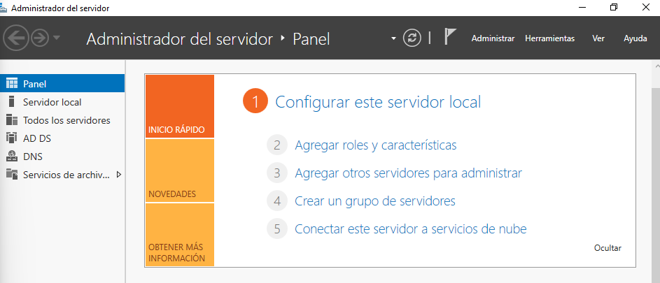
- 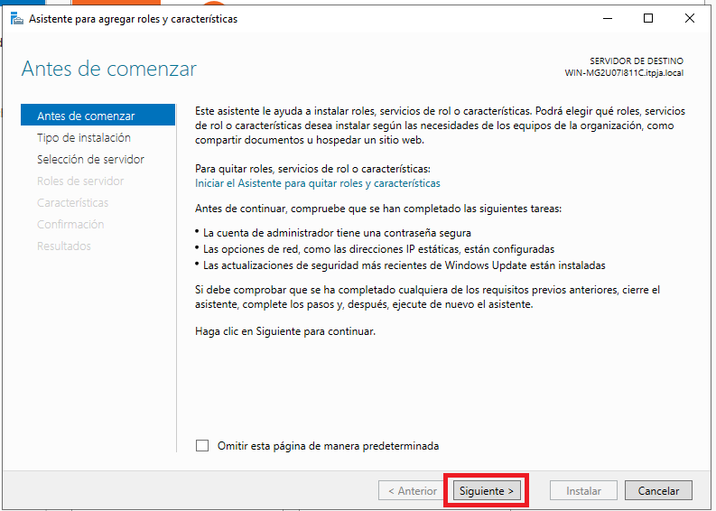
- 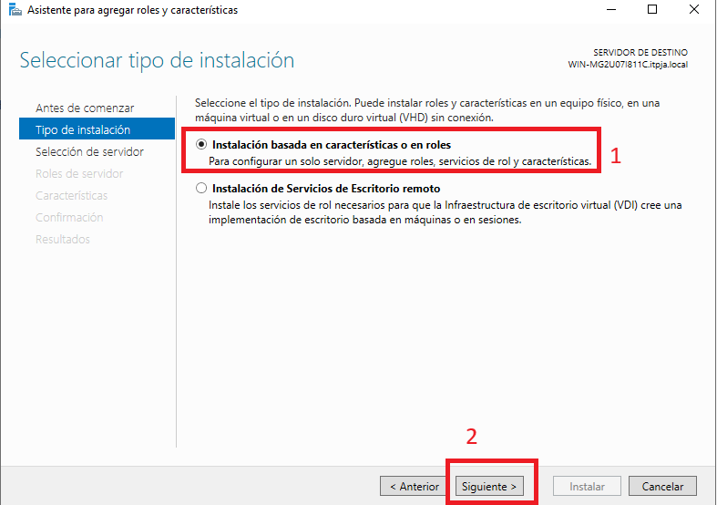
- 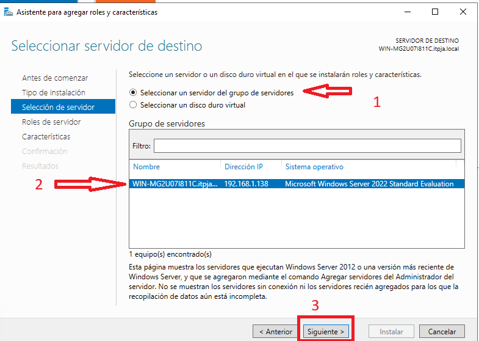
- 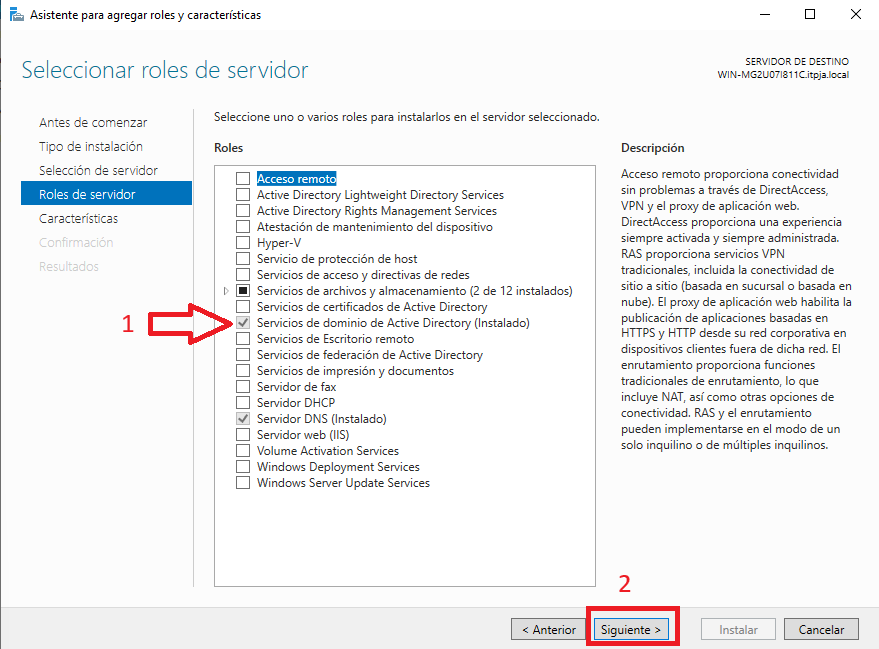
- 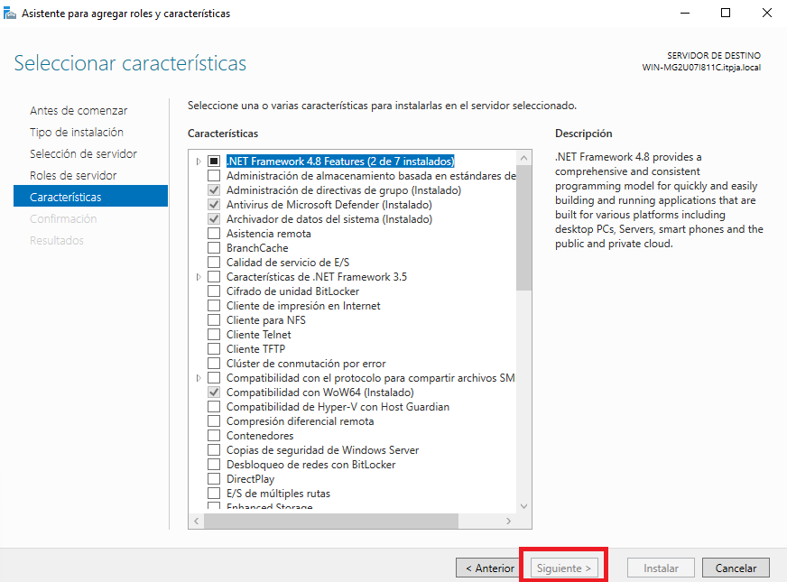
- 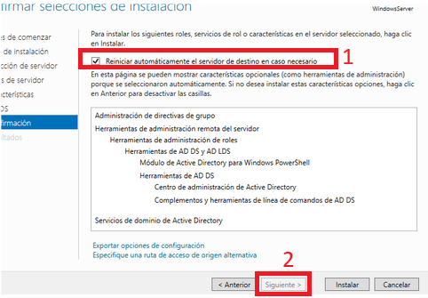

### **Configurar el Servidor como Controlador de Dominio**

> Disclaimer: Esta sección no es requerida por el profesor, pero ya que se menciona en la premisa de la actividad, la incluimos para completar el proceso de configuración de un dominio Active Directory.

Una vez hemos instalado el rol de Active Directory, volvemos a la pantalla de "Administrador del servidor".
Los pasos serían los siguientes:

1. **Promover el servidor a Controlador de Dominio**:
   1. En la parte superior veremos un aviso que marca "Promover este servidor a controlador de dominio". Hacemos click.
      1. 
   2. En el asistente de promoción, selecciona Agregar un nuevo bosque (si es la primera vez que configuras Active Directory). Este es nuestro primer controlador de dominio.
   3. Ingresa el nombre del dominio raíz (por ejemplo: itpfp.local). Para crear tu dominio, usa tu nombre+apellido.local. En nuestro caso: `itpja.local`. Se recomienda que todo sea minúsculas. A continuación pulsamos "Siguiente".
      1. Por ejemplo: `itpfp.local`. 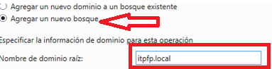
   4. Selecciona el nivel funcional del bosque y el dominio. Lo más común es dejar los valores predeterminados (por ejemplo, Windows Server 2016).
   5. Configura la contraseña del modo de restauración de servicios de directorio (DSRM). Esta contraseña es necesaria para realizar tareas de mantenimiento en caso de problemas con el Directorio Activo. Debe estar formada por mayúsculas, minúsculas, números y símbolos.
   6. Verifica el nombre NetBIOS asignado al dominio.
      1. Por ejemplo, en nuestro caso sería `ITPJA`, pero para las imágenes de ejemplo, para el dominio `itpfp.local`, sería `ITPFP`.
         1. 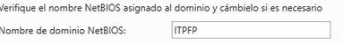
   7. Hacemos click en "Siguiente" hasta llegar a la opción de "Instalar".
   8. Por último, seleccionamos "Instalar". Una vez acabe la instalación, reiniciamos el servidor.
2. **Verificar la instalación**.
   1. Inicia sesión en el servidor utilizando la cuenta Administrador (o cualquier cuenta de dominio si ya has configurado una).
   2. Abre Usuarios y equipos de Active Directory desde el Administrador de servidor, haciendo click en Herramientas.
      1. 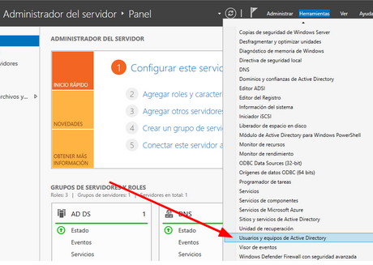
         1. Veremos el dominio recién creado (itpja.local).
         2. 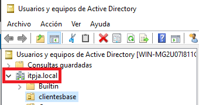

### **Crear un Usuario en Active Directory**

Una vez el servidor está configurado como controlador de dominio, podemos crear usuarios en Active Directory siguiendo estos pasos:

1. Abrir "Administrador del servidor", hacer click en "Herramientas" y seleccionar "*Usuarios y equipos de Active Directory*".
   1. 
2. En el panel izquierdo, expandir el dominio (itpja.local).
3. Opcionalmente, crear una nueva Unidad Organizativa (OU) para organizar mejor los usuarios:
   1. Hacer click derecho en el dominio, seleccionar "Nuevo" y luego "Unidad Organizativa".
      1. 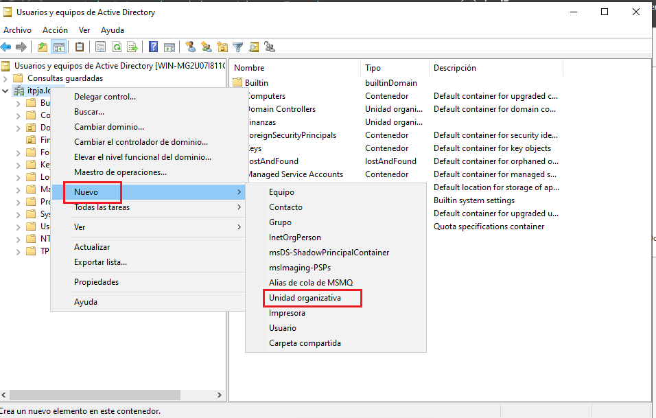
   2. Nombrar la OU (por ejemplo, "clientesbase").
      1. Es recomendable marcar la opción "Proteger contenedor contra eliminación accidental" para evitar borrar la OU por error.
      2. 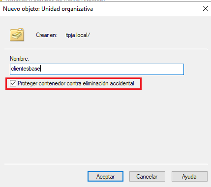
4. Crear un nuevo usuario:
   1. Hacer click derecho en la OU creada (clientesbase), seleccionar "Nuevo" y luego "Usuario".
      1. 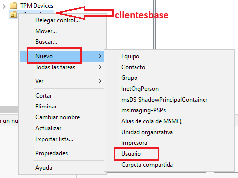
   2. Rellenar los campos con la información del usuario (nombre, apellido, nombre de inicio de sesión, etc.) y hacer click en "Siguiente".
      1. A tener en cuenta:
         - El nombre de inicio de sesión debe seguir el formato: nombre.apellido (por ejemplo, francisco.javier.osuna) o nombre (javier). Es recomendable usar minúsculas, evitar espacios y carácteres especiales o signos de puntuación.
         - El dominio debe ser el que hemos creado anteriormente (itpja.local).
      2. 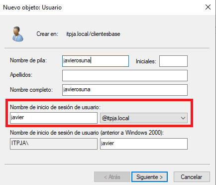
   3. Establecer una contraseña para el usuario y configurar las opciones de contraseña según sea necesario (por ejemplo, "El usuario debe cambiar la contraseña en el próximo inicio de sesión").
      1. A tener en cuenta:
         - La contraseña debe cumplir con los requisitos de complejidad (mayúsculas, minúsculas, números y símbolos).
         - No debe contener el nombre de usuario ni partes del nombre completo.
         - Por defecto, es recomendable marcar "El usuario no puede cambiar la contraseña". Si se desea que el usuario cambie la contraseña en el próximo inicio de sesión, marcar "El usuario debe cambiar la contraseña en el próximo inicio de sesión". Estas opciones son incompatibles entre sí.
         - Tenemos otras opciones como "La contraseña nunca caduca" o "Cuenta deshabilitada", que podemos dejar sin marcar para este caso.
      2. 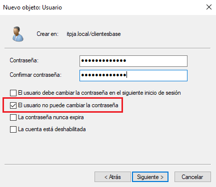
   4. Hacer click en "Finalizar" para crear el usuario.
      1. 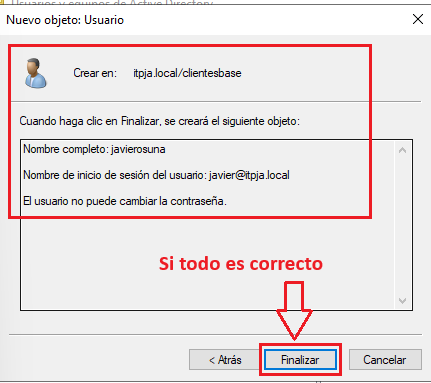

### **Configurar la Zona Horaria para inicio de sesión del Usuario**

Una vez creado el usuario, en la carpeta "Usuarios" o en la OU donde hemos creado el usuario (en nuestro caso, "clientesbase"), podemos aplicar restricciones de inicio de sesión basadas, por ejemplo, en la zona horaria. Para ello, seguimos estos pasos:

1. Seleccionar el usuario creado (javierosuna) y hacer click derecho para seleccionar "Propiedades".
   1. 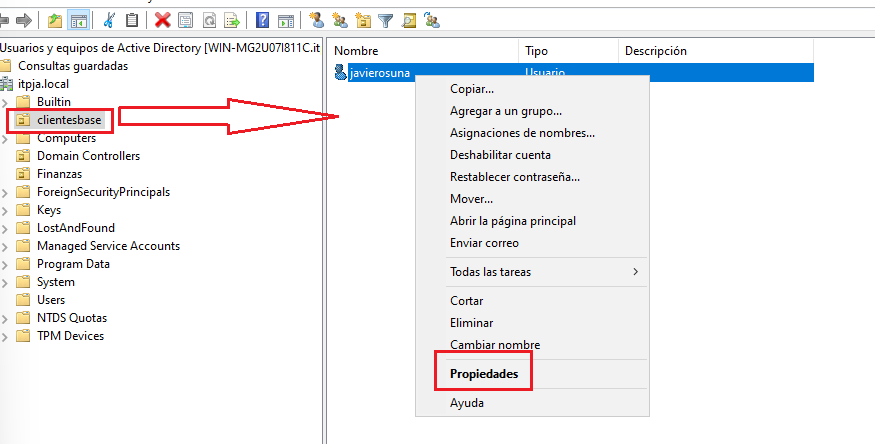
2. Se nos abrirá la ventana de propiedades del usuario.
   1. 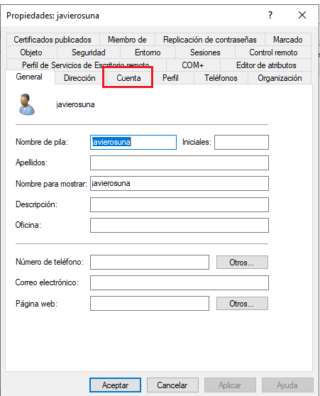
3. Ir a la pestaña "Cuenta".
   1. 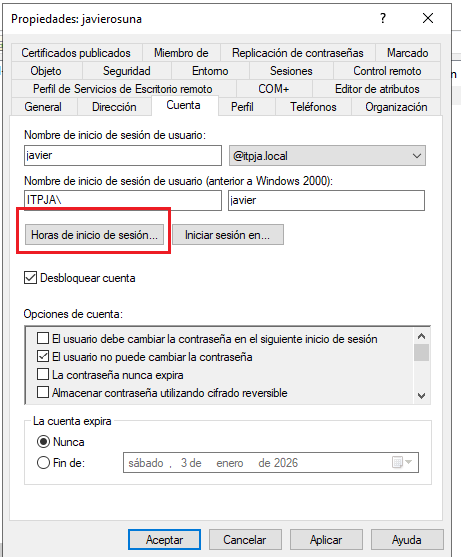
4. Abajo, en la sección "Restricciones de inicio de sesión", hacer click en el botón "Horas de inicio de sesión...".
5. Se abrirá una nueva ventana donde podemos configurar las horas permitidas para el inicio de sesión del usuario.
   1. 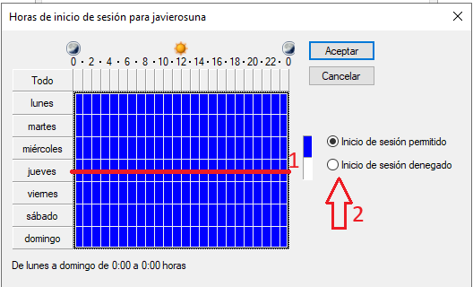
6. En nuestro caso, queremos prohibir el inicio de sesión al usuario los Jueves. Para ello, seleccionamos las franjas horarias correspondientes al Jueves y las desmarcamos.
   1. 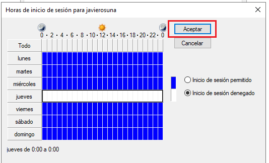
7. A continuación, hacemos click en "Aceptar" para guardar los cambios y cerrar la ventana de restricciones de inicio de sesión.
8. Finalmente, hacemos click en "Aplicar" y luego en "Aceptar" en la ventana de propiedades del usuario para guardar todos los cambios realizados.
   1. 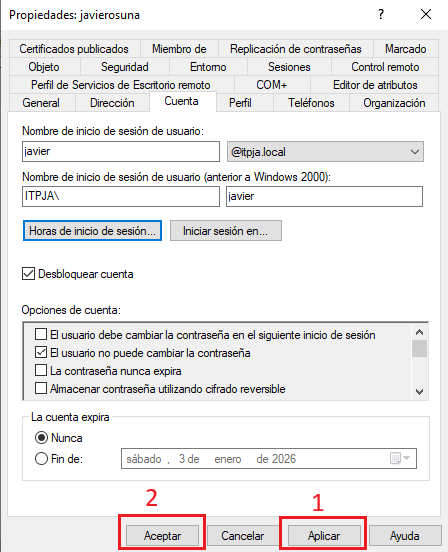

Ahora el usuario "javierosuna" tiene restricciones de inicio de sesión y no podrá iniciar sesión los Jueves.

Por último, antes de proceder a unir el cliente Windows 10 al dominio, es recomendable verificar que la configuración de red del servidor es correcta y que el servidor DNS está funcionando adecuadamente, ya que el cliente necesitará resolver el nombre del dominio para unirse correctamente.

Para acceder a la configuración de red del servidor, seguimos estos pasos:

1. Abrir el "Centro de redes y recursos compartidos" desde el Panel de Control o haciendo click derecho en el icono de red en la barra de tareas y seleccionando "Abrir configuración de red e Internet".
   1. 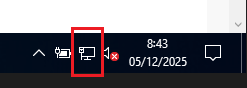
   2. 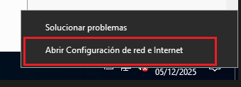
2. Hacer click en "Centro de redes y recursos compartidos".
   1. 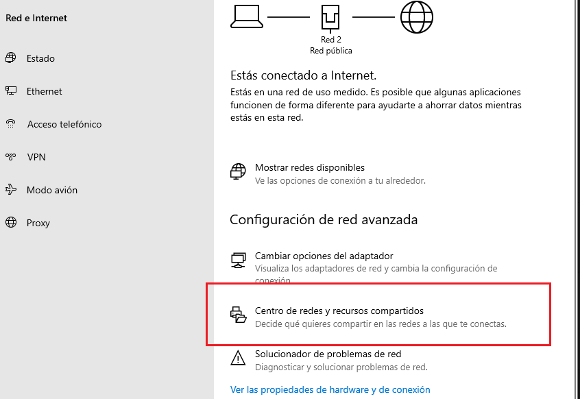
3. Hacer click derecho en el adaptador de red que estamos utilizando (por ejemplo, "Ethernet") y seleccionar "Propiedades".
   1. 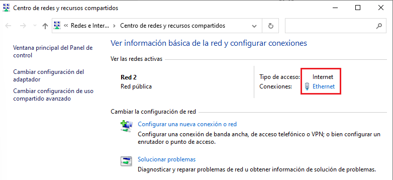
4. En la ventana de Estado de red seleccionamos "Propiedades"
   1. 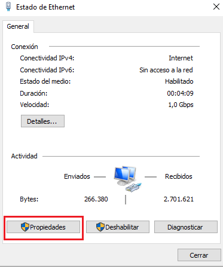
5. Se nos abrirá la ventana de propiedades del adaptador de red (en nuestro caso Ethernet).
   1. 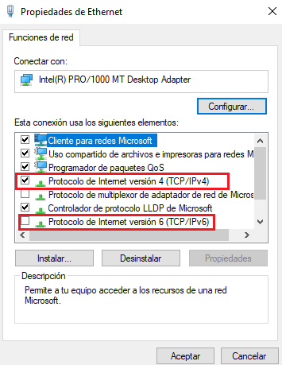
6. En la ventana de propiedades del adaptador de red, desmarcamos "Protocolo de Internet versión 6 (TCP/IPv6)".
7. Seleccionamos "Protocolo de Internet versión 4 (TCP/IPv4)" y hacemos click en "Propiedades".
8. En la ventana de propiedades de IPv4, configuramos lo siguiente:
   - Seleccionamos "Usar la siguiente dirección IP" e introducimos una dirección IP estática para el servidor (por defecto, `192.168.1.138`).
   - Introducimos la máscara de subred (por ejemplo, `255.255.255.0`) y la puerta de enlace predeterminada (por defecto, `192.168.1.1`).
9. Hacemos click en "Aceptar" para guardar los cambios y cerrar la ventana de propiedades de IPv4.

Por último, podemos reiniciar el servidor para asegurarnos de que todos los cambios se apliquen correctamente.

Una vez reiniciado, y antes de proceder a unir el cliente Windows 10 al dominio, es recomendable verificar que la configuración de red del servidor es correcta y que el servidor DNS está funcionando adecuadamente, ya que el cliente necesitará resolver el nombre del dominio para unirse correctamente.

- La **IPV6 está deshabilitada** en las propiedades del adaptador de red.
  - 
- La **IPV4 está configurada de forma manual**, de manera que:
  - La dirección IP del servidor sea estática y no genere conflictos con otras máquinas en la red.
  - La sección de DNS, hemos añadido la dirección IP del propio servidor como servidor DNS preferido (por ejemplo, `192.168.1.138`).
  - En Servidor DNS alternativo, podemos dejarlo vacío si no requerimos conexión a Internet, o usar un servidor DNS público como el de google (`8.8.8.8`).
- 

---

## **Configuración del Cliente **Windows 10 Pro** - Francisco Javier Osuna**

Una vez tenemos el servidor configurado como controlador de dominio y hemos creado un usuario con las restricciones necesarias, podemos proceder a unir el cliente **Windows 10 Pro**, asegurándonos de que la configuración de red del cliente es correcta.

En nuestro caso, la configuración de red del cliente **Windows 10 Pro** es la siguiente:

- La **IPV6 está deshabilitada** en las propiedades del adaptador de red.
  - 
- La **IPV4 está configurada de forma manual**:
  - 

### **Unir el Cliente al Dominio**

Para unir el cliente **Windows 10 Pro** al dominio, seguimos estos pasos:

1. Abrimos el "Explorador de archivos" y hacemos clic derecho en "Este PC", luego seleccionamos "Propiedades".
2. En la ventana de propiedades del sistema, hacemos clic en "Cambiar configuración" en la sección "Nombre del equipo, dominio y grupo de trabajo".
   1. 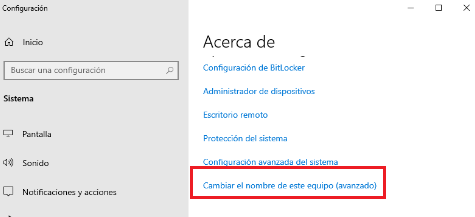
3. En la ventana de "Propiedades del sistema", hacemos clic en "Cambiar" en la sección "Para cambiar el nombre de este equipo o unirse a un dominio".
4. Seleccionamos "Dominio" e introducimos el nombre del dominio al que queremos unir el equipo (por ejemplo, `itpja.local`).
   1. 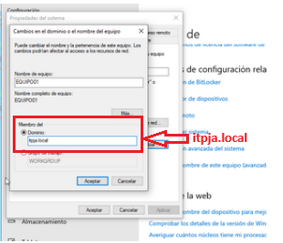
5. Hacemos clic en "Aceptar" y se nos pedirá que introduzcamos las credenciales de un usuario con permisos para unir equipos al dominio.
6. Introducimos las credenciales y hacemos clic en "Aceptar".
7. Si todo ha ido bien, recibiremos un mensaje de bienvenida al dominio. Reiniciamos el equipo para aplicar los cambios.
   1. 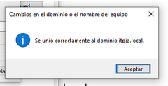

### **Iniciar Sesión con una Cuenta de Dominio**

Tras reiniciar el equipo, en la pantalla de inicio de sesión, seleccionamos "Otro usuario" e introducimos las credenciales del usuario creado en Active Directory (por ejemplo, `javier` y la contraseña correspondiente).

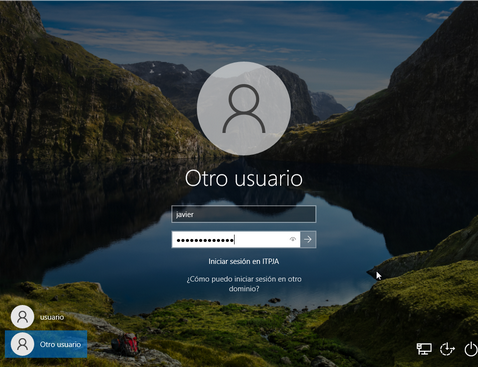

### **Verificación de Restricción por Zona Horaria**

Si todo ha sido configurado correctamente, al intentar iniciar sesión con el usuario `javier` en un día Jueves, deberíamos recibir un mensaje indicando que el inicio de sesión no está permitido en este momento debido a las restricciones de horario establecidas.

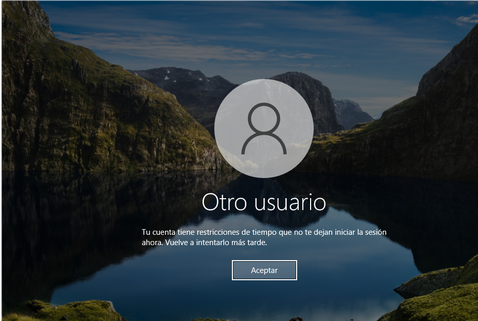

Tras verificar que la restricción de inicio de sesión por zona horaria funciona correctamente, podemos intentar iniciar sesión en otro día (por ejemplo, un Miércoles) o restablecer el horario para confirmar que el usuario puede acceder sin problemas en los horarios permitidos.

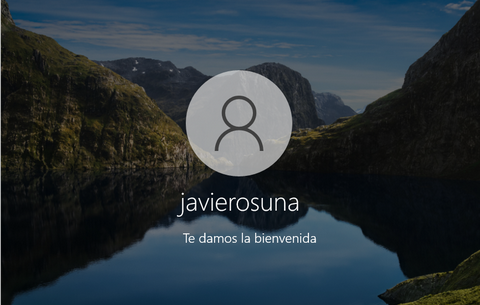
