# **Desarrollo Actividad 16: Gestión de Windows Server**

- **Autores**: José Ángel Alejo Sillero
- **Centro**: Instituto Tecnológico Pablo de la Torre
- **Curso**: 2025/2026
- **Módulo**: Sistemas Informáticos
- **Unidad**: 3 - Sistemas operativos en red. Windows Server

Para la realización de esta actividad se ha utilizado una máquina virtual con Windows Server 2019 instalada y configurada como controlador de dominio en un entorno de Active Directory con el dominio "itpja.local".

Las instrucciones de la actividad se han seguido en el orden propuesto, dividiendo el desarrollo en cuatro apartados principales. Para cada apartado se describen los pasos seguidos, los comandos utilizados y los resultados obtenidos, incluyendo capturas de pantalla cuando es relevante.

Para la realización de las tareas se han utilizado tanto la interfaz gráfica de Windows Server como PowerShell, según lo indicado en las instrucciones.

Se puede revisar la premisa propuesta en el siguiente enlace: [Premisa Actividad 16](PremisaAct16.md)

---
<div style="page-break-after: always;"></div>

> **Tabla de contenidos**

- [**Desarrollo Actividad 16: Gestión de Windows Server**](#desarrollo-actividad-16-gestión-de-windows-server)
  - [**1. Unidades Organizativas (OU) y Políticas de Grupo (GPO)**](#1-unidades-organizativas-ou-y-políticas-de-grupo-gpo)
  - [**2. Gestión de Usuarios con Comandos CSVDE y LDIFDE**](#2-gestión-de-usuarios-con-comandos-csvde-y-ldifde)
  - [**3. Creación de un Administrador de Dominio**](#3-creación-de-un-administrador-de-dominio)
  - [**4. Grupos y Compartición de Carpetas**](#4-grupos-y-compartición-de-carpetas)

---
<div style="page-break-after: always;"></div>

## **1. Unidades Organizativas (OU) y Políticas de Grupo (GPO)**

En nuestro caso, las OU se llamarán: "DAM", "DAW" y "SMR". Cada una tendrá una unidad organizativa dentro, serán "LM", "SI" y "SOM" respectivamente, con usuarios dentro.

Aplicaremos las instrucciones de OU_Usarios a la unidad "DAM/LM", las de OU_Temporales a "DAW/SI" y las de OU_Administradores a "SMR/SOM".

1. OU Existentes. 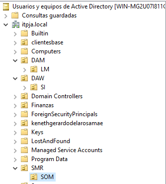
2. OU_Usuarios/DAM/LM:
   1. Bloquear desinstalación de programas. 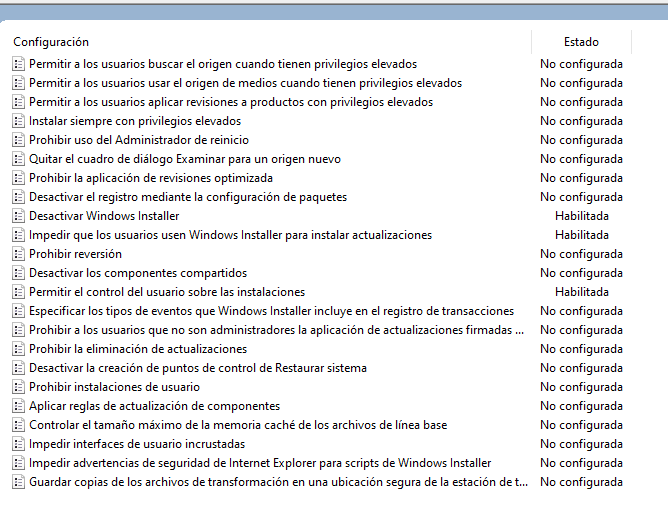
   2. Impedir cambio de fondo de escritorio. 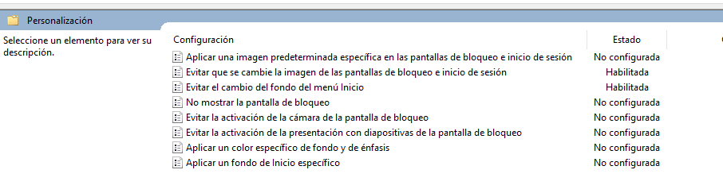
3. OU_Temporales/DAW/SI:
   1. Cerrar sesión tras 5 minutos de inactividad. 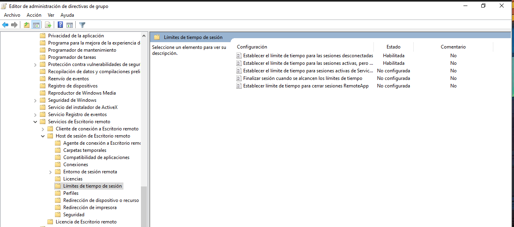
   2. Restringir acceso al Panel de Control. 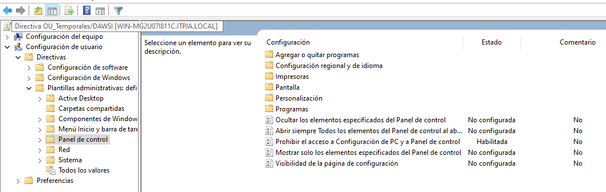
4. OU_Administradores/SMR/SOM:
   1. Permitir acceso total a configuraciones del sistema. [text](Act16_GestionWindowsServer_JAAlejo.md)
   2. En nuestro caso para habilitarla nos obliga a indicar configuraciones concretas de visibilidad(show o hide), por lo que de manera provisional ocultaremos todas las páginas de "acerca de"/"about" mediante la línea de configuración `Hide:*;About` 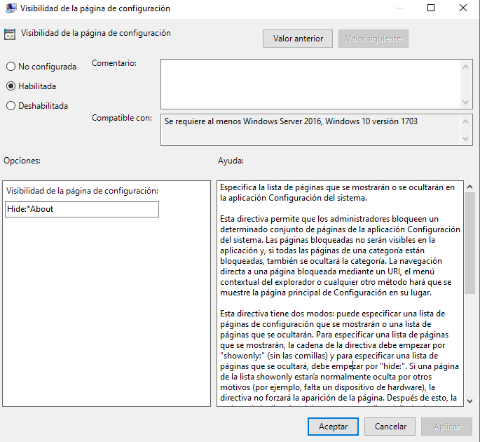

El punto 4 de inicio de sesión con alguno de los usuarios de las unidades organizativas no se realiza debido a no ser requisito obligatorio para la entrega.

---
<div style="page-break-after: always;"></div>

## **2. Gestión de Usuarios con Comandos CSVDE y LDIFDE**

1. Exportar usuarios existentes de una unidad organizativa con csvde:
   - Comando utilizado: `csvde -f usuarios.csv -d "OU=LM,OU=DAM,DC=itpja,DC=local" -r "(objectClass=user)" -l "DN,sAMAccountName,userPrincipalName,objectClass"`
   - Resultado: Archivo CSV guardado en el escritorio con los usuarios exportados. 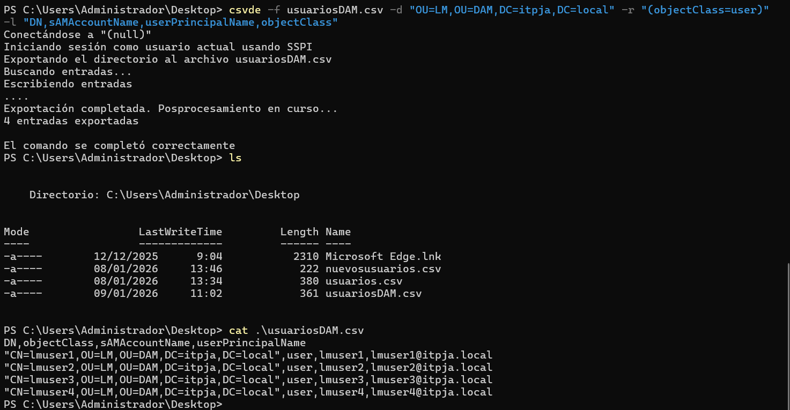
2. Importar una nueva unidad organizativa con ldifde:
   - Archivo LDIF creado con la estructura necesaria para la nueva OU y usuarios.
   - Comando utilizado: `ldifde -i -f .\ImportarUsuariosPRUEBAS.ldf -j .\Logs`
   - Resultado: Nueva unidad organizativa y usuarios importados correctamente. 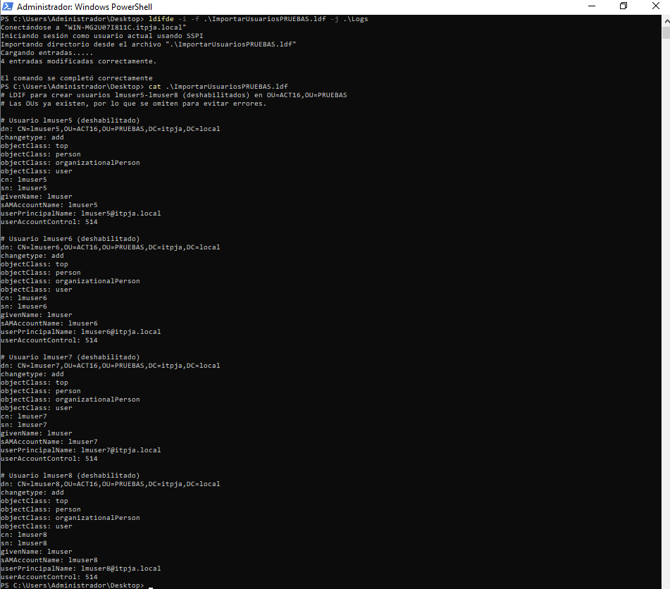
   - Comando `Import-Module ActiveDirectory` para importar el módulo de Active Directory en PowerShell.
   - Comando `Get-ADOrganizationalUnit -Filter * -SearchBase "DC=itpja,DC=local" | Where-Object {$_.Name -eq "PRUEBAS" -or $_.Name -eq "ACT16"} | Select Name, DistinguishedName` para comprobar la creación de la OU.
   - Comando `Get-ADUser -Filter * -SearchBase "OU=ACT16,OU=PRUEBAS,DC=itpja,DC=local" | Select Name, SamAccountName, Enabled, UserPrincipalName` para comprobar la creación de los usuarios dentro de la OU.
   - 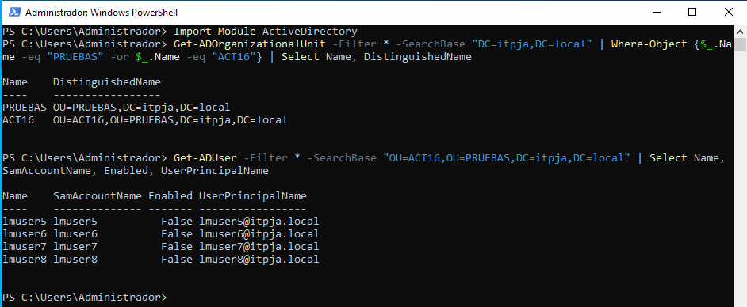
   - Nota: Los usuarios están deshabilitados por defecto al crearlos con ldifde, se habilitarán posteriormente si fuera necesario.
3. Modificar un atributo (cambiar el nombre del usuario) con ldifde:
   1. Comprobar usuarios existentes en la OU LM hija de la OU DAM:
      - Comando utilizado: `Get-ADUser -Filter * -SearchBase "OU=LM,OU=DAM,DC=itpja,DC=local" | Select Name, SamAccountName, GivenName`
      - Resultado: Lista de usuarios con sus nombres actuales.
        - 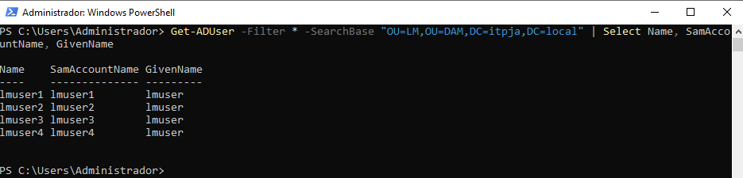
   - Archivo LDIF creado para modificar el atributo.
   - Comando utilizado: `ldifde -i -f .\ModificarUsuarios.ldf -j .\Logs`
   - Resultado: Atributo modificado correctamente.
     - 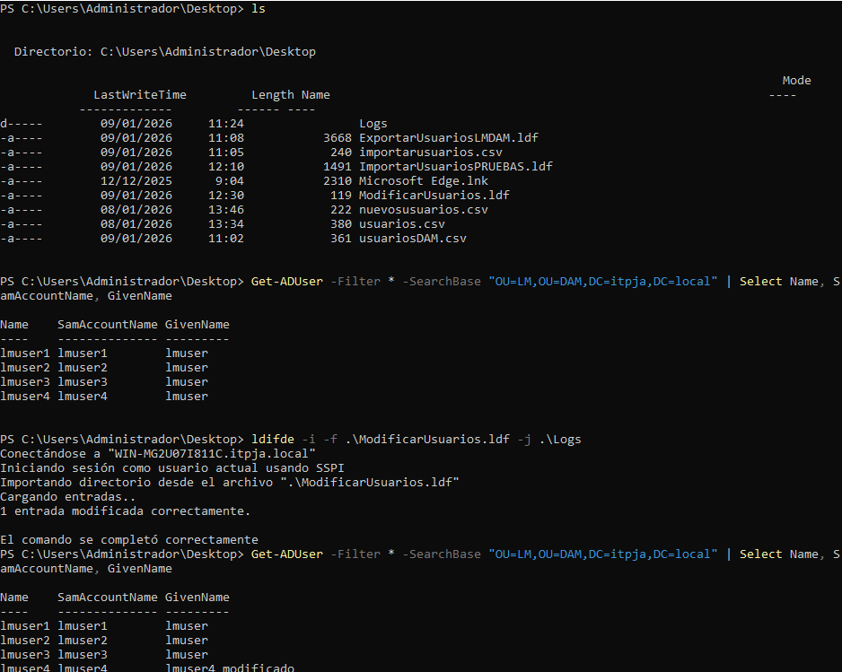
4. Eliminar un usuario del sistema con ldifde:
   - Comando utilizado: `ldifde -i -f .\EliminarUsuarios.ldf -j .\Logs`
   - Resultado: Usuario eliminado correctamente.
     - 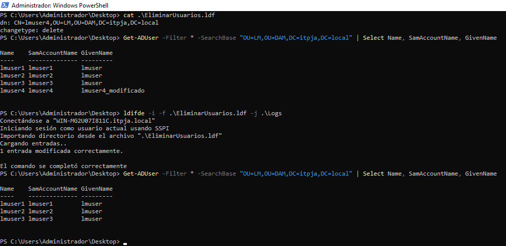
   - Archivo LDIF creado para eliminar el usuario.

Contenido del archivo ldf en apartado 3, modificar atributo de usuario:

```ldf
dn: CN=lmuser4,OU=LM,OU=DAM,DC=itpja,DC=local
changetype: modify
replace: givenName
givenName: lmuser4_modificado
-
```

> El guión (-) al final indica el final de la modificación. Se utiliza en los archivos LDIF para separar múltiples modificaciones o entradas, pero no se utiliza en comandos delete.

Contenido del archivo ldf en apartado 4, eliminar usuario:

```ldf
dn: CN=lmuser4_modificado,OU=LM,OU=DAM,DC=itpja,DC=local
changetype: delete
```

---
<div style="page-break-after: always;"></div>

## **3. Creación de un Administrador de Dominio**

1. Creación de un usuario y asignación de permisos de Administrador del Dominio usando el Administrador del Servidor:
   - Abrir el Administrador del Servidor y navegar a "Herramientas" > "Usuarios y Equipos de Active Directory".
     - 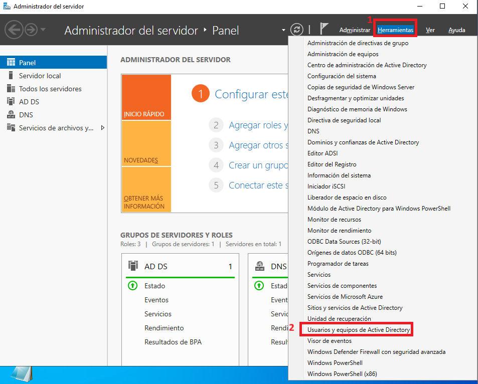
     - 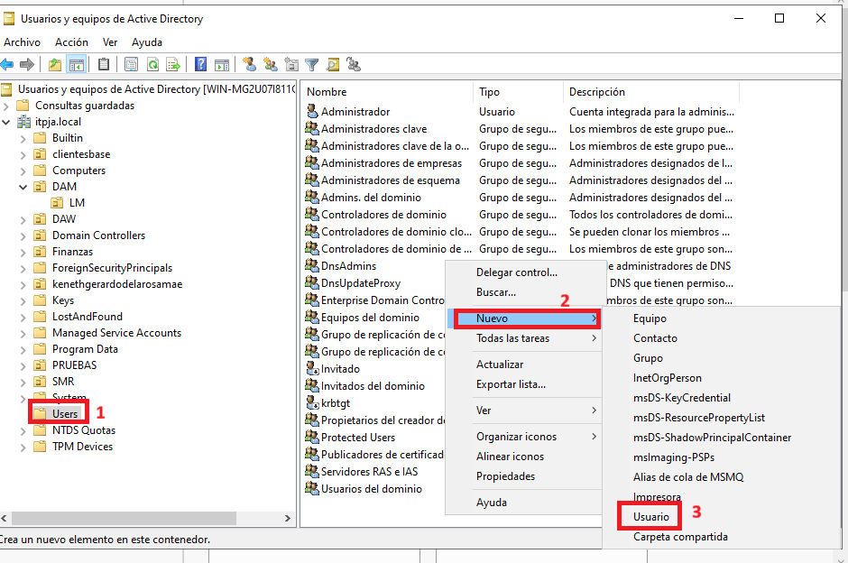
   - Crear un nuevo usuario llamado "admin_dominio".
     - 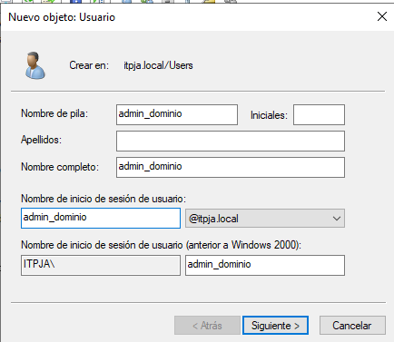
   - Asignar una contraseña segura y configurar las opciones necesarias.
     - 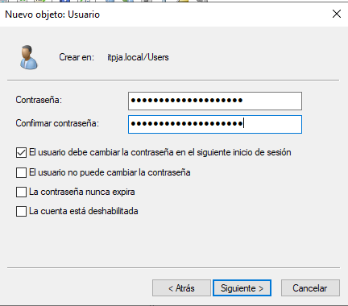
   - Agregar el usuario al grupo "Administradores del Dominio".
     - 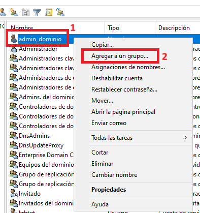
   - Seleccionar el grupo "Administradores del Dominio" y agregar el usuario creado.
     - 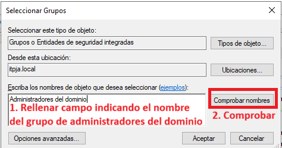
   - Comprobar que el grupo existe.
     - 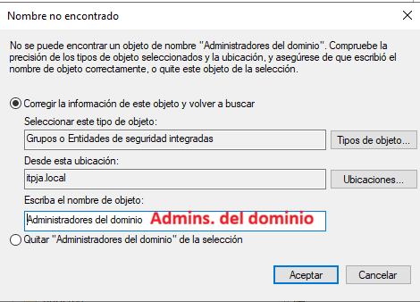
     - En nuestro caso el grupo "Administradores del Dominio" no existe, el grupo de administradores es "Admins. del dominio", por lo que lo corregimos y pulsamos aceptar.
   - El usuario "admin_dominio" se ha agregado correctamente al grupo "Admins. del dominio".
     - 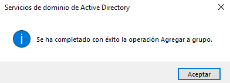
     - 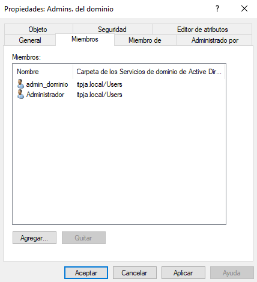
2. Creación de un usuario y asignación de permisos de Administrador del Dominio usando PowerShell:
   - Comando utilizado para crear el usuario: `New-ADUser -Name "admin_dominio_ps" -GivenName "Admin" -Surname "Dominio_PS" -SamAccountName "admin_dominio_ps" -UserPrincipalName "admin_dominio_ps@itpja.local" -AccountPassword (ConvertTo-SecureString "ContraseñaSegura123!" -AsPlainText -Force) -Enabled $true -Path "OU=ACT16,OU=PRUEBAS,DC=itpja,DC=local"`
   - Verificar creación del usuario:
     - `Get-ADUser -Filter {SamAccountName -eq "admin_dominio_ps"} | Select Name, SamAccountName, Enabled, UserPrincipalName`
   - Verificar existencia de grupos Admins y grupo "Admins. del dominio":
     - `Get-ADGroup -Filter {Name -like "*Admin*"} | Select Name, DistinguishedName`
     - Comando utilizado: `Get-ADGroup -Filter {Name -eq "Admins. del dominio"}`
   - Comando utilizado para agregar al grupo: `Add-ADGroupMember -Identity "Admins. del dominio" -Members "admin_dominio_ps"`
   - Verificar que el usuario ha sido agregado al grupo:
     - `Get-ADGroupMember -Identity "Admins. del dominio" | Where-Object {$_.SamAccountName -eq "admin_dominio_ps"}`
   - Resultado: Usuario creado y agregado al grupo "Administradores del dominio".
   - 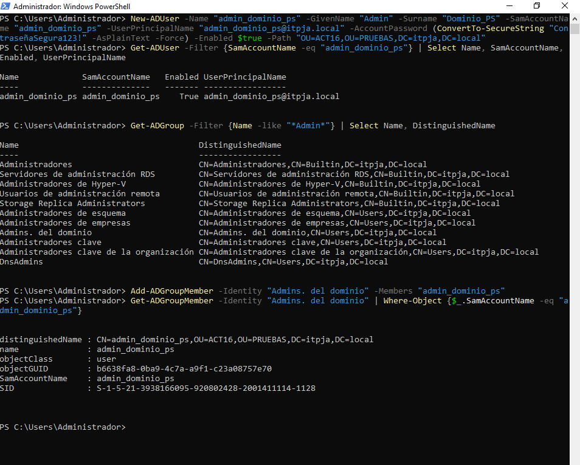

---
<div style="page-break-after: always;"></div>

## **4. Grupos y Compartición de Carpetas**

Los grupos en Active Directory son colecciones de objetos, como usuarios, computadoras y otros grupos, que se utilizan para simplificar la administración de permisos y recursos en una red. Al agrupar objetos, los administradores pueden asignar permisos y derechos a un grupo en lugar de hacerlo individualmente para cada objeto, lo que facilita la gestión y mejora la seguridad.

Podemos entenderlos como contenedores que permiten organizar y gestionar de manera eficiente los recursos y usuarios dentro de un entorno de Active Directory. Existen dos tipos principales de grupos:

1. Grupos de Seguridad: Estos grupos se utilizan para asignar permisos y derechos de acceso a recursos dentro de la red, como carpetas compartidas, impresoras y otros servicios. Los miembros de un grupo de seguridad heredan los permisos asignados al grupo.
2. Grupos de Distribución: Estos grupos se utilizan principalmente para la distribución de correos electrónicos. No tienen permisos de seguridad asociados y se utilizan para enviar mensajes a múltiples destinatarios de manera eficiente.

Los alcances de grupo determinan el ámbito en el que un grupo puede ser utilizado y cómo se pueden asignar permisos. Los tres alcances principales son:

1. Grupos Locales: Estos grupos se crean en un dominio específico y pueden contener miembros de cualquier dominio dentro del bosque. Se utilizan para asignar permisos a recursos locales en el dominio donde se crean.
2. Grupos Globales: Estos grupos se crean en un dominio y solo pueden contener miembros del mismo dominio. Se utilizan para asignar permisos a recursos en cualquier dominio dentro del bosque.
3. Grupos Universales: Estos grupos pueden contener miembros de cualquier dominio dentro del bosque y se utilizan para asignar permisos a recursos en cualquier dominio del bosque. Son útiles en entornos con múltiples dominios.

Pasos seguidos:

1. Creación de dos usuarios en la OU_Usuarios y asociación a un grupo de seguridad (PowerShell):
   - Crear usuarios "usuario1" y "usuario2" en la OU "LM" dentro de "DAM". `New-ADUser -Name "usuario1" -GivenName "Usuario" -Surname "Uno" -SamAccountName "usuario1" -UserPrincipalName "usuario1@itpja.local" -AccountPassword (ConvertTo-SecureString "ContraseñaSegura123!" -AsPlainText -Force) -Enabled $true -Path "OU=LM,OU=DAM,DC=itpja,DC=local"`
   - Crear usuario "usuario2": `New-ADUser -Name "usuario2" -GivenName "Usuario" -Surname "Dos" -SamAccountName "usuario2" -UserPrincipalName "usuario2@itpja.local" -AccountPassword (ConvertTo-SecureString "ContraseñaSegura123!" -AsPlainText -Force) -Enabled $true -Path "OU=LM,OU=DAM,DC=itpja,DC=local"`
   - Crear grupo de seguridad: `New-ADGroup -Name "GrupoUsuariosLM" -GroupScope Global -GroupCategory Security -Path "OU=LM,OU=DAM,DC=itpja,DC=local"`
   - Agregar usuarios al grupo: `Add-ADGroupMember -Identity "GrupoUsuariosLM" -Members "usuario1","usuario2"`
     - 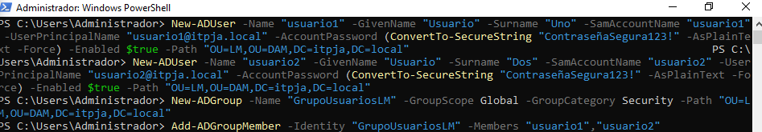
   - Comprobar usuarios y grupo:
     - `Get-ADUser -Filter {SamAccountName -eq "usuario1"} | Select Name, SamAccountName, Enabled, UserPrincipalName`
     - `Get-ADUser -Filter {SamAccountName -eq "usuario2"} | Select Name, SamAccountName, Enabled, UserPrincipalName`
     - `Get-ADGroupMember -Identity "GrupoUsuariosLM" | Select Name, SamAccountName`
     - 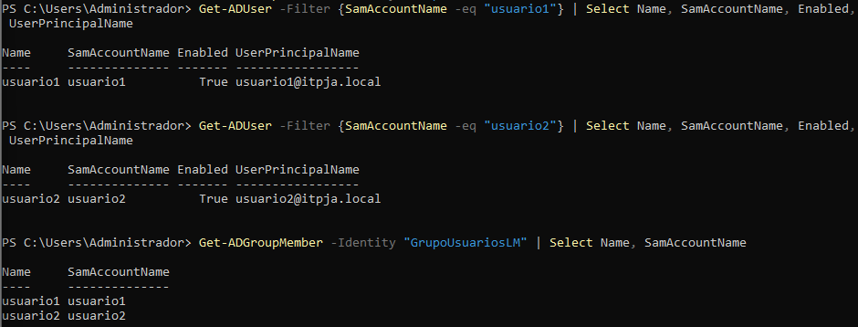
2. Configuración de una carpeta compartida para los dos usuarios con permisos específicos:
   - Crear carpeta compartida en C:\Compartida_LM.
   - Configurar permisos NTFS:
     - Usuario 1 (usuario1): Permiso de lectura.
       - Comando: `icacls "C:\Compartida_LM" /grant "itpja\usuario1:(R)"`
     - Usuario 2 (usuario2): Permiso de lectura y escritura.
       - Comando: `icacls "C:\Compartida_LM" /grant "itpja\usuario2:(M)"`
     - 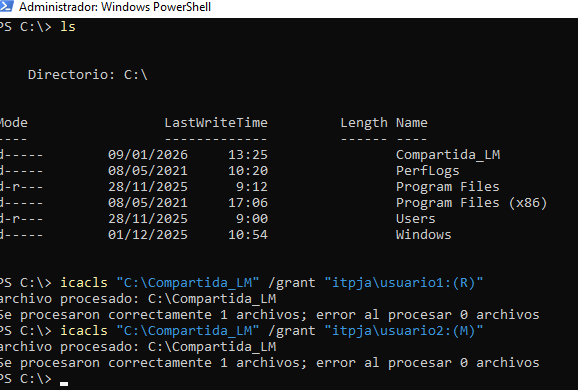
   - Configurar permisos de compartición:
     - Usuario 1 (usuario1): Permiso de lectura.
       - Comando: `net share Compartida_LM=C:\Compartida_LM /grant:itpja\usuario1,READ`
     - Usuario 2 (usuario2): Permiso de lectura y escritura.
       - Comando: `Grant-SmbShareAccess -Name "Compartida_LM" -AccountName "itpja\usuario2" -AccessRight Change`
     - 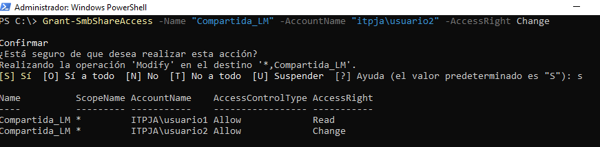
   - Comprobar permisos configurados:
     - Comando: `net share Compartida_LM`
     - 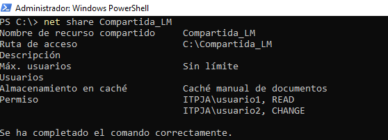
