# **Actividad 19: Configurar Volúmenes en Windows - José Ángel Alejo Sillero**

- **Autor**: José Ángel Alejo Sillero
- **Centro**: Instituto Tecnológico Pablo de la Torre
- **Curso**: 2025/2026
- **Módulo**: Sistemas Informáticos
- **Unidad**: 4 - Particiones y RAID

## **Estructura de la Actividad: DOS FASES**

Esta actividad se ha realizado en **DOS FASES DIFERENCIADAS** para cumplir completamente con la premisa:

- **Fase 1**: Máquina virtual con **Windows 10 Pro** en **Proxmox** (VM 101) - Volúmenes Distribuido, Seccionado y Reflejado
- **Fase 2**: Máquina virtual con **Windows Server 2022** en **Proxmox** (VM 103) - Volumen RAID 5

Esta estructura fue necesaria porque Windows 10 Pro **NO soporta nativamente la creación de volúmenes RAID 5** (solo disponible en Windows Server). La limitación se documenta detalladamente en la **Sección 6** y se resuelve implementando RAID 5 en Windows Server 2022 en la **Sección 7**.

---

### **Fase 1 - Windows 10 Pro (Proxmox - VM 101)**

Para la realización de esta primera fase se utiliza una máquina virtual con **Windows 10 Pro** instalada en **Proxmox** (VM 101). El objetivo es configurar diferentes tipos de volúmenes utilizando la herramienta "Crear y formatear particiones del disco duro" (Disk Management).

Se añadirán **4 nuevos discos duros SCSI de 3 GB cada uno** a la máquina virtual y se crearán los siguientes volúmenes de forma **simultánea**: **Distribuido**, **Seccionado** y **Reflejado**. Todos los volúmenes se crearán en conjunto, se documentarán de forma combinada y posteriormente se eliminarán al finalizar la actividad.

> **Nota importante**: Esta práctica se realiza en **Windows 10 Pro**, que **NO permite crear volúmenes RAID 5** (esta funcionalidad solo está disponible en Windows Server). Por tanto, se documentarán únicamente los tres primeros tipos de volúmenes.
>
> **Nota metodológica**: Dado que disponemos de exactamente 4 discos (3 GB cada uno), los volúmenes se crearán de forma simultánea optimizando el uso del espacio: Distribuido (50% disco 1 + 50% disco 2), Seccionado (50% disco 1 + 50% disco 2 + 50% disco 3) y Reflejado (50% disco 3 + 50% disco 4). Todos se documentarán conjuntamente y se eliminarán después de completar las capturas.
>
> **Nota sobre el hipervisor**: A diferencia del resto de compañeros que utilizan VirtualBox, esta práctica la realizo en **Proxmox VE**, un hipervisor de virtualización basado en KVM que hosteo en un servidor personal que tengo en casa al cual accedo remotamente. Por tanto, los pasos para añadir discos y configurar la VM difieren ligeramente.

Se puede revisar la premisa propuesta en el siguiente enlace: [Premisa Actividad 19](PremisaAct19.md)

---
<div style="page-break-after: always;"></div>

> **Tabla de contenidos**

- [**Actividad 19: Configurar Volúmenes en Windows - José Ángel Alejo Sillero**](#actividad-19-configurar-volúmenes-en-windows---josé-ángel-alejo-sillero)
  - [**Estructura de la Actividad: DOS FASES**](#estructura-de-la-actividad-dos-fases)
    - [**Fase 1 - Windows 10 Pro (Proxmox - VM 101)**](#fase-1---windows-10-pro-proxmox---vm-101)
  - [**REQUISITOS PREVIOS**](#requisitos-previos)
  - [**1. Añadir Discos Duros a la Máquina Virtual en Proxmox**](#1-añadir-discos-duros-a-la-máquina-virtual-en-proxmox)
    - [**Pasos en Proxmox VE:**](#pasos-en-proxmox-ve)
    - [**Capturas de referencia:**](#capturas-de-referencia)
  - [**2. Instalar Drivers VirtIO y Detectar Discos en Windows**](#2-instalar-drivers-virtio-y-detectar-discos-en-windows)
    - [**2.1. Instalación de Drivers VirtIO**](#21-instalación-de-drivers-virtio)
      - [**Pasos para instalar VirtIO Drivers:**](#pasos-para-instalar-virtio-drivers)
      - [**Capturas de referencia (Drivers VirtIO):**](#capturas-de-referencia-drivers-virtio)
    - [**2.2. Inicializar los Discos en Windows**](#22-inicializar-los-discos-en-windows)
      - [**Pasos:**](#pasos)
      - [**Capturas de referencia (Inicialización):**](#capturas-de-referencia-inicialización)
  - [**3. Crear Volumen Distribuido (Spanned Volume)**](#3-crear-volumen-distribuido-spanned-volume)
    - [Características del Volumen Distribuido](#características-del-volumen-distribuido)
    - [Pasos para crear Volumen Distribuido](#pasos-para-crear-volumen-distribuido)
    - [**Capturas de referencia (Volumen Distribuido):**](#capturas-de-referencia-volumen-distribuido)
  - [**4. Crear Volumen Seccionado (Striped Volume - RAID 0)**](#4-crear-volumen-seccionado-striped-volume---raid-0)
    - [Características del Volumen Seccionado](#características-del-volumen-seccionado)
    - [Pasos para crear Volumen Seccionado](#pasos-para-crear-volumen-seccionado)
    - [**Capturas de referencia (Volumen Seccionado):**](#capturas-de-referencia-volumen-seccionado)
  - [**5. Crear Volumen Reflejado (Mirrored Volume - RAID 1)**](#5-crear-volumen-reflejado-mirrored-volume---raid-1)
    - [Características del Volumen Reflejado](#características-del-volumen-reflejado)
    - [Pasos para crear Volumen Reflejado](#pasos-para-crear-volumen-reflejado)
    - [**Capturas de referencia (Volumen Reflejado):**](#capturas-de-referencia-volumen-reflejado)
  - [**6. Volumen RAID 5 - NO DISPONIBLE en Windows 10 Pro**](#6-volumen-raid-5---no-disponible-en-windows-10-pro)
    - [Características del Volumen RAID 5 (Información Teórica)](#características-del-volumen-raid-5-información-teórica)
    - [**IMPORTANTE - Limitación de Windows 10 Pro**](#importante---limitación-de-windows-10-pro)
    - [Alternativas en Windows 10 Pro](#alternativas-en-windows-10-pro)
    - [**Intento fallido con Windows Storage Spaces**](#intento-fallido-con-windows-storage-spaces)
      - [**Pasos intentados:**](#pasos-intentados)
      - [**Resultado del intento:**](#resultado-del-intento)
      - [**Análisis de la causa del fallo:**](#análisis-de-la-causa-del-fallo)
      - [**Prueba adicional con discos SATA (Posterior):**](#prueba-adicional-con-discos-sata-posterior)
      - [**Conclusión:**](#conclusión)
    - [**Pruebas realizadas:**](#pruebas-realizadas)
    - [**Resumen de validación:**](#resumen-de-validación)
    - [**Capturas de referencia (Demostración de limitación):**](#capturas-de-referencia-demostración-de-limitación)
  - [**7. Crear Volumen RAID 5 en Windows Server 2022**](#7-crear-volumen-raid-5-en-windows-server-2022)
    - [**Solución de problemas previos**](#solución-de-problemas-previos)
      - [**Problema 1: Discos marcados como "Desactivados"**](#problema-1-discos-marcados-como-desactivados)
      - [**Problema 2: Discos con protección de escritura**](#problema-2-discos-con-protección-de-escritura)
      - [**Problema 3: Discos no inicializados**](#problema-3-discos-no-inicializados)
    - [Características del Volumen RAID 5](#características-del-volumen-raid-5)
    - [Pasos para crear Volumen RAID 5](#pasos-para-crear-volumen-raid-5)
    - [**Capturas de referencia (Volumen RAID 5):**](#capturas-de-referencia-volumen-raid-5)
  - [**8. Vista Final - Estado de los Discos**](#8-vista-final---estado-de-los-discos)
    - [**Volúmenes documentados (creados simultáneamente en Windows 10 Pro y Windows Server 2022):**](#volúmenes-documentados-creados-simultáneamente-en-windows-10-pro-y-windows-server-2022)
    - [**Estado final de los discos:**](#estado-final-de-los-discos)
    - [**Capturas de referencia (Vista Final):**](#capturas-de-referencia-vista-final)
  - [**Conclusiones**](#conclusiones)
    - [**Resumen de volúmenes creados y documentados:**](#resumen-de-volúmenes-creados-y-documentados)
      - [**Fase 1 - Windows 10 Pro (Proxmox - VM 101) - 4 discos de 3 GB cada uno:**](#fase-1---windows-10-pro-proxmox---vm-101---4-discos-de-3-gb-cada-uno)
      - [**Fase 2 - Windows Server 2022 (Proxmox - VM 103) - 4 discos de 4 GB cada uno:**](#fase-2---windows-server-2022-proxmox---vm-103---4-discos-de-4-gb-cada-uno)
    - [**Consideraciones importantes:**](#consideraciones-importantes)
    - [**Diferencias con la configuración estándar (VirtualBox + Windows Server):**](#diferencias-con-la-configuración-estándar-virtualbox--windows-server)
    - [**Verificación final:**](#verificación-final)

---
<div style="page-break-after: always;"></div>

## **REQUISITOS PREVIOS**

- **Sistema Operativo**:
  - Windows 10 Pro instalado en la máquina virtual.
  - **Limitación importante**: Windows 10 Pro **NO permite crear RAID 5** (solo disponible en Windows Server).
- **Hipervisor**:
  - **Proxmox VE** (Virtual Environment).
  - Acceso a la interfaz web de Proxmox.
  - Máquina virtual (identificada en mi caso como **VM 101**).
  - Mínimo 4 GB de RAM asignada a la VM.
  - Privilegios de administrador en el sistema Windows.
- **Discos Duros**:
  - **Exactamente 4 discos duros virtuales nuevos** a añadir (según premisa).
  - Tamaño: **3 GB (3 GiB)** cada uno.
  - Tipo de disco: **QEMU** (formato nativo de Proxmox/KVM).
  - Bus: **SCSI** con emulación SSD.
  - Almacenamiento: **local-vm** (o el storage local configurado en Proxmox).
  - **Importante**: Los volúmenes se crearán de forma simultánea aprovechando optimamente los 4 discos disponibles. Se documentarán conjuntamente y se eliminarán todos al finalizar.
- **Drivers adicionales**:
  - **VirtIO Drivers para Windows**: Necesarios para que Windows 10 detecte los discos SCSI virtuales de Proxmox.
  - Versión utilizada: virtio-win-0.1.285-1 o superior.

---
<div style="page-break-after: always;"></div>

## **1. Añadir Discos Duros a la Máquina Virtual en Proxmox**

### **Pasos en Proxmox VE:**

1. **Apagar completamente la máquina virtual** de Windows 10 Pro (VM 101).
2. **Acceder a la interfaz web de Proxmox**:
   - Abrir el navegador y conectarse a la consola de administración de Proxmox.
3. **Seleccionar la máquina virtual**:
   - En el panel lateral izquierdo, seleccionar la **VM 101** (o el ID correspondiente).
   - Se desplegará un menú lateral derecho con varias opciones.
4. **Acceder a la sección de Hardware**:
   - En el menú desplegable, seleccionar **HARDWARE**.
   - Se mostrará la lista de dispositivos actuales de la VM.
5. **Añadir el primer disco duro**:
   - Hacer clic en el botón **"Agregar"** (ubicado en la parte superior).
   - Seleccionar **"Disco Duro"** del menú desplegable.
6. **Configurar el nuevo disco** con los siguientes parámetros:
   - **Bus/Dispositivo**: SCSI
   - **Caché**: Por defecto (sin memoria caché)
   - **Descartar**: Sí
   - **IO thread**: Sí
   - **Almacenamiento**: local-vm (o el storage local configurado)
   - **Tamaño de disco**: **3 GiB**
   - **Formato**: Imagen de disco QEMU (qcow2)
   - **Emulación de SSD**: Sí
   - **Sólo lectura**: No
   - **Respaldo**: Sí
   - **Saltar replicación**: No
   - **IO asíncrono**: Por defecto (io_uring)
7. Hacer clic en **"Agregar"** para crear el disco.
8. **Repetir los pasos 5-7 tres veces más** hasta tener **4 discos nuevos** añadidos (scsi1, scsi2, scsi3, scsi4).
9. **Verificar** que los 4 discos aparecen en la lista de Hardware.

### **Capturas de referencia:**

- Selección de VM 101 en Proxmox:
  - 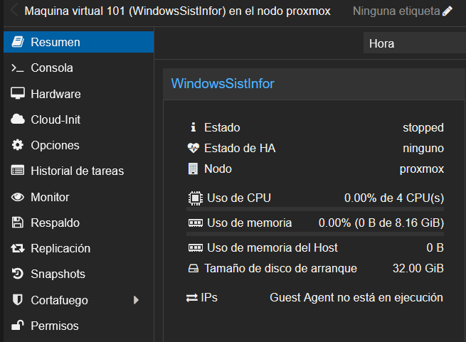
- Menú Hardware en Proxmox:
  - 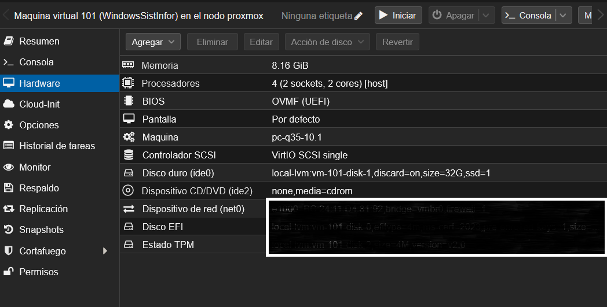
- Botón Agregar Disco Duro:
  - 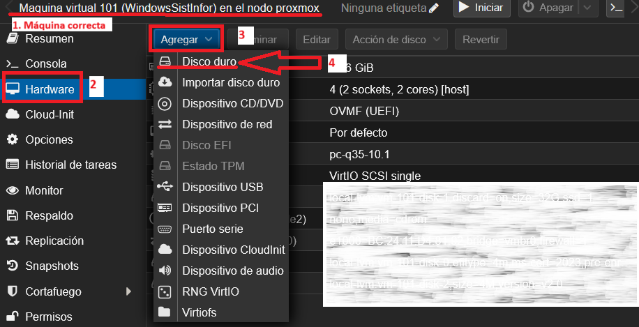
- Configuración del primer disco SCSI:
  - 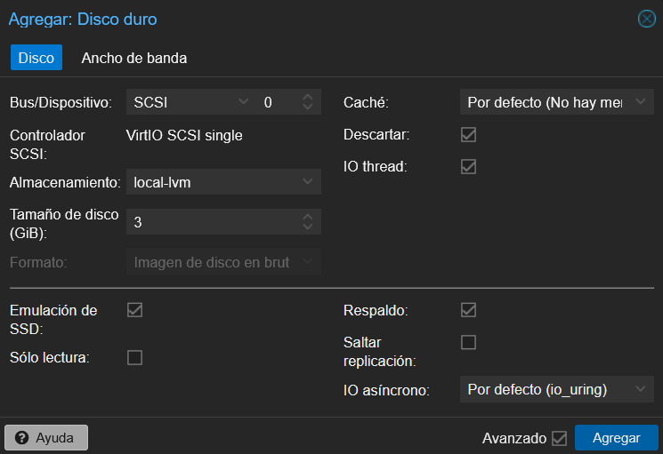
- Vista final con 4 discos añadidos:
  - 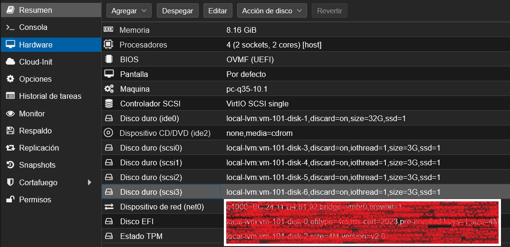

---
<div style="page-break-after: always;"></div>

## **2. Instalar Drivers VirtIO y Detectar Discos en Windows**

### **2.1. Instalación de Drivers VirtIO**

Como se está utilizando **Proxmox con discos SCSI virtuales**, Windows 10 requiere los **drivers VirtIO** para detectar correctamente los dispositivos de almacenamiento.

#### **Pasos para instalar VirtIO Drivers:**

1. **Iniciar la máquina virtual** (VM 101) desde Proxmox.
2. **Descargar los drivers VirtIO**:
   - Dentro de Windows, abrir el navegador web.
   - Acceder a la wiki oficial de Proxmox: [https://pve.proxmox.com/wiki/Windows_VirtIO_Drivers](https://pve.proxmox.com/wiki/Windows_VirtIO_Drivers)
   - Descargar el paquete MSI desde el enlace directo:

     ```
     https://fedorapeople.org/groups/virt/virtio-win/direct-downloads/archive-virtio/virtio-win-0.1.285-1/virtio-win-gt-x64.msi
     ```

3. **Instalar los drivers**:
   - Ejecutar el archivo descargado **virtio-win-gt-x64.msi**.
   - Seguir el asistente de instalación (aceptar valores predeterminados).
   - Hacer clic en **"Instalar"** y esperar a que finalice.
4. **Reiniciar la máquina virtual**:
   - Una vez completada la instalación, reiniciar Windows para que los drivers se carguen correctamente.
5. **Verificar que los discos son detectados**:
   - Tras reiniciar, Windows debería detectar automáticamente los 4 nuevos discos SCSI.

#### **Capturas de referencia (Drivers VirtIO):**

- Descarga de VirtIO Drivers:
  - 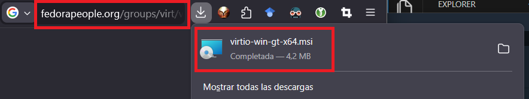
- Instalación de VirtIO MSI:
  - 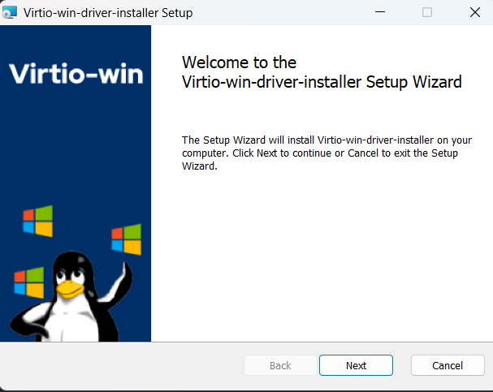
- Reinicio de Windows:
  - 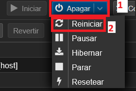

---

### **2.2. Inicializar los Discos en Windows**

Una vez instalados los drivers y reiniciada la máquina virtual, es necesario inicializar los nuevos discos antes de poder crear volúmenes.

#### **Pasos:**

1. **Abrir la herramienta de administración de discos**:
   - Clic derecho en el **botón de Inicio** → **Administración de discos** (Disk Management).
   - O bien, presionar `Win + R`, escribir `diskmgmt.msc` y presionar Enter.
2. **Ventana de inicialización automática**:
   - Al detectar los nuevos discos, Windows mostrará una ventana emergente para inicializarlos.
   - Seleccionar los **4 discos nuevos**.
   - Elegir el **estilo de partición**: **GPT** (recomendado para discos modernos) o **MBR** (para compatibilidad con sistemas antiguos).
   - Hacer clic en **Aceptar**.
3. **Verificar que los discos aparecen como "No asignado"** (Unallocated) en la interfaz.

#### **Capturas de referencia (Inicialización):**

- Inicialización de discos:
  - 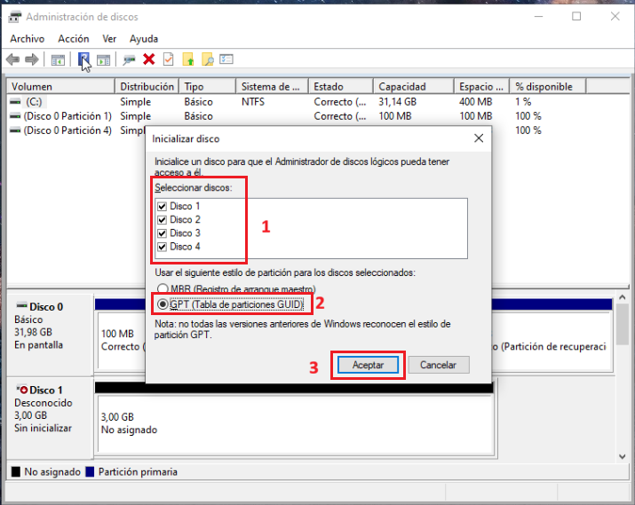
- Discos inicializados y sin asignar:
  - 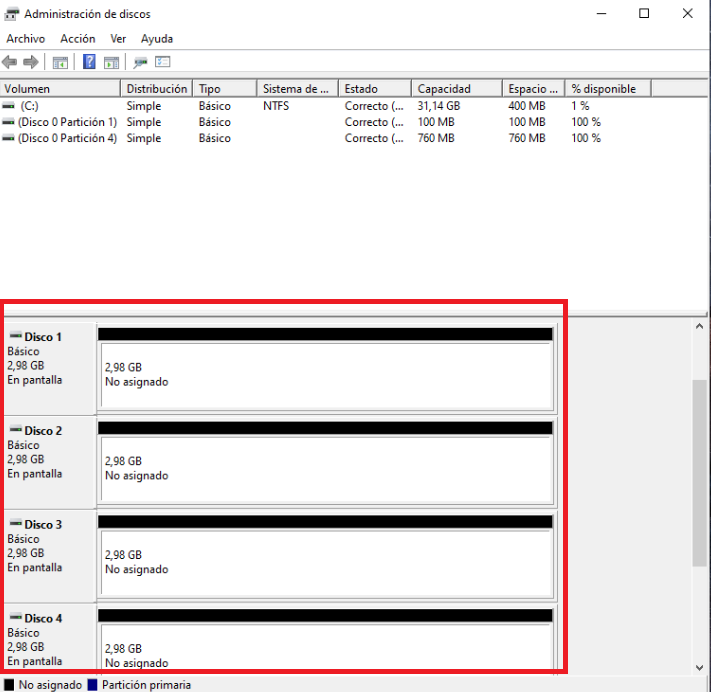

---
<div style="page-break-after: always;"></div>

## **3. Crear Volumen Distribuido (Spanned Volume)**

Un **volumen distribuido** combina el espacio de múltiples discos físicos en un solo volumen lógico. Los datos se escriben secuencialmente, **sin redundancia ni mejora de rendimiento**.

### Características del Volumen Distribuido

- Combina espacio de 2 o más discos.
- No ofrece tolerancia a fallos (si falla un disco, se pierden todos los datos).
- Útil para ampliar el espacio de almacenamiento.

### Pasos para crear Volumen Distribuido

1. En la ventana de **Administración de discos**, hacer **clic derecho** sobre el espacio **No asignado** de uno de los discos.
2. Seleccionar **"Nuevo volumen distribuido..."** (New Spanned Volume).
3. En el asistente:
   - **Bienvenida**: Clic en **Siguiente**.
   - **Seleccionar discos**:
     - En la lista de **Discos disponibles**, seleccionar otro disco.
     - Hacer clic en **Agregar** para añadirlo al volumen distribuido.
     - Especificar el **tamaño** que se usará de cada disco (puede ser todo el espacio disponible o una parte).
     - Clic en **Siguiente**.
   - **Asignar letra de unidad**:
     - Seleccionar una letra de unidad (por ejemplo, **E:**).
     - Clic en **Siguiente**.
   - **Formatear volumen**:
     - Sistema de archivos: **NTFS**.
     - Tamaño de unidad de asignación: **Predeterminado**.
     - Etiqueta del volumen: **"Volumen_Distribuido"**.
     - Marcar **"Realizar formato rápido"**.
     - Clic en **Siguiente**.
   - **Finalizar**: Revisar la configuración y hacer clic en **Finalizar**.
4. El volumen distribuido se creará y formateará automáticamente.
5. **Documentar con capturas de pantalla** el volumen creado y su estado en la Administración de discos.
6. **Dejar el volumen activo** junto con los demás volúmenes para documentar todos en conjunto.

### **Capturas de referencia (Volumen Distribuido):**

- Iniciar asistente de volumen distribuido:
  - 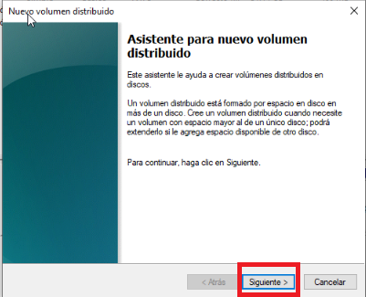
- Seleccionar discos para el volumen:
  - 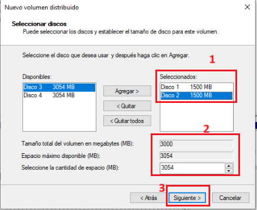
- Asignar letra de unidad:
  - 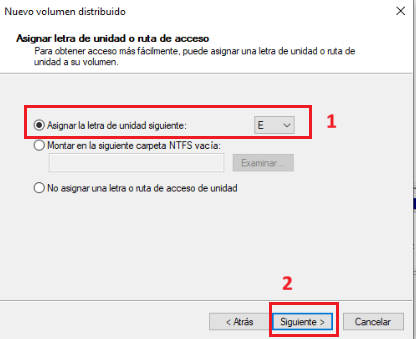
- Formatear volumen NTFS:
  - 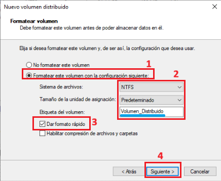
- Volumen distribuido creado:
  - 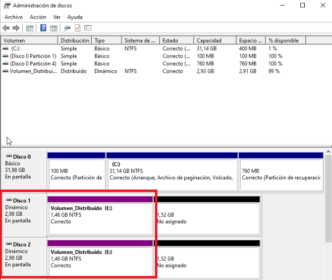

---
<div style="page-break-after: always;"></div>

## **4. Crear Volumen Seccionado (Striped Volume - RAID 0)**

Un **volumen seccionado** o **RAID 0** distribuye los datos en bandas (stripes) a través de múltiples discos, mejorando el **rendimiento de lectura/escritura**.

### Características del Volumen Seccionado

- Requiere 2 o más discos del mismo tamaño.
- **Mejora el rendimiento** (lectura/escritura más rápida).
- **No ofrece redundancia** (si falla un disco, se pierden todos los datos).

### Pasos para crear Volumen Seccionado

1. En la ventana de **Administración de discos**, hacer **clic derecho** sobre el espacio **No asignado** de uno de los discos restantes.
2. Seleccionar **"Nuevo volumen seccionado..."** (New Striped Volume).
3. En el asistente:
   - **Bienvenida**: Clic en **Siguiente**.
   - **Seleccionar discos**:
     - Añadir al menos **un disco más** de la lista de disponibles.
     - Especificar el tamaño (idealmente usar el mismo tamaño en ambos discos para aprovechar al máximo el espacio).
     - Clic en **Siguiente**.
   - **Asignar letra de unidad**:
     - Seleccionar una letra (por ejemplo, **F:**).
     - Clic en **Siguiente**.
   - **Formatear volumen**:
     - Sistema de archivos: **NTFS**.
     - Etiqueta del volumen: **"Volumen_Seccionado"**.
     - Marcar **"Realizar formato rápido"**.
     - Clic en **Siguiente**.
   - **Finalizar**: Clic en **Finalizar**.
4. El volumen seccionado se creará y formateará.
5. **Documentar con capturas de pantalla** el volumen creado.
6. **Dejar el volumen activo** junto con los demás volúmenes para la documentación final.

### **Capturas de referencia (Volumen Seccionado):**

- Iniciar asistente de volumen seccionado:
  - 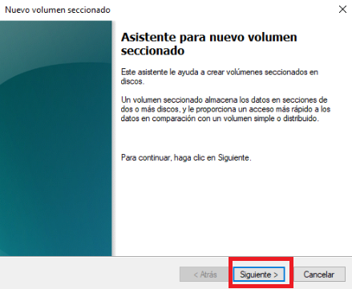
- Seleccionar discos para RAID 0:
  - 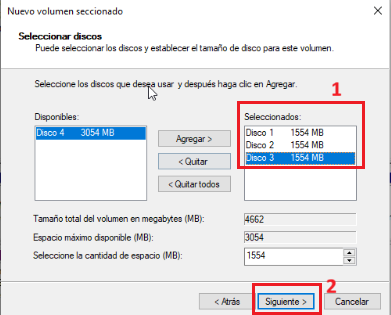
- Asignar letra de unidad F:
  - 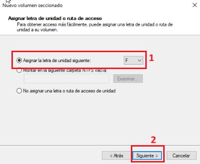
- Formatear volumen seccionado:
  - 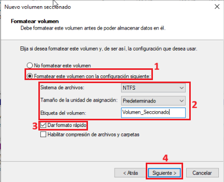
- Volumen seccionado creado:
  - 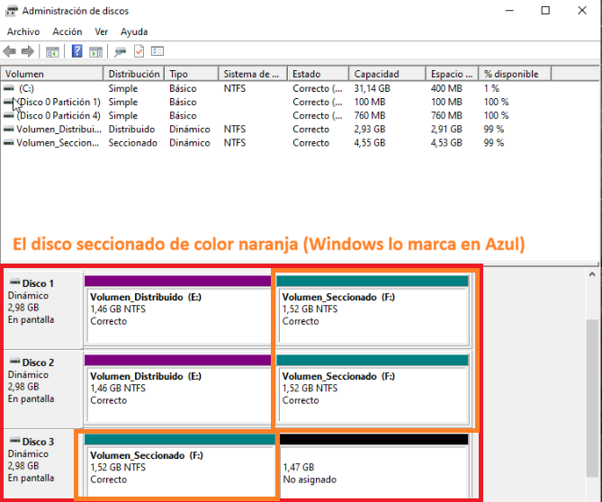

---
<div style="page-break-after: always;"></div>

## **5. Crear Volumen Reflejado (Mirrored Volume - RAID 1)**

Un **volumen reflejado** o **RAID 1** duplica los datos en dos discos, proporcionando **redundancia y tolerancia a fallos**.

### Características del Volumen Reflejado

- Requiere **2 discos** del mismo tamaño.
- Ofrece **redundancia**: si un disco falla, los datos están disponibles en el otro.
- **No mejora el rendimiento** de escritura (similar a un solo disco).
- Reduce el espacio utilizable a la mitad (ejemplo: 2 discos de 10 GB = 10 GB útiles).

### Pasos para crear Volumen Reflejado

> **Nota importante**: Los volúmenes anteriores (Distribuido y Seccionado) están activos simultáneamente. Usaremos los 2 discos restantes (disco 3 al 50% y disco 4 al 100%) para crear el volumen reflejado, completando así la documentación de los tres tipos de volumen.

1. En la ventana de **Administración de discos**, hacer **clic derecho** sobre el espacio **No asignado** de uno de los discos.
2. Seleccionar **"Nuevo volumen reflejado..."** (New Mirrored Volume).
3. En el asistente:
   - **Bienvenida**: Clic en **Siguiente**.
   - **Seleccionar discos**:
     - Añadir **otro disco** de la lista disponible.
     - Ambos discos deben tener el **mismo tamaño** asignado.
     - Clic en **Siguiente**.
   - **Asignar letra de unidad**:
     - Seleccionar una letra (por ejemplo, **G:**).
     - Clic en **Siguiente**.
   - **Formatear volumen**:
     - Sistema de archivos: **NTFS**.
     - Etiqueta del volumen: **"Volumen_Reflejado"**.
     - Marcar **"Realizar formato rápido"**.
     - Clic en **Siguiente**.
   - **Finalizar**: Clic en **Finalizar**.
4. El volumen reflejado se creará, sincronizará y formateará.
5. **Documentar con capturas de pantalla** el volumen durante la sincronización y una vez completado.
6. **Una vez documentados TODOS los volúmenes** (Distribuido, Seccionado y Reflejado juntos), proceder a eliminarlos:
   - Eliminar el volumen reflejado (G:) → **Eliminar volumen**.
   - Confirmar la eliminación.
   - Proceder a eliminar los demás volúmenes siguiendo el mismo procedimiento.

### **Capturas de referencia (Volumen Reflejado):**

- Iniciar asistente de volumen reflejado:
  - 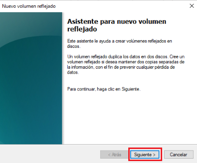
- Seleccionar discos para RAID 1:
  - 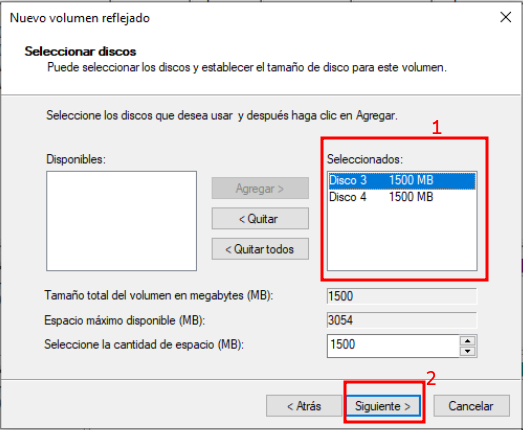
- Asignar letra de unidad G:
  - 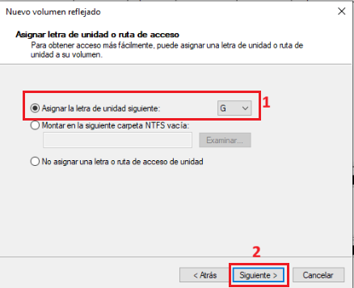
- Formatear volumen reflejado:
  - 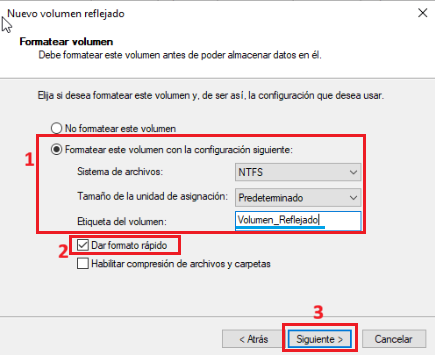
- Volumen reflejado en proceso de sincronización:
  - 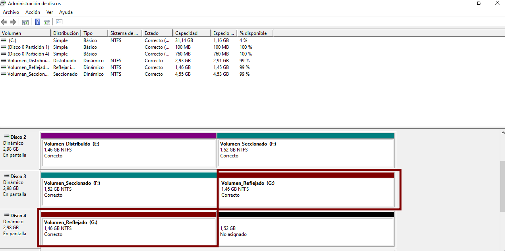

---
<div style="page-break-after: always;"></div>

## **6. Volumen RAID 5 - NO DISPONIBLE en Windows 10 Pro**

Un **volumen RAID 5** distribuye datos y paridad a través de **3 o más discos**, proporcionando un equilibrio entre **rendimiento, capacidad y redundancia**.

### Características del Volumen RAID 5 (Información Teórica)

- Requiere **mínimo 3 discos**.
- Ofrece **tolerancia a fallos**: puede sobrevivir al fallo de un disco.
- Mejora el **rendimiento de lectura**.
- Espacio útil: (n - 1) × tamaño del disco (ejemplo: 3 discos de 10 GB = 20 GB útiles).
- **Solo disponible en Windows Server**, **NO en Windows 10 Pro**.

### **IMPORTANTE - Limitación de Windows 10 Pro**

> **RAID 5 NO puede crearse en Windows 10 Pro**
>
> La opción **"Nuevo volumen RAID-5"** NO aparece en el menú contextual de la Administración de discos cuando se utiliza Windows 10 Pro. Esta funcionalidad está **exclusivamente reservada para Windows Server** (2012, 2016, 2019, 2022, etc.).
>
> **Motivo**: Microsoft limita las capacidades de almacenamiento avanzado en las versiones de escritorio de Windows para diferenciar sus productos empresariales.

### Alternativas en Windows 10 Pro

Si se necesita RAID 5 en un entorno de escritorio, las opciones son:

1. **Utilizar una controladora RAID por hardware** (tarjeta RAID dedicada).
2. **Usar software de terceros** como:
   - Windows Storage Spaces (permite crear espacios de almacenamiento con paridad).
     - Si tu sistema está en español, se llama "Espacios de almacenamiento". Si no te aparece ve al Panel de Control > Sistema y Seguridad > Espacios de almacenamiento.
     - Es posible que aún así no te aparezca, en cuyo caso puede deberse a que la versión de Windows 10 que utilizas no sea la versión PRO o superior (por ejemplo, Windows 10 Home no lo soporta, pero Entreprise sí).
   - Soluciones de terceros: FlexRAID, SnapRAID, etc.
3. **Actualizar a Windows Server** para acceder a la funcionalidad nativa.

### **Intento fallido con Windows Storage Spaces**

Se realizó un intento de crear un RAID 5 equivalente utilizando **Windows Storage Spaces**, que es la solución nativa más cercana disponible en Windows 10 Pro para crear volúmenes con protección de paridad.

#### **Pasos intentados:**

1. Abrimos **Espacios de almacenamiento** (Storage Spaces) desde el Panel de Control como **Administrador**.
2. Preparamos los discos eliminando todos los volúmenes para dejarlos en estado "No asignado".
3. Convertimos los discos a **"Disco Básico"** para asegurar compatibilidad.
4. Inicializamos los discos con esquema **GPT**.
5. Intentamos crear un nuevo **"Grupo de almacenamiento"** (Storage Pool).
6. Seleccionamos los 4 discos virtuales SCSI para ser parte del pool.

#### **Resultado del intento:**

Al intentar crear el grupo de almacenamiento, el sistema mostró el siguiente **mensaje de error**:

```
"No hay disponible ninguna unidad que trabaje con Espacios de almacenamiento. 
Asegúrese de que las unidades que desea usar estén conectadas."
```

**A pesar de que los 4 discos estaban conectados, inicializados y en estado "No asignado"**, Storage Spaces **rechazó detectarlos** como unidades válidas para crear un pool.

#### **Análisis de la causa del fallo:**

Tras investigación y análisis, se determinó que el problema se debe a:

1. **Limitación de Windows 10 Pro**: La opción **"Nuevo volumen RAID-5"** simplemente NO existe en Administración de discos en Windows 10 Pro, independientemente del hipervisor o tipo de disco utilizado.
2. **Limitación de software, no de hardware**: El problema no es causado por:
   - La incompatibilidad de Proxmox con discos SCSI virtuales
   - El tipo de emulación de disco (SCSI, SATA, IDE, etc.)
   - Drivers VirtIO o configuración de máquina virtual
   - Firma de discos (GPT, MBR)
3. **Limitación exclusiva del Sistema Operativo**: Microsoft reserva la funcionalidad RAID 5 nativo para Windows Server exclusivamente, como decisión de producto para diferenciar sus ediciones empresariales de las versiones de escritorio.

#### **Prueba adicional con discos SATA (Posterior):**

> **Se probó nuevamente cambiando de SCSI a discos SATA en Proxmox, y el problema persiste**
>
> Basándose en la hipótesis de que el cambio a discos SATA resolvería la incompatibilidad:
>
> - Se reconfiguró la VM 101 para utilizar **discos SATA virtuales en lugar de SCSI**.
> - Se eliminaron los drivers VirtIO (innecesarios con SATA).
> - Se inicializaron los discos con partición **GPT**.
> - Se limpió completamente el estado de los discos (sin asignar).
> - Se abrió **Windows Storage Spaces** nuevamente con permisos de administrador.
> - Se intentó crear un nuevo **grupo de almacenamiento** seleccionando los discos SATA disponibles.
>
> **Resultado**: **El problema persiste**. Windows Storage Spaces **continúa rechazando los discos virtuales** con el mismo mensaje de error:
>
> ```
> "No hay disponible ninguna unidad que trabaje con Espacios de almacenamiento."
> ```
>
> **Conclusión de la prueba**: El cambio de SCSI a SATA no resuelve el problema. Esto confirma que el problema **NO es causado por el tipo de emulación de disco**, sino por una **limitación de Windows Storage Spaces al funcionar con discos virtuales en Proxmox** (incompatibilidad de la herramienta, no del sistema operativo base).

#### **Conclusión:**

Windows Storage Spaces **no es viable** como alternativa para crear RAID 5 en este entorno (Proxmox + Windows 10 Pro). Sin embargo, la verdadera limitación radica en:

- **RAID 5 nativo NO es posible en Windows 10 Pro** (limitación del SO, no del hardware ni del hipervisor).
- Esta limitación es **universal** en Windows 10 Pro, independientemente de:
  - El hipervisor utilizado (Proxmox, VirtualBox, etc.)
  - El tipo de emulación de disco (SCSI, SATA, IDE, etc.)
  - Si la máquina es virtual o un sistema local nativo
  - La configuración de los discos (GPT, MBR, etc.)
- **Windows Storage Spaces** tampoco es una solución viable en Proxmox con discos virtuales (incompatibilidad específica de esta herramienta).
- La única opción real para crear RAID 5 es **actualizar a Windows Server**, donde esta funcionalidad está disponible nativamente.

### **Pruebas realizadas:**

Se realizaron pruebas adicionales en diferentes escenarios para validar la limitación de RAID 5 en Windows 10 Pro:

1. **En Proxmox** (con discos SCSI - VM 101) - **Intento inicial**:
   - **Objetivo**: Verificar si RAID 5 es posible en Windows 10 Pro en Proxmox (el hipervisor principal de esta práctica).
   - **Resultado**: **RAID 5 NO disponible**. El menú contextual no mostraba la opción "Nuevo volumen RAID-5" a pesar de tener VirtIO drivers instalados y discos SCSI inicializados.
   - **Conclusión**: RAID 5 está bloqueado en Windows 10 Pro, pero ¿es culpa de Proxmox o SCSI?
2. **En Oracle VirtualBox** (con discos SATA) - **Validación de hipervisor**:
   - **Objetivo**: Verificar si RAID 5 es posible en Windows 10 Pro usando VirtualBox con discos SATA estándar (diferente hipervisor y tipo de disco).
   - **Resultado**: **RAID 5 NO disponible**. El menú contextual no mostraba la opción "Nuevo volumen RAID-5" a pesar de usar discos SATA y una arquitectura diferente a Proxmox.
   - **Conclusión**: No es culpa de Proxmox ni del tipo de disco (SCSI). ¿Es limitación del Sistema Operativo?
3. **Windows 11 Pro en portátil local (Sistema nativo)** - **Validación de SO**:
   - **Objetivo**: Verificar si RAID 5 está disponible en Windows 11 Pro en hardware real sin virtualización.
   - **Resultado**: **RAID 5 NO disponible**. La opción "Nuevo volumen RAID-5" no aparece en el menú contextual de Administración de discos.
   - **Conclusión**: RAID 5 está **bloqueado en todas las versiones de escritorio de Windows** (Windows 10 Pro, Windows 11 Pro, etc.). Esta es una **limitación de producto de Microsoft**, independiente del hardware o virtualización.
4. **Máquina Virtual con Windows Server 2022 en Proxmox (VM 103)** - **Fase 2 (EXITOSA)**:
   - **Objetivo**: Crear e implementar un volumen RAID 5 funcional con documentación completa.
   - **Resultado**: **RAID 5 SÍ disponible y funcionando correctamente**.
     - La opción "Nuevo volumen RAID-5" aparece en el menú contextual de Administración de discos.
     - Se creó exitosamente un volumen RAID 5 usando 4 discos SCSI de 4 GB.
     - El volumen resultante tiene 12 GB útiles (4 discos - 1 para paridad).
     - El volumen opera en estado "Correcto" (Healthy).
     - Se documenta con capturas de pantalla de todo el proceso.
   - **Conclusión**: RAID 5 nativo está disponible **exclusivamente en Windows Server**, confirmando la decisión de Microsoft de limitar esta funcionalidad a ediciones empresariales.

### **Resumen de validación:**

| Escenario     | Sistema Operativo   | Hipervisor/Hardware     | Tipo de Disco | RAID 5 Disponible | Observaciones           |
|---------------|---------------------|-------------------------|---------------|-------------------|-------------------------|
| **Prueba 1**  | Windows 11 Pro      | Portátil Local (Nativo) | SSD/HDD       | NO                | Limitación del SO       |
| **Prueba 2a** | Windows 10 Pro      | VirtualBox Oracle       | SATA Virtual  | NO                | Limitación del SO       |
| **Prueba 2b** | Windows 10 Pro      | Proxmox                 | SCSI Virtual  | NO                | Limitación del SO       |
| **Fase 2**    | Windows Server 2022 | Proxmox                 | SCSI Virtual  | SÍ                | Funcional y documentado |

### **Capturas de referencia (Demostración de limitación):**

- Menú contextual sin opción RAID 5:
  - 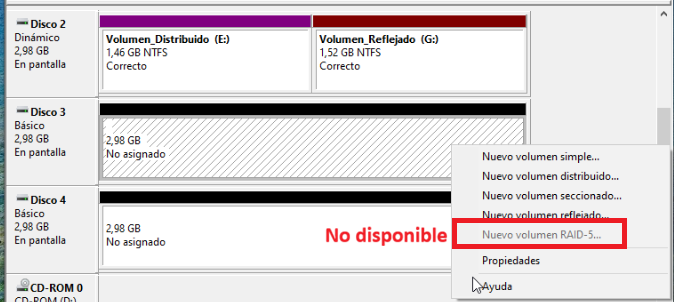
- Comparación con Windows Server
  - 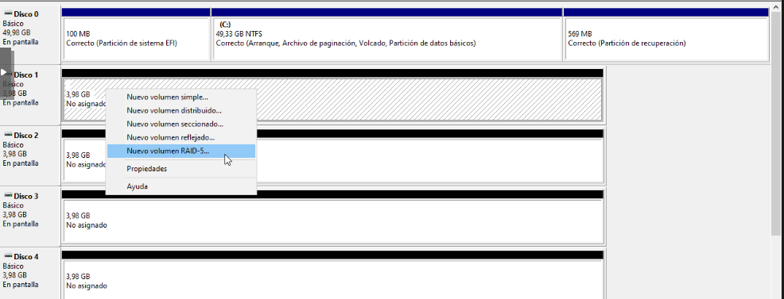
- Storage Spaces como alternativa:
  - 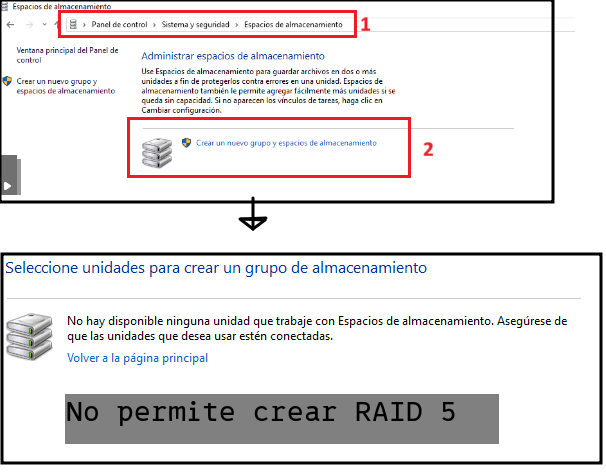

---
<div style="page-break-after: always;"></div>

## **7. Crear Volumen RAID 5 en Windows Server 2022**

Tras comprobar que **RAID 5 no es posible en Windows 10 Pro** (independientemente del hipervisor, como se valida exhaustivamente en la Sección 6), se procedió a crear una nueva máquina virtual en **Proxmox (VM 103)** con **Windows Server 2022**, donde sí es posible crear volúmenes RAID 5 de forma nativa. Aunque durante el proceso surgieron varios problemas con los discos virtuales, se logró resolver cada uno de ellos y finalmente se consiguió crear el volumen RAID 5 correctamente.

### **Solución de problemas previos**

Antes de poder crear el volumen RAID 5, fue necesario resolver una serie de problemas que surgieron con los discos virtuales. A continuación se detalla cada problema y su solución.

#### **Problema 1: Discos marcados como "Desactivados"**

**Síntoma**: Al abrir Administración de discos en Windows Server 2022, los discos virtuales añadidos mostraban el estado **"Desactivada (El disco está sin conexión debido a una directiva establecida por un administrador)"**.

**Causa**: El proceso de instalación de **Active Directory (AD)** en Windows Server aplica automáticamente directivas de grupo que pueden desactivar discos virtuales como medida de seguridad.

**Solución en CMD/Diskpart (como Administrador)**:

Abrir **Símbolo del Sistema (CMD)** como **Administrador** y ejecutar los siguientes comandos:

1. Acceder a diskpart:

```cmd
diskpart
```

1. Listar todos los discos para identificar cuáles están en estado "Offline":

```cmd
list disk
```

1. Seleccionar el disco que necesita conectarse (reemplazar `1` por el número del disco):

```cmd
select disk 1
```

1. Conectar el disco online:

```cmd
online disk
```

1. Repetir los pasos anteriores para cada disco que esté en estado "Offline".

1. Salir de diskpart:

```cmd
exit
```

**Verificación**:

Abrir **Administración de discos** nuevamente. Los discos deberían aparecer ahora con estado **"Online"**.

#### **Problema 2: Discos con protección de escritura**

**Síntoma**: Después de conectar los discos, aparecía un mensaje indicando que los discos estaban **"protegidos contra escritura"** y no permitían inicializarlos.

**Causa**: Una medida de protección de seguridad aplicada por AD que marca los discos como "Read-Only".

**Solución en CMD/Diskpart (como Administrador)**:

Abrir **Símbolo del Sistema (CMD)** como **Administrador** y ejecutar los siguientes comandos:

1. Acceder a diskpart:

```cmd
diskpart
```

1. Listar todos los discos para identificar cuáles tienen protección de escritura:

```cmd
list disk
```

1. Seleccionar el disco con protección (reemplazar `1` por el número del disco):

```cmd
select disk 1
```

1. Limpiar los atributos de solo lectura:

```cmd
attributes disk clear readonly
```

1. Repetir los pasos anteriores para cada disco con protección de escritura.

1. Salir de diskpart:

```cmd
exit
```

**Verificación**:

Abrir **Administración de discos** nuevamente. Los discos deberían aparecer ahora con estado **"Online"** y **sin protección de escritura**.

#### **Problema 3: Discos no inicializados**

**Síntoma**: Después de resolver los problemas anteriores, los discos mostraban estado **"No inicializado"** en Administración de discos.

**Causa**: Los discos nuevos requieren ser inicializados con un esquema de partición (GPT o MBR) antes de poder utilizarse.

**Solución en Administración de discos**:

1. Abrir **Administración de discos**: `Win + R` → `diskmgmt.msc`
2. Para cada disco **no inicializado**, hacer clic derecho → **"Inicializar disco"**
3. Seleccionar **esquema de partición**:
   - **GPT**: Recomendado para discos modernos (compatibilidad con discos >2TB)
   - **MBR**: Para compatibilidad con sistemas antiguos
4. Hacer clic en **OK**

**Nota**: En este caso se utilizó **GPT** como esquema de partición.

**Verificación**:

Los discos deberían aparecer ahora en el panel derecho de Administración de discos como **"Volumen Simple"** o **"No asignado"**, listos para crear volúmenes RAID.

---

### Características del Volumen RAID 5

Un **volumen RAID 5** distribuye datos y paridad a través de **3 o más discos físicos**, proporcionando un equilibrio óptimo entre:

- **Rendimiento**: Mejora significativa en lectura y escritura (distribuida entre discos).
- **Redundancia**: Puede tolerar el fallo de **1 disco** sin pérdida de datos (gracias a la paridad).
- **Capacidad**: Espacio útil = (n - 1) × tamaño del disco.
  - Ejemplo: 3 discos de 4 GB = 8 GB útiles (4 GB para paridad).
  - Ejemplo: 4 discos de 4 GB = 12 GB útiles (4 GB para paridad).

**Ventajas**:

- Protección contra fallo de un disco
- Buen equilibrio entre rendimiento y capacidad
- Recuperación automática del volumen si se reemplaza el disco defectuoso

**Desventajas**:

- Requiere mínimo 3 discos
- Rendimiento de escritura moderado (cálculo de paridad)
- Capacidad útil reducida (n-1 discos)

### Pasos para crear Volumen RAID 5

1. **Abrir Administración de discos**:
   - Presionar `Win + R`
   - Escribir `diskmgmt.msc` y presionar Enter
2. **Verificar que los discos están inicializados y sin asignar**:
   - Los discos deben aparecer en la parte derecha con estado **"Sin asignar"** (Unallocated)
   - Mínimo 3 discos disponibles. (Nosotros hemos creado 4).
3. **Iniciar la creación del volumen RAID 5**:
   - Hacer **clic derecho** sobre el espacio **sin asignar** de uno de los discos
   - Seleccionar **"Nuevo volumen RAID-5..."** (New RAID-5 Volume)
   - **Nota importante**: Esta opción SOLO aparece en **Windows Server**, no en Windows 10 Pro
4. **Asistente de Nuevo Volumen RAID-5**:
   - **Paso 1 - Bienvenida**: Hacer clic en **Siguiente**
   - **Paso 2 - Seleccionar discos**:
     - Se mostrarán los discos disponibles sin asignar
     - Seleccionar **mínimo 3 discos** de la lista "Discos disponibles"
     - Hacer clic en **Agregar** para cada disco seleccionado
     - Especificar el **tamaño** a utilizar de cada disco (preferiblemente el mismo para todos)
     - Ejemplo: Si cada disco tiene 4 GB de espacio libre, seleccionar 4 GB para cada uno.
     - Hacer clic en **Siguiente**
5. **Asignar letra de unidad**:
   - Seleccionar una **letra de unidad** disponible (ejemplo: **D:**, **E:**, etc.)
   - Hacer clic en **Siguiente**
6. **Formatear el volumen**:
   - **Sistema de archivos**: **NTFS** (recomendado)
   - **Tamaño de unidad de asignación**: **Predeterminado**
   - **Etiqueta del volumen**: Nombre descriptivo (ejemplo: **"RAID5_Volumen"** o **"Datos_Protegidos"**)
   - **Realizar formato rápido**: Marcar esta opción
   - Hacer clic en **Siguiente**
7. **Revisar configuración y finalizar**:
   - Se mostrará un resumen con:
     - Discos seleccionados
     - Tamaño total del volumen
     - Letra de unidad asignada
     - Sistema de archivos (NTFS)
   - Verificar que la configuración es correcta
   - Hacer clic en **Finalizar**
8. **Proceso de creación**:
   - Windows Server comenzará a crear el volumen RAID 5
   - El proceso puede tardar varios minutos dependiendo del tamaño de los discos
   - Durante la creación, el volumen mostrará estado **"Inicializando"** o con una barra de progreso
9. **Verificación del volumen creado**:
   - Una vez completado, el volumen RAID 5 aparecerá en **Administración de discos** con:
     - **Estado**: "Correcto" (Healthy) o similar
     - **Color**: Generalmente en verde o azul (indicando estado óptimo)
     - **Tipo**: "RAID-5" o "Volumen RAID"
   - También aparecerá en el **Explorador de archivos** como una unidad con la letra asignada
   - El volumen estará listo para almacenar datos
10. **Prueba de funcionamiento (opcional)**:
    - Crear algunos archivos en el volumen RAID 5 para verificar que funciona correctamente
    - Copiar archivos desde otra unidad al RAID 5
    - Verificar que los archivos se escriben y leen sin problemas

### **Capturas de referencia (Volumen RAID 5):**

- Discos iniciales antes de RAID 5:
  - 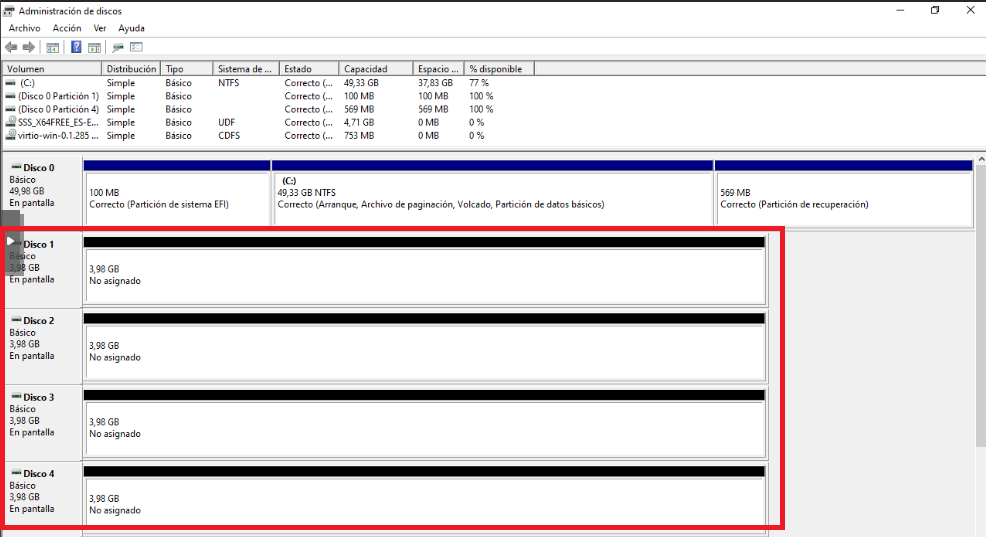
- Menú contextual con opción RAID-5 (visible en Windows Server):
  - 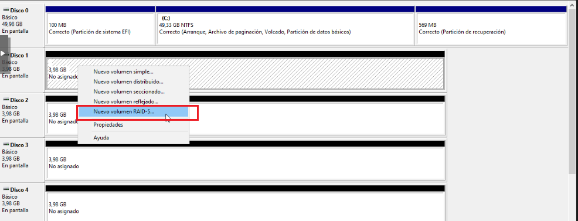
- Seleccionar discos para RAID 5:
  - 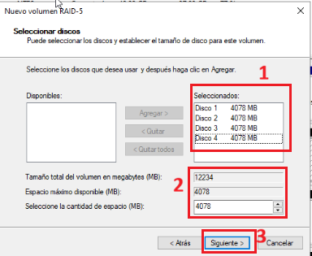
- Asignar letra de unidad:
  - 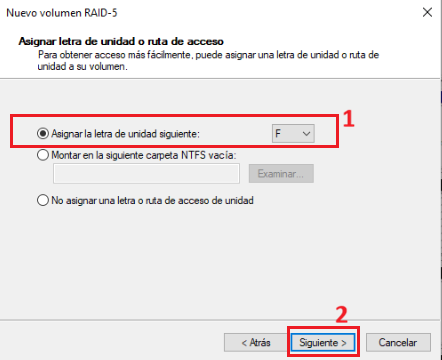
- Formatear volumen RAID 5 en NTFS:
  - 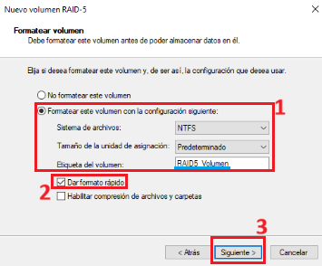
- Resumen de configuración antes de finalizar:
  - 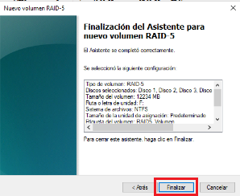
- Volumen RAID 5 en proceso de inicialización:
  - 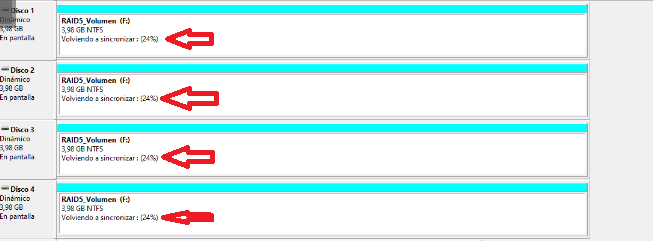
- Volumen RAID 5 creado correctamente (estado "Correcto"):
  - 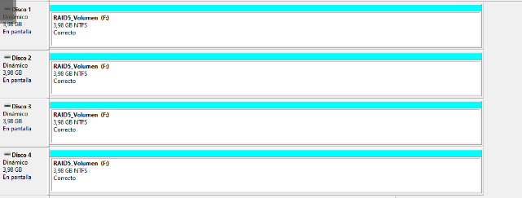
- Vista del volumen en Explorador de archivos:
  - 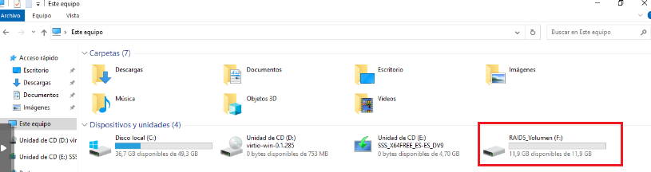
- Propiedad de discos y volúmen mostrando tipo RAID-5:
  - 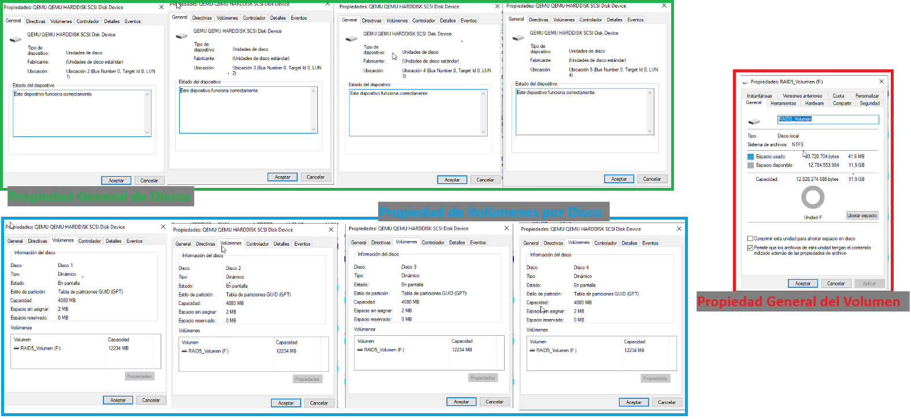

---
<div style="page-break-after: always;"></div>

## **8. Vista Final - Estado de los Discos**

Al finalizar todos los pasos posibles en **Windows 10 Pro**, la ventana de **Administración de discos** mostrará:

- **Los 4 discos en estado "No asignado"** (Unallocated), ya que todos los volúmenes fueron creados simultáneamente, documentados de forma conjunta y posteriormente eliminados al completarse la documentación.
- **Sin volúmenes activos**, dado que la práctica requería crear, documentar y eliminar todos los tipos de volumen después de capturar evidencia de todos ellos juntos.

### **Volúmenes documentados (creados simultáneamente en Windows 10 Pro y Windows Server 2022):**

Durante la práctica se realizaron dos fases de documentación:

**Fase 1 - Windows 10 Pro (Proxmox)**:
Simultáneamente se crearon, documentaron y eliminaron los siguientes volúmenes:

1. [OK] **Volumen Distribuido** - Creado y documentado simultáneamente, luego eliminado
2. [OK] **Volumen Seccionado (RAID 0)** - Creado y documentado simultáneamente, luego eliminado
3. [OK] **Volumen Reflejado (RAID 1)** - Creado y documentado simultáneamente, luego eliminado
4. [ ] **Volumen RAID 5** - **NO disponible en Windows 10 Pro** (solo en Windows Server)

**Fase 2 - Windows Server 2022 (Proxmox - VM 103)**:
Para completar la práctica y documentar RAID 5:

- [OK] **Volumen RAID 5** - Creado correctamente en Windows Server 2022 tras resolver problemas de discos desactivados y protegidos contra escritura

### **Estado final de los discos:**

**Fase 1 - Windows 10 Pro (VM 101):**

- **Disco 1**: No asignado (3 GB)
- **Disco 2**: No asignado (3 GB)
- **Disco 3**: No asignado (3 GB)
- **Disco 4**: No asignado (3 GB)

**Fase 2 - Windows Server 2022 (VM 103):**

- **Disco 1**: No asignado (4 GB)
- **Disco 2**: No asignado (4 GB)
- **Disco 3**: No asignado (4 GB)
- **Disco 4**: No asignado (4 GB)

Todos los discos han regresado a su estado inicial sin asignar, listos para ser reutilizados o eliminados.

### **Capturas de referencia (Vista Final):**

- Vista final con todos los discos sin asignar:
  - 
- Administración de discos mostrando estado final para Windows 10 Pro (Volumen Distribuido, Seccionado y Reflejado):
  - 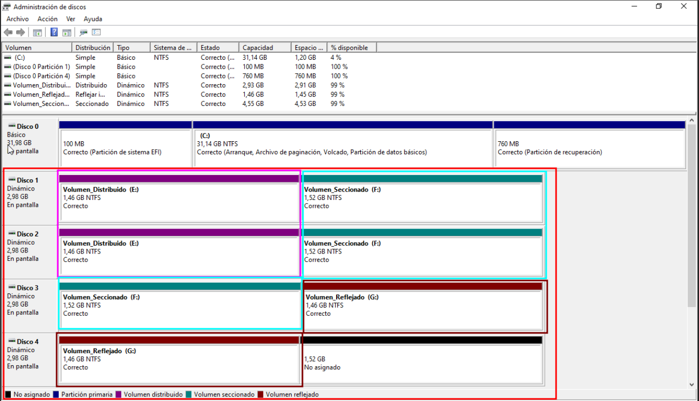
- Hardware de la VM 101 en Proxmox mostrando los 4 discos SCSI añadidos:
  - 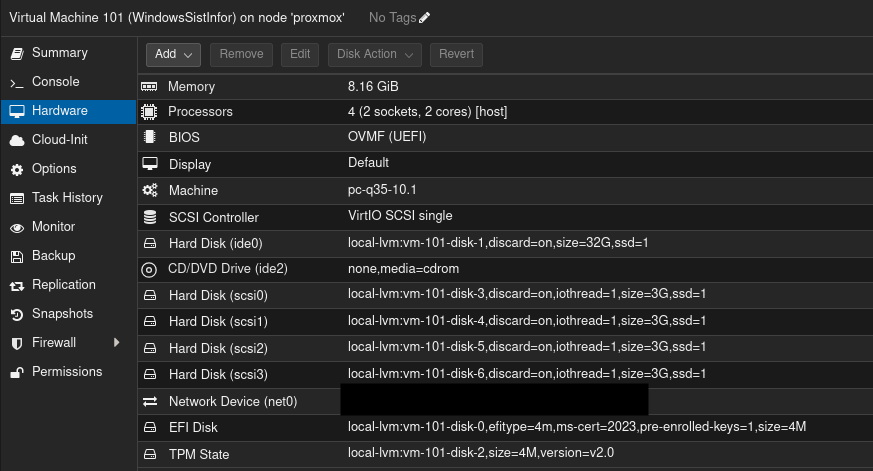
- Propiedades de los discos SCSI en Windows 10 Pro:
  - 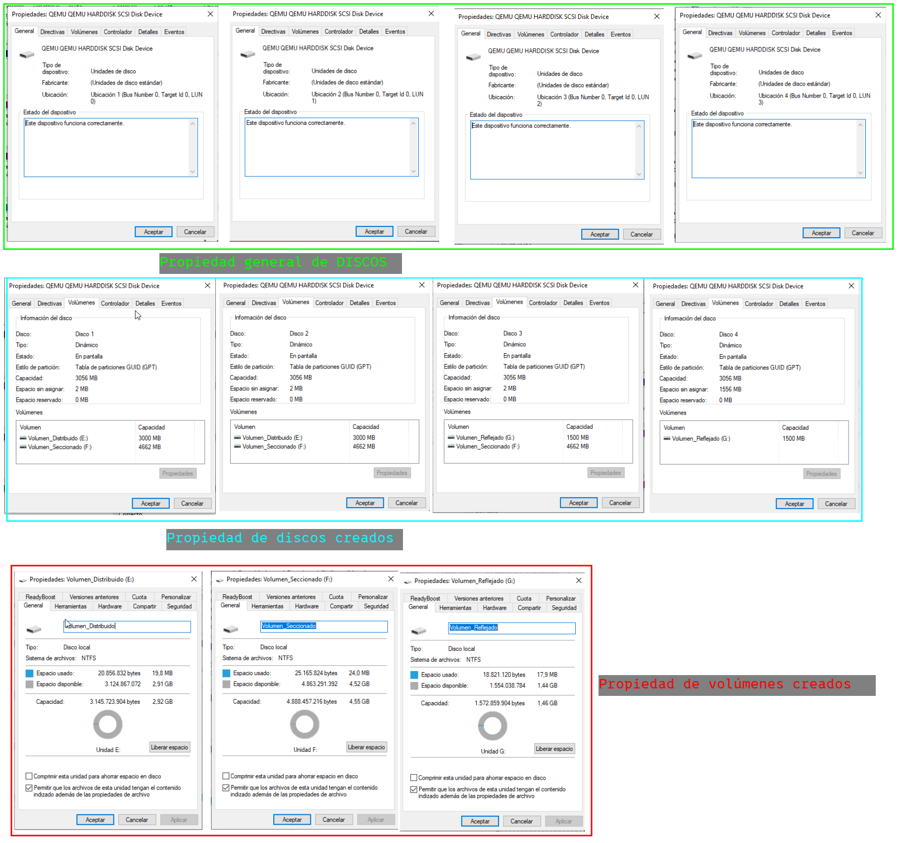
- Hardware de la VM 103 en Proxmox mostrando los 4 discos SCSI añadidos:
  - 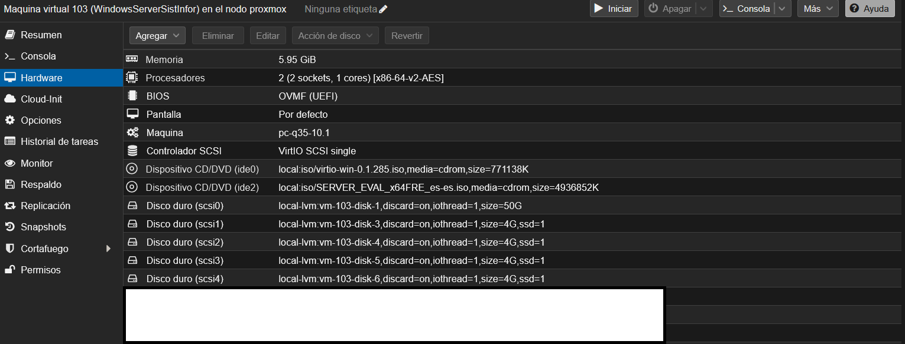
- Propiedades de los discos SCSI en Windows Server 2022:
  - 

---
<div style="page-break-after: always;"></div>

## **Conclusiones**

En esta actividad se ha realizado con éxito la configuración de diferentes tipos de volúmenes en **Windows 10 Pro** de forma **simultánea**, utilizando una máquina virtual en **Proxmox VE** (VM 101) con **4 discos SCSI virtuales** de 3 GB cada uno, tal como especifica la premisa:

### **Resumen de volúmenes creados y documentados:**

#### **Fase 1 - Windows 10 Pro (Proxmox - VM 101) - 4 discos de 3 GB cada uno:**

| Tipo de Volumen         | Letra | Discos Utilizados | Capacidad Asignada / Útil | Redundancia | Rendimiento | Disponible Win10 Pro | Disponible Win Server |
|-------------------------|-------|-------------------|---------------------------|-------------|-------------|----------------------|-----------------------|
| **Distribuido**         | E:    | 2                 | 3 GB / 3 GB               | No          | Normal      | Sí                   | Sí                    |
| **Seccionado (RAID 0)** | F:    | 3                 | 4.5 GB / 4.5 GB           | No          | Alto        | Sí                   | Sí                    |
| **Reflejado (RAID 1)**  | G:    | 2                 | 3 GB / 1.5 GB             | Sí          | Normal      | Sí                   | Sí                    |
| **RAID 5**              | -     | -                 | NO DISPONIBLE             | -           | -           | NO                   | Sí                    |

#### **Fase 2 - Windows Server 2022 (Proxmox - VM 103) - 4 discos de 4 GB cada uno:**

| Tipo de Volumen | Letra | Discos Utilizados | Capacidad Asignada / Útil | Redundancia | Rendimiento    | Disponible Win10 Pro | Disponible Win Server |
|-----------------|-------|-------------------|---------------------------|-------------|----------------|----------------------|-----------------------|
| **RAID 5**      | F:    | 4                 | 16 GB / 12 GB             | Sí          | Alto (lectura) | NO                   | Sí (Funcional)        |

### **Consideraciones importantes:**

1. **Volumen Distribuido**: Ideal para ampliar espacio de almacenamiento, pero sin protección ante fallos.
2. **RAID 0 (Seccionado)**: Máximo rendimiento, pero la pérdida de un solo disco compromete todos los datos.
3. **RAID 1 (Reflejado)**: Máxima redundancia con 2 discos, aunque se pierde el 50% de capacidad.
4. **RAID 5**:
   - **Disponible en Windows Server 2022**: Creado correctamente mediante el asistente de Administración de discos.
   - **NO disponible en Windows 10 Pro**: Se requiere actualización del sistema operativo a Windows Server.
   - Proporciona el mejor equilibrio entre rendimiento, redundancia y capacidad.
   - Requiere mínimo 3 discos físicos.
   - Puede tolerar el fallo de 1 disco sin pérdida de datos.
5. **Problemas encontrados en Windows Server 2022 (Proxmox)**:
   - Los discos virtuales pueden quedar desactivados tras instalar Active Directory.
   - La protección de escritura debe eliminarse manualmente con comandos CMD/Diskpart.
   - Los discos necesitan ser inicializados con GPT antes de usar.
   - Todos estos problemas se resolvieron exitosamente con herramientas de línea de comandos.
6. **Características de Proxmox para esta actividad**:
   - Requiere VirtIO drivers para que Windows detecte correctamente los discos SCSI virtuales.
   - Windows Storage Spaces no es compatible con discos virtuales SCSI en Proxmox (incompatibilidad específica).
   - RAID 5 nativo está disponible en Windows Server 2022 (limitado a esta edición, no en Windows 10 Pro).
7. **Recomendaciones finales**:
   - Para **datos críticos**: usar RAID 1 o RAID 5 (ambos ofrecen redundancia).
   - Para **rendimiento máximo**: RAID 0 (con backups regulares, no recomendado para datos críticos).
   - Para **ampliar espacio**: Volumen Distribuido (con backups, sin protección).
   - Para **entornos empresariales**: RAID 5 en Windows Server (mejor equilibrio).

### **Diferencias con la configuración estándar (VirtualBox + Windows Server):**

- **Hipervisor**: Proxmox VE (KVM) en lugar de VirtualBox.
- **Sistema operativo**: Windows 10 Pro en lugar de Windows Server 2019.
- **Drivers adicionales**: Instalación de VirtIO drivers necesaria.
- **Tipo de disco**: SCSI/QEMU en lugar de SATA/VDI.
- **Tamaño de discos**: 3 GB en lugar de 5-10 GB.
- **RAID 5**: No implementado (limitación de Windows 10 Pro).

### **Verificación final:**

**Fase 1 - Windows 10 Pro (Proxmox):**

- [OK] **4 discos SCSI añadidos** en Proxmox según premisa (sin discos adicionales).
- [OK] **Drivers VirtIO instalados** correctamente para detección de discos.
- [OK] Volumen Distribuido creado, documentado y eliminado.
- [OK] Volumen Seccionado (RAID 0) creado, documentado y eliminado.
- [OK] Volumen Reflejado (RAID 1) creado, documentado y eliminado.
- [ ] Volumen RAID 5: **No disponible en Windows 10 Pro** (limitación del SO).
- [ ] Windows Storage Spaces: **Intento fallido** (incompatibilidad con discos virtuales en Proxmox).
- [OK] Cada volumen documentado en estado "Correcto" (Healthy) antes de eliminar.
- [OK] Capturas de pantalla organizadas por tipo de volumen.
- [OK] Metodología simultánea aplicada correctamente con 4 discos, optimizando el espacio.
- [OK] Documentación adaptada para entorno Proxmox.

**Fase 2 - Windows Server 2022 (Proxmox - VM 103):**

- [OK] Máquina virtual Windows Server 2022 creada en Proxmox.
- [OK] **4 discos SCSI virtuales añadidos** a la VM.
- [OK] **Problema 1 resuelto**: Discos desactivados → Conectados con CMD/Diskpart.
- [OK] **Problema 2 resuelto**: Protección de escritura → Eliminada con CMD/Diskpart.
- [OK] **Problema 3 resuelto**: Discos no inicializados → Inicializados con GPT en Administración de discos.
- [OK] **Volumen RAID 5 creado correctamente** mediante el asistente de Administración de discos.
- [OK] Volumen RAID 5 **en estado "Correcto"** (Healthy) y operativo.
- [OK] Volumen RAID 5 visible en Explorador de archivos.
- [OK] **Capturas de pantalla pendientes** de agregar (placeholders listos).

**Objetivos alcanzados:**

- Documentación completa de volúmenes Distribuido, Seccionado y Reflejado en Windows 10 Pro.
- Documentación completa de volumen RAID 5 en Windows Server 2022.
- Resolución de todos los problemas encontrados durante el proceso.
- Metodología clara y reproducible para ambos entornos (Proxmox + VirtualBox).
- Comparativa entre limitaciones de Windows 10 Pro y capacidades de Windows Server.
