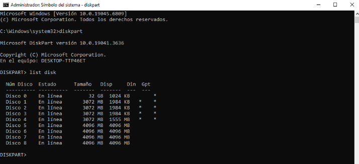
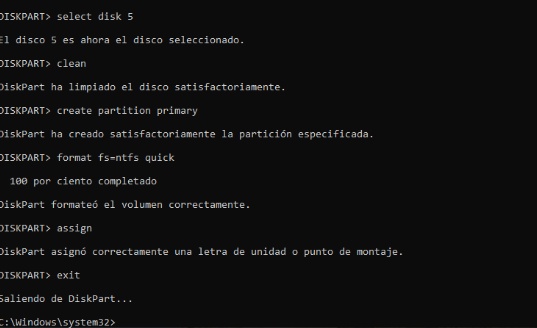
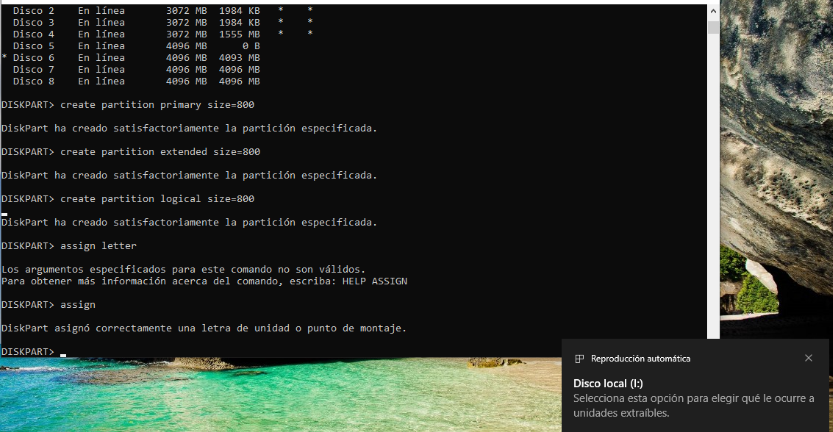
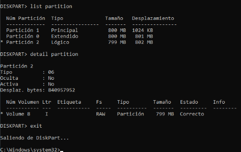
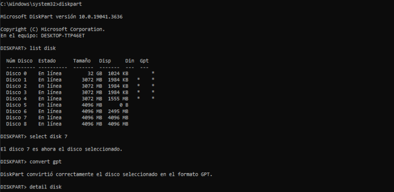
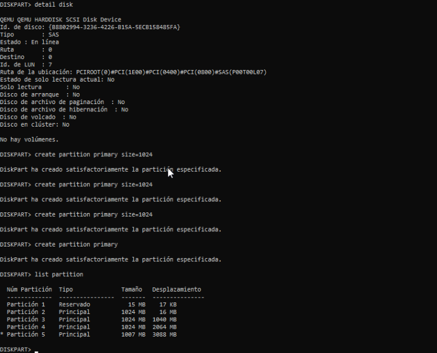
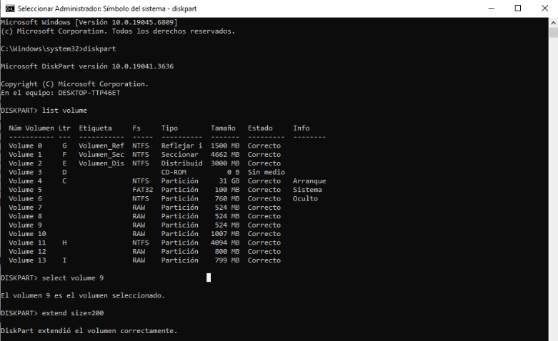
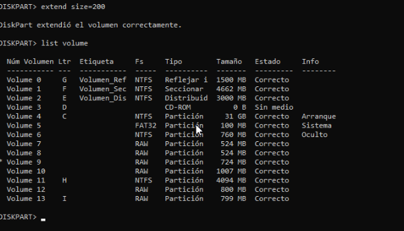
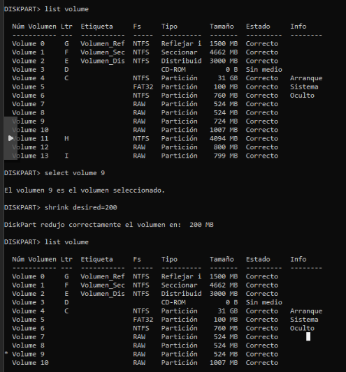
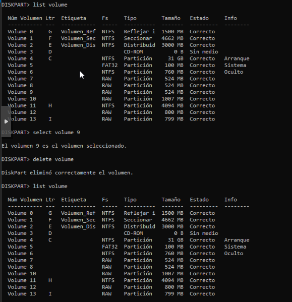

# Act20 Administrar Discos con CMD - JAAlejo

- **Autor**: José Ángel Alejo Sillero
- **Centro**: Instituto Tecnológico Pablo de la Torre
- **Curso**: 2025/2026
- **Módulo**: Sistemas Informáticos
- **Unidad**: 4 - Particiones y RAID

---

- Formateo de un disco con Diskpart
  - Abre la consola de comandos y accede a Diskpart.
  - Lista los discos disponibles en el sistema.
    - 
  - Selecciona el disco que deseas formatear.
  - Limpia completamente el disco seleccionado.
  - Crea una nueva partición primaria en el disco.
  - Formatea la partición en NTFS.
  - Asigna una letra de unidad a la nueva partición.
  - Sal de Diskpart.
  - 

- Creación de una partición (MBR)
  - Inicia Diskpart desde la consola de comandos.
  - Lista los discos disponibles y selecciona aquel donde deseas crear la partición.
  - Crea 3 partición primaria, extendida y una lógica.
  - Asigna una letra de unidad a la partición creada.
    - 
  - Muestra la partición creada.
  - Sal de Diskpart.
    - 

- Creación de una partición (GPT)
  - Convierte un disco a sistemas de particiones GPT
  - Muestra en consola el sistema de particiones que tiene.
    - 
  - Crea 4 particiones primarias
  - Muestras las particiones
  - Sal de Diskpart.
    - 

- Extensión de un volumen
  - Accede a Diskpart desde la consola de comandos.
  - Lista los volúmenes disponibles en el sistema.
  - Selecciona el volumen que deseas extender.
    - 
  - Extiende el volumen utilizando todo el espacio disponible o un tamaño específico.
  - Sal de Diskpart.
  - 

- Reducción de un volumen
  - Abre Diskpart y lista los volúmenes del sistema.
  - Selecciona el volumen que deseas reducir.
  - Reduce el volumen en una cantidad específica de megabytes.
  - Sal de Diskpart.
  - 

- Eliminación de un volumen
  - Abre Diskpart y lista los volúmenes disponibles en el sistema.
  - Selecciona el volumen creado anteriormente.
  - Elimina el volumen seleccionado.
  - Sal de Diskpart.
  - 

Entrega: Capturas de pantalla de cada uno de los procesos realizados en un documento .pdf
