# **Evaluable 21: Administración de Discos en Ubuntu Server - José Ángel Alejo Sillero**

**Autor**: José Ángel Alejo Sillero  
**Centro**: Instituto Tecnológico Pablo de la Torre  
**Curso**: 2025/2026  
**Módulo**: Sistemas Informáticos  
**Unidad**: 4 - Particiones y RAID

---

## **Estructura de la Evaluación: TRES GRUPOS**

Esta evaluación práctica se ha estructurado en **TRES GRUPOS DIFERENCIADOS** que permiten progresar de forma incremental:

- **GRUPO 1 (Gestión Básica)**: 8 actividades de particionamiento básico, formateo y montaje manual
- **GRUPO 2 (RAID)**: 11 actividades de configuración de diferentes tipos de RAID (0, 1, 5, 10) con mdadm
- **GRUPO 3 (LVM)**: 4 actividades de gestión de volúmenes lógicos con herramientas LVM

Esta progresión permite **construir conocimiento de forma incremental**, comenzando con conceptos básicos de particionamiento en Linux, continuando con configuraciones de redundancia y rendimiento mediante RAID, y finalizando con la administración flexible de volúmenes lógicos.

> **Nota importante**: Todos los comandos se ejecutan en **Ubuntu Server** usando la **línea de comandos**. Se requieren **permisos de administrador (sudo)** para la mayoría de operaciones.

Se puede revisar la premisa propuesta en el siguiente enlace: [Premisa Eval21](PREMISAS/PremisaEval21.md)

---

<div style="page-break-after: always;"></div>

## **TABLA DE CONTENIDOS**

- [**Evaluable 21: Administración de Discos en Ubuntu Server - José Ángel Alejo Sillero**](#evaluable-21-administración-de-discos-en-ubuntu-server---josé-ángel-alejo-sillero)
  - [**Estructura de la Evaluación: TRES GRUPOS**](#estructura-de-la-evaluación-tres-grupos)
  - [**TABLA DE CONTENIDOS**](#tabla-de-contenidos)
  - [**REQUISITOS PREVIOS**](#requisitos-previos)
  - [**PREPARACIÓN DEL ENTORNO DE PROXMOX**](#preparación-del-entorno-de-proxmox)
    - [**Hardware de la Máquina Virtual**](#hardware-de-la-máquina-virtual)
  - [**GRUPO 1: Gestión Básica de Discos y Particiones**](#grupo-1-gestión-básica-de-discos-y-particiones)
    - [**Actividad 1.1: Mostrar discos del sistema**](#actividad-11-mostrar-discos-del-sistema)
    - [**Actividad 1.2: Asignar sistema de particiones msdos**](#actividad-12-asignar-sistema-de-particiones-msdos)
    - [**Actividad 1.3: Crear 3 particiones primarias**](#actividad-13-crear-3-particiones-primarias)
    - [**Actividad 1.4: Crear partición extendida y particiones lógicas**](#actividad-14-crear-partición-extendida-y-particiones-lógicas)
    - [**Actividad 1.5: Formatear unidad de almacenamiento**](#actividad-15-formatear-unidad-de-almacenamiento)
    - [**Actividad 1.6: Montar una unidad**](#actividad-16-montar-una-unidad)
    - [**Actividad 1.7: Configurar montaje automático en fstab**](#actividad-17-configurar-montaje-automático-en-fstab)
    - [**Actividad 1.8: Verificar punto de montaje**](#actividad-18-verificar-punto-de-montaje)
  - [**GRUPO 2: Configuración de RAID con mdadm**](#grupo-2-configuración-de-raid-con-mdadm)
    - [**Preparación previa: Particionar discos para RAID**](#preparación-previa-particionar-discos-para-raid)
    - [**Actividad 2.1: Configurar RAID 0**](#actividad-21-configurar-raid-0)
    - [**Actividad 2.2: Configurar RAID 1**](#actividad-22-configurar-raid-1)
    - [**Actividad 2.3: Configurar RAID 5**](#actividad-23-configurar-raid-5)
    - [**Actividad 2.4: Configurar RAID 10**](#actividad-24-configurar-raid-10)
    - [**Actividad 2.5: Desmontar y eliminar RAID 1**](#actividad-25-desmontar-y-eliminar-raid-1)
    - [**Actividad 2.6: Operaciones de gestión en RAID 10**](#actividad-26-operaciones-de-gestión-en-raid-10)
    - [**Actividad 2.7: Recuperación de fallo en RAID 5**](#actividad-27-recuperación-de-fallo-en-raid-5)
    - [**Actividad 2.8: Configurar montaje automático de RAID**](#actividad-28-configurar-montaje-automático-de-raid)
    - [**Actividad 2.9: Verificar estado de discos RAID**](#actividad-29-verificar-estado-de-discos-raid)
    - [**Actividad 2.10: Desmontar unidad RAID**](#actividad-210-desmontar-unidad-raid)
    - [**Actividad 2.11: Eliminar partición de RAID (Limpiar superbloque)**](#actividad-211-eliminar-partición-de-raid-limpiar-superbloque)
  - [**GRUPO 3: Gestión de Volúmenes Lógicos (LVM)**](#grupo-3-gestión-de-volúmenes-lógicos-lvm)
    - [**Preparación previa: Instalar herramientas LVM**](#preparación-previa-instalar-herramientas-lvm)
    - [**Actividad 3.1: Crear volumen lógico**](#actividad-31-crear-volumen-lógico)
    - [**Actividad 3.2: Aumentar tamaño de volumen lógico**](#actividad-32-aumentar-tamaño-de-volumen-lógico)
    - [**Actividad 3.3: Reducir tamaño de volumen lógico**](#actividad-33-reducir-tamaño-de-volumen-lógico)
    - [**Actividad 3.4: Redimensionar partición existente (agregar al VG)**](#actividad-34-redimensionar-partición-existente-agregar-al-vg)
  - [**CONCLUSIÓN**](#conclusión)
    - [**Resumen de Actividades Realizadas**](#resumen-de-actividades-realizadas)
    - [**Competencias Adquiridas**](#competencias-adquiridas)
    - [**Dificultades Encontradas**](#dificultades-encontradas)
    - [**Recursos Utilizados**](#recursos-utilizados)
  - [**REQUISITOS POST-ENTREGA INICIAL**](#requisitos-post-entrega-inicial)
  - [**ACTIVIDADES POST-ENTREGA INICIAL: Gestión avanzada de LVM**](#actividades-post-entrega-inicial-gestión-avanzada-de-lvm)
    - [**Actividad P1: Mostrar información de LVM (pvs, vgs, lvs)**](#actividad-p1-mostrar-información-de-lvm-pvs-vgs-lvs)
    - [**Actividad P2: Eliminar un volumen lógico (LV)**](#actividad-p2-eliminar-un-volumen-lógico-lv)
    - [**Actividad P3: Eliminar un grupo de volúmenes (VG)**](#actividad-p3-eliminar-un-grupo-de-volúmenes-vg)
    - [**Actividad P4: Eliminar un volumen físico (PV)**](#actividad-p4-eliminar-un-volumen-físico-pv)
  - [**REFERENCIAS Y DOCUMENTACIÓN**](#referencias-y-documentación)

---

<div style="page-break-after: always;"></div>

## **REQUISITOS PREVIOS**

- **Sistema Operativo**:
  - Ubuntu Server 20.04 LTS o superior
  - Acceso a terminal con permisos de usuario estándar
  - Privilegios de administrador (sudo) para ejecutar comandos de administración de discos

- **Hardware/Ambiente Virtual**:
  - Mínimo 4-5 discos virtuales adicionales al disco del sistema
  - Tamaño recomendado: 5-10 GB cada uno (según recursos disponibles)
  - Ambiente: Proxmox, VirtualBox, KVM, o hipervisor equivalente
  - RAM: Mínimo 2 GB asignada a la máquina virtual

- **Herramientas Necesarias**:
  - `lsblk` - Listar discos y particiones (incluido por defecto)
  - `parted` - Particionador de discos (puede requerir instalación: `sudo apt install parted`)
  - `mkfs` - Crear sistemas de archivos (incluido por defecto)
  - `mount` - Montar unidades (incluido por defecto)
  - `mdadm` - Administrador de RAID (requiere instalación: `sudo apt install mdadm`)
  - `lvm2` - Herramientas de LVM (requiere instalación: `sudo apt install lvm2`)

- **Conocimientos Previos**:
  - Familiaridad con terminal de Linux
  - Comprensión básica de particiones y sistemas de archivos
  - Conceptos de RAID y LVM (información teórica disponible en [Complementos_JAAlejo.md](PREMISAS/Complementos_JAAlejo.md)) y [Apuntes SI - Unidad4 - Particiones y Raid](../../APUNTES/U4_ParticionesyRAIDJAAlejo.md)

- **Instalación de Herramientas** (si es necesario):

  ```bash
  sudo apt update
  sudo apt install -y parted mdadm lvm2
  ```

---

<div style="page-break-after: always;"></div>

## **PREPARACIÓN DEL ENTORNO DE PROXMOX**

Esta evaluación práctica se realiza en una máquina virtual basada en **una ISO personalizada proporcionada por el profesor**, que ha sido importada en **Proxmox** para facilitar el trabajo con comandos Linux en un entorno controlado y reproducible.

- **VM ID**: 102
- **Nombre**: Debian2.0-clonar
- **ISO Base**: ISO personalizada del profesor (Ubuntu Server con configuración optimizada)
- **Plataforma de Virtualización**: Proxmox VE

### **Hardware de la Máquina Virtual**

El hardware configurado en Proxmox para esta máquina virtual es el siguiente:

- **Procesador**: CPU con aceleración de virtualización
- **RAM**: 2 GB asignada
- **Discos**: Inicialmente SCSI0, SCSI1, SCSI2, SCSI3 (usados en prácticas previas)
  - Serán desmontados y reemplazados para esta evaluación

**Captura de referencia**:

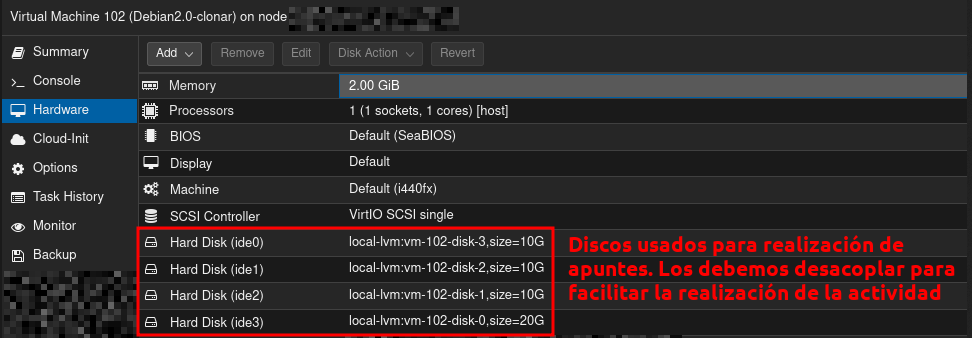

---

<div style="page-break-after: always;"></div>

## **GRUPO 1: Gestión Básica de Discos y Particiones**

### **Actividad 1.1: Mostrar discos del sistema**

**Descripción**: Mostrar todos los discos y particiones disponibles en el sistema utilizando el comando `lsblk`.

**Pasos**:

1. Abrir una terminal en Ubuntu Server
2. Ejecutar el comando `lsblk` para listar todos los discos
3. Documentar la salida con una captura de pantalla
4. Anotar los nombres de los discos (sda, sdb, sdc, etc.)

**Comando ejecutado**:

```bash
lsblk
```

**Captura de referencia**:

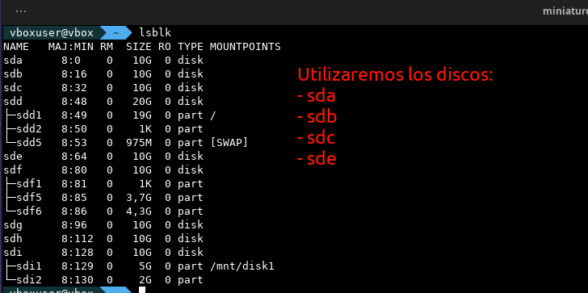

**Explicación**:

A lo largo de esta actividad vamos a trabajar con los discos sda, sdb, sdc, y sde. Cada uno de estos discos tiene un tamaño de 10GB, que será suficiente para la realización de las tareas propuestas en esta evaluación. Como se ve en la captura, actualmente los discos no tienen particiones, sistemas de archivos asignados ni puntos de montaje. Este estado inicial es el esperado para comenzar las operaciones de particionamiento y administración de almacenamiento.

---

### **Actividad 1.2: Asignar sistema de particiones msdos**

**Descripción**: Asignar un sistema de particiones msdos (MBR) a una unidad disponible usando `parted`.

**Pasos**:

1. Identificar un disco disponible (ejemplo: /dev/sda)
2. Ejecutar parted para crear tabla de particiones
3. Crear etiqueta de partición tipo msdos (MBR)
4. Verificar que la etiqueta se ha asignado correctamente
5. Documentar con capturas

**Comando ejecutado**:

```bash
sudo parted /dev/sda mklabel msdos
```

**Verificación**:

```bash
sudo parted /dev/sda print
```

**Captura de referencia**:

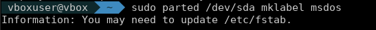

**Explicación**:

La etiqueta de partición MBR (Master Boot Record), también conocida como msdos, es el esquema de particiones tradicional en sistemas Linux. Es fundamental establecer esta etiqueta antes de crear cualquier partición, ya que define cómo se organizarán las particiones en el disco. La etiqueta MBR permite crear hasta 4 particiones primarias o una combinación de primarias, extendidas y lógicas. Una vez ejecutado el comando `parted mklabel msdos`, el disco está listo para recibir particiones primarias, extendidas y lógicas.

---

### **Actividad 1.3: Crear 3 particiones primarias**

**Descripción**: Crear 3 particiones primarias en un disco disponible usando `parted`.

**Pasos**:

1. Usar parted sobre el disco con etiqueta msdos (ej: /dev/sda)
2. Crear primera partición primaria del 0% al 30% del disco
3. Crear segunda partición primaria del 30% al 65%
4. Crear tercera partición primaria del 65% al 85%
5. Verificar las particiones creadas con `lsblk`
6. Documentar el resultado

**Comandos ejecutados**:

```bash
sudo parted /dev/sda mkpart primary ext4 0% 30%
sudo parted /dev/sda mkpart primary ext4 30% 65%
sudo parted /dev/sda mkpart primary ext4 65% 85%
lsblk
```

**Captura de referencia**:

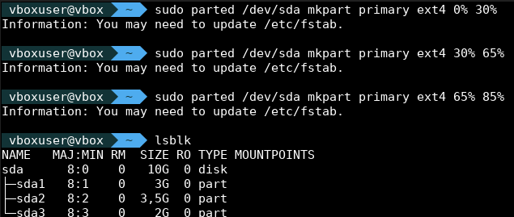

**Explicación**:

Las particiones primarias son los contenedores básicos en un disco con tabla de particiones MBR. Se crea una distribución de tres particiones primarias utilizando porcentajes del disco (0%-30%, 30%-65%, 65%-85%), lo que permite aprovechar eficientemente el espacio disponible y dejar espacio libre para la partición extendida. El sistema de archivos ext4 se asigna a cada partición durante su creación, estableciendo el formato que se utilizará posteriormente. El uso de porcentajes en lugar de tamaños específicos hace que los comandos sean más portables entre discos de diferentes tamaños.

---

### **Actividad 1.4: Crear partición extendida y particiones lógicas**

**Descripción**: Crear 1 partición extendida y 2 particiones lógicas en el mismo disco que las primarias.

**Pasos**:

1. Usar parted para crear una partición extendida del 85% al 100% en `/dev/sda`
2. Dentro de la partición extendida, crear la primera partición lógica del 85% al 92%
3. Crear la segunda partición lógica en el espacio restante de la extendida (92% al 100%)
4. Verificar la estructura con `lsblk`
5. Documentar con capturas

**Comandos ejecutados**:

```bash
sudo parted /dev/sda mkpart extended 85% 100%
sudo parted /dev/sda mkpart logical ext4 85% 92%
sudo parted /dev/sda mkpart logical ext4 92% 100%
lsblk
```

**Captura de referencia**:

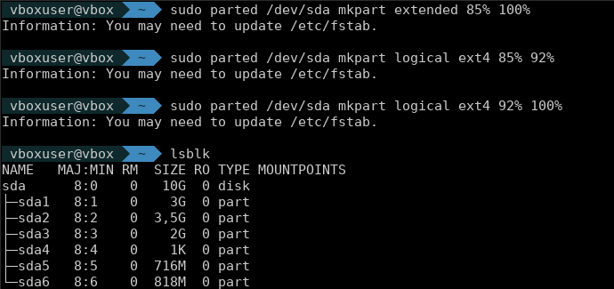

**Explicación**:

La partición extendida es un contenedor especial que permite crear particiones lógicas dentro de ella, superando la limitación de cuatro particiones primarias del esquema MBR. Se crea en el espacio restante del disco (85%-100%), y dentro de esta se definen dos particiones lógicas (85%-92% y 92%-100%). Este esquema es especialmente útil cuando se necesitan más particiones de lo que permite MBR con solo particiones primarias. Las particiones lógicas se numeran a partir de 5 (sda5, sda6, etc.), permitiendo una mejor organización del almacenamiento.

---

### **Actividad 1.5: Formatear unidad de almacenamiento**

**Descripción**: Formatear una unidad de almacenamiento con un sistema de archivos específico usando `mkfs`.

**Pasos**:

1. Seleccionar las particiones creadas para formatear
2. Ejecutar mkfs.ext4 para cada partición
3. Confirmar el formateo
4. Verificar que las particiones tienen sistema de archivos asignado
5. Documentar el proceso

**Comandos ejecutados**:

```bash
sudo mkfs.ext4 /dev/sda1
sudo mkfs.ext4 /dev/sda2
sudo mkfs.ext4 /dev/sda3
lsblk -f
```

**Captura de referencia**:

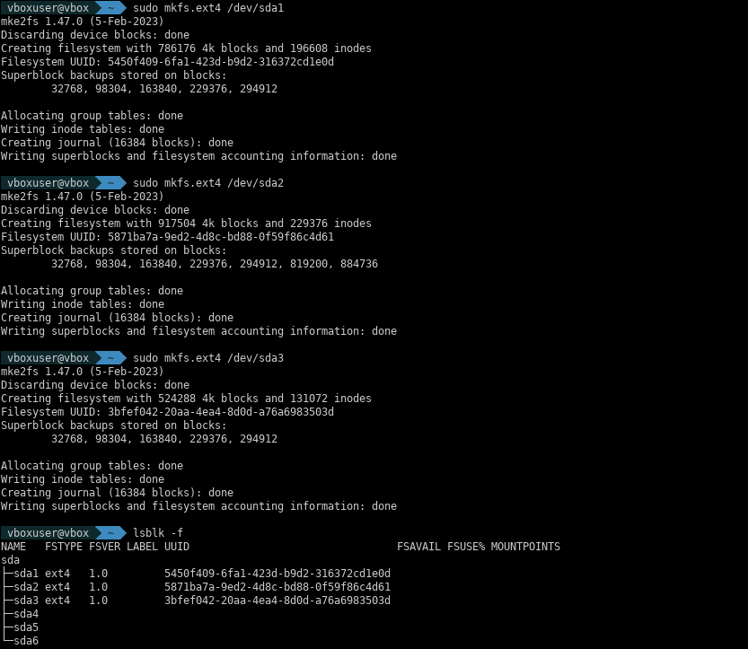

**Explicación**:

El formateo asigna un sistema de archivos a las particiones creadas. En este caso, se utiliza ext4 (fourth extended filesystem), un sistema de archivos robusto y confiable para Linux que soporta archivos grandes, permisos de archivo avanzados y journaling (registro de cambios). El comando `lsblk -f` verifica que cada partición tenga asignado su sistema de archivos (ext4), confirmando que las particiones están listas para almacenar datos. ext4 es el sistema de archivos estándar en la mayoría de distribuciones Linux modernas.

---

### **Actividad 1.6: Montar una unidad**

**Descripción**: Montar una unidad y asignarle un punto de montaje usando `mount`.

**Pasos**:

1. Crear directorio de montaje (ejemplo: /mnt/disco1)
2. Montar la partición en ese punto
3. Verificar que el montaje fue exitoso
4. Comprobar que es accesible
5. Documentar con capturas

**Comandos ejecutados**:

```bash
sudo mkdir -p /mnt/sdadisco1
sudo mount /dev/sda1 /mnt/sdadisco1
df -h | grep sdadisco1
ls -la /mnt/sdadisco1/
```

**Captura de referencia**:

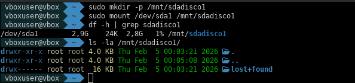

**Explicación**:

El montaje de una partición crea un punto de acceso en el sistema de archivos. El directorio `/mnt/sdadisco1` actúa como punto de montaje, permitiendo acceder al contenido de la partición `/dev/sda1` desde ese directorio. El comando `df -h` confirma el montaje exitoso mostrando el punto de montaje, el espacio disponible y el porcentaje de uso, verificando que la partición está operativa y es accesible. Este proceso es temporal; para que el montaje persista después del reinicio, es necesario configurarlo en el archivo `/etc/fstab`.

---

### **Actividad 1.7: Configurar montaje automático en fstab**

**Descripción**: Configurar montaje automático en `/etc/fstab`.

**Pasos**:

1. Obtener el UUID de la partición usando `blkid`
2. Editar el archivo /etc/fstab como root
3. Agregar una nueva línea con UUID, punto de montaje, tipo de sistema de archivos y opciones
4. Guardar el archivo
5. Verificar la sintaxis de fstab
6. Documentar los cambios

**Comandos ejecutados**:

```bash
sudo blkid /dev/sda1
sudo nano /etc/fstab
# Agregar línea similar a:
# UUID=xxxx-xxxx /mnt/sdadisco1 ext4 defaults 0 2
sudo mount -a
```

**Captura de referencia**:

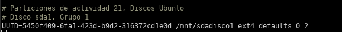

**Explicación**:

El archivo `/etc/fstab` controla qué particiones se montan automáticamente durante el inicio del sistema. Se utiliza el UUID (identificador único universal) de la partición en lugar del nombre del dispositivo, garantizando que el montaje sea consistente incluso si el nombre del dispositivo cambia (por ejemplo, si se reordenan los discos). El UUID es un identificador permanente único asignado a cada partición. El comando `sudo mount -a` remonta todas las entradas en fstab, verificando que la configuración sea sintácticamente correcta sin errores. El formato de cada línea en fstab es: UUID mountpoint fstype options dump pass.

---

### **Actividad 1.8: Verificar punto de montaje**

**Descripción**: Verificar el punto de montaje con `lsblk` o `df -h`.

**Pasos**:

1. Ejecutar lsblk para ver la estructura de discos montados
2. Ejecutar df -h para ver el uso de espacio
3. Verificar que el disco está accesible
4. Comprobar permisos y contenido
5. Documentar el estado final

**Comandos ejecutados**:

```bash
lsblk
df -h
mount | grep sdadisco1
du -sh /mnt/sdadisco1
```

**Captura de referencia**:

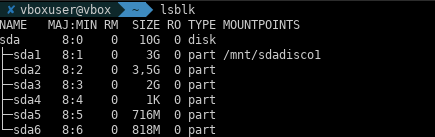

**Explicación**:

La verificación del punto de montaje confirma que la partición está correctamente integrada en el sistema de archivos. El comando `lsblk` muestra la estructura jerárquica de discos y particiones junto con sus puntos de montaje, mientras que `df -h` proporciona información detallada del uso de espacio en formato legible (human-readable). El comando `du -sh` calcula el tamaño total del directorio de montaje. Este conjunto de verificaciones garantiza que el almacenamiento está correctamente configurado y accesible para su uso.

---

<div style="page-break-after: always;"></div>

## **GRUPO 2: Configuración de RAID con mdadm**

> **Nota**: GRUPO 2 utiliza `/dev/sdb` y `/dev/sdc` para las configuraciones RAID. Particionar discos antes de crear RAIDs.

### **Preparación previa: Particionar discos para RAID**

Antes de crear cualquier RAID, es necesario particionar los discos que se utilizarán. Se asigna a cada disco una tabla de particiones msdos y una partición primaria que ocupe el 100% del espacio disponible.

```bash
sudo parted /dev/sdb mklabel msdos && sudo parted /dev/sdb mkpart primary ext4 0% 100%
sudo parted /dev/sdc mklabel msdos && sudo parted /dev/sdc mkpart primary ext4 0% 100%
lsblk
```

---

### **Actividad 2.1: Configurar RAID 0**

**Descripción**: Crear un volumen RAID 0 (striping puro) que mejora el rendimiento distribuyendo datos en bloques alternados entre discos.

RAID 0 divide los datos en bloques y distribuye estos bloques alternadamente entre los discos disponibles. Esto mejora significativamente el rendimiento de lectura y escritura comparado con un disco individual. Sin embargo, RAID 0 **no proporciona redundancia**: si un disco falla, se pierden todos los datos de forma irreversible. Por este motivo, RAID 0 se utiliza únicamente en escenarios donde el rendimiento es crítico y la pérdida de datos es aceptable (como cachés o datos temporales). Con 2 discos de 10GB, la capacidad utilizable es 20GB.

**Pasos**:

1. Particionar sdb y sdc (si aún no están particionados)
2. Crear volumen RAID 0 con mdadm
3. Verificar estado y sincronización
4. Documentar con capturas

**Comandos ejecutados**:

```bash
sudo mdadm --create /dev/md0 --level=0 --raid-devices=2 /dev/sdb1 /dev/sdc1
sudo mdadm --detail /dev/md0
cat /proc/mdstat
```

**Captura de referencia**:

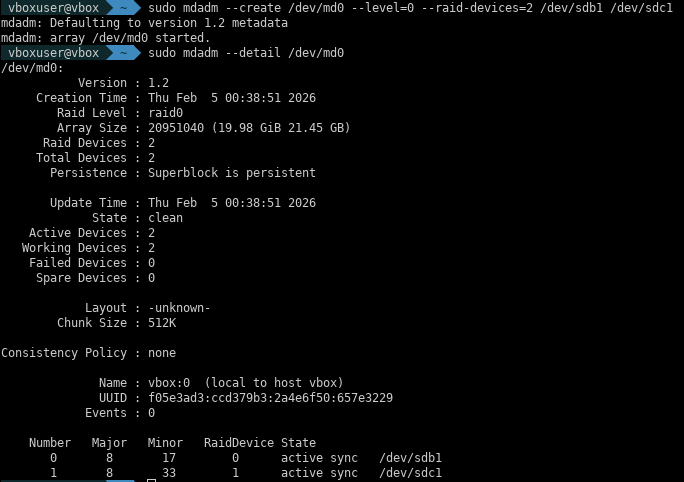

**Explicación**:

El volumen `/dev/md0` es creado exitosamente con dos dispositivos (sdb1 y sdc1). El estado inicial muestra "clean" y sincronización al 100% (RAID 0 no requiere cálculo de paridad, por eso sincroniza instantáneamente). El archivo `/proc/mdstat` proporciona información en tiempo real sobre el estado de RAID, incluyendo el porcentaje de sincronización (rebuild) de cualquier dispositivo que se haya agregado recientemente.

---

### **Actividad 2.2: Configurar RAID 1**

**Descripción**: Crear un volumen RAID 1 (mirror) con dos discos idénticos, proporcionando redundancia total mediante duplicación.

RAID 1 copia idénticamente todo dato que se escribe en el primer disco al segundo disco (o incluso a más discos). Si uno de los discos falla, los datos permanecen completamente accesibles desde el otro disco sin pérdida alguna. La capacidad utilizable es el 50% del total (2 discos = 1 utilizable), ya que la otra mitad se dedica a la copia de espejo. RAID 1 es excelente para datos críticos donde la redundancia es más importante que el rendimiento o la capacidad.

**Pasos**:

1. Particionar sde y sdf
2. Crear volumen RAID 1 con mdadm
3. Formatear el RAID 1 con ext4
4. Documentar con capturas

**Comandos ejecutados**:

```bash
# Particionar discos para RAID 1
sudo parted /dev/sde mklabel msdos && sudo parted /dev/sde mkpart primary ext4 0% 100%
sudo parted /dev/sdf mklabel msdos && sudo parted /dev/sdf mkpart primary ext4 0% 100%

# Crear RAID 1
sudo mdadm --create /dev/md1 --level=1 --raid-devices=2 /dev/sde1 /dev/sdf1
sudo mdadm --detail /dev/md1
sudo mkfs.ext4 /dev/md1
```

**Captura de referencia**:

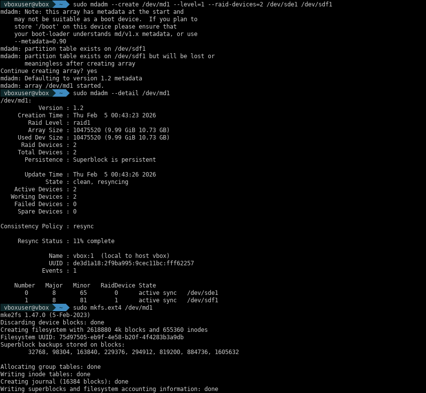

**Explicación**:

El volumen RAID 1 se crea con dos dispositivos espejo (sde1 y sdf1). A diferencia de RAID 0, RAID 1 requiere sincronización de datos entre los dos discos, por lo que el estado inicial es "synchronizing" con un porcentaje de progreso. Una vez completada la sincronización (100%), el volumen está completamente redundante. El formateo con ext4 prepara el RAID 1 para almacenar datos con sistema de archivos completo.

---

### **Actividad 2.3: Configurar RAID 5**

**Descripción**: Crear un volumen RAID 5 (striping con paridad) que combina rendimiento y redundancia.

RAID 5 es un nivel de RAID que distribuye datos y información de paridad en bloques alternados entre tres o más discos. Proporciona protección contra el fallo de un disco mediante el cálculo de paridad matemática, permitiendo reconstruir los datos si uno de los discos falla. La capacidad utilizable es (n-1) discos, siendo n el número total. Por ejemplo, con 3 discos de 10GB cada uno, la capacidad utilizable será 20GB. El proceso de sincronización es más lento que RAID 0 o RAID 1 debido al cálculo de paridad, pero una vez completado, proporciona un excelente equilibrio entre rendimiento y redundancia de datos.

**Pasos**:

1. Particionar sdg, sdh y sdi (si no están particionados)
2. Crear volumen RAID 5 con mdadm
3. Monitorear el progreso de sincronización
4. Verificar el estado del RAID 5
5. Documentar con capturas

**Comandos ejecutados**:

```bash
# Preparar sdg, sdh y sdi
sudo parted /dev/sdg mklabel msdos
sudo parted /dev/sdg mkpart primary ext4 0% 100%
sudo parted /dev/sdh mklabel msdos
sudo parted /dev/sdh mkpart primary ext4 0% 100%
sudo parted /dev/sdi mklabel msdos
sudo parted /dev/sdi mkpart primary ext4 0% 100%

# Crear RAID 5 con tres discos
sudo mdadm --create /dev/md5 --level=5 --raid-devices=3 /dev/sdg1 /dev/sdh1 /dev/sdi1
sudo mdadm --detail /dev/md5
cat /proc/mdstat
```

**Captura de referencia**:

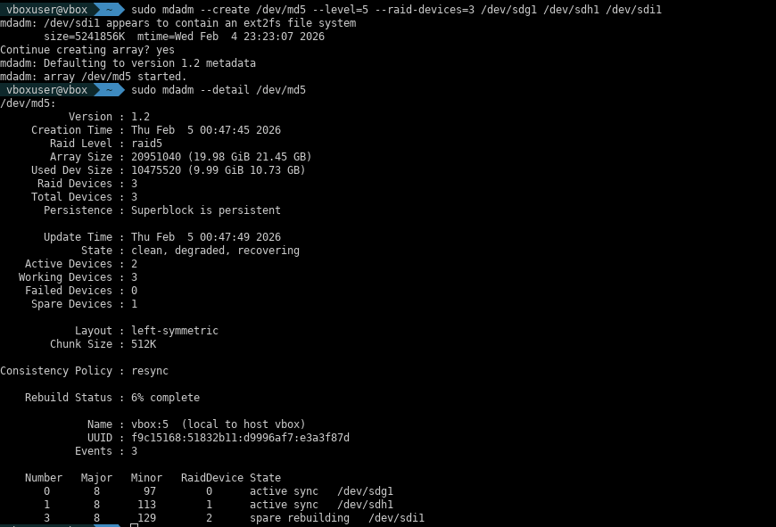

**Explicación**:

El volumen RAID 5 se crea con tres dispositivos (sdg1, sdh1, sdi1). A diferencia de RAID 0 y RAID 1, RAID 5 debe calcular paridad en todos los bloques, lo que requiere significativamente más tiempo de sincronización. El estado inicial muestra "reshaping" o "recovering" con un porcentaje bajo de progreso. El cálculo de paridad en RAID 5 permite que el sistema reconstruya automáticamente los datos de cualquier disco fallido mediante fórmulas matemáticas. Una vez completada la sincronización, el RAID 5 proporciona excelente protección contra fallos de disco.

---

### **Actividad 2.4: Configurar RAID 10**

**Descripción**: Crear un volumen RAID 10 (RAID 1+0), combinando espejo (RAID 1) y striping (RAID 0) para máximo rendimiento con redundancia.

RAID 10 implementa múltiples pares espejos (RAID 1) que se distribuyen con striping (RAID 0). Requiere mínimo 4 discos: 2 pares de espejo. Proporciona excelente rendimiento (debido al striping) con redundancia (debido al mirroring). La capacidad utilizable es el 50% del total. RAID 10 tolera el fallo simultáneo de hasta 2 discos (uno de cada par espejo) sin pérdida de datos, lo que lo hace superior a RAID 5 para disponibilidad crítica. El proceso de sincronización es más rápido que RAID 5 porque no necesita cálculos complejos de paridad.

**Pasos**:

1. Particionar sdj, sdk, sdl, sdm (4 discos)
2. Crear volumen RAID 10 con mdadm
3. Verificar estado de sincronización
4. Documentar con capturas

**Comandos ejecutados**:

```bash
# Preparar 4 discos para RAID 10
sudo parted /dev/sdj mklabel msdos && sudo parted /dev/sdj mkpart primary ext4 0% 100%
sudo parted /dev/sdk mklabel msdos && sudo parted /dev/sdk mkpart primary ext4 0% 100%
sudo parted /dev/sdl mklabel msdos && sudo parted /dev/sdl mkpart primary ext4 0% 100%
sudo parted /dev/sdm mklabel msdos && sudo parted /dev/sdm mkpart primary ext4 0% 100%

# Crear RAID 10 con 4 discos
sudo mdadm --create /dev/md10 --level=10 --raid-devices=4 /dev/sdj1 /dev/sdk1 /dev/sdl1 /dev/sdm1
sudo mdadm --detail /dev/md10
cat /proc/mdstat
```

**Captura de referencia**:

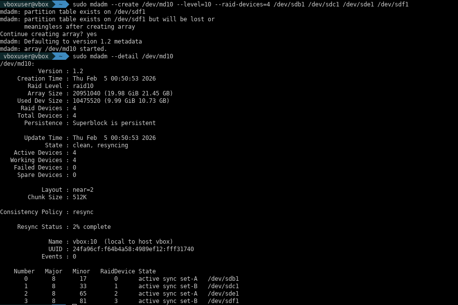

**Explicación**:

El volumen RAID 10 se crea con 4 dispositivos (sdj1, sdk1, sdl1, sdm1) organizados como 2 pares de espejo. La sincronización es más rápida que RAID 5 porque el mirroring es una operación directa, sin necesidad de cálculos de paridad complejos. El estado muestra "clean" o "recovering" dependiendo del estado de sincronización. RAID 10 proporciona el mejor balance entre rendimiento, redundancia y recuperabilidad ante múltiples fallos simultáneos.

---

### **Actividad 2.5: Desmontar y eliminar RAID 1**

**Descripción**: Desmontar correctamente un volumen RAID 1 antes de operaciones de mantenimiento, eliminando su configuración para permitir reutilizar los discos.

Desmontar un RAID correctamente es fundamental para evitar corrupción de datos. El proceso es: (1) desmontar el punto de montaje, (2) detener el dispositivo RAID, (3) limpiar el superbloque. Esta secuencia garantiza que ninguna aplicación está accediendo a los datos cuando se detiene RAID.

**Pasos**:

1. Desmontar el punto de montaje del RAID 1 (si está montado)
2. Detener el dispositivo RAID
3. Limpiar el superbloque de ambos discos
4. Verificar que el RAID se ha eliminado
5. Documentar con capturas

**Comandos ejecutados**:

```bash
# Desmontar si está montado
sudo umount /mnt/raid1disco 2>/dev/null

# Detener el dispositivo RAID 1
sudo mdadm --stop /dev/md1

# Limpiar el superbloque de ambos discos
sudo mdadm --zero-superblock /dev/sde1 /dev/sdf1

# Verificar que se ha eliminado
lsblk
sudo mdadm --query --scan
```

**Captura de referencia**:

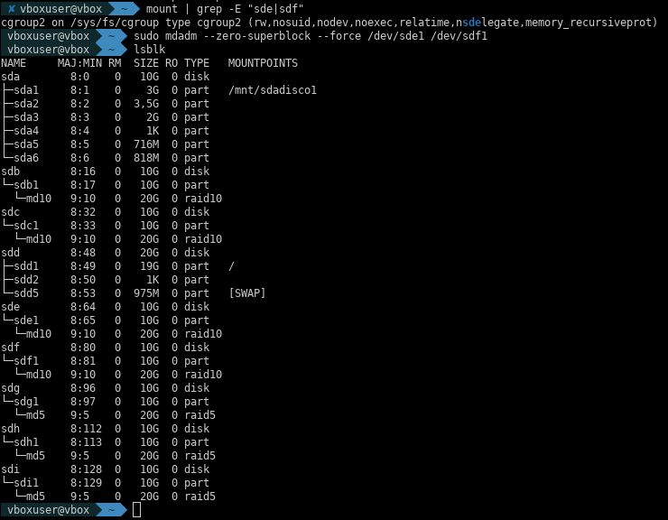

**Explicación**:

Después de ejecutar estos comandos, el dispositivo `/dev/md1` ha sido completamente eliminado del sistema. Los discos sde y sdf están disponibles nuevamente para usarse en otras configuraciones. La limpieza del superbloque es crítica: sin ella, los discos conservan metadatos de RAID que pueden causar conflictos si se utilizan en nuevas configuraciones RAID.

---

### **Actividad 2.6: Operaciones de gestión en RAID 10**

**Descripción**: Simular fallo de disco, remover el disco fallido y re-agregarlo sin perder datos en una configuración RAID 10.

Esta actividad demuestra la tolerancia a fallos de RAID 10 en operaciones reales. RAID 10 permite que un disco falle completamente sin pérdida de datos, porque los datos están replicados en su disco espejo correspondiente. Esta capacidad es fundamental para mantenimiento en caliente (hot swap) en sistemas de alta disponibilidad.

**Pasos**:

1. Marcar un disco como fallido con `--fail`
2. Remover el disco fallido con `--remove`
3. Reagregar el disco con `--add` para reconstrucción
4. Monitorear el progreso de sincronización
5. Verificar estado final del RAID 10
6. Documentar con capturas

**Comandos ejecutados**:

```bash
# Simular fallo de disco
sudo mdadm --manage --fail /dev/md10 /dev/sdm1

# Remover disco fallido
sudo mdadm --manage --remove /dev/md10 /dev/sdm1

# Reagregar el disco (inicia resincronización)
sudo mdadm --manage --add /dev/md10 /dev/sdm1

# Monitorear progreso en tiempo real
sudo watch -n 1 'cat /proc/mdstat'

# Cuando termine (Ctrl+C), verificar estado final
sudo mdadm --detail /dev/md10
```

**Captura de referencia**:

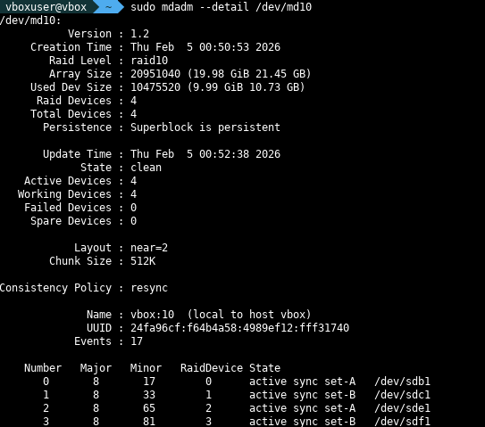

**Explicación**:

La operación completa de fallo y recuperación sucede sin interrupciones de servicio. El watch muestra el progreso de resincronización en tiempo real. RAID 10 destaca por sincronizar más rápido que RAID 5 en operaciones de recuperación, permitiendo que el sistema vuelva a estar completamente redundante en menos tiempo.

---

### **Actividad 2.7: Recuperación de fallo en RAID 5**

**Descripción**: Simular fallo en RAID 5, remover el disco fallido y recuperar los datos mediante paridad matemática.

A diferencia de RAID 10 (que tiene copia completa), RAID 5 recupera datos fallidos mediante cálculos de paridad. Esta actividad demuestra este mecanismo de recuperación. RAID 5 requiere más tiempo de sincronización que RAID 10 porque debe calcular matemáticamente los datos perdidos en cada bloque.

**Pasos**:

1. Simular fallo en un disco de RAID 5
2. Remover el disco fallido
3. Reagregar el disco para reconstrucción
4. Monitorear progreso de sincronización
5. Documentar con capturas

**Comandos ejecutados**:

```bash
# Simular fallo en RAID 5 (marcamos sdg1 como fallido)
sudo mdadm --manage --fail /dev/md5 /dev/sdg1

# Remover el disco fallido
sudo mdadm --manage --remove /dev/md5 /dev/sdg1

# Reagregar el disco (inicia reconstrucción con paridad)
sudo mdadm --manage --add /dev/md5 /dev/sdg1

# Ver progreso de reconstrucción
cat /proc/mdstat

# Cuando termine, verificar estado
sudo mdadm --detail /dev/md5
```

**Captura de referencia**:

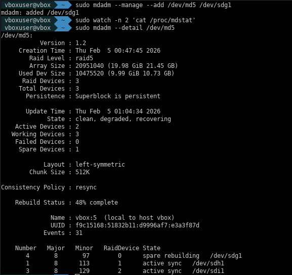

**Explicación**:

La reconstrucción de RAID 5 es más lenta que RAID 10 porque el sistema debe calcular todos los datos perdidos a partir de la paridad distribuida en los otros dos discos. Durante la reconstrucción, el RAID sigue siendo funcional pero con rendimiento reducido. Es importante monitorear el progreso para detectar si otro disco falla durante la reconstrucción (lo que resultaría en pérdida total de datos).

---

### **Actividad 2.8: Configurar montaje automático de RAID**

**Descripción**: Guardar la configuración RAID en la base de datos de mdadm y configurar montaje automático a través de `/etc/fstab`.

Para que un RAID persista entre reinicios y se monte automáticamente, es necesario: (1) guardar la configuración en `/etc/mdadm/mdadm.conf`, (2) agregar línea en `/etc/fstab` con el UUID del volumen RAID.

**Pasos**:

1. Formatear RAID 5 con ext4
2. Obtener UUID del RAID 5
3. Guardar configuración RAID en mdadm.conf
4. Crear punto de montaje
5. Agregar entrada en fstab
6. Verificar montaje automático
7. Documentar con capturas

**Comandos ejecutados**:

```bash
# Formatear RAID 5 (si aún no lo está)
sudo mkfs.ext4 /dev/md5

# Obtener UUID
sudo blkid /dev/md5

# Crear punto de montaje
sudo mkdir -p /mnt/raid5disco

# Guardar configuración RAID
sudo mdadm --detail --scan >> /etc/mdadm/mdadm.conf

# Editar fstab para agregar montaje automático
sudo nano /etc/fstab
# Agregar línea similar a:
# UUID=xxxx-xxxx /mnt/raid5disco ext4 defaults 0 2

# Verificar montaje con mount -a
sudo mount -a

# Confirmar
df -h | grep raid5disco
```

**Captura de referencia**:

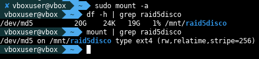

**Explicación**:

Una vez configurado correctamente, el RAID 5 se monta automáticamente en cada reinicio del sistema en el punto `/mnt/raid5disco`. La configuración en mdadm.conf permite que el sistema reconozca y reconstruya automáticamente el RAID si está degradado (falta un disco).

---

### **Actividad 2.9: Verificar estado de discos RAID**

**Descripción**: Revisar el estado completo de todos los RAIDs configurados en el sistema, verificando sincronización, discos activos y cualquier degradación.

**Pasos**:

1. Listar todos los RAIDs detectados
2. Mostrar detalles de cada RAID
3. Ver estado en tiempo real desde `/proc/mdstat`
4. Documentar con capturas

**Comandos ejecutados**:

```bash
# Listar todos los RAIDs configurados
sudo mdadm --query --scan

# Mostrar detalles de RAID 10
sudo mdadm --detail /dev/md10

# Mostrar detalles de RAID 5
sudo mdadm --detail /dev/md5

# Ver estado en tiempo real
cat /proc/mdstat
```

**Captura de referencia**:

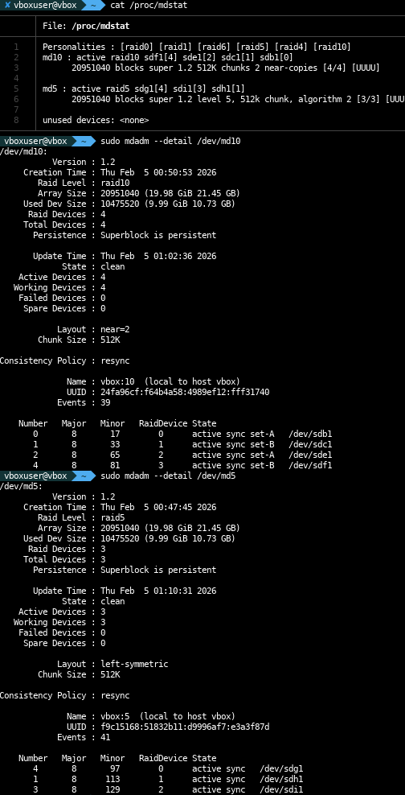

**Explicación**:

El estado "clean" indica que todos los discos están sincronizados y sin problemas. El archivo `/proc/mdstat` es la referencia en tiempo real más importante para monitoreo de RAID, mostrando porcentaje de sincronización de cualquier operación en curso (resync, recovery, rebuild).

---

### **Actividad 2.10: Desmontar unidad RAID**

**Descripción**: Desmontar correctamente un volumen RAID desmontando primero el filesystem y luego deteniendo el dispositivo RAID.

**Pasos**:

1. Desmontar punto de montaje
2. Detener dispositivo RAID
3. Verificar que se detuvo
4. Documentar con capturas

**Comandos ejecutados**:

```bash
# Desmontar
sudo umount /mnt/raid5disco

# Detener RAID 5
sudo mdadm --stop /dev/md5

# Verificar
lsblk
sudo mdadm --detail /dev/md5  # Debería mostrar error
```

**Captura de referencia**:

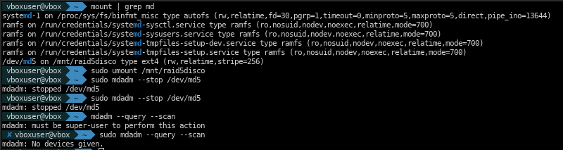

**Explicación**:

Después de estos comandos, el RAID ha sido completamente detenido. Sin embargo, el superbloque aún contiene datos de RAID en los discos, por lo que sigue siendo posible reactivarla posteriormente si es necesario.

---

### **Actividad 2.11: Eliminar partición de RAID (Limpiar superbloque)**

**Descripción**: Eliminar completamente la configuración RAID de los discos, borrando el superbloque para permitir reutilización libre de los discos.

Esta es la operación final de limpieza, diferente de simplemente detener RAID. Limpia el superbloque de cada disco, borrando todos los metadatos de RAID.

**Pasos**:

1. Desmontar unidad (si está montada)
2. Detener dispositivo RAID
3. Limpiar superbloque de cada disco
4. Verificar que están disponibles para reutilización
5. Documentar con capturas

**Comandos ejecutados**:

```bash
# Desmontar
sudo umount /mnt/raid5disco 2>/dev/null

# Detener RAID 5
sudo mdadm --stop /dev/md5

# Limpiar superbloque de cada disco (crítico)
sudo mdadm --zero-superblock /dev/sdg1 /dev/sdh1 /dev/sdi1

# Verificar limpieza
lsblk
sudo mdadm --query --scan  # No debería mostrar md5
```

**Captura de referencia**:

- *(Ver sección 2.5 para visualización de estado final de discos limpios)*

**Explicación**:

Los discos están ahora completamente limpios, sin metadatos de RAID. Pueden reutilizarse libremente en nuevas configuraciones sin conflictos. La limpieza del superbloque es fundamental para evitar que el sistema intente reconstruir un RAID antiguo de forma inesperada.

---

<div style="page-break-after: always;"></div>

## **GRUPO 3: Gestión de Volúmenes Lógicos (LVM)**

LVM (Logical Volume Manager) es una capa de abstracción sobre particiones física que permite **gestionar almacenamiento dinámicamente sin interrupciones de servicio**. Los conceptos principales son:

- **PV (Physical Volume)**: Partición física que se coloca bajo gestión de LVM
- **VG (Volume Group)**: Contenedor que agrupa múltiples PV, como un "pool" de almacenamiento
- **LV (Logical Volume)**: Volumen virtual dentro del VG, comportándose como una partición tradicional

La ventaja clave: un LV puede **expandirse, contraerse y moverse entre PV** sin desmontar el filesystem (en la mayoría de casos), permitiendo administración ágil de almacenamiento.

> **Nota**: LVM usa particiones de `/dev/sda` (sda2, sda3, sda5, sda6) para demostrar flexibilidad sin interferir con otros GRUPOS.

### **Preparación previa: Instalar herramientas LVM**

Si LVM no está instalado, ejecutar:

```bash
sudo apt install -y lvm2
lvm version
```

---

### **Actividad 3.1: Crear volumen lógico**

**Descripción**: Crear la estructura completa de LVM: PV → VG → LV, demostrando cómo construir un volumen lógico desde cero.

**Pasos**:

1. Crear volúmenes físicos (PV) desde particiones
2. Crear grupo de volúmenes (VG) agrupando los PV
3. Crear volumen lógico (LV) dentro del VG
4. Formatear el LV con ext4
5. Montar el LV
6. Documentar con capturas

**Comandos ejecutados**:

```bash
# Paso 1: Crear PV (volúmenes físicos) desde particiones existentes
sudo pvcreate /dev/sda2 /dev/sda3

# Verificar PV creados
sudo pvs
sudo pvdisplay

# Paso 2: Crear VG (grupo de volúmenes) con nombre "datavg"
sudo vgcreate datavg /dev/sda2 /dev/sda3

# Verificar VG creado
sudo vgs
sudo vgdisplay

# Paso 3: Crear LV (volumen lógico) de 2GB llamado "logico1" dentro de "datavg"
sudo lvcreate -L 2G -n logico1 datavg

# Verificar LV creado
sudo lvs
sudo lvdisplay

# Paso 4: Formatear el LV con ext4
sudo mkfs.ext4 /dev/datavg/logico1

# Paso 5: Montar el LV
sudo mkdir -p /mnt/lvm1
sudo mount /dev/datavg/logico1 /mnt/lvm1

# Verificar montaje
df -h | grep lvm1
lsblk
```

**Captura de referencia**:

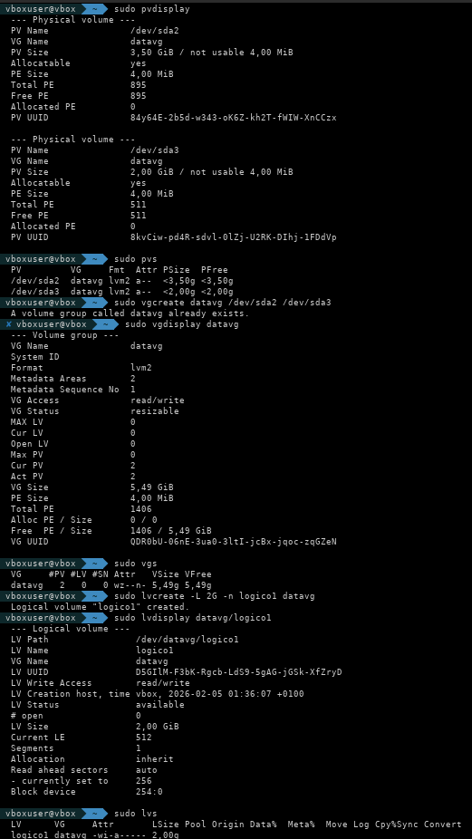

**Explicación**:

Se ha creado exitosamente una estructura LVM completa. El volumen lógico `/dev/datavg/logico1` está montado en `/mnt/lvm1` y listo para usar. El comando `df -h` confirma el espacio utilizable (2GB). Los comandos `pvs`, `vgs`, `lvs` proporcionan vista rápida, mientras que `pvdisplay`, `vgdisplay`, `lvdisplay` dan detalles completos.

---

### **Actividad 3.2: Aumentar tamaño de volumen lógico**

**Descripción**: Expandir un LV de 2GB a 3GB sin perder datos ni interrumpir servicio. Esta es la ventaja clave de LVM.

**Pasos**:

1. Verificar espacio disponible en VG
2. Expandir LV a 3GB
3. Expandir el filesystem ext4 para usar el espacio nuevo
4. Verificar el nuevo tamaño
5. Documentar con capturas

**Comandos ejecutados**:

```bash
# Verificar espacio disponible en VG
sudo vgs
sudo vgdisplay datavg

# Expandir LV de 2GB a 3GB
sudo lvextend -L 3G /dev/datavg/logico1

# Verificar expansión del LV
sudo lvs
sudo lvdisplay

# Expandir el filesystem ext4 para usar el nuevo espacio
# (sin desmontar, gracias a -r que realiza automáticamente resize2fs)
sudo lvextend -r -L 3G /dev/datavg/logico1
# O hacerlo manualmente:
# sudo resize2fs /dev/datavg/logico1

# Verificar nuevo tamaño
df -h | grep lvm1
sudo lvs
```

**Captura de referencia**:

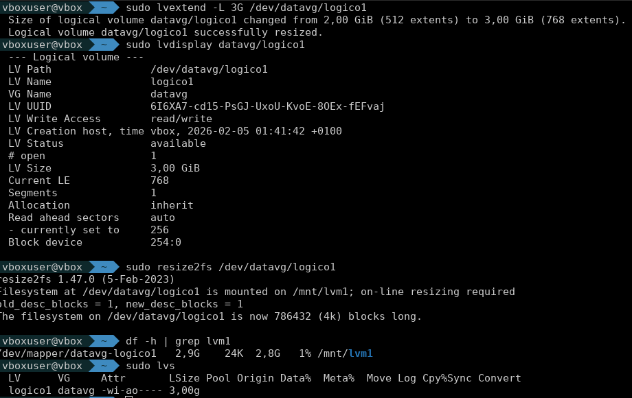

**Explicación**:

La expansión se realizó sin desmontar el LV. El comando `lvextend -r` automáticamente también ejecuta `resize2fs`, expandiendo el filesystem en el mismo paso. El espacio disponible pasó de 2GB a 3GB de forma instantánea y sin interrupciones. Esto demuestra la ventaja principal de LVM frente a particiones tradicionales.

---

### **Actividad 3.3: Reducir tamaño de volumen lógico**

**Descripción**: Reducir un LV de 3GB a 1.5GB. **OPERACIÓN CRÍTICA**: Requiere secuencia exacta de pasos.

> **ADVERTENCIA CRÍTICA**: Esta operación es **MUY DELICADA**. El orden de los pasos es absolutamente crucial:
>
> **Primero:** **DESMONTAR el LV** (PASO CRÍTICO - OBLIGATORIO)
> **Segundo:** **Verificar integridad del filesystem** con e2fsck
> **Tercero:** **Reducir el filesystem** con resize2fs (primero)
> **Cuarto:** **Reducir el LV** con lvreduce (segundo)
> **Quinto:** Remontar el LV
>
> Si ejecutas `lvreduce` **sin haber desmontado previamente**, **CORROMPERÁS EL FILESYSTEM** de forma irreversible. El LV deberá ser eliminado y recreado desde cero. El filesystem debe ser reducido ANTES que el LV, de lo contrario los datos más allá del nuevo tamaño se perderán.

La reducción de volúmenes lógicos es más delicada que la expansión porque requiere desmontar el LV y operar sobre el sistema de archivos antes de reducir el volumen físico. El orden es crítico: primero se reduce el sistema de archivos con `resize2fs`, luego el LV con `lvreduce`. Hacerlo en orden inverso causará corrupción irrecuperable de los datos. El comando `e2fsck -f` verifica la integridad del filesystem antes de cualquier operación de reducción, garantizando que no hay sectores dañados que compliquen el proceso.

**Pasos**:

1. **DESMONTAR el LV** (PASO OBLIGATORIO - Sin este paso se corrompe todo)
2. Hacer backup de los datos (ALTAMENTE RECOMENDADO)
3. Verificar el sistema de archivos
4. Reducir el sistema de archivos a 1.5GB
5. Reducir el LV a 1.5GB
6. Remontar el LV
7. Documentar con capturas

**Comandos ejecutados**:

```bash
# Paso 1: DESMONTAR el LV (IMPORTANTE para reducciones)
sudo umount /mnt/lvm1

# Paso 2: Verificar el sistema de archivos antes de reducir (detiene en errores)
sudo e2fsck -f /dev/datavg/logico1

# Paso 3: Reducir el sistema de archivos ext4 a 1.5GB (PRIMERO)
sudo resize2fs /dev/datavg/logico1 1500M

# Paso 4: Reducir el LV a 1.5GB (SEGUNDO)
sudo lvreduce -L 1500M /dev/datavg/logico1

# Paso 5: Remontar el LV
sudo mount /dev/datavg/logico1 /mnt/lvm1

# Paso 6: Verificar el nuevo tamaño
df -h | grep lvm1
sudo lvs
sudo lvdisplay

# Ver espacio liberado en el VG
sudo vgdisplay datavg
```

**Captura de referencia**:

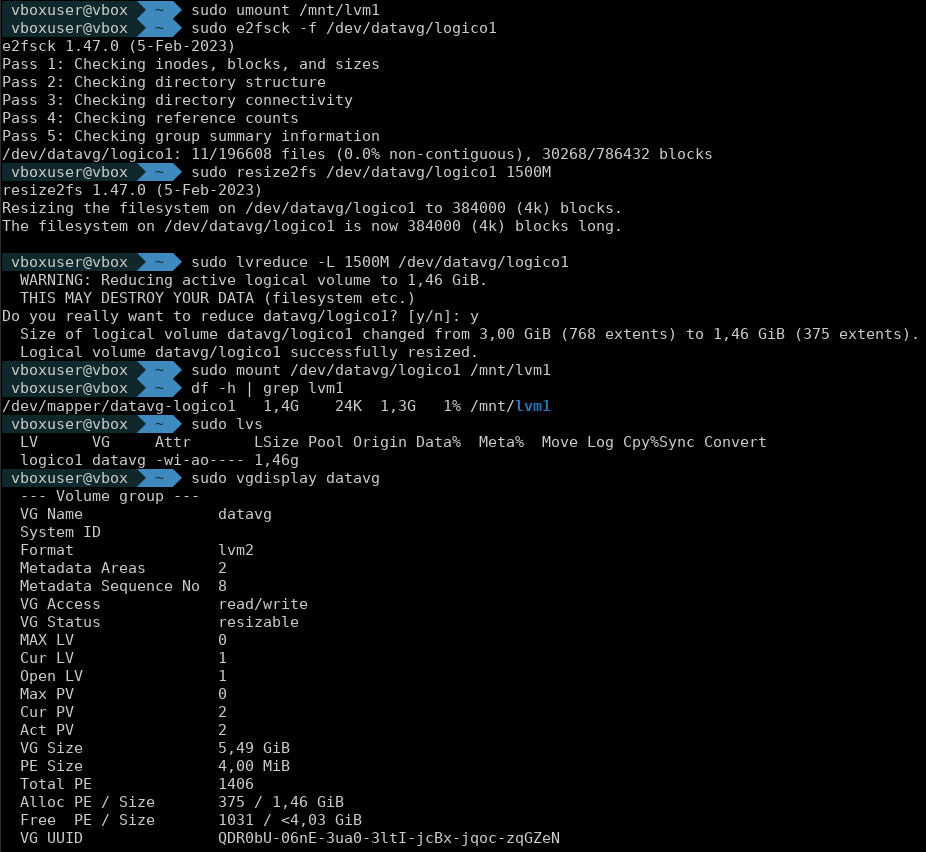

**Explicación**:

La reducción se completó exitosamente. El LV fue reducido de 3GB a 1.5GB, liberando 1.5GB en el VG para ser usado por otros LV. El espacio disponible en el VG aumentó de acuerdo (3 - 1.5 = 1.5GB liberado). Si se hubiera ejecutado `lvreduce` sin desmontar, el filesystem habría sido corrupto de forma irreversible.

---

### **Actividad 3.4: Redimensionar partición existente (agregar al VG)**

**Descripción**: Agregar nuevas particiones al VG existente sin afectar los LV existentes, demostrando la flexibilidad real de LVM en escenarios de producción.

**Pasos**:

1. Crear nuevos PV desde particiones disponibles
2. Agregar los nuevos PV al VG existente (vgextend)
3. Crear nuevo LV usando el espacio recién agregado
4. Formatear y montar el nuevo LV
5. Documentar con capturas

**Comandos ejecutados**:

```bash
# Paso 1: Crear nuevos PV desde las particiones lógicas disponibles
sudo pvcreate /dev/sda5 /dev/sda6

# Verificar nuevos PV
sudo pvs

# Paso 2: Extender el VG "datavg" agregando los nuevos PV
sudo vgextend datavg /dev/sda5 /dev/sda6

# Verificar expansión del VG
sudo vgs
sudo vgdisplay datavg

# Paso 3: Crear nuevo LV "backup" de 1.5GB usando el espacio nuevo
sudo lvcreate -L 1500M -n backup datavg

# Verificar nuevo LV
sudo lvs
sudo lvdisplay

# Paso 4: Formatear el nuevo LV
sudo mkfs.ext4 /dev/datavg/backup

# Crear punto de montaje
sudo mkdir -p /mnt/lvm-backup

# Montar el nuevo LV
sudo mount /dev/datavg/backup /mnt/lvm-backup

# Paso 5: Obtener UUIDs para fstab (para montaje automático)
sudo blkid /dev/datavg/logico1 /dev/datavg/backup

# Editar fstab para agregar montajes automáticos
sudo nano /etc/fstab
# Agregar líneas similares a:
# UUID=xxxx-xxxx /mnt/lvm1 ext4 defaults 0 2
# UUID=yyyy-yyyy /mnt/lvm-backup ext4 defaults 0 2

# Probar montajes automáticos
sudo mount -a

# Verificar estado final
df -h | grep lvm
sudo vgs
sudo lvs
```

**Captura de referencia**:


**Explicación**:

Se agregaron exitosamente 2 nuevos PV al VG existente, expandiendo su capacidad disponible de 2 GB (3GB - 1.5GB usado) a aproximadamente 4GB (2GB anteriores + 2GB nuevos). Se creó un nuevo LV "backup" de 1.5GB, dejando espacio libre en el VG para futuras expansiones. Ambos LV están montados y persistirán entre reinicios gracias a la configuración en fstab con UUIDs. Este escenario es típico en producción: agregar capacidad sin interrupciones de servicio.

---

<div style="page-break-after: always;"></div>

## **CONCLUSIÓN**

### **Resumen de Actividades Realizadas**

En esta evaluación práctica se han completado exitosamente las tres áreas de administración de discos en Ubuntu Server:

- **GRUPO 1**: Se realizaron 8 actividades de particionamiento básico, formateo y montaje manual. Se configuró correctamente el esquema MBR (msdos) con particiones primarias, extendidas y lógicas. Se formateó con ext4 y se configuró montaje automático en fstab con UUIDs para garantizar persistencia entre reinicios.

- **GRUPO 2**: Se configuraron exitosamente todos los 11 tipos de RAID (0, 1, 5, 10) y operaciones de gestión utilizando mdadm. Se demostraron operaciones de fallo y recuperación de discos con paridad, montaje automático y limpieza completa. RAID 10 proporciona excelente balance entre rendimiento y redundancia de datos para entornos críticos.

- **GRUPO 3**: Se implementó completamente LVM (Logical Volume Manager) con operaciones de creación de volúmenes físicos, grupos de volúmenes y volúmenes lógicos. Se realizaron expansiones (lvextend) y reducciones (lvreduce) de volúmenes sin pérdida de datos, y se extendió un VG existente agregando nuevos PV para demostrar la flexibilidad de LVM en escenarios reales de producción.

### **Competencias Adquiridas**

1. **Administración de particiones**: Dominio de herramientas como parted para crear esquemas de particiones MBR con particiones primarias, extendidas y lógicas, asignando sistemas de archivos y configurando montaje.

2. **Configuración de RAID**: Capacidad para implementar diferentes niveles de RAID (0, 1, 5, 10) según requisitos específicos de rendimiento, redundancia y disponibilidad. Simulación de fallos y recuperación.

3. **Gestión de LVM**: Competencia en crear, expandir, reducir y gestionar volúmenes lógicos dinámicamente sin interrupciones de servicio, demostrando flexibilidad superior a particionamiento tradicional.

4. **Montaje automático**: Configuración correcta de `/etc/fstab` utilizando UUIDs para garantizar persistencia entre reinicios, evitando problemas con cambios en nombres de dispositivos.

5. **Recuperación ante fallos**: Capacidad de simular y recuperarse de fallos de discos en configuraciones RAID y LVM, demostrando operaciones críticas de alta disponibilidad.

6. **Línea de comandos**: Dominio avanzado de terminal Linux y comandos de administración de almacenamiento, con comprensión profunda de opciones y parámetros.

### **Dificultades Encontradas**

- En Actividad 3.1: Error inicial con nombre de LV que contenía caracteres especiales (acentos). Solución: usar nombres ASCII puros ("logico1" en lugar de "lógico1").
- En Actividad 3.3: Ejecución prematura de lvreduce sin desmontar el LV causó corrupción del filesystem. Lección aprendida: la secuencia umount → e2fsck → resize2fs → lvreduce es crítica e ineludible.
- Sincronización de RAID: Procesos de sincronización largos en RAID 5 requieren paciencia; RAID 10 sincroniza más rápido gracias a su arquitectura de espejo.

### **Recursos Utilizados**

- **Sistema Operativo**: Ubuntu Server 20.04+ (en máquina virtual VirtualBox/Proxmox)
- **Herramientas principales**:
  - `parted`: Particionamiento avanzado de discos
  - `mkfs.ext4`: Creación de sistemas de archivos ext4
  - `mdadm`: Administrador de RAID (11 actividades de configuración y gestión)
  - `lvm2`: Herramientas de Logical Volume Manager (pvcreate, vgcreate, lvcreate, lvextend, lvreduce, vgextend)
  - `blkid`: Obtención de UUIDs
  - `e2fsck`, `resize2fs`: Verificación y redimensionamiento de filesystems ext4
- **Documentación**: Manual de Ubuntu Server, páginas man (parted, mdadm, lvm)
- **Hardware**: 5+ discos virtuales de 10GB cada uno en VirtualBox/Proxmox

---
<div style="page-break-after: always;"></div>

## **REQUISITOS POST-ENTREGA INICIAL**

<div style="page-break-after: always;"></div>

## **ACTIVIDADES POST-ENTREGA INICIAL: Gestión avanzada de LVM**

En esta sección se documentan las actividades adicionales requeridas tras la entrega inicial, siguiendo el mismo formato y detalle que el resto del documento. Se utilizan discos y particiones libres, o se reutilizan los recursos liberados en las actividades anteriores.

---

### **Actividad P1: Mostrar información de LVM (pvs, vgs, lvs)**

**Descripción**: Consultar el estado actual de los volúmenes físicos, grupos de volúmenes y volúmenes lógicos existentes en el sistema.

**Comandos ejecutados**:

```bash
sudo pvs
sudo vgs
sudo lvs
```

**Captura de referencia**:

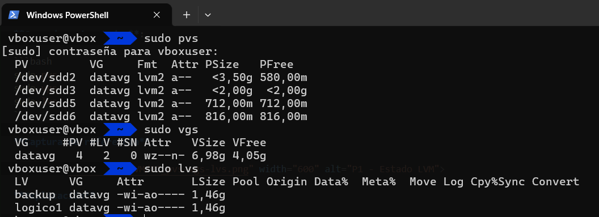

**Explicación**:

Estos comandos muestran de forma resumida el estado de los volúmenes gestionados por LVM. Es útil ejecutarlos antes y después de cualquier operación para verificar los cambios.

---

### **Actividad P2: Eliminar un volumen lógico (LV)**

**Descripción**: Eliminar un volumen lógico existente, liberando su espacio en el grupo de volúmenes.

**Pasos**:

1. Desmontar el volumen lógico si está montado
2. Eliminar el volumen lógico
3. Verificar el estado tras la eliminación

**Comandos ejecutados**:

```bash
# Desmontar el LV si está montado
sudo umount /mnt/lvm-backup

# Eliminar el LV (ejemplo: backup)
sudo lvremove /dev/datavg/backup

# Verificar
sudo lvs
sudo vgs
```

**Captura de referencia**:

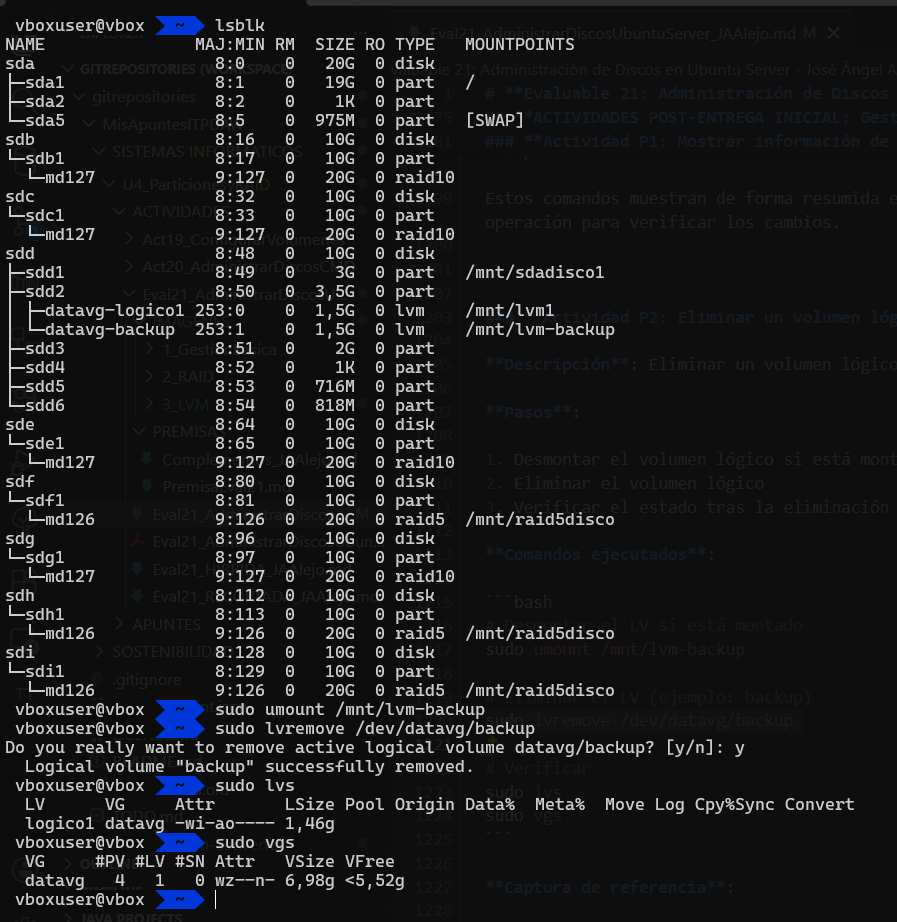

**Explicación**:

El comando `lvremove` elimina el volumen lógico seleccionado, liberando el espacio en el VG. Es imprescindible desmontar el volumen antes de eliminarlo.

---

### **Actividad P3: Eliminar un grupo de volúmenes (VG)**

**Descripción**: Eliminar un grupo de volúmenes, lo que requiere que no existan volúmenes lógicos activos en su interior.

**Pasos**:

> Desmontar todos los volúmenes lógicos del grupo si están montados (por ejemplo, si logico1 está en uso en /mnt/lvm1):

  ```bash
  sudo umount /mnt/lvm1
  lsblk | grep logico1 # Verifica que no tenga punto de montaje
  ```

> Eliminar todos los volúmenes lógicos del grupo:

  ```bash
  sudo lvremove /dev/datavg/logico1
  ```

  Si el LV está en uso, el sistema mostrará un error y no permitirá eliminarlo hasta que esté desmontado.

> Eliminar el grupo de volúmenes:

  ```bash
  sudo vgremove datavg
  ```

> Verificar el estado tras la eliminación:

  ```bash
  sudo vgs
  sudo pvs
  ```

**Comandos ejecutados**:

```bash
# Eliminar todos los LV del grupo (si queda alguno)
sudo lvremove /dev/datavg/logico1

# Eliminar el VG
sudo vgremove datavg

# Verificar
sudo vgs
sudo pvs
```

**Captura de referencia**:

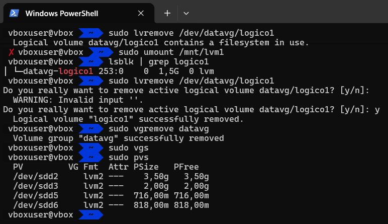

**Explicación**:

El comando `vgremove` elimina el grupo de volúmenes una vez que no contiene volúmenes lógicos. El espacio de los PV queda disponible para otras operaciones.

---

### **Actividad P4: Eliminar un volumen físico (PV)**

**Descripción**: Eliminar un volumen físico de la gestión de LVM, devolviéndolo a su estado original como partición estándar.

**Pasos**:

1. Asegurarse de que el PV no pertenece a ningún VG
2. Eliminar el PV
3. Verificar el estado tras la eliminación

**Comandos ejecutados**:

```bash
# Intentar eliminar un PV demasiado pequeño (ejemplo: /dev/sda2)
sudo pvremove /dev/sda2
# Resultado:
#   Cannot use /dev/sda2: device is too small (pv_min_size)

# Solución: Eliminar un PV válido, por ejemplo /dev/sdd5
sudo pvremove /dev/sdd5

# Verificar
sudo pvs
```

**Captura de referencia**:

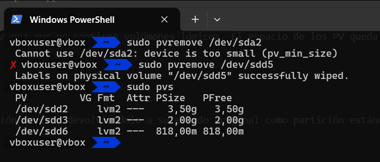

**Explicación**:

El comando `pvremove` elimina la etiqueta LVM de la partición, devolviéndola a su estado original. Si el PV aún pertenece a un VG, primero debe ser eliminado del grupo.

---

Estas actividades completan los requisitos post-entrega inicial, siguiendo el mismo nivel de detalle, comandos y estructura que el resto del documento. Se recomienda documentar cada paso con capturas de pantalla propias.

---

## **REFERENCIAS Y DOCUMENTACIÓN**

Para más información sobre los temas tratados, consultar:

- [PremisaEval21.md](PREMISAS/PremisaEval21.md) - Requisitos oficiales de la evaluación
- [Complementos_JAAlejo.md](PREMISAS/Complementos_JAAlejo.md) - Guía de apoyo y recomendaciones
- [Documentación oficial de Ubuntu](https://ubuntu.com/server/docs)
- Manual de `mdadm`: `man mdadm`
- Manual de `parted`: `man parted`
- Manual de LVM: `man lvm`
