# **Evaluable 21: Administración de Discos en Ubuntu Server - José Ángel Alejo Sillero**

**Autor**: José Ángel Alejo Sillero  
**Centro**: Instituto Tecnológico Pablo de la Torre  
**Curso**: 2025/2026  
**Módulo**: Sistemas Informáticos  
**Unidad**: 4 - Particiones y RAID

---

## **Estructura de la Evaluación: TRES GRUPOS**

Esta evaluación se estructura en **TRES GRUPOS DIFERENCIADOS** que permiten progresar de forma incremental:

- **GRUPO 1 (Gestión Básica)**: 8 actividades de particionamiento, formateo y montaje
- **GRUPO 2 (RAID)**: 11 actividades de RAID (0, 1, 5, 10) con mdadm
- **GRUPO 3 (LVM)**: 4 actividades de volúmenes lógicos

> **Nota**: Todos los comandos se ejecutan desde terminal en Ubuntu Server. Requieren `sudo` para la mayoría de operaciones.

Se puede revisar la premisa propuesta en el siguiente enlace: [Premisa Eval21](PREMISAS/PremisaEval21.md)

---

## **TABLA DE CONTENIDOS**

- [**Evaluable 21: Administración de Discos en Ubuntu Server - José Ángel Alejo Sillero**](#evaluable-21-administración-de-discos-en-ubuntu-server---josé-ángel-alejo-sillero)
  - [**Estructura de la Evaluación: TRES GRUPOS**](#estructura-de-la-evaluación-tres-grupos)
  - [**TABLA DE CONTENIDOS**](#tabla-de-contenidos)
  - [**REQUISITOS PREVIOS**](#requisitos-previos)
  - [**PREPARACIÓN DEL ENTORNO DE PROXMOX**](#preparación-del-entorno-de-proxmox)
  - [**GRUPO 1: Gestión Básica de Discos y Particiones**](#grupo-1-gestión-básica-de-discos-y-particiones)
    - [**Actividad 1.1: Mostrar discos del sistema**](#actividad-11-mostrar-discos-del-sistema)
    - [**Actividad 1.2: Asignar sistema de particiones msdos**](#actividad-12-asignar-sistema-de-particiones-msdos)
    - [**Actividad 1.3: Crear 3 particiones primarias**](#actividad-13-crear-3-particiones-primarias)
    - [**Actividad 1.4: Crear partición extendida y particiones lógicas**](#actividad-14-crear-partición-extendida-y-particiones-lógicas)
    - [**Actividad 1.5: Formatear unidad de almacenamiento**](#actividad-15-formatear-unidad-de-almacenamiento)
    - [**Actividad 1.6: Montar una unidad**](#actividad-16-montar-una-unidad)
    - [**Actividad 1.7: Configurar montaje automático en fstab**](#actividad-17-configurar-montaje-automático-en-fstab)
    - [**Actividad 1.8: Verificar punto de montaje**](#actividad-18-verificar-punto-de-montaje)
  - [**GRUPO 2: Configuración de RAID con mdadm**](#grupo-2-configuración-de-raid-con-mdadm)
    - [**Preparación previa: Particionar discos para RAID**](#preparación-previa-particionar-discos-para-raid)
    - [**Actividad 2.1: Configurar RAID 0**](#actividad-21-configurar-raid-0)
    - [**Actividad 2.2: Configurar RAID 1**](#actividad-22-configurar-raid-1)
    - [**Actividad 2.3: Configurar RAID 5**](#actividad-23-configurar-raid-5)
    - [**Actividad 2.4: Configurar RAID 10**](#actividad-24-configurar-raid-10)
    - [**Actividad 2.5: Desmontar y eliminar RAID 1**](#actividad-25-desmontar-y-eliminar-raid-1)
    - [**Actividad 2.6: Operaciones de gestión en RAID 10**](#actividad-26-operaciones-de-gestión-en-raid-10)
    - [**Actividad 2.7: Recuperación de fallo en RAID 5**](#actividad-27-recuperación-de-fallo-en-raid-5)
    - [**Actividad 2.8: Configurar montaje automático de RAID**](#actividad-28-configurar-montaje-automático-de-raid)
    - [**Actividad 2.9: Verificar estado de discos RAID**](#actividad-29-verificar-estado-de-discos-raid)
    - [**Actividad 2.10: Desmontar unidad RAID**](#actividad-210-desmontar-unidad-raid)
    - [**Actividad 2.11: Eliminar partición de RAID**](#actividad-211-eliminar-partición-de-raid)
  - [**GRUPO 3: Gestión de Volúmenes Lógicos (LVM)**](#grupo-3-gestión-de-volúmenes-lógicos-lvm)
    - [**Preparación previa: Instalar herramientas LVM**](#preparación-previa-instalar-herramientas-lvm)
    - [**Actividad 3.1: Crear volumen lógico**](#actividad-31-crear-volumen-lógico)
    - [**Actividad 3.2: Aumentar tamaño de volumen lógico**](#actividad-32-aumentar-tamaño-de-volumen-lógico)
    - [**Actividad 3.3: Reducir tamaño de volumen lógico**](#actividad-33-reducir-tamaño-de-volumen-lógico)
    - [**Actividad 3.4: Redimensionar partición existente (agregar al VG)**](#actividad-34-redimensionar-partición-existente-agregar-al-vg)
  - [**CONCLUSIÓN**](#conclusión)
    - [**Resumen de Actividades Realizadas**](#resumen-de-actividades-realizadas)
    - [**Competencias Adquiridas**](#competencias-adquiridas)
    - [**Dificultades Encontradas**](#dificultades-encontradas)
    - [**Recursos Utilizados**](#recursos-utilizados)
  - [**ACTIVIDADES POST-ENTREGA INICIAL: Gestión avanzada de LVM**](#actividades-post-entrega-inicial-gestión-avanzada-de-lvm)
    - [**P1: Mostrar información de LVM (pvs, vgs, lvs)**](#p1-mostrar-información-de-lvm-pvs-vgs-lvs)
    - [**P2: Eliminar un volumen lógico (LV)**](#p2-eliminar-un-volumen-lógico-lv)
    - [**P3: Eliminar un grupo de volúmenes (VG)**](#p3-eliminar-un-grupo-de-volúmenes-vg)
    - [**P4: Eliminar un volumen físico (PV)**](#p4-eliminar-un-volumen-físico-pv)
  - [**REFERENCIAS Y DOCUMENTACIÓN**](#referencias-y-documentación)

---

## **REQUISITOS PREVIOS**

- **Sistema**: Ubuntu Server 20.04 LTS o superior
- **Hardware**: 4-5 discos virtuales de 10GB cada uno (Proxmox, VirtualBox, KVM)
- **RAM**: Mínimo 2GB
- **Herramientas** (instalar si no están):

  ```bash
  sudo apt update
  sudo apt install -y parted mdadm lvm2
  ```
  
- **Conocimientos**: Manejo básico de terminal Linux, conceptos de particiones y RAID

---

## **PREPARACIÓN DEL ENTORNO DE PROXMOX**

Esta evaluación práctica se realiza en una máquina virtual basada en **una ISO personalizada proporcionada por el profesor**, importada en **Proxmox** para facilitar el trabajo con comandos Linux en un entorno controlado.

- **VM ID**: 102
- **Nombre**: Debian2.0-clonar
- **ISO Base**: ISO personalizada del profesor
- **Plataforma**: Proxmox VE

**Hardware**: Procesador con virtualización, 2GB RAM, inicialmente con SCSI0-SCSI3 que serán reemplazados por 5 discos nuevos de 10GB cada uno.

---

## **GRUPO 1: Gestión Básica de Discos y Particiones**

### **Actividad 1.1: Mostrar discos del sistema**

**Descripción**: Listar discos y particiones disponibles con `lsblk`.

**Comando**:

```bash
lsblk
```

**Resultado esperado**: 5 discos de 10GB sin particiones (sda, sdb, sdc, sdd, sde).

**Captura**: 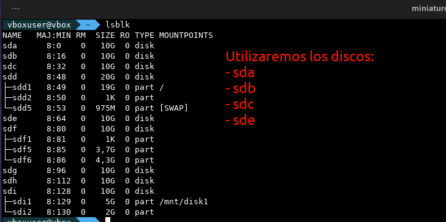

---

### **Actividad 1.2: Asignar sistema de particiones msdos**

**Descripción**: Crear tabla de particiones MBR con `parted`. MBR (Master Boot Record) es el esquema tradicional en Linux, fundamental establecerlo antes de crear particiones.

**Comando**:

```bash
sudo parted /dev/sda mklabel msdos
```

**Verificación**:

```bash
sudo parted /dev/sda print
```

**Captura**: 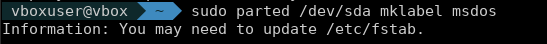

---

### **Actividad 1.3: Crear 3 particiones primarias**

**Descripción**: Crear 3 particiones primarias en `/dev/sda` con sistema de archivos ext4. Las particiones primarias son contenedores básicos en MBR, permitiendo máximo 4 primarias.

**Comandos**:

```bash
sudo parted /dev/sda mkpart primary ext4 0% 30%
sudo parted /dev/sda mkpart primary ext4 30% 65%
sudo parted /dev/sda mkpart primary ext4 65% 85%
lsblk
```

**Resultado**: 3 particiones primarias (sda1, sda2, sda3) utilizando porcentajes para máxima portabilidad.

**Captura**: 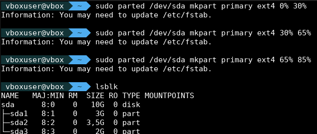

---

### **Actividad 1.4: Crear partición extendida y particiones lógicas**

**Descripción**: Crear 1 partición extendida y 2 lógicas en el 15% restante. La partición extendida es contenedor que permite crear lógicas, superando límite de 4 primarias.

**Comandos**:

```bash
sudo parted /dev/sda mkpart extended 85% 100%
sudo parted /dev/sda mkpart logical ext4 85% 92%
sudo parted /dev/sda mkpart logical ext4 92% 100%
lsblk
```

**Resultado**: Particiones lógicas sda5 y sda6 dentro de la extendida. Las lógicas se numeran a partir de 5.

**Captura**: 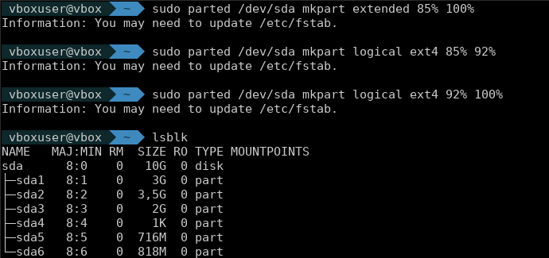

---

### **Actividad 1.5: Formatear unidad de almacenamiento**

**Descripción**: Formatear particiones con ext4. ext4 (fourth extended filesystem) es robusto, soporta archivos grandes, permisos avanzados y journaling.

**Comandos**:

```bash
sudo mkfs.ext4 /dev/sda1
sudo mkfs.ext4 /dev/sda2
sudo mkfs.ext4 /dev/sda3
lsblk -f
```

**Resultado**: Todas las particiones con ext4 asignado.

**Captura**: 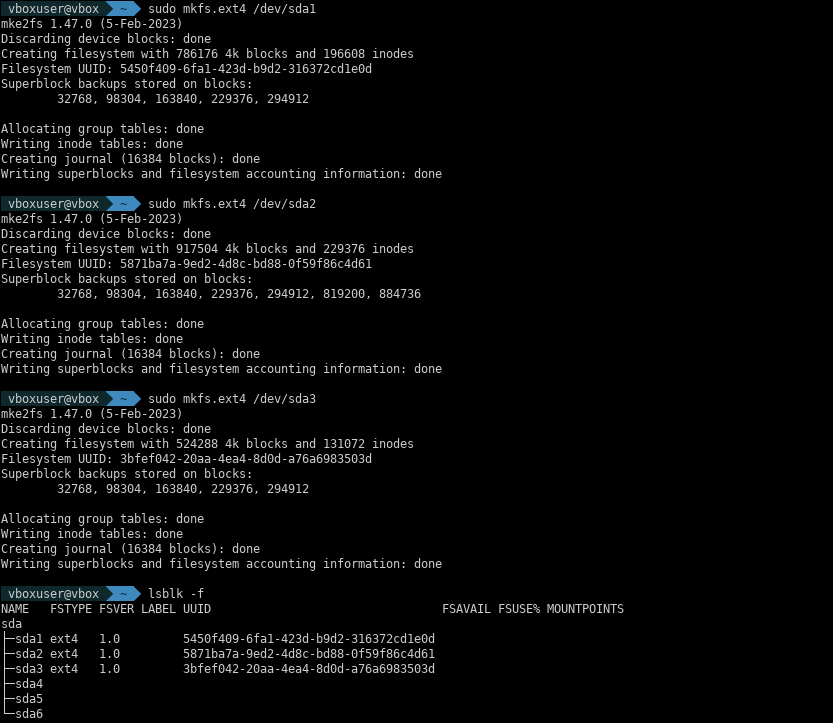

---

### **Actividad 1.6: Montar una unidad**

**Descripción**: Montar partición creando punto de acceso. El montaje es temporal; para persistencia se requiere configurar `/etc/fstab`.

**Comandos**:

```bash
sudo mkdir -p /mnt/sdadisco1
sudo mount /dev/sda1 /mnt/sdadisco1
df -h | grep sdadisco1
ls -la /mnt/sdadisco1/
```

**Resultado**: Partición montada y accesible en `/mnt/sdadisco1`.

**Captura**: 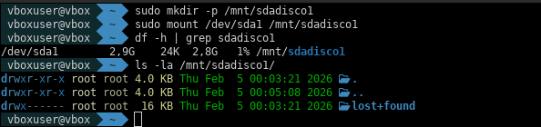

---

### **Actividad 1.7: Configurar montaje automático en fstab**

**Descripción**: Configurar montaje automático en `/etc/fstab`. Usar UUID en lugar de nombres de dispositivos para garantizar consistencia si cambian los nombres.

**Comandos**:

```bash
sudo blkid /dev/sda1
sudo nano /etc/fstab
# Agregar: UUID=xxxx-xxxx /mnt/sdadisco1 ext4 defaults 0 2
sudo mount -a
```

**Captura**: 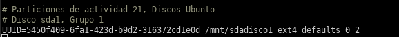

---

### **Actividad 1.8: Verificar punto de montaje**

**Descripción**: Verificar que la partición está montada correctamente.

**Comandos**:

```bash
lsblk
df -h
mount | grep sdadisco1
du -sh /mnt/sdadisco1
```

**Resultado**: Se ve que sda1 está montado en `/mnt/sdadisco1` con espacio disponible.

**Captura**: 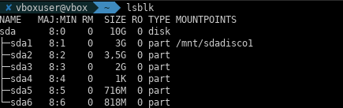

---

## **GRUPO 2: Configuración de RAID con mdadm**

> **Nota**: GRUPO 2 utiliza `/dev/sdb` y `/dev/sdc` para las configuraciones RAID. Particionar discos antes de crear RAIDs.

### **Preparación previa: Particionar discos para RAID**

```bash
sudo parted /dev/sdb mklabel msdos && sudo parted /dev/sdb mkpart primary ext4 0% 100%
sudo parted /dev/sdc mklabel msdos && sudo parted /dev/sdc mkpart primary ext4 0% 100%
lsblk
```

---

### **Actividad 2.1: Configurar RAID 0**

**Descripción**: Crear RAID 0 (striping). Distribuye datos en bloques alternados entre discos, mejorando velocidad. **Sin redundancia**: fallo de disco = pérdida total de datos.

**Comandos**:

```bash
sudo mdadm --create /dev/md0 --level=0 --raid-devices=2 /dev/sdb1 /dev/sdc1
sudo mdadm --detail /dev/md0
```

**Captura**: 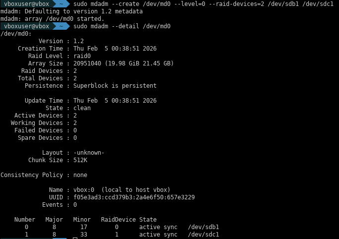

---

### **Actividad 2.2: Configurar RAID 1**

**Descripción**: Crear RAID 1 (mirror). Copia idéntica en 2 discos, tolerancia a 1 fallo. **Capacidad reducida a 50%**.

**Comandos**:

```bash
sudo mdadm --create /dev/md1 --level=1 --raid-devices=2 /dev/sde1 /dev/sdf1
sudo mdadm --detail /dev/md1
sudo mkfs.ext4 /dev/md1
```

**Captura**: 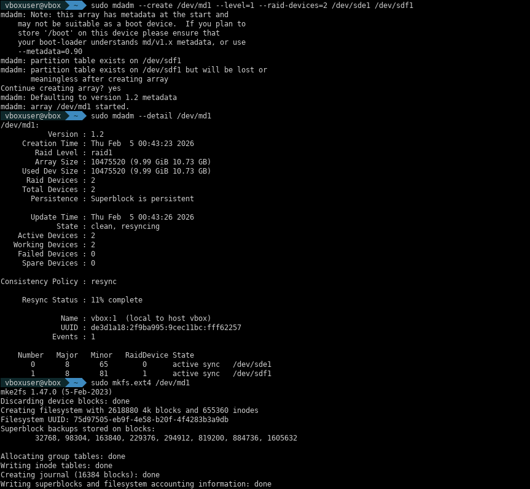

---

### **Actividad 2.3: Configurar RAID 5**

**Descripción**: Crear RAID 5 (striping + paridad). Distribuye datos y paridad en 3+ discos, tolera 1 fallo mediante cálculo de paridad. **Capacidad**: (n-1) discos. Reconstrucción lenta pero excelente equilibrio rendimiento/redundancia.

**Comandos**:

```bash
sudo mdadm --create /dev/md5 --level=5 --raid-devices=3 /dev/sdg1 /dev/sdh1 /dev/sdi1
sudo mdadm --detail /dev/md5
```

**Captura**: 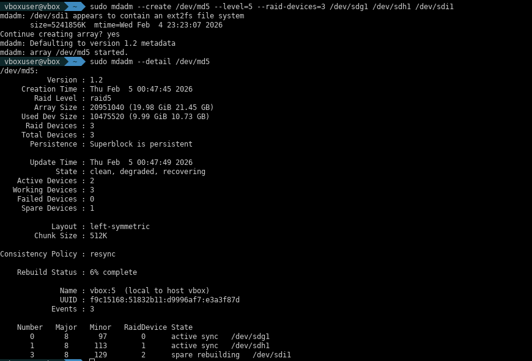

---

### **Actividad 2.4: Configurar RAID 10**

**Descripción**: Crear RAID 10 (RAID 1+0). Combina mirror (RAID 1) + striping (RAID 0) con 4+ discos. Tolera fallo de 2 discos simultáneos (uno de cada espejo). Alto rendimiento con redundancia.

**Comandos**:

```bash
sudo mdadm --create /dev/md10 --level=10 --raid-devices=4 /dev/sdb1 /dev/sdc1 /dev/sde1 /dev/sdf1
sudo mdadm --detail /dev/md10
```

**Captura**: 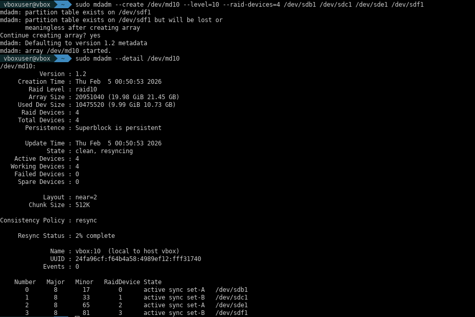

---

### **Actividad 2.5: Desmontar y eliminar RAID 1**

> **Nota**: Se realiza implícitamente en 2.4 al limpiar discos.

**Comandos**:

```bash
sudo umount /dev/md1 2>/dev/null
sudo mdadm --stop /dev/md1
sudo mdadm --zero-superblock /dev/sde1 /dev/sdf1
```

**Captura**: 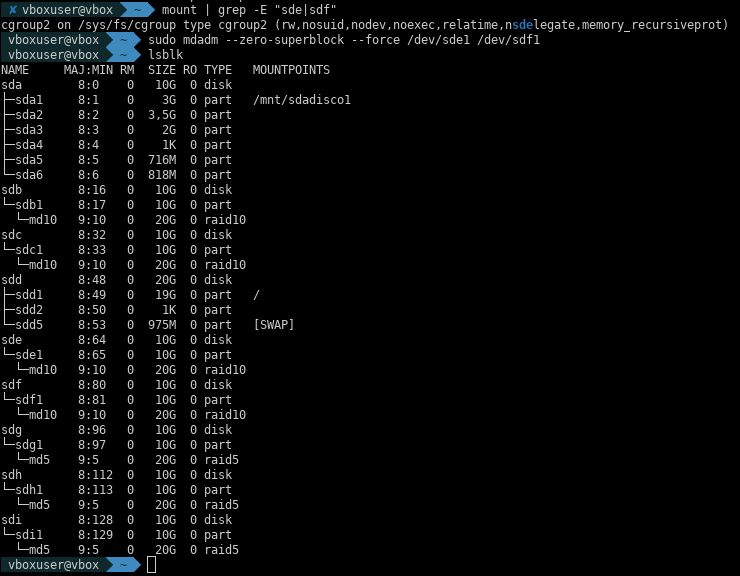

---

### **Actividad 2.6: Operaciones de gestión en RAID 10**

**Descripción**: Simular fallo, remover y re-agregar disco sin perder datos. Demuestra tolerancia a fallos de RAID 10.

**Comandos**:

```bash
sudo mdadm --manage --fail /dev/md10 /dev/sdf1
sudo mdadm --manage --remove /dev/md10 /dev/sdf1
sudo mdadm --manage --add /dev/md10 /dev/sdf1
sudo watch -n 1 'cat /proc/mdstat'
sudo mdadm --detail /dev/md10
```

**Captura**: 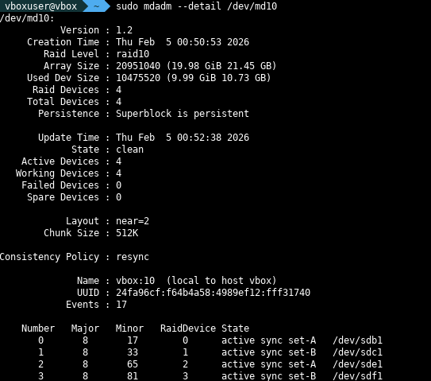

---

### **Actividad 2.7: Recuperación de fallo en RAID 5**

**Descripción**: Simular fallo en RAID 5, remover y recuperar mediante paridad. Sincronización más lenta que RAID 10 por cálculos matemáticos.

**Comandos**:

```bash
sudo mdadm --manage --fail /dev/md5 /dev/sdg1
sudo mdadm --manage --remove /dev/md5 /dev/sdg1
sudo mdadm --manage --add /dev/md5 /dev/sdg1
cat /proc/mdstat
```

**Captura**: 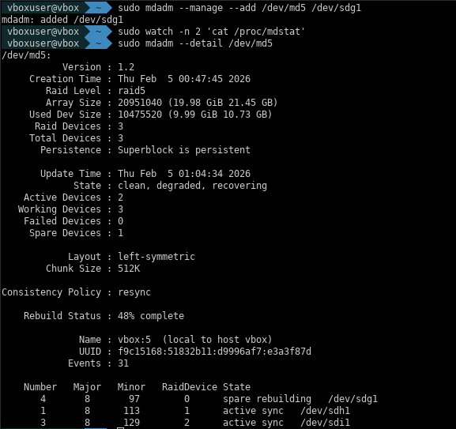

---

### **Actividad 2.8: Configurar montaje automático de RAID**

**Descripción**: Guardar configuración RAID y configurar montaje automático.

**Comandos**:

```bash
sudo mkfs.ext4 /dev/md5
sudo mkdir -p /mnt/raid5disco
sudo blkid /dev/md5
sudo nano /etc/mdadm/mdadm.conf
sudo nano /etc/fstab
sudo mount -a
df -h | grep raid5disco
```

**Captura**: 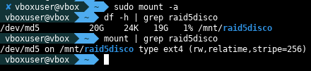

---

### **Actividad 2.9: Verificar estado de discos RAID**

**Descripción**: Revisar estado de todos los RAID configurados.

**Comandos**:

```bash
sudo mdadm --query --scan
sudo mdadm --detail /dev/md10
sudo mdadm --detail /dev/md5
cat /proc/mdstat
```

**Captura**: 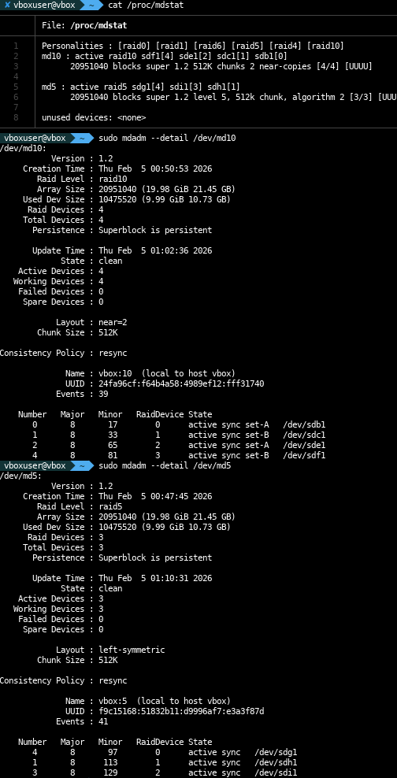

---

### **Actividad 2.10: Desmontar unidad RAID**

**Descripción**: Desmontar RAID correctamente (umount → mdadm --stop).

**Comandos**:

```bash
sudo umount /mnt/raid5disco
sudo mdadm --stop /dev/md5
lsblk
```

**Captura**: 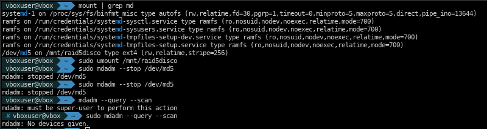

---

### **Actividad 2.11: Eliminar partición de RAID**

**Descripción**: Limpiar completamente RAID de discos (borrar superbloque).

**Comandos**:

```bash
sudo umount /mnt/raid5disco
sudo mdadm --stop /dev/md5
sudo mdadm --zero-superblock /dev/sdg1 /dev/sdh1 /dev/sdi1
lsblk
```

**Captura**: 

---

## **GRUPO 3: Gestión de Volúmenes Lógicos (LVM)**

> **Nota**: LVM usa particiones de `/dev/sda` (sda2, sda3, sda5, sda6) para demostrar flexibilidad sin interferir con otros GRUPOs.

### **Preparación previa: Instalar herramientas LVM**

```bash
sudo apt install -y lvm2
lvm version
```

---

### **Actividad 3.1: Crear volumen lógico**

**Descripción**: Crear estructura LVM completa: PV (volumen físico) → VG (grupo volúmenes) → LV (volumen lógico). LVM abstrae particiones físicas permitiendo redimensionamiento dinámico sin interrupciones.

**Comandos**:

```bash
sudo pvcreate /dev/sda2 /dev/sda3
sudo pvs
sudo vgcreate datavg /dev/sda2 /dev/sda3
sudo vgs
sudo lvcreate -L 2G -n logico1 datavg
sudo lvs
sudo mkfs.ext4 /dev/datavg/logico1
sudo mkdir -p /mnt/lvm1
sudo mount /dev/datavg/logico1 /mnt/lvm1
df -h | grep lvm1
```

**Captura**: 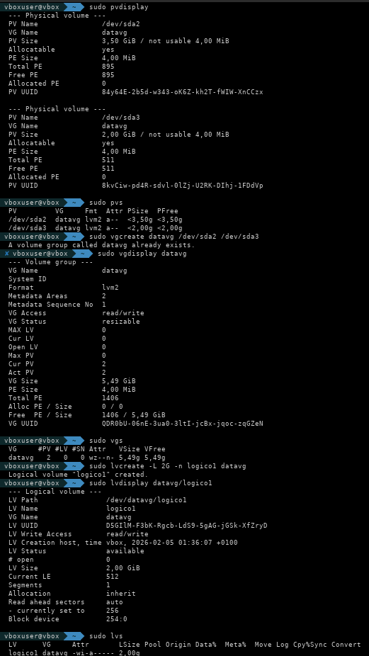

---

### **Actividad 3.2: Aumentar tamaño de volumen lógico**

**Descripción**: Expandir LV de 2GB a 3GB sin perder datos ni desmontar (con `-r` automático). Ventaja clave de LVM.

**Comandos**:

```bash
sudo vgs
sudo lvextend -L 3G /dev/datavg/logico1
sudo resize2fs /dev/datavg/logico1
df -h | grep lvm1
sudo lvs
```

**Captura**: 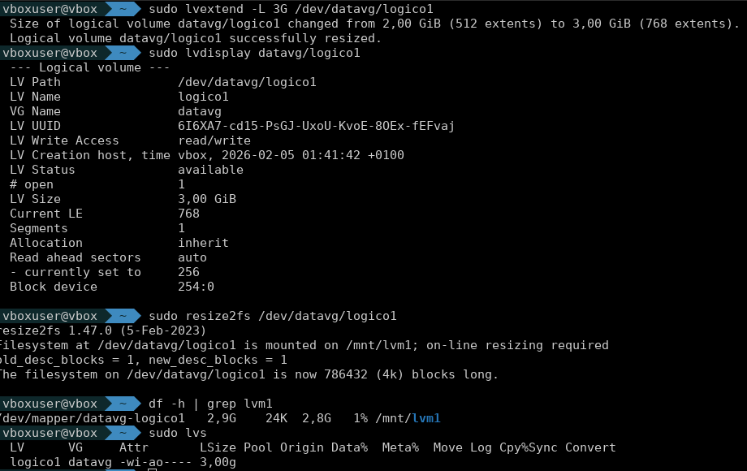

---

### **Actividad 3.3: Reducir tamaño de volumen lógico**

**Descripción**: Reducir LV de 3GB a 1.5GB. **CRÍTICO**: umount → e2fsck → resize2fs → lvreduce (orden exacto). Ejecutar `lvreduce` sin desmontar **CORROMPE FILESYSTEM**.

**Comandos**:

```bash
sudo umount /mnt/lvm1
sudo e2fsck -f /dev/datavg/logico1
sudo resize2fs /dev/datavg/logico1 1500M
sudo lvreduce -L 1500M /dev/datavg/logico1
sudo mount /dev/datavg/logico1 /mnt/lvm1
df -h | grep lvm1
```

**Captura**: 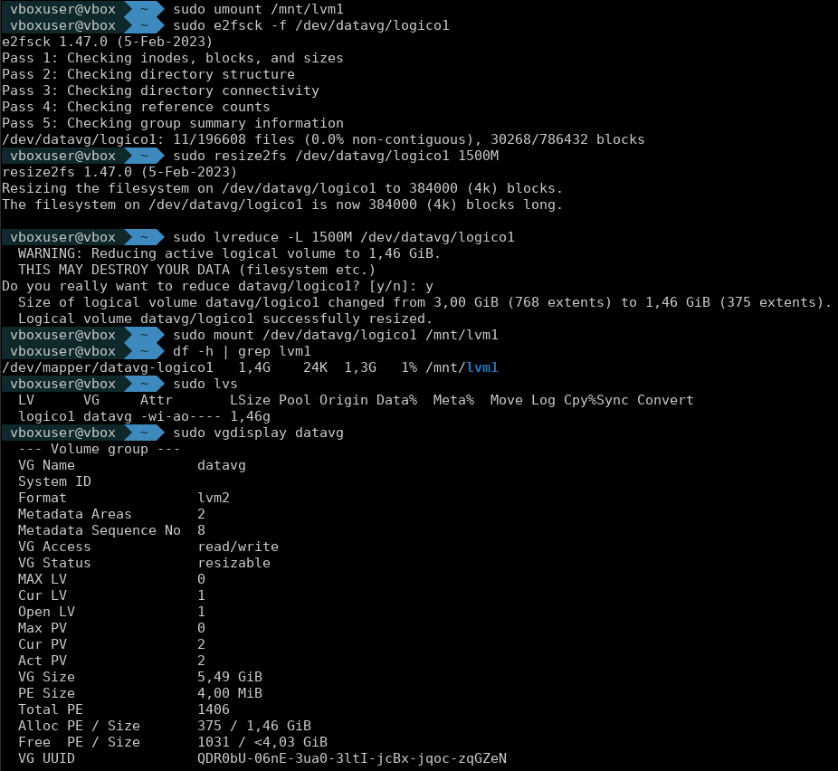

---

### **Actividad 3.4: Redimensionar partición existente (agregar al VG)**

**Descripción**: Agregar nuevas particiones al VG sin afectar LV existentes. Demuestra flexibilidad real de LVM en producción.

**Comandos**:

```bash
sudo pvcreate /dev/sda5 /dev/sda6
sudo pvs
sudo vgextend datavg /dev/sda5 /dev/sda6
sudo vgs
sudo lvcreate -L 1500M -n backup datavg
sudo lvs
sudo mkfs.ext4 /dev/datavg/backup
sudo mkdir -p /mnt/lvm-backup
sudo mount /dev/datavg/backup /mnt/lvm-backup
sudo blkid /dev/datavg/logico1 /dev/datavg/backup
sudo nano /etc/fstab
# Agregar UUIDs
df -h | grep lvm
```

**Captura**: 

---

## **CONCLUSIÓN**

### **Resumen de Actividades Realizadas**

Se completaron exitosamente todas las actividades de los 3 GRUPOS:

- **GRUPO 1**: 8 actividades de particionamiento MBR, formateo ext4 y montaje. Configuración de fstab con UUIDs para persistencia.
- **GRUPO 2**: 4 niveles de RAID (0, 1, 5, 10) con mdadm. Simulación de fallos, recuperación con paridad y montaje automático.
- **GRUPO 3**: Implementación completa de LVM. Operaciones de expansión, reducción y extensión de VG sin interrupciones.

### **Competencias Adquiridas**

1. **Administración de particiones**: parted para esquemas MBR, primarias, extendidas, lógicas
2. **Configuración RAID**: Implementación de RAID 0, 1, 5, 10 según requisitos de rendimiento/redundancia
3. **Gestión LVM**: Creación, expansión, reducción y extensión de volúmenes dinámicamente sin downtime
4. **Montaje automático**: fstab con UUIDs para persistencia entre reinicios
5. **Recuperación ante fallos**: Simulación y recuperación de fallos en RAID y LVM
6. **Terminal Linux**: Dominio avanzado de administración de almacenamiento

### **Dificultades Encontradas**

- Actividad 3.1: Error con caracteres especiales en nombres de LV (solucionado con ASCII puros)
- Actividad 3.3: Ejecución prematura de `lvreduce` sin desmontar causó corrupción (aprendizaje: orden crítico es ineludible)
- RAID 5: Sincronización lenta; RAID 10 sincroniza más rápido gracias a arquitectura de espejo

### **Recursos Utilizados**

---

## **ACTIVIDADES POST-ENTREGA INICIAL: Gestión avanzada de LVM**

En esta sección se documentan las actividades adicionales requeridas tras la entrega inicial, siguiendo el mismo formato y detalle que el resto del documento.

---

### **P1: Mostrar información de LVM (pvs, vgs, lvs)**

```bash
sudo pvs
sudo vgs
sudo lvs
```

---

### **P2: Eliminar un volumen lógico (LV)**

```bash
sudo umount /mnt/lvm-backup
sudo lvremove /dev/datavg/backup
sudo lvs
sudo vgs
```

---

### **P3: Eliminar un grupo de volúmenes (VG)**

```bash
sudo umount /mnt/lvm1
sudo lvremove /dev/datavg/logico1
sudo vgremove datavg
sudo vgs
sudo pvs
```

---

### **P4: Eliminar un volumen físico (PV)**

```bash
# Error típico:
sudo pvremove /dev/sda2
#   Cannot use /dev/sda2: device is too small (pv_min_size)

# Solución:
sudo pvremove /dev/sdd5
sudo pvs
```

---

## **REFERENCIAS Y DOCUMENTACIÓN**

- [PremisaEval21.md](PREMISAS/PremisaEval21.md) - Requisitos oficiales
- [Complementos_JAAlejo.md](PREMISAS/Complementos_JAAlejo.md) - Guía de apoyo
- [Documentación oficial de Ubuntu](https://ubuntu.com/server/docs)
- Manual de `mdadm`: `man mdadm`
- Manual de `parted`: `man parted`
- Manual de LVM: `man lvm`
