# **Evaluable 21: Administración de Discos en Ubuntu Server - José Ángel Alejo Sillero**

**Autor**: José Ángel Alejo Sillero  
**Centro**: Instituto Tecnológico Pablo de la Torre  
**Curso**: 2025/2026  
**Módulo**: Sistemas Informáticos  
**Unidad**: 4 - Particiones y RAID

---

## **Estructura de la Evaluación: TRES GRUPOS**

- **GRUPO 1 (Gestión Básica)**: 8 actividades de particionamiento, formateo y montaje
- **GRUPO 2 (RAID)**: 11 actividades de RAID (0, 1, 5, 10) con mdadm
- **GRUPO 3 (LVM)**: 4 actividades de volúmenes lógicos

> **Nota**: Todos los comandos se ejecutan desde terminal en Ubuntu Server. Requieren `sudo` para la mayoría de operaciones.

Se puede revisar la premisa propuesta en el siguiente enlace: [Premisa Eval21](PREMISAS/PremisaEval21.md)

---

## **TABLA DE CONTENIDOS**

- [**Evaluable 21: Administración de Discos en Ubuntu Server - José Ángel Alejo Sillero**](#evaluable-21-administración-de-discos-en-ubuntu-server---josé-ángel-alejo-sillero)
  - [**Estructura de la Evaluación: TRES GRUPOS**](#estructura-de-la-evaluación-tres-grupos)
  - [**TABLA DE CONTENIDOS**](#tabla-de-contenidos)
  - [**REQUISITOS PREVIOS**](#requisitos-previos)
  - [**PREPARACIÓN DEL ENTORNO DE PROXMOX**](#preparación-del-entorno-de-proxmox)
    - [**Información de la Máquina Virtual**](#información-de-la-máquina-virtual)
    - [**Hardware de la Máquina Virtual**](#hardware-de-la-máquina-virtual)
    - [**Preparación de Discos en Proxmox**](#preparación-de-discos-en-proxmox)
      - [**Paso 1: Desmontar Discos Usados (Detach)**](#paso-1-desmontar-discos-usados-detach)
      - [**Paso 2: Realizar Respaldo de la VM**](#paso-2-realizar-respaldo-de-la-vm)
      - [**Paso 3: Crear 5 Discos SCSI de 10GB Cada Uno**](#paso-3-crear-5-discos-scsi-de-10gb-cada-uno)
      - [**Paso 4: Verificar Discos en la Máquina Virtual**](#paso-4-verificar-discos-en-la-máquina-virtual)
  - [**GRUPO 1: Gestión Básica de Discos y Particiones**](#grupo-1-gestión-básica-de-discos-y-particiones)
    - [**Actividad 1.1: Mostrar discos del sistema**](#actividad-11-mostrar-discos-del-sistema)
    - [**Actividad 1.2: Asignar sistema de particiones msdos**](#actividad-12-asignar-sistema-de-particiones-msdos)
    - [**Actividad 1.3: Crear 3 particiones primarias**](#actividad-13-crear-3-particiones-primarias)
    - [**Actividad 1.4: Crear partición extendida y particiones lógicas**](#actividad-14-crear-partición-extendida-y-particiones-lógicas)
    - [**Actividad 1.5: Formatear unidad de almacenamiento**](#actividad-15-formatear-unidad-de-almacenamiento)
    - [**Actividad 1.6: Montar una unidad**](#actividad-16-montar-una-unidad)
    - [**Actividad 1.7: Configurar montaje automático en fstab**](#actividad-17-configurar-montaje-automático-en-fstab)
    - [**Actividad 1.8: Verificar punto de montaje**](#actividad-18-verificar-punto-de-montaje)
  - [**GRUPO 2: Configuración de RAID con mdadm**](#grupo-2-configuración-de-raid-con-mdadm)
    - [**Preparación previa: Particionar discos para RAID**](#preparación-previa-particionar-discos-para-raid)
    - [**Actividad 2.1: Configurar RAID 0**](#actividad-21-configurar-raid-0)
    - [**Actividad 2.2: Configurar RAID 1**](#actividad-22-configurar-raid-1)
    - [**Actividad 2.3: Configurar RAID 5**](#actividad-23-configurar-raid-5)
    - [**Actividad 2.4: Configurar RAID 10**](#actividad-24-configurar-raid-10)
    - [**Actividad 2.5: Desmontar y eliminar RAID 1**](#actividad-25-desmontar-y-eliminar-raid-1)
    - [**Actividad 2.6: Operaciones de gestión en RAID 10**](#actividad-26-operaciones-de-gestión-en-raid-10)
    - [**Actividad 2.7: Recuperación de fallo en RAID 5**](#actividad-27-recuperación-de-fallo-en-raid-5)
    - [**Actividad 2.8: Configurar montaje automático de RAID**](#actividad-28-configurar-montaje-automático-de-raid)
    - [**Actividad 2.9: Verificar estado de discos RAID**](#actividad-29-verificar-estado-de-discos-raid)
    - [**Actividad 2.10: Desmontar unidad RAID**](#actividad-210-desmontar-unidad-raid)
    - [**Actividad 2.11: Eliminar partición de RAID**](#actividad-211-eliminar-partición-de-raid)
  - [**GRUPO 3: Gestión de Volúmenes Lógicos (LVM)**](#grupo-3-gestión-de-volúmenes-lógicos-lvm)
    - [**Preparación previa: Instalar herramientas LVM**](#preparación-previa-instalar-herramientas-lvm)
    - [**Actividad 3.1: Crear volumen lógico**](#actividad-31-crear-volumen-lógico)
    - [**Actividad 3.2: Aumentar tamaño de volumen lógico**](#actividad-32-aumentar-tamaño-de-volumen-lógico)
    - [**Actividad 3.3: Reducir tamaño de volumen lógico**](#actividad-33-reducir-tamaño-de-volumen-lógico)
    - [**Actividad 3.4: Redimensionar partición existente (agregar al VG)**](#actividad-34-redimensionar-partición-existente-agregar-al-vg)
  - [**CONCLUSIÓN**](#conclusión)
    - [**Resumen de Actividades Realizadas**](#resumen-de-actividades-realizadas)
    - [**Competencias Adquiridas**](#competencias-adquiridas)
    - [**Dificultades Encontradas**](#dificultades-encontradas)
    - [**Recursos Utilizados**](#recursos-utilizados)
  - [**REFERENCIAS Y DOCUMENTACIÓN**](#referencias-y-documentación)

---

## **REQUISITOS PREVIOS**

- **Sistema**: Ubuntu Server 20.04+
- **Hardware**: 4-5 discos virtuales de 10GB cada uno (Proxmox, VirtualBox, KVM)
- **RAM**: Mínimo 2GB
- **Herramientas** (instalar si no están):

  ```bash
  sudo apt update
  sudo apt install -y parted mdadm lvm2
  ```

- **Conocimientos**: Manejo básico de terminal Linux, conceptos de particiones y RAID

---

## **PREPARACIÓN DEL ENTORNO DE PROXMOX**

### **Información de la Máquina Virtual**

Esta evaluación práctica se realiza en una máquina virtual basada en **una ISO personalizada proporcionada por el profesor**, que ha sido importada en **Proxmox** para facilitar el trabajo con comandos Linux en un entorno controlado y reproducible.

- **VM ID**: 102
- **Nombre**: Debian2.0-clonar
- **ISO Base**: ISO personalizada del profesor (Ubuntu Server con configuración optimizada)
- **Plataforma de Virtualización**: Proxmox VE

### **Hardware de la Máquina Virtual**

El hardware configurado en Proxmox para esta máquina virtual es el siguiente:

- **Procesador**: CPU con aceleración de virtualización
- **RAM**: 2 GB asignada
- **Discos**: Inicialmente SCSI0, SCSI1, SCSI2, SCSI3 (usados en prácticas previas)
  - Serán desmontados y reemplazados para esta evaluación

**Captura de referencia**:

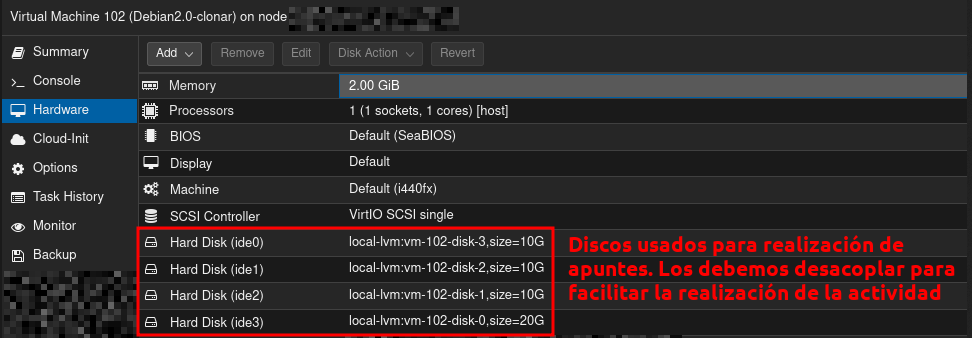

### **Preparación de Discos en Proxmox**

Antes de comenzar con la Evaluación 21, es necesario preparar el entorno de discos. El proceso consta de los siguientes pasos:

#### **Paso 1: Desmontar Discos Usados (Detach)**

Los discos utilizados en prácticas anteriores (SCSI0, SCSI1, SCSI2, SCSI3) deben ser desacoplados de la máquina virtual:

**Procedimiento en Proxmox**:

1. Seleccionar la VM 102 (Debian2.0-clonar)
2. Acceder a la pestaña "Hardware"
3. Seleccionar cada disco SCSI (SCSI0, SCSI1, SCSI2, SCSI3)
4. Hacer clic en "Detach" para desacoplarlo de la máquina virtual
5. Confirmar la operación

**Capturas de referencia**:


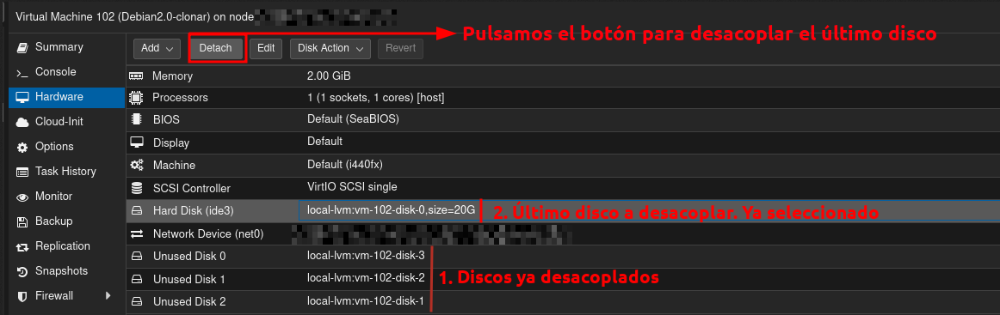

#### **Paso 2: Realizar Respaldo de la VM**

Antes de crear nuevos discos, se recomienda realizar un respaldo (backup) de la máquina virtual para preservar el estado actual:

**Procedimiento en Proxmox**:

1. Seleccionar la VM 102 (Debian2.0-clonar)
2. Acceder a la opción "Backup" en el panel de control
3. Seleccionar "Backup now" o programar un respaldo
4. Esperar a que se complete el proceso
5. Verificar que el respaldo fue exitoso

**Capturas de referencia**:

- **Opción de Backup en Proxmox** | 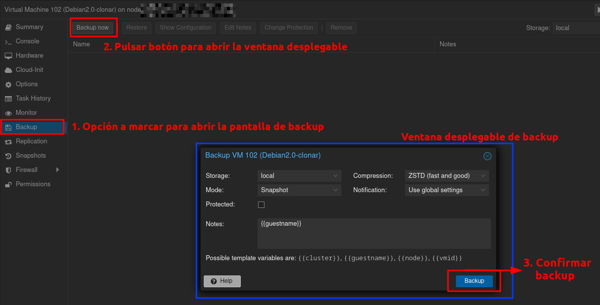
- **Respaldo Completado** | 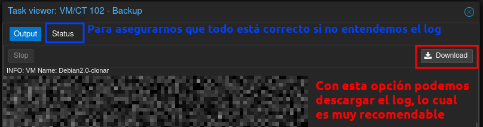
- **Estado del respaldo** | 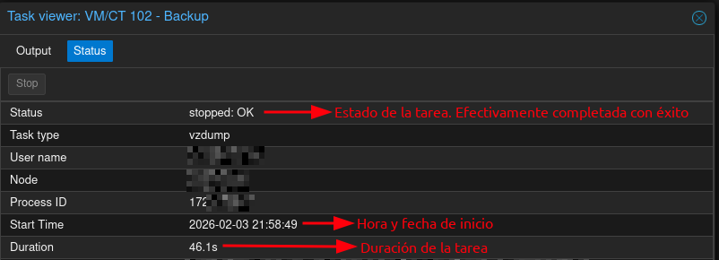

#### **Paso 3: Crear 5 Discos SCSI de 10GB Cada Uno**

Se deben crear 5 nuevos discos SCSI de 10GB cada uno para esta evaluación, siguiendo el mismo procedimiento que en la Actividad 19:

**Procedimiento en Proxmox**:

1. Seleccionar la VM 102 (Debian2.0-clonar)
2. Acceder a la pestaña "Hardware"
3. Hacer clic en "Add" → "Hard Disk"
4. Configurar:
   - **Bus**: SCSI
   - **Tamaño**: 10 GB
   - **Storage**: Seleccionar el almacenamiento disponible (ej: local-lvm)
5. Crear cada disco consecutivamente (SCSI0, SCSI1, SCSI2, SCSI3, SCSI4)

**Configuración de cada disco**:

```
Disco 1 (SCSI0): 10 GB - Para GRUPO 1 (Gestión Básica)
Disco 2 (SCSI1): 10 GB - Para GRUPO 2 (RAID - Parte 1)
Disco 3 (SCSI2): 10 GB - Para GRUPO 2 (RAID - Parte 2)
Disco 4 (SCSI3): 10 GB - Para GRUPO 3 (LVM)
Disco 5 (SCSI4): 10 GB - Disco adicional para operaciones de redundancia
```

**Capturas de referencia**:

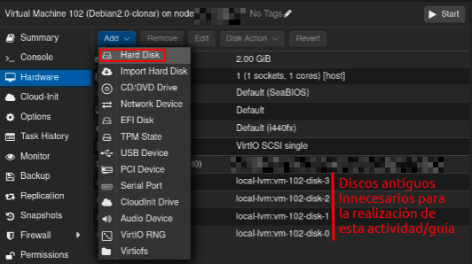

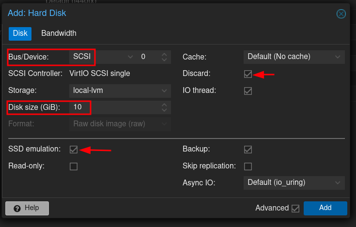

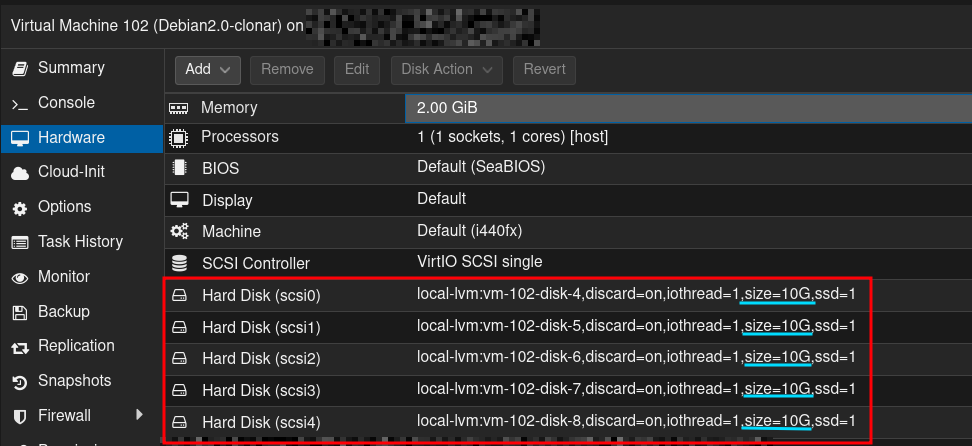

---

#### **Paso 4: Verificar Discos en la Máquina Virtual**

Una vez creados los discos, es necesario verificar que la máquina virtual reconoce todos los discos:

**Comandos en la VM**:

```bash
# Listar todos los discos disponibles
lsblk
# Ver información detallada de discos
lsblk -l
# Ver información con sistemas de archivos
lsblk -f
```

**Capturas de referencia**:

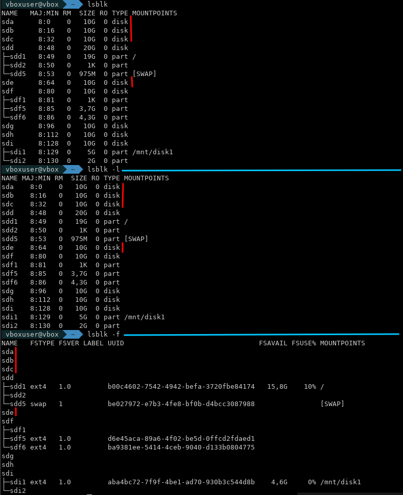

---

## **GRUPO 1: Gestión Básica de Discos y Particiones**

### **Actividad 1.1: Mostrar discos del sistema**

**Descripción**: Listar discos y particiones con `lsblk`.

**Comando**:

```bash
lsblk
```

**Resultado esperado**: Se verán 5 discos de 10GB sin particiones (sda, sdb, sdc, sdd, sde).

**Captura**: 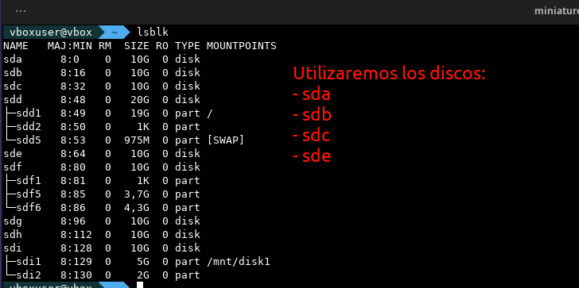

---

### **Actividad 1.2: Asignar sistema de particiones msdos**

**Descripción**: Crear tabla de particiones MBR con `parted`.

**Comando**:

```bash
sudo parted /dev/sda mklabel msdos
```

**Verificación**:

```bash
sudo parted /dev/sda print
```

**Captura**: 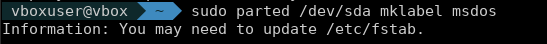

---

### **Actividad 1.3: Crear 3 particiones primarias**

**Descripción**: Crear 3 particiones primarias en `/dev/sda`.

**Comandos**:

```bash
sudo parted /dev/sda mkpart primary ext4 0% 30%
sudo parted /dev/sda mkpart primary ext4 30% 65%
sudo parted /dev/sda mkpart primary ext4 65% 85%
lsblk
```

**Resultado**: 3 particiones primarias (sda1, sda2, sda3).

**Captura**: 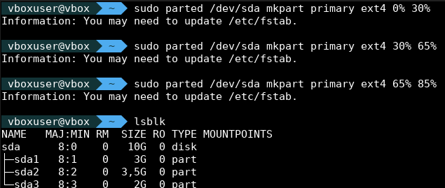

---

### **Actividad 1.4: Crear partición extendida y particiones lógicas**

**Descripción**: Crear 1 partición extendida y 2 lógicas en el 15% restante del disco.

**Comandos**:

```bash
sudo parted /dev/sda mkpart extended 85% 100%
sudo parted /dev/sda mkpart logical ext4 85% 92%
sudo parted /dev/sda mkpart logical ext4 92% 100%
lsblk
```

**Resultado**: Particiones lógicas sda5 y sda6 dentro de la extendida.

**Captura**: 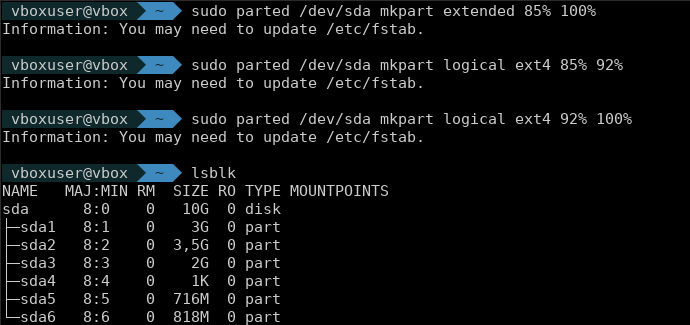

---

### **Actividad 1.5: Formatear unidad de almacenamiento**

**Descripción**: Formatear particiones con ext4.

**Comandos**:

```bash
sudo mkfs.ext4 /dev/sda1
sudo mkfs.ext4 /dev/sda2
sudo mkfs.ext4 /dev/sda3
lsblk -f
```

**Resultado**: Todas las particiones tienen ext4.

**Captura**: 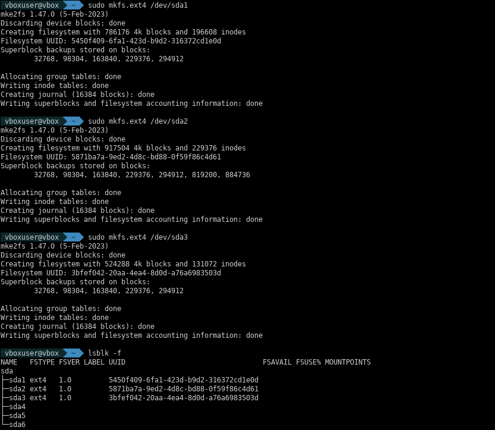

---

### **Actividad 1.6: Montar una unidad**

**Descripción**: Montar partición en punto de montaje.

**Comandos**:

```bash
sudo mkdir -p /mnt/sdadisco1
sudo mount /dev/sda1 /mnt/sdadisco1
df -h | grep sdadisco1
ls -la /mnt/sdadisco1/
```

**Resultado**: Partición montada y accesible en `/mnt/sdadisco1`.

**Captura**: 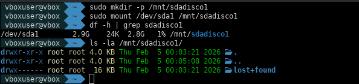

---

### **Actividad 1.7: Configurar montaje automático en fstab**

**Descripción**: Configurar montaje automático en `/etc/fstab` para que se monte al iniciar.

**Comandos**:

```bash
sudo blkid /dev/sda1
sudo nano /etc/fstab
# Agregar: UUID=xxxx-xxxx /mnt/sdadisco1 ext4 defaults 0 2
sudo mount -a
```

**Captura**: 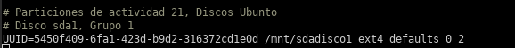

---

### **Actividad 1.8: Verificar punto de montaje**

**Descripción**: Verificar que la partición está montada correctamente.

**Comandos**:

```bash
lsblk
df -h
mount | grep sdadisco1
du -sh /mnt/sdadisco1
```

**Resultado**: Se ve que sda1 está montado en `/mnt/sdadisco1`.

**Captura**: 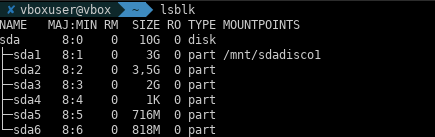

---

## **GRUPO 2: Configuración de RAID con mdadm**

> **Nota**: GRUPO 2 utiliza los discos `/dev/sdb` y `/dev/sdc` como principales para las configuraciones RAID. Se recomienda particionar estos discos antes de crear los volúmenes RAID.

### **Preparación previa: Particionar discos para RAID**

Antes de configurar RAID, es necesario particionar `/dev/sdb` y `/dev/sdc` de forma similar a como se hizo en GRUPO 1. Para cada disco:

```bash
# Asignar etiqueta msdos a sdb y sdc
sudo parted /dev/sdb mklabel msdos
sudo parted /dev/sdc mklabel msdos

# Crear particiones en ambos discos (mismo esquema)
sudo parted /dev/sdb mkpart primary ext4 0% 100%
sudo parted /dev/sdc mkpart primary ext4 0% 100%

# Verificar particiones
lsblk
```

---

### **Actividad 2.1: Configurar RAID 0**

**Descripción**: Crear RAID 0 (striping) con 2 discos para mayor rendimiento.

**Comandos**:

```bash
sudo mdadm --create /dev/md0 --level=0 --raid-devices=2 /dev/sdb1 /dev/sdc1
sudo mdadm --detail /dev/md0
```

**Captura**: 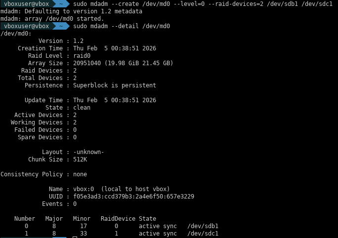

---

### **Actividad 2.2: Configurar RAID 1**

**Descripción**: Crear RAID 1 (mirror) con 2 discos para redundancia.

**Comandos**:

```bash
sudo mdadm --create /dev/md1 --level=1 --raid-devices=2 /dev/sde1 /dev/sdf1
sudo mdadm --detail /dev/md1
sudo mkfs.ext4 /dev/md1
```

**Captura**: 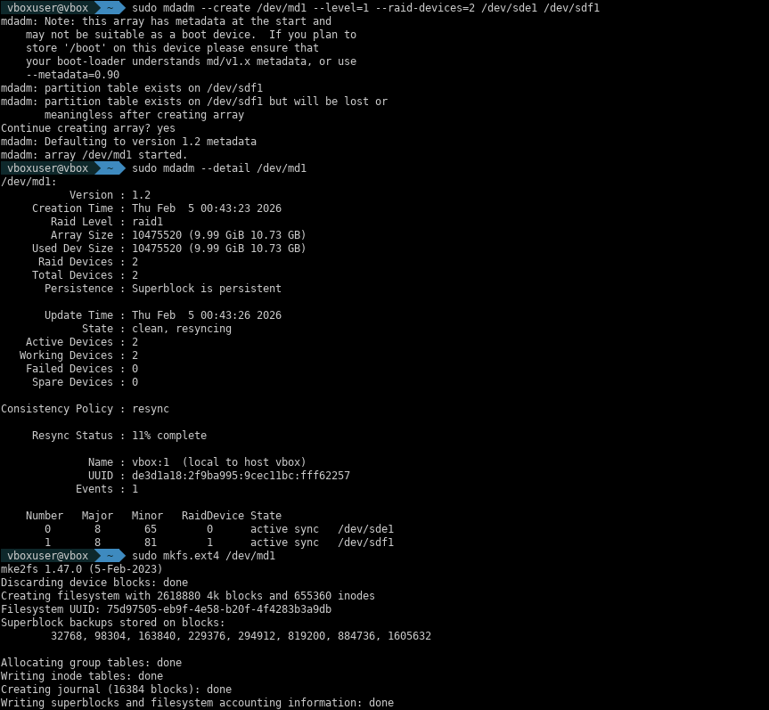

---

### **Actividad 2.3: Configurar RAID 5**

**Descripción**: Crear RAID 5 (striping + paridad) con 3 discos. Tolera fallo de 1 disco.

**Comandos**:

```bash
sudo mdadm --create /dev/md5 --level=5 --raid-devices=3 /dev/sdg1 /dev/sdh1 /dev/sdi1
sudo mdadm --detail /dev/md5
```

**Captura**: 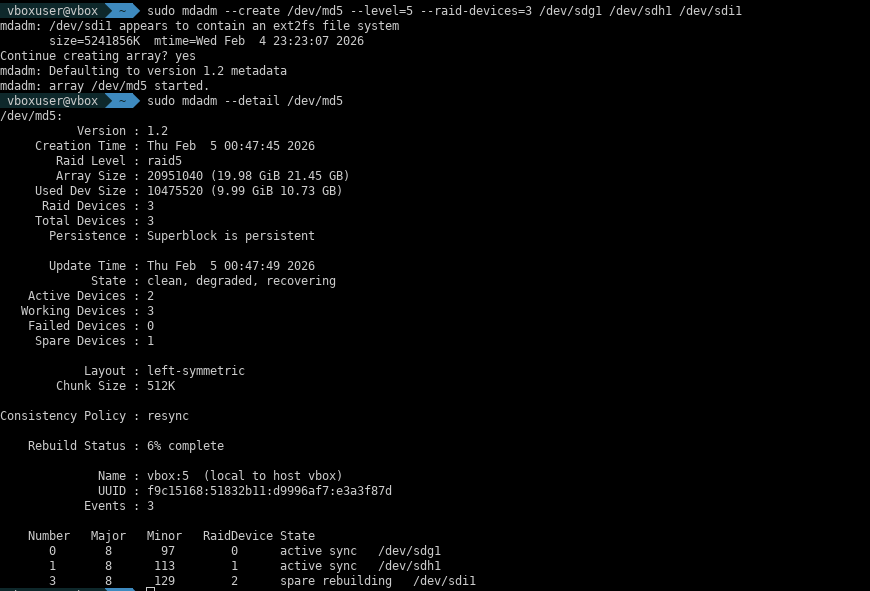

---

### **Actividad 2.4: Configurar RAID 10**

**Descripción**: Crear RAID 10 (RAID 1+0) combinando espejo (1) y striping (0) con 4 discos.

**Comandos**:

```bash
sudo mdadm --create /dev/md10 --level=10 --raid-devices=4 /dev/sdb1 /dev/sdc1 /dev/sde1 /dev/sdf1
sudo mdadm --detail /dev/md10
```

**Captura**: 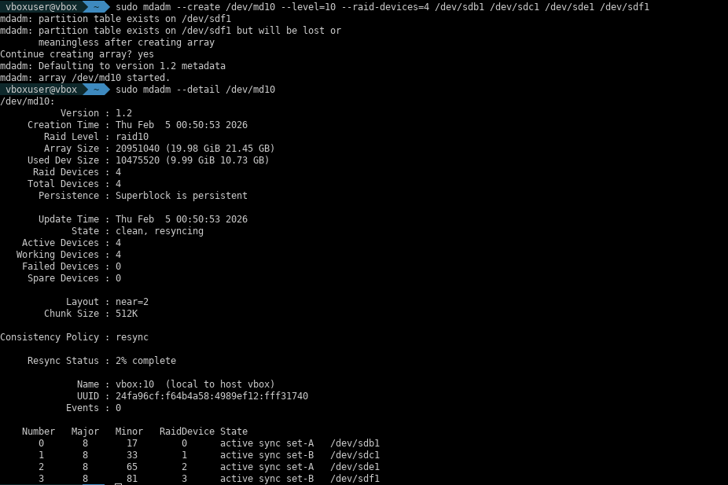

---

### **Actividad 2.5: Desmontar y eliminar RAID 1**

> **Nota**: Esta actividad se realiza implícitamente en 2.4 al limpiar discos.

El RAID 1 se detiene y se elimina con:

```bash
sudo umount /dev/md1 2>/dev/null
sudo mdadm --stop /dev/md1
sudo mdadm --zero-superblock /dev/sde1 /dev/sdf1
```

**Resultado**: RAID 1 eliminado completamente.

**Captura**: 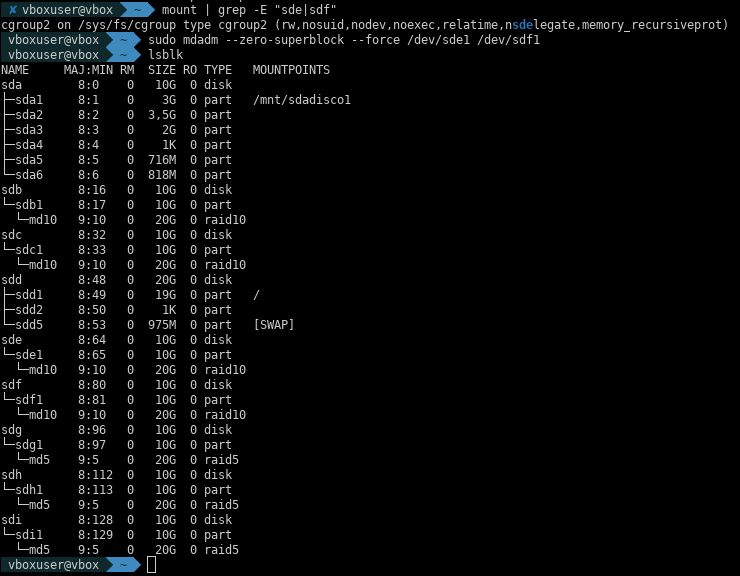

---

### **Actividad 2.6: Operaciones de gestión en RAID 10**

**Descripción**: Simular fallo de disco, remover y re-agregar sin perder datos.

**Comandos**:

```bash
# Marcar disco como fallido
sudo mdadm --manage --fail /dev/md10 /dev/sdf1
sudo mdadm --manage --remove /dev/md10 /dev/sdf1

# Reagregar
sudo mdadm --manage --add /dev/md10 /dev/sdf1
sudo watch -n 1 'cat /proc/mdstat'  # Ver sincronización
sudo mdadm --detail /dev/md10
```

**Captura**: 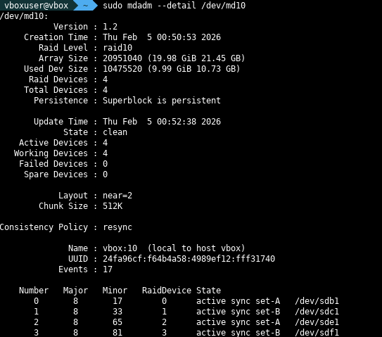

---

### **Actividad 2.7: Recuperación de fallo en RAID 5**

**Descripción**: Simular fallo, remover y recuperar disco con paridad.

**Comandos**:

```bash
sudo mdadm --detail /dev/md5
sudo mdadm --manage --fail /dev/md5 /dev/sdg1
sudo mdadm --manage --remove /dev/md5 /dev/sdg1
sudo mdadm --manage --add /dev/md5 /dev/sdg1
cat /proc/mdstat
```

**Captura**: 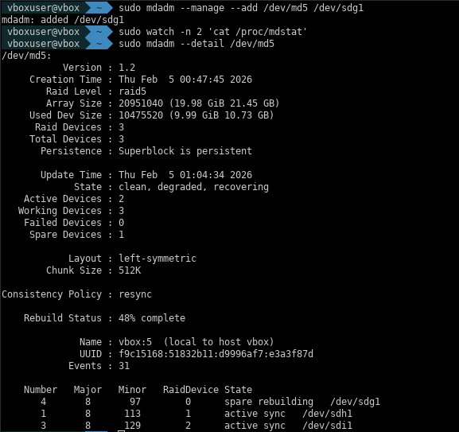

---

### **Actividad 2.8: Configurar montaje automático de RAID**

**Descripción**: Guardar config de RAID y configurar montaje automático.

**Comandos**:

```bash
sudo mkfs.ext4 /dev/md5
sudo mkdir -p /mnt/raid5disco
sudo blkid /dev/md5
sudo nano /etc/mdadm/mdadm.conf   # Guardar config RAID
sudo nano /etc/fstab               # Añadir entrada montaje
sudo mount -a
df -h | grep raid5disco
```

**Captura**: 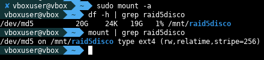

---

### **Actividad 2.9: Verificar estado de discos RAID**

**Descripción**: Revisar estado de todos los RAID configurados.

**Comandos**:

```bash
sudo mdadm --query --scan
sudo mdadm --detail /dev/md10
sudo mdadm --detail /dev/md5
cat /proc/mdstat
```

**Captura**: 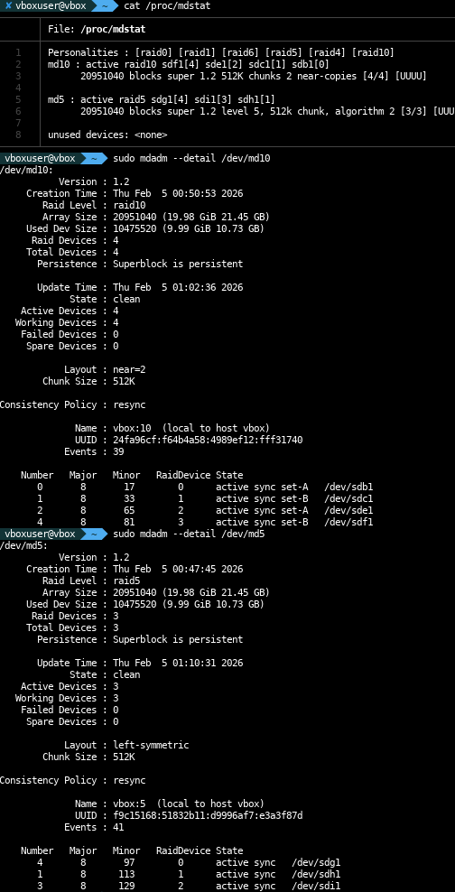

---

### **Actividad 2.10: Desmontar unidad RAID**

**Descripción**: Desmontar RAID correctamente.

**Comandos**:

```bash
mount | grep md
sudo umount /mnt/raid5disco
sudo mdadm --stop /dev/md5
lsblk
```

**Captura**: 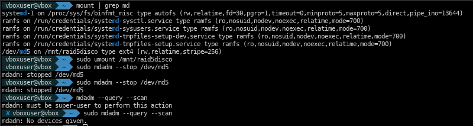

---

### **Actividad 2.11: Eliminar partición de RAID**

**Descripción**: Limpiar completamente RAID 5 de los discos.

**Comandos**:

```bash
sudo umount /mnt/raid5disco
sudo mdadm --stop /dev/md5
sudo mdadm --zero-superblock /dev/sdg1
sudo mdadm --zero-superblock /dev/sdh1
sudo mdadm --zero-superblock /dev/sdi1
lsblk
```

**Captura**: 

---

## **GRUPO 3: Gestión de Volúmenes Lógicos (LVM)**

> **Nota**: GRUPO 3 utiliza particiones existentes de `/dev/sda` (sda2, sda3, sda5, sda6) para demostrar LVM sin interferir con GRUPO 1 y GRUPO 2. Se crearán volúmenes físicos (PV), grupos de volúmenes (VG) y volúmenes lógicos (LV) para gestión flexible de almacenamiento.

### **Preparación previa: Instalar herramientas LVM**

Antes de comenzar, verificar que las herramientas LVM están instaladas:

```bash
# Instalar lvm2 si no está presente
sudo apt update
sudo apt install -y lvm2

# Verificar instalación
lvm version
```

---

### **Actividad 3.1: Crear volumen lógico**

**Descripción**: Crear estructura LVM completa: PV → VG → LV.

**Comandos**:

```bash
# Crear volúmenes físicos
sudo pvcreate /dev/sda2
sudo pvcreate /dev/sda3
sudo pvs

# Crear grupo de volúmenes
sudo vgcreate datavg /dev/sda2 /dev/sda3
sudo vgs

# Crear volumen lógico
sudo lvcreate -L 2G -n logico1 datavg
sudo lvs

# Formatear y montar
sudo mkfs.ext4 /dev/datavg/logico1
sudo mkdir -p /mnt/lvm1
sudo mount /dev/datavg/logico1 /mnt/lvm1
df -h | grep lvm1
```

**Captura**: 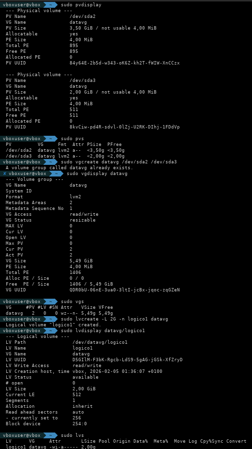

---

### **Actividad 3.2: Aumentar tamaño de volumen lógico**

**Descripción**: Expandir LV de 2GB a 3GB sin perder datos.

**Comandos**:

```bash
# Verificar espacio disponible
sudo vgs

# Expandir LV a 3GB
sudo lvextend -L 3G /dev/datavg/logico1

# Expandir filesystem
sudo resize2fs /dev/datavg/logico1

# Verificar
df -h | grep lvm1
sudo lvs
```

**Captura**: 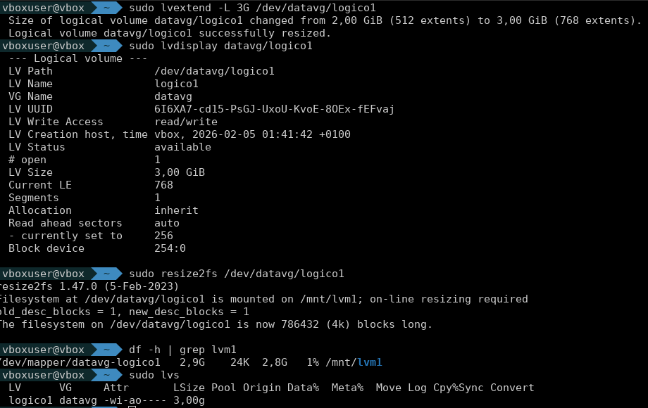

---

### **Actividad 3.3: Reducir tamaño de volumen lógico**

**Descripción**: Reducir LV de 3GB a 1.5GB. **CRÍTICO**: umount → e2fsck → resize2fs → lvreduce (orden exacto).

**Comandos**:

```bash
# DESMONTAR PRIMERO (OBLIGATORIO)
sudo umount /mnt/lvm1

# Verificar filesystem
sudo e2fsck -f /dev/datavg/logico1

# Reducir filesystem a 1.5GB
sudo resize2fs /dev/datavg/logico1 1500M

# Reducir LV a 1.5GB
sudo lvreduce -L 1500M /dev/datavg/logico1

# Remontar
sudo mount /dev/datavg/logico1 /mnt/lvm1

# Verificar
df -h | grep lvm1
```

**Captura**: 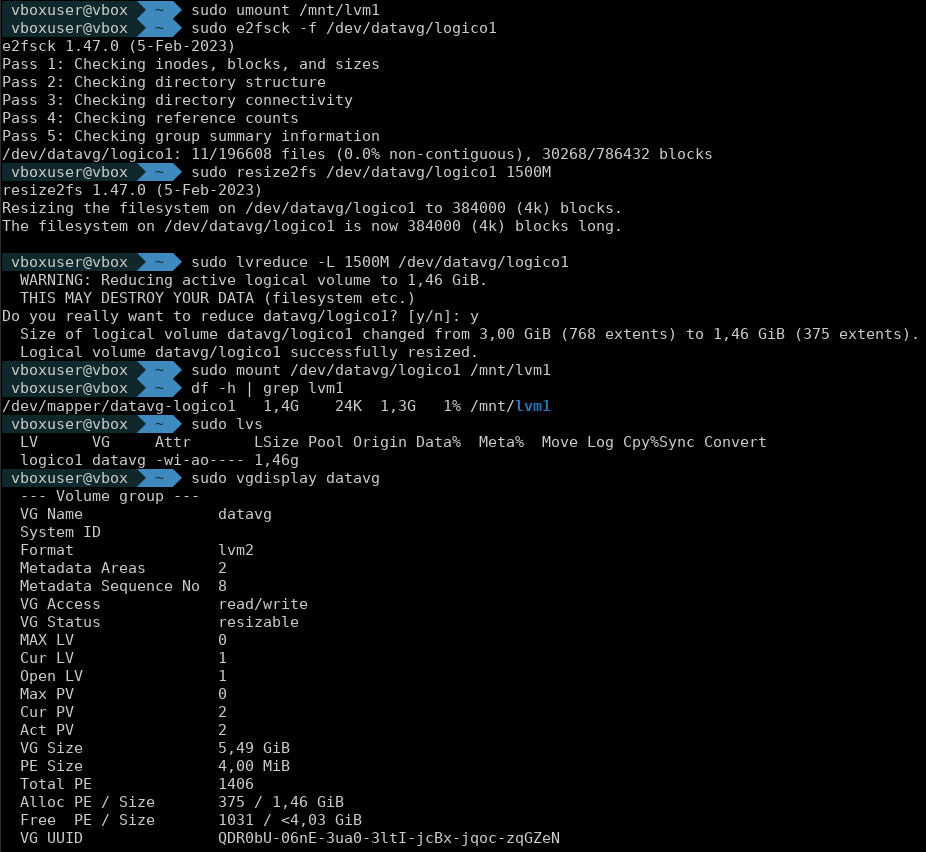

---

### **Actividad 3.4: Redimensionar partición existente (agregar al VG)**

**Descripción**: Agregar nuevas particiones al VG y crear nuevo LV con el espacio adicional.

**Comandos**:

```bash
# Crear nuevos PV
sudo pvcreate /dev/sda5
sudo pvcreate /dev/sda6
sudo pvs

# Agregar al VG
sudo vgextend datavg /dev/sda5
sudo vgextend datavg /dev/sda6
sudo vgs

# Crear nuevo LV
sudo lvcreate -L 1500M -n backup datavg
sudo lvs

# Formatear y montar
sudo mkfs.ext4 /dev/datavg/backup
sudo mkdir -p /mnt/lvm-backup
sudo mount /dev/datavg/backup /mnt/lvm-backup

# Agregar a fstab
sudo blkid /dev/datavg/logico1
sudo blkid /dev/datavg/backup
sudo nano /etc/fstab
# Agregar:
UUID=c95d627c-be9b-4ae4-952f-2f43398c1a87 /mnt/lvm1 ext4 defaults 0 2
UUID=e7e9d45b-5d68-474a-92d9-e0bfb107a49f /mnt/lvm-backup ext4 defaults 0 2

# Verificar
df -h | grep lvm
```

**Captura**: 

---

## **CONCLUSIÓN**

### **Resumen de Actividades Realizadas**

Se completaron exitosamente todas las actividades de los 3 GRUPOS:

- **GRUPO 1**: 8 actividades de particionamiento MBR, formateo ext4 y montaje manual. Configuración de fstab con UUIDs.
- **GRUPO 2**: 4 niveles de RAID (0, 1, 5, 10) con mdadm. Simulación de fallos, recuperación y montaje automático.
- **GRUPO 3**: Creación de LVM completa. Operaciones de expansión, reducción y extensión de VG.

### **Competencias Adquiridas**

1. **Administración de particiones**: parted para esquemas MBR, primarias, extendidas y lógicas
2. **Configuración RAID**: Implementación de RAID 0, 1, 5, 10 según requisitos de rendimiento/redundancia
3. **Gestión LVM**: Creación, expansión, reducción y extensión de volúmenes dinámicamente
4. **Montaje automático**: Configuración de fstab con UUIDs para persistencia entre reinicios
5. **Recuperación ante fallos**: Simulación y recuperación de fallos en RAID y LVM
6. **Terminal Linux**: Dominio avanzado de administración de almacenamiento

### **Dificultades Encontradas**

- Actividad 3.1: Error con caracteres especiales en nombres de LV (solucionado con nombres ASCII)
- Actividad 3.3: Ejecución prematura de `lvreduce` sin desmontar causó corrupción (aprendizaje: orden crítico)
- RAID 5: Sincronización lenta; RAID 10 sincroniza más rápido

### **Recursos Utilizados**

- **SO**: Ubuntu Server
- **Herramientas**: parted, mkfs.ext4, mdadm, lvm2, blkid, e2fsck, resize2fs
- **Documentación**: man parted, man mdadm, man lvm

---

## **REFERENCIAS Y DOCUMENTACIÓN**

Para más información sobre los temas tratados, consultar:

- [PremisaEval21.md](PREMISAS/PremisaEval21.md) - Requisitos oficiales de la evaluación
- [Complementos_JAAlejo.md](PREMISAS/Complementos_JAAlejo.md) - Guía de apoyo y recomendaciones
- [Documentación oficial de Ubuntu](https://ubuntu.com/server/docs)
- Manual de `mdadm`: `man mdadm`
- Manual de `parted`: `man parted`
- Manual de LVM: `man lvm`
