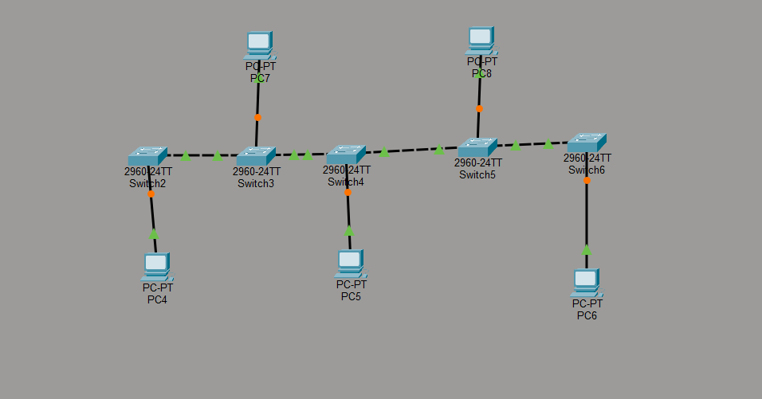
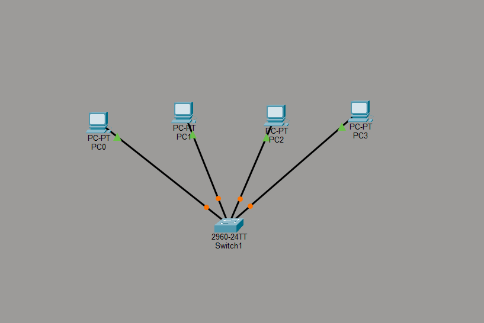
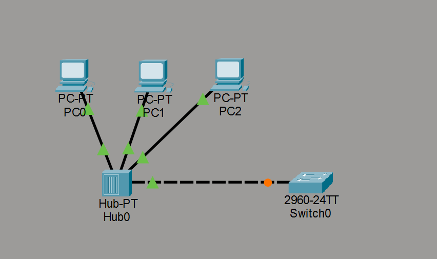
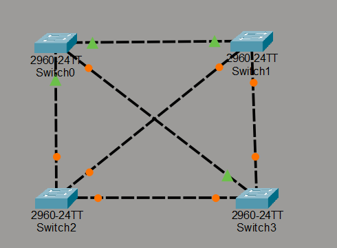
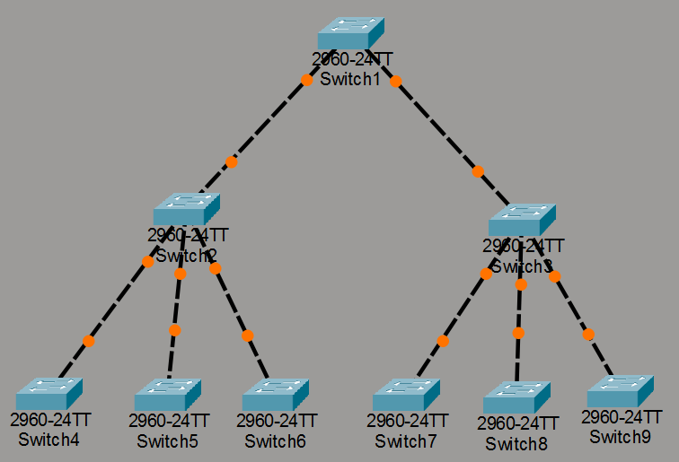
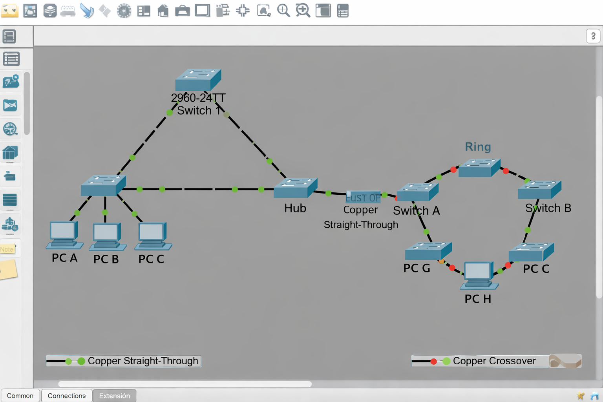

# Topologías de Red - Actividad Cisco Packet Tracer

## Tabla de Topologías de Red

| Topología              | Descripción                                                            | Ventajas                                                  | Desventajas                                                                |
|------------------------|------------------------------------------------------------------------|-----------------------------------------------------------|----------------------------------------------------------------------------|
| **Bus**                | Todos los dispositivos se conectan a un único cable central (backbone) | Simple y barata de instalar; usa poco cable               | Si falla el cable central, cae toda la red; difícil de diagnosticar fallos |
| **Estrella**           | Todos los dispositivos se conectan a un nodo central (switch/hub)      | Fácil de gestionar y ampliar; un fallo no afecta al resto | Dependencia total del nodo central; más cable necesario                    |
| **Anillo**             | Los dispositivos se conectan formando un círculo cerrado               | El tráfico fluye en una dirección, reduce colisiones      | Si falla un nodo o cable, cae toda la red; difícil de ampliar              |
| **Malla**              | Cada dispositivo se conecta con todos los demás                        | Alta redundancia y tolerancia a fallos                    | Muy cara y compleja de instalar; mucho cableado                            |
| **Árbol (jerárquica)** | Combinación de estrella y bus, con nodos raíz y ramas                  | Escalable y bien organizada por niveles                   | Si falla un nodo intermedio, cae su rama completa                          |
| **Híbrida**            | Combinación de dos o más topologías                                    | Flexible y adaptable a cualquier necesidad                | Compleja de diseñar y mantener                                             |

---

## ¿Qué topología para uso doméstico o pequeñas empresas?

**La topología en estrella** es la más adecuada. Es la que se usa en la mayoría de hogares y pequeñas oficinas: tienes un router/switch central al que se conectan todos los dispositivos (PCs, móviles, impresoras...). Es fácil de instalar, económica, y si un dispositivo falla no afecta a los demás. Cisco Packet Tracer la representa con un switch central y cables directos a cada equipo.

---

## ¿Qué topología para grandes empresas?

**La topología en árbol o híbrida** es la más adecuada. Las grandes empresas tienen departamentos, plantas y sedes distintas, por lo que necesitan una estructura jerárquica: switches de núcleo (core), switches de distribución y switches de acceso. Además, se combina con elementos de malla en el núcleo para garantizar redundancia. Cisco Packet Tracer permite construir exactamente esta jerarquía de tres capas.

## Simulación Básica en Cisco Packet Tracer

- En Bus: 
- En Estrella: 
- En Anillo: 
- En Malla: 
- En Árbol: 
- Híbrido: 
