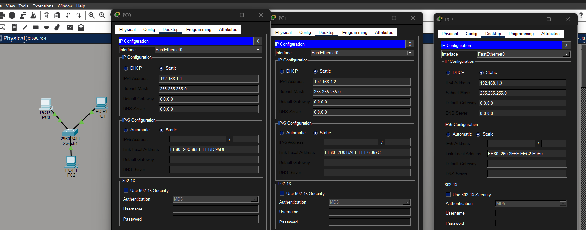
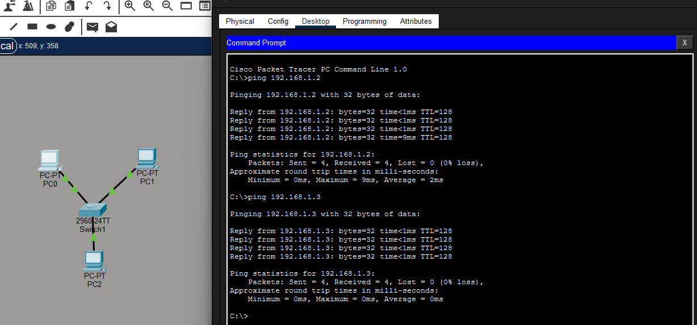
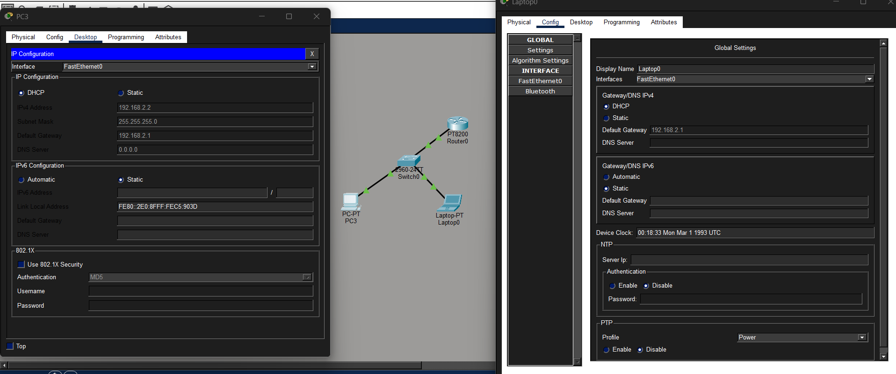
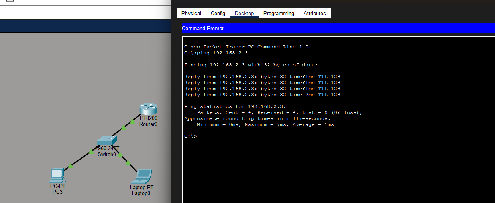
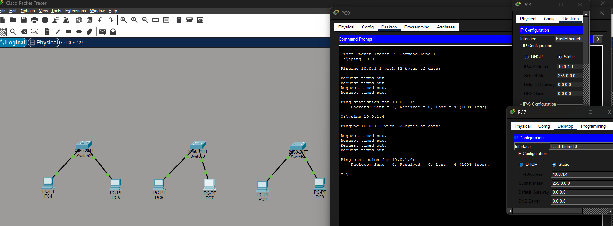

# Actividad 24 - Configuración de IP Estática e IP Dinámica | Cisco Packet Tracer

- Sistemas Informáticos
- Unidad 5: Redes, Subnetting, VLSM y Tablas de Enrutamiento
- Actividad 24: Configuración de IP Estática e IP Dinámica
- Alumno: José Ángel Alejo Sillero

## Parte 1: Configuración de IP Estática

- 
- 

## Parte 2: Configuración de IP Dinámica (DHCP)

- 
- 

## Parte 3: Redes LAN

- 
