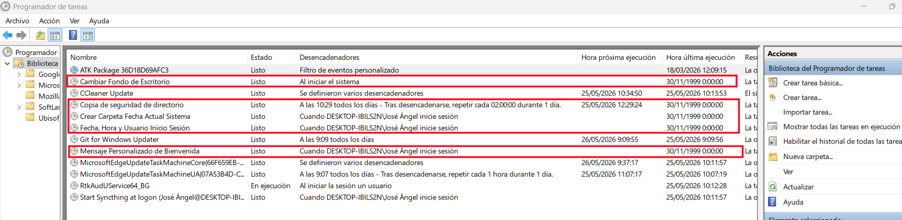

# Act 31 - Programador de Tareas Windows - José Ángel Alejo Sillero

Scripts sencillos en PowerShell para usar con el Programador de Tareas.

## 1 Cambiar el fondo de escritorio al iniciar sesion

```powershell
$rutaImagen = "C:\Imagenes\fondo.jpg"

Set-ItemProperty -Path "HKCU:\Control Panel\Desktop" -Name Wallpaper -Value $rutaImagen
Set-ItemProperty -Path "HKCU:\Control Panel\Desktop" -Name WallpaperStyle -Value "10"
Set-ItemProperty -Path "HKCU:\Control Panel\Desktop" -Name TileWallpaper -Value "0"

Add-Type @"
using System.Runtime.InteropServices;
public class Wallpaper {
    [DllImport("user32.dll", SetLastError = true)]
    public static extern bool SystemParametersInfo(int uAction, int uParam, string lpvParam, int fuWinIni);
}
"@

[Wallpaper]::SystemParametersInfo(20, 0, $rutaImagen, 3)
```

## 2 Mostrar un mensaje de bienvenida

```powershell
Add-Type -AssemblyName PresentationFramework
[System.Windows.MessageBox]::Show("Bienvenido, $env:USERNAME. Que tengas un buen dia.", "Inicio de sesion")
```

## 3 Crear una carpeta con la fecha actual en el escritorio

```powershell
$escritorio = [Environment]::GetFolderPath('Desktop')
$fecha = Get-Date -Format "yyyy-MM-dd"
$carpeta = Join-Path $escritorio $fecha

New-Item -Path $carpeta -ItemType Directory -Force | Out-Null
```

## 4 Guardar fecha, hora y usuario de inicio en un archivo de texto

```powershell
$archivo = "C:\Users\Public\inicio_sesion.txt"
$registro = "$(Get-Date -Format 'yyyy-MM-dd HH:mm:ss') - Usuario: $env:USERNAME"

Add-Content -Path $archivo -Value $registro
```

## 5 Hacer una copia de seguridad de una carpeta a otra llamada Recovery

```powershell
$origen = "C:\Datos"
$destino = "C:\Recovery"

if (!(Test-Path $destino)) {
    New-Item -Path $destino -ItemType Directory | Out-Null
}

Copy-Item -Path "$origen\*" -Destination $destino -Recurse -Force
```

## Captura de Pantalla


