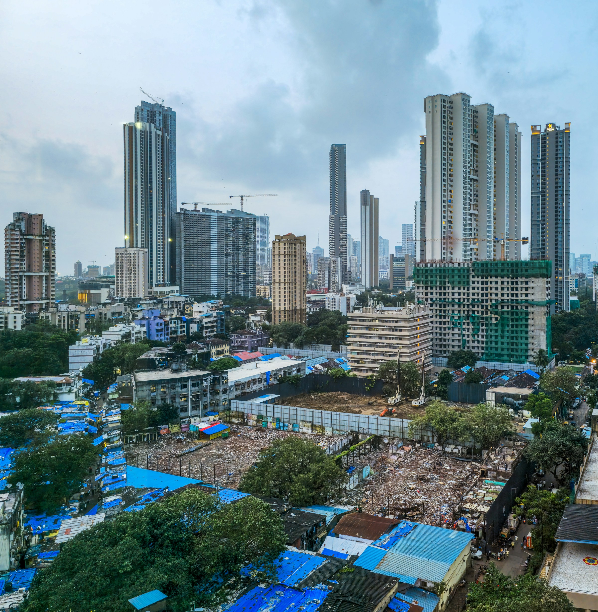

# **ACTIVIDAD EVALUABLE: RETOS AMBIENTALES Y SOCIALES | JOSÉ ÁNGEL ALEJO SILLERO**

  

---

> **ÍNDICE / TABLA DE CONTENIDOS**

- [**ACTIVIDAD EVALUABLE: RETOS AMBIENTALES Y SOCIALES | JOSÉ ÁNGEL ALEJO SILLERO**](#actividad-evaluable-retos-ambientales-y-sociales--josé-ángel-alejo-sillero)
  - [**RETOS AMBIENTALES**](#retos-ambientales)
    - [**1. Mitigación del cambio climático**](#1-mitigación-del-cambio-climático)
    - [**2. Transición energética**](#2-transición-energética)
    - [**3. Eficiencia energética**](#3-eficiencia-energética)
    - [**4. Energías renovables**](#4-energías-renovables)
    - [**5. Calificación energética de los electrodomésticos**](#5-calificación-energética-de-los-electrodomésticos)
    - [**6. Movilidad sostenible**](#6-movilidad-sostenible)
    - [**7. Conservación de la biodiversidad**](#7-conservación-de-la-biodiversidad)
    - [**8. Educación ambiental**](#8-educación-ambiental)
  - [**RETOS SOCIALES**](#retos-sociales)
    - [**9. Pobreza absoluta y pobreza relativa**](#9-pobreza-absoluta-y-pobreza-relativa)
    - [**10. Soluciones para la pobreza**](#10-soluciones-para-la-pobreza)
    - [**11. Desigualdad social**](#11-desigualdad-social)
    - [**12. Tipos de desigualdades**](#12-tipos-de-desigualdades)
    - [**13. Exclusión social**](#13-exclusión-social)
    - [**14. Inclusión social**](#14-inclusión-social)
    - [**15. Problemas demográficos y la "España vaciada"**](#15-problemas-demográficos-y-la-españa-vaciada)
  - [**WEBGRAFÍA**](#webgrafía)

---

## **RETOS AMBIENTALES**

---

### **1. Mitigación del cambio climático**

A continuación se describen tres acciones individuales o comunitarias que contribuyen a mitigar el cambio climático:

1. **Reducir el consumo de carne y productos de origen animal**: La ganadería intensiva es responsable de una parte muy significativa de las emisiones globales de gases de efecto invernadero, especialmente metano (CH₄). Reducir el consumo de carne roja y optar por dietas más basadas en vegetales contribuye directamente a reducir la demanda de este sector y, por tanto, a disminuir las emisiones asociadas. A nivel colectivo, si este cambio de hábito se generaliza, el impacto puede ser enorme.

2. **Apostar por el transporte público, la bicicleta o desplazamientos a pie**: El transporte privado de combustión interna es una de las principales fuentes de emisiones de CO₂ en las ciudades. Sustituir el uso del coche particular por el transporte público, la bicicleta o los trayectos a pie reduce de forma directa las emisiones per cápita. A nivel comunitario, impulsar carriles bici, ampliar líneas de metro o autobús y peatonalizar zonas céntricas son medidas con un impacto muy positivo en la calidad del aire y en la reducción del efecto invernadero.

3. **Instalar paneles solares y mejorar el aislamiento del hogar**: A nivel individual, adoptar sistemas de autoconsumo fotovoltaico permite reducir la dependencia de la red eléctrica convencional (que todavía incorpora una parte de energías fósiles) y disminuir así la huella de carbono doméstica. Complementariamente, mejorar el aislamiento térmico del hogar (ventanas de doble acristalamiento, aislamiento de fachadas, etc.) reduce el consumo de energía para calefacción y refrigeración, con el consecuente ahorro de emisiones.

---

### **2. Transición energética**

**Resumen de la noticia:**

El Ministerio para la Transición Ecológica y el Reto Demográfico (MITECO) ha aprobado la adjudicación de **10,7 millones de euros** en ayudas para la creación de **106 nuevas comunidades energéticas** en toda España, enmarcadas dentro de los fondos europeos NextGenerationEU y el Plan de Recuperación, Transformación y Resiliencia (PRTR). Con esta convocatoria, se eleva a 251 el total de proyectos en marcha dentro del programa *CE Implementa*, que busca democratizar el sistema energético y acelerar el despliegue de las renovables en el territorio nacional, priorizando especialmente los municipios del reto demográfico.

**Tipo de energía promovida y por qué:**

La mayoría de estas iniciativas apuestan por la **energía solar fotovoltaica** combinada con sistemas de almacenamiento mediante baterías. Se promueve este tipo de energía porque es renovable, limpia, cada vez más asequible y especialmente adecuada para comunidades de pequeño tamaño que no tienen capacidad de conectarse a grandes parques energéticos. Además, contribuye directamente a reducir la dependencia de los combustibles fósiles y a cumplir con los objetivos del Plan Nacional Integrado de Energía y Clima (PNIEC), que fija como meta generar el 81% de la electricidad a partir de fuentes renovables para 2030.

- **Enlace de la noticia:** [https://www.lamoncloa.gob.es/serviciosdeprensa/notasprensa/transicion-ecologica/paginas/2025/301025-comunidades-energeticas-ayudas.aspx](https://www.lamoncloa.gob.es/serviciosdeprensa/notasprensa/transicion-ecologica/paginas/2025/301025-comunidades-energeticas-ayudas.aspx)

---

### **3. Eficiencia energética**

**¿Qué es la eficiencia energética?**

La eficiencia energética es la **capacidad de obtener el mismo resultado o prestación utilizando la menor cantidad de energía posible**. En otras palabras, se trata de hacer más con menos: conseguir la misma iluminación, el mismo nivel de refrigeración o el mismo rendimiento industrial consumiendo menos electricidad o combustible. No implica renunciar a comodidades, sino utilizarlas de forma más inteligente y responsable.

**Ejemplo de dispositivo eficiente:**

Un buen ejemplo es una **lavadora de clase energética A** (o A+++ en la antigua escala). Este tipo de lavadoras están diseñadas para lavar con la misma eficacia que modelos más antiguos, pero consumiendo hasta un 40-50% menos de electricidad y agua. Para ello incorporan tecnologías como motores de accionamiento directo, sensores de carga que adaptan el consumo al peso real de la ropa, y programas de lavado a baja temperatura que mantienen el mismo poder de limpieza.

**Beneficios para el medio ambiente:**

- **Reducción de las emisiones de CO₂**: Al consumir menos electricidad, los aparatos eficientes reducen indirectamente la demanda a las centrales eléctricas, muchas de las cuales todavía utilizan combustibles fósiles en parte de su generación.
- **Menor consumo de recursos naturales**: En el caso de electrodomésticos como lavadoras o lavavajillas, la eficiencia también implica un menor consumo de agua, un recurso cada vez más escaso en muchas regiones.
- **Reducción de residuos energéticos**: Una parte de la energía consumida por aparatos ineficientes se disipa en forma de calor sin realizar trabajo útil; los dispositivos eficientes minimizan este desperdicio.

---

### **4. Energías renovables**

A continuación se clasifica cada tipo de energía y se justifican al menos dos de las respuestas:

|  **Tipo de energía**   | **Clasificación** |
|:----------------------:|:-----------------:|
|   **Energía solar**    |    ✅ Renovable   |
|    **Gas natural**     |  ❌ No renovable  |
|   **Energía eólica**   |    ✅ Renovable   |
|       **Carbón**       |  ❌ No renovable  |
| **Energía hidráulica** |    ✅ Renovable   |
|      **Petróleo**      |  ❌ No renovable  |

**Justificaciones:**

- **Energía solar (renovable)**: La energía solar es renovable porque su fuente, la radiación emitida por el sol, es prácticamente inagotable a escala humana. El sol continuará irradiando energía durante aproximadamente 5.000 millones de años más, por lo que su explotación no compromete su disponibilidad futura. Además, no genera emisiones contaminantes durante su uso.

- **Carbón (no renovable)**: El carbón es un combustible fósil formado por la descomposición de materia orgánica durante millones de años bajo condiciones de alta presión y temperatura. Su formación es tan lenta que, a efectos prácticos, es un recurso finito: una vez extraído y quemado, no se regenera. Además, su combustión libera grandes cantidades de CO₂ y otros contaminantes, siendo una de las principales causas del cambio climático.

---

### **5. Calificación energética de los electrodomésticos**

**Electrodoméstico elegido:** Frigorífico combi de uso doméstico.

**Clase energética:** **A** (escala actual en vigor desde marzo de 2021).

**¿Qué significa esta calificación?**

La etiqueta energética es un sistema estandarizado a nivel europeo que clasifica los electrodomésticos en una escala que va desde la letra **A** (más eficiente) hasta la **G** (menos eficiente). Esta escala fue renovada en 2021 para los frigoríficos, lavadoras, lavavajillas y televisores, eliminando las antiguas categorías A+, A++ y A+++ que se habían quedado obsoletas porque la gran mayoría de productos las alcanzaban fácilmente, haciendo inútil la comparativa.

Un frigorífico de clase **A** es, por tanto, el más eficiente disponible actualmente en el mercado. En la etiqueta también se indica el consumo anual estimado en kWh, las dimensiones del aparato y otros datos relevantes.

**¿Cómo influye en el consumo eléctrico?**

La diferencia entre una clase A y una clase G puede suponer un ahorro de hasta el **60-70%** en el consumo energético anual de ese electrodoméstico. Dado que un frigorífico está encendido las 24 horas del día los 365 días del año, elegir uno eficiente tiene un impacto muy notable en la factura eléctrica y en la huella de carbono del hogar. A largo plazo, el mayor precio inicial de un modelo eficiente se ve ampliamente compensado por el ahorro en el consumo.

---

### **6. Movilidad sostenible**

**Noticia sobre Sevilla:**

El Ayuntamiento de Sevilla ha impulsado el **Plan de Movilidad Urbana Sostenible 2030 (PMUS 2030)**, un ambicioso programa que fija como objetivo que **dos de cada tres desplazamientos en la ciudad se realicen a pie, en bicicleta o en transporte público**, dejando el coche privado como opción residual. Entre las medidas concretas del plan destacan la ampliación del Metrocentro para doblar el número de usuarios, la implantación de la primera **Zona de Bajas Emisiones** en el PCT Cartuja con red de puntos de recarga para vehículos eléctricos, y el objetivo de que el **75% de la flota de transporte público** esté compuesta por vehículos de cero emisiones para 2030. Como reconocimiento a estos esfuerzos, Sevilla fue elegida sede del **Congreso ITS Europa 2025**, uno de los foros de referencia a nivel europeo sobre movilidad sostenible, transporte conectado y ciudades inteligentes.

- **Beneficios del proyecto:**
  - **Para el medio ambiente**: La reducción del tráfico privado de combustión interna conllevaría una disminución directa de las emisiones de CO₂ y de partículas contaminantes, mejorando la calidad del aire en la ciudad y contribuyendo a los objetivos climáticos del Acuerdo de París.
  - **Para la población**: Menos tráfico implica menos ruido, más espacio público para las personas, menores tiempos de desplazamiento en transporte público y una ciudad más saludable y habitable en general.

- **Enlace:**: [https://www.sevilla.org/servicios/movilidad/pmus](https://www.sevilla.org/servicios/movilidad/pmus)

---

**¿Qué es BlaBlaCar y cómo contribuye a una movilidad más sostenible?**

**BlaBlaCar** es una plataforma digital de **carpooling o coche compartido** que conecta a conductores que realizan un trayecto con pasajeros que quieren hacer ese mismo recorrido. El conductor publica su viaje, el punto de salida, el destino y las plazas disponibles, y los pasajeros pueden reservar su asiento pagando una pequeña cantidad que ayuda al conductor a cubrir parte de los gastos de combustible. La app gestiona los pagos y las valoraciones de forma segura.

**¿Cómo contribuye a una movilidad más sostenible?**

- BlaBlaCar contribuye a la sostenibilidad de varias formas:
  - **Reduce el número de vehículos en circulación**: Si cuatro personas comparten un coche en lugar de ir cada una en el suyo, se emiten cuatro veces menos emisiones para el mismo desplazamiento.
  - **Optimiza los recursos existentes**: La mayoría de los coches circulan con una sola persona a bordo, lo que supone un enorme desperdicio de recursos. El carpooling aprovecha esa capacidad ociosa.
  - **Reduce la necesidad de infraestructuras viales y aparcamientos**, aliviando la congestión y la presión sobre el territorio.
- **Ventajas frente al coche privado:**
  - **Económicas**: El coste del viaje se divide entre los pasajeros, resultando más barato para todos.
  - **Ambientales**: Las emisiones de CO₂ por persona se reducen drásticamente.
  - **Sociales**: Favorece la conexión entre personas y permite llegar a destinos no cubiertos por el transporte público convencional, especialmente en trayectos interurbanos o rurales.

**¿En qué consiste el Bono BlaBlaCar (BlaBla Bono)?**

El **BlaBla Bono** (anteriormente conocido como Blablabus o BlaBlaCar Bus) es un **servicio de autobús de larga distancia** operado por BlaBlaCar en colaboración con compañías de transporte. Permite reservar plazas en autobuses de línea regular a precios muy competitivos, con la misma interfaz y filosofía de la plataforma. En cuanto al concepto de **Bono Energético** asociado a BlaBlaCar, se refiere a una modalidad de abono o crédito que algunos usuarios pueden obtener para viajes en carpooling certificados como sostenibles, enmarcado en iniciativas de movilidad verde que ciertos organismos o empresas promueven para incentivar el uso de transporte compartido frente al coche individual.

---

### **7. Conservación de la biodiversidad**

**¿Qué es la biodiversidad y por qué es importante conservarla?**

La **biodiversidad** hace referencia a la **variedad de formas de vida existentes en la Tierra**: incluye la diversidad de especies (animales, plantas, hongos, microorganismos), la diversidad genética dentro de cada especie y la diversidad de ecosistemas (selvas, océanos, praderas, etc.).

- **Conservarla es fundamental por múltiples razones**:
  - Los ecosistemas saludables y diversos nos proporcionan servicios esenciales como la purificación del agua y el aire, la regulación del clima, la polinización de cultivos o la estabilización de los suelos.
  - La pérdida de una especie puede desencadenar un efecto dominó que desequilibre ecosistemas enteros.
  - Muchos medicamentos y avances científicos han surgido del estudio de organismos vivos; perder biodiversidad es perder conocimiento y potencial científico irrecuperable.

**Dos amenazas que enfrenta:**

1. **Destrucción y fragmentación del hábitat**: La deforestación, la urbanización descontrolada y la expansión agrícola eliminan o fragmentan los espacios naturales donde viven las especies, reduciéndolas a poblaciones cada vez más pequeñas y vulnerables.
2. **Cambio climático**: El aumento de las temperaturas y la alteración de los patrones de precipitación modifican los hábitats más rápido de lo que muchas especies pueden adaptarse, forzando migraciones, alterando ciclos reproductivos y aumentando el riesgo de extinción.

**Una solución para protegerla:**

La **creación y ampliación de áreas naturales protegidas** (reservas naturales, parques nacionales, corredores ecológicos) es una de las medidas más eficaces. Estos espacios garantizan refugio para las especies, permiten la recuperación de poblaciones y, cuando están bien conectados entre sí mediante corredores, facilitan el flujo genético necesario para la supervivencia a largo plazo.

### **8. Educación ambiental**

- **Actividad propuesta: "Un día sin residuos"**
- **Objetivo:**

Concienciar al alumnado sobre la cantidad de residuos que genera cada persona en su día a día y fomentar hábitos de consumo más responsables, enmarcados en la regla de las 3R (Reducir, Reutilizar, Reciclar).

- **Desarrollo de la actividad:**

Durante una semana, cada estudiante anotaría en un diario personal todos los residuos que genera a lo largo del día (envases, papel, plásticos, restos de comida, etc.), indicando también si los ha reciclado correctamente o no. Al final de la semana, en clase, se pondrían en común los resultados y se haría un análisis grupal de los datos recogidos:

- ¿Cuántos residuos genera cada persona al día?
- ¿Qué tipo de residuo es el más frecuente?
- ¿Qué porcentaje se ha reciclado correctamente?
- ¿Qué cambios de hábito podrían reducir esa cantidad?

Como cierre, el grupo elaboraría de forma colaborativa un **"manifiesto de compromisos sostenibles"** que se publicaría en el tablón del centro, invitando al resto de la comunidad escolar a sumarse.

Esta actividad tiene la ventaja de partir de la experiencia real del alumnado, haciendo el aprendizaje significativo y conectado con su vida cotidiana, lo que suele ser mucho más efectivo que la mera instrucción teórica.

---

## **RETOS SOCIALES**

---

### **9. Pobreza absoluta y pobreza relativa**

**Pobreza absoluta:**

La **pobreza absoluta** es aquella situación en la que una persona o familia **no dispone de los recursos mínimos necesarios para sobrevivir**: es decir, no puede cubrir sus necesidades más básicas como la alimentación, el agua potable, el acceso a un techo o la atención sanitaria elemental. No es una cuestión de comparación con otros, sino de supervivencia. El Banco Mundial fija el umbral de pobreza extrema en torno a **2,15 dólares por persona y día**.

- ***Ejemplo***: Una familia en el Sahel africano que no tiene acceso a agua potable, vive en condiciones de hambruna y carece de cualquier tipo de atención médica se encuentra en una situación de pobreza absoluta.

**Pobreza relativa:**

La **pobreza relativa** no implica necesariamente carecer de lo básico para sobrevivir, sino que se define en función del **nivel de vida medio de la sociedad en la que se vive**. Una persona es considerada en situación de pobreza relativa cuando sus ingresos están por debajo de un determinado porcentaje (generalmente el 60%) de la renta mediana del país. En este caso, aunque puede cubrir sus necesidades mínimas, queda excluida de los estándares de vida considerados normales en su entorno social.

- ***Ejemplo***: Una persona en España que trabaja a tiempo parcial y cobra 600 € al mes puede tener acceso a comida y vivienda, pero no puede permitirse vacaciones, actividades de ocio, ropa de calidad o participar en la vida social de la misma forma que la mayoría de sus conciudadanos. Estaría en una situación de pobreza relativa.

---

### **10. Soluciones para la pobreza**

A continuación se explican dos medidas que pueden tomar los gobiernos u organizaciones sociales para reducir la pobreza:

1. **Implementación de rentas mínimas garantizadas o transferencias directas de efectivo**: Esta medida consiste en proporcionar a las personas en situación de vulnerabilidad una prestación económica directa que les permita cubrir sus necesidades básicas. En España, el equivalente más reciente es el **Ingreso Mínimo Vital (IMV)**, aprobado en 2020. La evidencia internacional muestra que este tipo de transferencias, lejos de desincentiva el trabajo, permiten a las familias estabilizarse, invertir en educación y salud y acceder a mejores oportunidades laborales a medio plazo.

2. **Inversión en educación pública de calidad y acceso universal**: La educación es el mecanismo más efectivo para romper el ciclo intergeneracional de la pobreza. Cuando los gobiernos garantizan el acceso a una educación de calidad, independientemente del origen socioeconómico del alumnado, dotan a las personas de las herramientas necesarias para acceder al mercado laboral en mejores condiciones. Esto incluye no solo la educación formal (escuelas, universidades), sino también la formación profesional y el aprendizaje a lo largo de la vida.

---

### **11. Desigualdad social**

**¿Qué se entiende por desigualdad social?**

La **desigualdad social** es la distribución desigual de recursos, oportunidades, derechos y poder entre los distintos grupos o individuos de una sociedad. No se refiere únicamente a las diferencias económicas, sino a todos aquellos factores que determinan las posibilidades reales de vida de las personas: su acceso a la educación, a la salud, a la participación política, al reconocimiento cultural, etc.

**Dos ámbitos en los que puede observarse y cómo afecta a las personas:**

1. **Ámbito económico (mercado laboral y salarios)**: La brecha salarial entre los trabajadores mejor y peor remunerados ha crecido en las últimas décadas en la mayoría de los países. Esta desigualdad no solo implica diferencias en el nivel de vida, sino también en el acceso a la vivienda, la alimentación, el ocio y el ahorro. A largo plazo, las personas con menores ingresos tienen menos posibilidades de acceder a estudios superiores o de vivir en barrios con buenas infraestructuras y servicios, lo que perpetúa la desigualdad de generación en generación.

2. **Ámbito educativo**: El acceso a una educación de calidad sigue estando fuertemente condicionado por el origen social de las familias. Los hijos de familias con mayores recursos tienen más posibilidades de acceder a colegios privados, clases extraescolares, libros, tecnología y viajes formativos. Esto genera desde la infancia una brecha de oportunidades que se traduce más tarde en diferencias en el acceso al empleo y en los ingresos obtenidos.

---

### **12. Tipos de desigualdades**

A continuación se relaciona cada tipo de desigualdad con un ejemplo concreto:

- **Desigualdad económica**: La diferencia en los ingresos entre los empleados de base y los altos directivos de una misma empresa, donde unos cobran el salario mínimo y otros perciben retribuciones millonarias incluyendo bonos y acciones. Esta brecha se ha acentuado especialmente en el sector tecnológico y financiero.

- **Desigualdad de género**: La **brecha salarial de género**, que en España sigue siendo de alrededor del 18-20% de media. Esto implica que, a igual trabajo y cualificación, las mujeres cobran menos que los hombres. A ello se añade la mayor presencia femenina en empleos a tiempo parcial, muchas veces motivada por la carga desproporcionada del trabajo de cuidados no remunerado (hijos, mayores, personas dependientes) que recae sobre las mujeres.

- **Desigualdad étnica o racial**: En muchos países, las personas pertenecientes a minorías étnicas o raciales tienen más dificultades para acceder a empleos cualificados, vivienda en barrios céntricos o servicios públicos de calidad. Un ejemplo en España sería la situación de la **comunidad gitana**, que históricamente ha sufrido exclusión del sistema educativo y del mercado laboral formal, con tasas de abandono escolar muy por encima de la media.

---

### **13. Exclusión social**

**¿En qué consiste la exclusión social?**

La **exclusión social** es un proceso dinámico por el cual determinadas personas o grupos quedan **al margen de la participación plena en la vida económica, social, cultural y política** de la sociedad en la que viven. No se trata únicamente de pobreza económica, aunque esta puede ser uno de sus desencadenantes; la exclusión social es multidimensional e incluye la falta de acceso a empleo, educación, vivienda digna, sanidad, redes sociales de apoyo y participación ciudadana.

Es importante subrayar que la exclusión social no suele ser una elección de las personas afectadas, sino el resultado de barreras estructurales, discriminación y falta de oportunidades.

- **Grupos más vulnerables:**
  - **Personas en situación de sin hogar**: Carecen de vivienda estable, lo que les dificulta enormemente acceder a empleo, servicios sanitarios o mantener relaciones sociales normalizadas.
  - **Personas con discapacidad**: Pueden encontrar barreras físicas, comunicativas y actitudinales que les impidan participar en igualdad de condiciones en el mercado laboral y en la vida social.
  - **Inmigrantes en situación irregular**: La falta de documentación les priva de derechos básicos y les hace especialmente vulnerables a la explotación laboral y a la exclusión del sistema de protección social.
  - **Jóvenes de entornos desfavorecidos**: El abandono escolar temprano, la falta de red de apoyo familiar y el desempleo juvenil pueden generar un círculo vicioso de exclusión difícil de romper.

---

### **14. Inclusión social**

**Dos estrategias para fomentar la inclusión social:**

1. **Programas de empleo con apoyo para personas en situación de vulnerabilidad**: Estos programas consisten en proporcionar a personas con dificultades especiales de inserción laboral (personas con discapacidad, exreclusos, personas en situación de exclusión crónica) un acompañamiento personalizado durante todo el proceso de búsqueda de empleo, contratación y adaptación al puesto de trabajo. No basta con ofrecer formación; el apoyo continuo y la figura de un preparador laboral que actúe como puente entre el trabajador y la empresa han demostrado ser mucho más efectivos que las acciones puntuales.

2. **Acceso universal a la vivienda y a los servicios básicos**: Sin una vivienda estable, es prácticamente imposible que una persona pueda integrarse social y laboralmente. Por ello, estrategias como el modelo **Housing First** (que proporciona primero una vivienda digna y después aborda el resto de problemas asociados) han mostrado resultados muy positivos en países como Finlandia, que prácticamente ha erradicado el sinhogarismo crónico en las últimas décadas.

**El papel de la escuela en este proceso:**

La escuela tiene un papel absolutamente clave en la inclusión social, ya que es el primer espacio en el que las personas de distintos orígenes, capacidades y condiciones sociales conviven y aprenden juntas. Una escuela verdaderamente inclusiva no es solo aquella que admite a todos, sino la que adapta sus metodologías, recursos y actitudes para que **todos los alumnos puedan participar, aprender y sentirse valorados**. El trabajo con la diversidad en el aula, la educación en valores y el fomento de la empatía son herramientas fundamentales para construir una sociedad más cohesionada y menos excluyente.

---

### **15. Problemas demográficos y la "España vaciada"**

**Resumen de la noticia e identificación de causas:**

Un artículo publicado por BBVA en noviembre de 2025 aborda el fenómeno de la despoblación rural en España con datos muy reveladores. Actualmente, **más del 80% de la población española vive en menos del 20% del territorio**, y casi 4.900 municipios (seis de cada diez ayuntamientos del país) tienen menos de 1.000 habitantes, concentrando apenas el 3% de la población total. Las regiones más afectadas son las dos Castillas, Aragón, Extremadura, Asturias y Galicia, donde la densidad poblacional cae por debajo de los 12,5 habitantes por km², cifra que la Unión Europea considera de riesgo demográfico.

La principal causa identificada es la **emigración de jóvenes hacia las ciudades en busca de oportunidades laborales y educativas**, proceso que se inició durante la industrialización de los años 50 y 60 del siglo XX y que no se ha detenido desde entonces. Esta emigración provoca un envejecimiento progresivo de la población rural, la pérdida de servicios básicos (sanidad, educación, transporte), lo que a su vez desincentiva aún más la permanencia de quienes quedan, generando un círculo vicioso de declive difícil de revertir.

**Solución propuesta:**

Una solución viable para frenar la despoblación es la **extensión de la banda ancha de alta velocidad e infraestructura digital en los municipios rurales**, acompañada de incentivos al teletrabajo y a la instalación de empresas en el medio rural. Un estudio reciente de la Universidad de Zaragoza (*Cities*, 2025) concluye que el acceso a internet de alta velocidad impulsa el crecimiento poblacional en el largo plazo y tiene efectos positivos sobre el empleo local. El teletrabajo, por su parte, permite que personas con empleos en sectores digitales puedan vivir en el entorno rural sin renunciar a su actividad profesional. Esto, combinado con incentivos fiscales para empresas que se instalen en zonas despobladas y una mejora de los servicios públicos locales, podría contribuir de forma significativa a revertir la tendencia.

- **Enlace:** [https://www.bbva.com/es/sostenibilidad/la-despoblacion-rural-cronica-de-una-desaparicion-anunciada/](https://www.bbva.com/es/sostenibilidad/la-despoblacion-rural-cronica-de-una-desaparicion-anunciada/)

---

## **WEBGRAFÍA**

- **MITECO — Comunidades Energéticas (CE Implementa)**: [https://www.lamoncloa.gob.es/serviciosdeprensa/notasprensa/transicion-ecologica/paginas/2025/301025-comunidades-energeticas-ayudas.aspx](https://www.lamoncloa.gob.es/serviciosdeprensa/notasprensa/transicion-ecologica/paginas/2025/301025-comunidades-energeticas-ayudas.aspx)

- **PNIEC — Plan Nacional Integrado de Energía y Clima**: [https://www.miteco.gob.es/es/ministerio/planes-estrategias/plan-nacional-energia-clima-2021-2030/](https://www.miteco.gob.es/es/ministerio/planes-estrategias/plan-nacional-energia-clima-2021-2030/)

- **Plan de Movilidad Urbana Sostenible Sevilla 2030 (PMUS)**: [https://www.sevilla.org/servicios/movilidad/pmus](https://www.sevilla.org/servicios/movilidad/pmus)

- **ITS Europa 2025 en Sevilla**: [https://salirporsevilla.com/noticias-y-eventos-en-sevilla/movilidad-sostenible-its-europa-2025/](https://salirporsevilla.com/noticias-y-eventos-en-sevilla/movilidad-sostenible-its-europa-2025/)

- **BBVA — La despoblación rural en España**: [https://www.bbva.com/es/sostenibilidad/la-despoblacion-rural-cronica-de-una-desaparicion-anunciada/](https://www.bbva.com/es/sostenibilidad/la-despoblacion-rural-cronica-de-una-desaparicion-anunciada/)

- **Scientias — Banda ancha y despoblación rural (Universidad de Zaragoza, 2025)**: [https://scientias.net/un-andador-robotico-adaptativo-para-mejorar-la-movilidad-y-la-autonomia/](https://scientias.net/banda-ancha-despoblacion-rural/)

- **BlaBlaCar**: [https://www.blablacar.es/](https://www.blablacar.es/)

- **Etiqueta energética europea (Comisión Europea)**: [https://energy.ec.europa.eu/topics/energy-efficiency/energy-efficient-products/energy-label_es](https://energy.ec.europa.eu/topics/energy-efficiency/energy-efficient-products/energy-label_es)

- **Greenpeace — Los problemas de la España vaciada**: [https://es.greenpeace.org/es/en-profundidad/salvar-el-planeta-desde-la-espana-vaciada/los-problemas-de-la-espana-vaciada/](https://es.greenpeace.org/es/en-profundidad/salvar-el-planeta-desde-la-espana-vaciada/los-problemas-de-la-espana-vaciada/)

- **Imágenes**:
  - [Freepik](https://www.freepik.com/)
  - [Unsplash](https://unsplash.com/es/)

- **Zoshua Colah - Imagen de portada: [Zoshua Colah. Byculla, Mumbai, Maharashtra, India](https://unsplash.com/es/fotos/rascacielos-modernos-se-elevan-sobre-una-zona-urbana-densamente-poblada-7aqDjqgUdX4)**

---

> **NOTA**: La información presentada en este documento es una recopilación y síntesis de diversas fuentes, con el objetivo de proporcionar respuestas claras, razonadas y fundamentadas a cada uno de los apartados de la actividad evaluable.
>
> La redacción, estructura y análisis son originales y reflejan mi comprensión personal del tema, basada tanto en los apuntes de la asignatura como en recursos adicionales de carácter público.

---
> **AUTOR**: **José Ángel Alejo Sillero**
